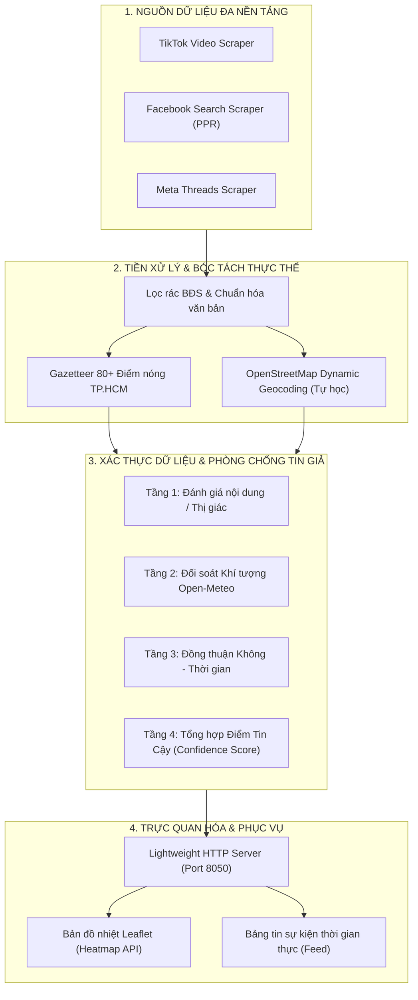

# 🌊 HỆ THỐNG GIÁM SÁT & CẢNH BÁO NGẬP LỤT ĐÔ THỊ ĐA NỀN TẢNG (TP. HỒ CHÍ MINH)
> **Đề tài Môn học SE363 - Kỹ nghệ Tri thức & Dữ liệu**  
> *Đại học Quốc gia TP. Hồ Chí Minh*

[](https://www.python.org/)
[](http://localhost:8050)
[](https://open-meteo.com/)
[](https://www.openstreetmap.org/)
[](LICENSE)

---

## 📌 Giới thiệu tổng quan (Overview)

Hệ thống **Giám sát & Cảnh báo Ngập lụt Đô thị Đa nền tảng** là giải pháp thu thập, phân tích và trực quan hóa dữ liệu thời gian thực phục vụ cảnh báo ngập lụt tại TP. Hồ Chí Minh. 

Hệ thống kết hợp sức mạnh từ dòng dữ liệu mạng xã hội (TikTok, Facebook, Threads), đối soát tự động với trạm khí tượng vệ tinh **Open-Meteo**, giải quyết triệt để vấn đề tin giả / báo cáo sai lệch (**Data Veracity**) và trực quan hóa thành bản đồ nhiệt (**Heatmap**) cảnh báo trực quan.

---

## 🏛️ Kiến trúc hệ thống (System Architecture)



---

## 🌟 Các tính năng cốt lõi (Key Features)

### 1. Thu thập đa nền tảng gần thời gian thực (Multi-Platform Ingestion)
* **TikTok Video:** Cào các video cảnh báo ngập lụt thực tế theo bộ Hashtags và từ khóa tìm kiếm tiếng Việt tối ưu.
* **Facebook Search PPR:** Ứng dụng cơ chế Consolidated Search giúp chống checkpoint và bypass rate-limit.
* **Meta Threads:** Cào bài đăng thảo luận nhanh từ người dân đô thị với chi phí tối ưu.

### 2. Định danh địa lý đa tầng & Tự động Geocoding (Precision GIS)
* **Kho tri thức hạt nhân (Seed Gazetteer):** Tích hợp sẵn hơn 80+ điểm nóng ngập lụt kinh điển của TP.HCM (*Nguyễn Hữu Cảnh, Chợ Thủ Đức, Ung Văn Khiêm, Cây Bàng, Võ Văn Ngân, Lê Văn Lương...*) với tọa độ tim đường và phân cấp Phường/Xã chuẩn sau sáp nhập.
* **Cơ chế tự động học (Zero-Shot Discovery via OpenStreetMap):** Tự động bóc tách tên đường mới xuất hiện trong bài viết, truy vấn máy chủ OpenStreetMap Nominatim lấy tọa độ GPS chính xác và tự lưu vào bộ nhớ đệm tự học (`data/gazetteer_dynamic_cache.json`).

### 3. Xác thực dữ liệu & Phòng chống tin giả (Data Veracity Multi-tier Engine)
Hệ thống sử dụng cơ chế bảo vệ 4 tầng độc lập để đánh giá độ tin cậy của bài đăng:
* **Tầng 1 - Content & Visual Verification:** Kiểm chứng bằng chứng video/hình ảnh và từ khóa khẳng định ngập lụt thực tế. Sẵn sàng điểm cắm tích hợp mô hình AI đa phương thái (*Dual-Span ASTE, Whisper ASR, Image Classifier*).
* **Tầng 2 - Weather Cross-Check:** Đối soát lượng mưa thực tế tại đúng tọa độ điểm ngập từ trạm khí tượng vệ tinh **Open-Meteo** (khung giờ đăng bài trong lịch sử hoặc thời gian thực hiện tại).
* **Tầng 3 - Spatio-Temporal Consensus:** Tính toán độ đồng thuận mạng lưới trong bán kính 500m và khung trượt thời gian 60 phút.
* **Tầng 4 - Phân cấp cảnh báo tin cậy:**
  * 🔴 **Đã xác thực (Confirmed - Điểm $\ge$ 75%):** Đủ bằng chứng hình ảnh + khí tượng ghi nhận mưa lớn + đồng thuận mạng lưới.
  * 🟡 **Nghi vấn (Suspect - Điểm 50% - 74%):** Cần chờ thêm dữ liệu kiểm chứng.
  * ⚪ **Chưa kiểm chứng (Unverified - Điểm 35% - 49%):** Dữ liệu thăm dò.
  * 🚫 **Bác bỏ (Rejected - Điểm < 35%):** Chặn tin giả, clip cũ câu tương tác khi trời không mưa.

### 4. Bản đồ nhiệt trực quan thời gian thực (Heatmap Dashboard)
* Giao diện Web hiển thị bản đồ nhiệt Leaflet trực quan, tự động cập nhật chu kỳ 10 giây.
* Hỗ trợ ghim điểm nóng ngập lụt, xem chi tiết bài đăng, video bằng chứng gốc và bảng phân tích Veracity độc lập.

---

## ⚡ Hướng dẫn cài đặt & Khởi chạy (Quick Start)

### 1. Cài đặt môi trường
Yêu cầu: **Python 3.10 trở lên**.

```bash
# Clone repository về máy
git clone https://github.com/SE363-HVT/urban-flood-monitor.git
cd urban-flood-monitor

# Cài đặt các thư viện cần thiết
pip install -r requirements.txt
```

### 2. Khởi chạy hệ thống

#### 🔹 Chế độ 1: Chế độ Mô phỏng (Simulation Mode - Dùng để Demo / Báo cáo)
> Phát lại dòng dữ liệu thực tế từ kho bài viết lịch sử, kiểm chứng lượng mưa tại thời điểm đăng tải, demo trôi động trong khung thời gian 2 giờ (120 phút).

```bash
python run_pipeline_test.py --mode simulation --window 120
```

#### 🔹 Chế độ 2: Chế độ Thời gian thực (Live Mode - Cào trực tiếp từ mạng xã hội)
> Gọi trực tiếp Apify API để cào bài đăng thời gian thực từ TikTok, Facebook và Threads, đo thời tiết thực tế ngoài trời.

```bash
python run_pipeline_test.py --mode live --window 120
```

### 3. Trải nghiệm Dashboard
Mở trình duyệt web và truy cập địa chỉ:
👉 **`http://localhost:8050`**

---

## 📁 Cấu trúc thư mục dự án (Project Structure)

```text
urban-flood-monitor/
├── core/                           # Các module cấu hình và định danh cốt lõi
│   ├── config.py                   # Cấu hình Apify Token, Actor ID, Query, Hashtags
│   ├── gazetteer.py                # Cơ sở tri thức địa lý 80+ điểm nóng & OSM Geocoder
│   └── state_manager.py            # Quản lý trạng thái deduplication bài viết
├── pipeline/                       # Pipeline xử lý dữ liệu và thuật toán
│   ├── event_processor.py          # Lọc rác BĐS, phân tích sắc thái cảm xúc ngập lụt
│   ├── tiktok_poller.py            # Module thu thập và phân tầng video TikTok
│   ├── facebook_poller.py          # Module thu thập bài đăng Facebook Search PPR
│   ├── threads_poller.py           # Module thu thập bài đăng Meta Threads
│   ├── multi_poller.py             # Bộ điều phối hợp nhất dữ liệu đa nền tảng
│   └── veracity_checker.py         # Module xác thực tin giả & đối soát khí tượng Open-Meteo
├── dashboard/                      # Giao diện người dùng & Web Server
│   ├── index.html                  # Giao diện bản đồ nhiệt Leaflet, Feed & Popup Veracity
│   └── server.py                   # Threading TCP Server & REST API phục vụ bản đồ
├── data/                           # Kho lưu trữ dữ liệu
│   ├── gazetteer_dynamic_cache.json# Bộ nhớ đệm tự học địa danh từ OpenStreetMap
│   ├── real_facebook_flood_pool.json# Kho bài đăng Facebook kiểm chứng phục vụ mô phỏng
│   └── raw/                        # Các tệp dataset thô phục vụ kiểm thử
├── documents/                      # Tài liệu kỹ thuật dự án
│   ├── AI_INTEGRATION_AND_VERACITY_GUIDE.md  # HƯỚNG DẪN CẮM MÔ HÌNH AI (ASTE / DUAL SPAN)
│   ├── DATA_VERACITY_AND_FAKE_REPORT_MITIGATION.md # Kiến trúc phòng chống tin giả
│   └── PROJECT_PROGRESS_AND_ROADMAP.md # Báo cáo tiến độ đề tài
├── run_pipeline_test.py            # File thực thi chính của toàn bộ hệ thống
├── requirements.txt                # Danh sách thư viện phụ thuộc
└── .gitignore                      # Cấu hình loại trừ file rác / scratch
```

---

## 🧩 Điểm tích hợp Mô hình AI (AI Model Extension Point)

Dự án được thiết kế theo kiến trúc module hóa cao (**Modular & Decoupled Architecture**), sẵn sàng tích hợp với mô hình AI đa phương thái / ASTE (*Aspect Sentiment Triplet Extraction*) của thành viên trong nhóm.

👉 **Vị trí tích hợp:** File `pipeline/veracity_checker.py`, phương thức:
```python
def evaluate_content_ai(self, event: Dict[str, Any]) -> Dict[str, Any]:
    # Điểm cắm tích hợp mô hình AI:
    # from models.dual_span import predict_triplets
    # res = predict_triplets(text=event['text'])
    ...
```

📖 Chi tiết tài liệu kỹ thuật, định dạng đầu vào/đầu ra và kịch bản kết hợp xem tại:  
👉 **[documents/AI_INTEGRATION_AND_VERACITY_GUIDE.md](documents/AI_INTEGRATION_AND_VERACITY_GUIDE.md)**

---

## 👥 Nhóm tác giả & Đóng góp (Credits)
* **Tổ chức GitHub:** [SE363 - HVT](https://github.com/SE363-HVT)
* **Repository:** [urban-flood-monitor](https://github.com/SE363-HVT/urban-flood-monitor)
