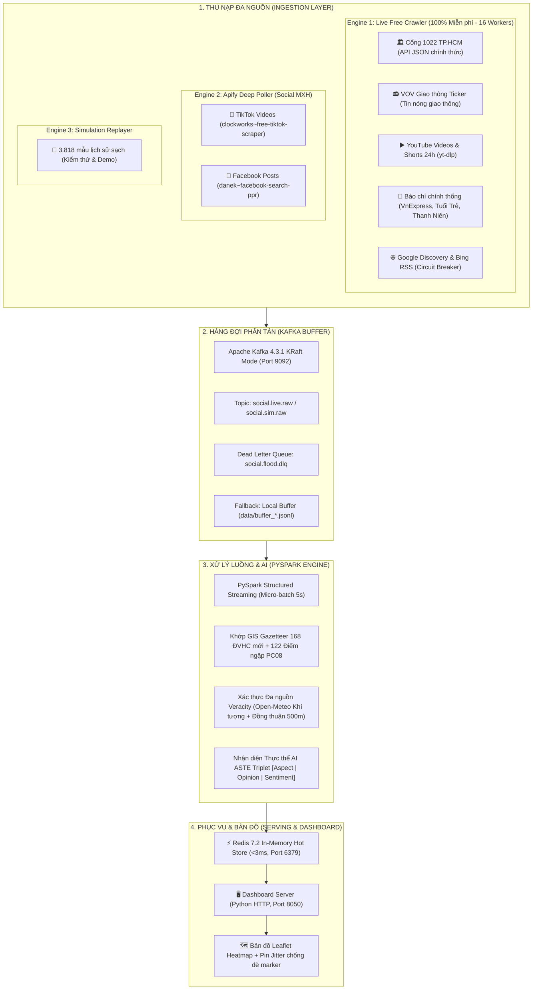

# 🌊 SE363: HỆ THỐNG GIÁM SÁT NGẬP LỤT ĐÔ THỊ THỜI GIAN THỰC (TP.HCM)
## TÀI LIỆU KIẾN TRÚC CRAWLING - STREAMING & CẨM NANG VẬN HÀNH TOÀN TRÌNH (RUNBOOK)

---

## 📑 MỤC LỤC
1. [Tổng quan Kiến trúc Hệ thống](#1-tổng-quan-kiến-trúc-hệ-thống)
2. [Chi tiết Động cơ Crawling Đa nguồn (Multi-Engine Ingestion)](#2-chi-tiết-động-cơ-crawling-đa-nguồn)
3. [Tầng Xử lý Luồng Dữ liệu Lớn (Big Data Streaming & AI)](#3-tầng-xử-lý-luồng-dữ-liệu-lớn)
4. [Tầng Bộ nhớ Đệm Phục vụ & Giao diện (Serving & Dashboard)](#4-tầng-bộ-nhớ-đệm-phục-vụ--giao-diện)
5. [Cẩm nang Khởi động Hệ thống (Terminal Runbook)](#5-cẩm-nang-khởi-động-hệ-thống-terminal-runbook)
   - [Phương án A: Khởi động Tự động 1-Click (Khuyến nghị)](#phương-án-a-khởi-động-tự-động-1-click-khuyến-nghị)
   - [Phương án B: Khởi động Thủ công Từng Tầng (Debug / Trình diễn)](#phương-án-b-khởi-động-thủ-công-từng-tầng)
6. [Các Lệnh Kiểm tra, Giám sát & Khắc phục Sự cố](#6-các-lệnh-kiểm-tra-giám-sát--khắc-phục-sự-cố)

---

## 1. TỔNG QUAN KIẾN TRÚC HỆ THỐNG

Hệ thống được thiết kế theo kiến trúc **Lambda/Kappa Streaming hiện đại**, kết hợp đa nguồn thu nạp dữ liệu thực tế và phân tích thời gian thực:



---

## 2. CHI TIẾT ĐỘNG CƠ CRAWLING ĐA NGUỒN

### 🔹 Engine 1: LiveFreeSocialCrawler (`pipeline/live_free_crawler.py`)
- **Đặc điểm**: Hoạt động **100% Miễn phí (Zero Cost)**, không cần token trả phí, chạy song song **16 ThreadPool Workers** cho tốc độ phản hồi cực nhanh (< 2 giây).
- **Các luồng dữ liệu thành phần**:
  1. **Cổng Thông Tin 1022 TP.HCM (Citizen Reports)**:
     - Tự động lấy public token từ Keycloak SSO của Cổng 1022 (`https://sso1022.tphcm.gov.vn`).
     - Gọi trực tiếp API backend công khai: `/pe/petition/--search-public`.
     - **Bóc tách mặt đường chuẩn xác**: Đọc trường JSON `takePlaceAt.fullAddress` để lấy tên đường chi tiết (Ví dụ: `Đường Sông Lu`, `ĐT744`), vượt qua giới hạn của giao diện web chỉ hiện cấp xã/phường.
     - **Bộ lọc nghiệp vụ sạch**: Tự động loại bỏ các đơn khiếu nại hành chính/hóa đơn nước sinh hoạt (`lạm thu`, `tiền nước`, `hóa đơn`), chỉ giữ lại tin ngập đường thực tế.
  2. **VOV Giao Thông Live Ticker**:
     - Quét bản tin cảnh báo kẹt xe, đường ngập, chết máy giờ cao điểm do tài xế và người dân gọi về tổng đài VOV Giao thông TP.HCM.
  3. **YouTube Videos & YouTube Shorts trong 24 giờ**:
     - Sử dụng bộ lọc YouTube chính thống `sp=EgIIAg%253D%253D` để quét video đăng trong ngày.
     - Trích xuất **thời gian đăng tải thật** (`upload timestamp`), phân tầng độ tươi nghiêm ngặt (`<2h`, `2-4h`, `4-24h`).
     - Tích hợp bộ ghi log câm `YtDlpMuteLogger` và lọc bỏ video công chiếu (`Premiere / is_upcoming`).
  4. **Báo Chí Chính Thống Trực Tiếp (Direct RSS & News)**:
     - Nạp trực tiếp từ VnExpress RSS (`thoi-su.rss`), Tuổi Trẻ, Thanh Niên, Dân Trí, Báo Pháp Luật TP.HCM.
     - Áp dụng bộ lọc từ khóa nghiêm ngặt: Chỉ nhận tin ngập lụt, triều cường; loại bỏ tuyệt đối các tin tức xã hội/giao thông không liên quan.
  5. **Google Discovery & Bing Live RSS**:
     - Cơ chế **Circuit Breaker**: Khi gặp phản hồi 503/429 từ Google, hệ thống tạm ngắt 5 phút và tự động phục hồi, chuyển tải mượt mà qua các nguồn khác.

---

### 🔹 Engine 2: Apify Deep Social Poller (`pipeline/multi_poller.py`)
- **Đặc điểm**: Dùng cho chế độ cào sâu mạng xã hội (TikTok, Facebook), cấu hình thích ứng cao.
- **Các luồng thành phần**:
  1. **TikTok Poller (`pipeline/tiktok_poller.py`)**:
     - Actor: `clockworks~free-tiktok-scraper`.
     - Quy mô: Tối ưu **50 video/batch**, **15 kết quả/trang**.
     - Thời gian chờ: Nâng lên **360s - 400s** chống ngắt quãng (chống lỗi `TIMED-OUT`).
     - Bộ Hashtag & Query: `#ngapsaigon`, `#trieucuong`, `#saigonngap`, `#trieucuongsaigon`, `#ngaptphcm`.
  2. **Facebook Poller (`pipeline/facebook_poller.py`)**:
     - Actor: **`danek~facebook-search-ppr`** (Bản nâng cấp chính thống, >9 triệu lượt chạy).
     - Tham số: `"recent_posts": True`, `"search_type": "posts"` giúp lấy thẳng các bài viết có chữ thực tế của người dân.
     - Bóc tách đa định dạng: Hỗ trợ trường `message`, `message_rich`, `album_preview.caption`.

---

## 3. TẦNG XỬ LÝ LUỒNG DỮ LIỆU LỚN

### 🔹 Apache Kafka 4.3.1 KRaft Cluster (`bigdata/docker-compose.yml`)
- Phiên bản Apache Kafka 4.3.1 mới nhất chạy **100% Pure KRaft Mode** (không cần ZooKeeper, giảm 50% RAM tiêu thụ).
- **Các Topics**:
  - `social.live.raw`: Nhận luồng sự kiện thời gian thực từ Producer.
  - `social.sim.raw`: Nhận luồng sự kiện mô phỏng từ Replayer.
  - `social.flood.dlq`: Dead Letter Queue chứa các bản ghi sai schema hoặc lỗi để đối soát.
- **Khử trùng lặp Tầng 1 (Deduplication)**:
  - Khóa Kafka Message được gán bằng `canonical_id` duy nhất (`{platform}_{id}`). Các tin trùng trong chu kỳ bị loại bỏ ngay lập tức.
- **Khả năng chịu lỗi (Fault-Tolerance)**:
  - Tích hợp cơ chế kiểm tra socket cổng 9092. Nếu Kafka chưa bật, hệ thống tự động lưu vào **Local Buffer JSONL** (`data/buffer_social.live.raw.jsonl`) để luồng cào không bao giờ bị đứt.

### 🔹 PySpark Structured Streaming (`bigdata/streaming/spark_flood_processor.py`)
- Đọc micro-batch 5 giây từ Kafka, chạy các UDF song song:
  1. **Địa lý hóa (Georeferencing)**: Đối chiếu với Gazetteer 168 phường/xã sáp nhập mới của TP.HCM và 122 điểm đen ngập nước của Phòng CSGT PC08 TP.HCM.
  2. **Động cơ Xác thực Đa nguồn (Veracity Engine)**:
     - Gọi Open-Meteo API kiểm tra lượng mưa thực tế tại tọa độ sự kiện.
     - Kiểm tra đồng thuận không gian - thời gian (Spatial-Temporal Consensus) trong bán kính 500m và cửa sổ 60 phút.
  3. **Nhận diện Thực thể AI ASTE Triplet**:
     - Phân tách cấu trúc bộ 3: `[Aspect (Địa danh) | Opinion (Tình trạng ngập) | Sentiment/Polarity]`.

---

## 4. TẦNG BỘ NHỚ ĐỆM PHỤC VỤ & GIAO DIỆN

### 🔹 Redis 7.2 In-Memory Serving Store
- Lưu trữ trạng thái nóng với tốc độ truy xuất siêu tốc (< 3 mili-giây).
- Cấu trúc dữ liệu:
  - `flood:timeline:zset`: Sorted Set lưu trữ theo timestamp để lọc nhanh theo cửa sổ thời gian.
  - `flood:geo:index`: Geospatial Index hỗ trợ quét lân cận (Proximity Search) quanh vị trí người dùng.
  - `flood:event:{id}`: Chi tiết sự kiện với thời gian hết hạn TTL 24 giờ.

### 🔹 Leaflet Heatmap Dashboard (`dashboard/index.html`)
- **Thuật toán Radial Jitter Offset**: Tự động nhận diện khi có từ 2 tin trở lên tại cùng một điểm tọa độ (ví dụ 2 phản ánh tại ĐH609/ĐT744), tự động tản nhẹ các marker theo vòng cung (~35m) để cả 2 icon hiển thị cạnh nhau, không bị đè che khuất.
- **3 Tầng Độ Tươi Chuẩn Xác**:
  - 🔴 `ĐANG DIỄN RA (< 2 GIỜ)`
  - 🟠 `ĐỢT MƯA VỪA DỨT (2-4 GIỜ)`
  - 🟡 `CẢNH BÁO TRONG NGÀY (4-24 GIỜ)`
- Loại bỏ tuyệt đối bài viết cũ quá 24 giờ trong chế độ Live Mode.

---

## 5. CẨM NANG KHỞI ĐỘNG HỆ THỐNG (TERMINAL RUNBOOK)

> **Môi trường yêu cầu:**
> - Hệ điều hành: Windows 10/11 (PowerShell)
> - Docker Desktop đã bật
> - Môi trường Python: Sử dụng virtualenv `.venv` tại thư mục dự án `D:\SE363_RAWDATA`

---

### PHƯƠNG ÁN A: KHỞI ĐỘNG TỰ ĐỘNG 1-CLICK (KHUYẾN NGHỊ)
Đây là cách nhanh nhất và an toàn nhất. Script sẽ tự kiểm tra Docker, bật Kafka/Redis nếu chưa chạy, dọn sạch cache, khởi động Dashboard, PySpark và Producer Ingestion:

Mở PowerShell tại thư mục `D:\SE363_RAWDATA`:

```powershell
# 1. Di chuyển vào thư mục dự án
cd D:\SE363_RAWDATA

# 2. Khởi chạy toàn bộ hệ thống ở chế độ LIVE STREAMING (Mặc định cào Live Free 100%)
.\.venv\Scripts\python.exe bigdata/run_streaming_pipeline.py --mode live

# HOẶC: Khởi chạy có kèm cào sâu Apify (khi cần demo mạng xã hội TikTok / Facebook)
.\.venv\Scripts\python.exe bigdata/run_streaming_pipeline.py --mode live --enable-apify

# HOẶC: Khởi chạy ở chế độ MÔ PHỎNG (Simulation 3.818 sự kiện lịch sử để chấm điểm / kiểm thử)
.\.venv\Scripts\python.exe bigdata/run_streaming_pipeline.py --mode simulation
```

👉 **Mở trình duyệt truy cập:**
- **Dashboard Bản Đồ Live**: [http://localhost:8050](http://localhost:8050)
- **Giao diện Quản trị Kafka-UI**: [http://localhost:8080](http://localhost:8080)

---

### PHƯƠNG ÁN B: KHỞI ĐỘNG THỦ CÔNG TỪNG TẦNG
Dành cho trường hợp muốn debug từng thành phần riêng biệt trên từng cửa sổ Terminal.

#### 📌 Terminal 1: Khởi động Hạ tầng Docker (Kafka KRaft, Kafka-UI, Redis)
```powershell
cd D:\SE363_RAWDATA

# Khởi động cụm container
docker compose -f bigdata\docker-compose.yml up -d

# Kiểm tra container đã bật thành công chưa
docker ps
```
*(Kết quả cần thấy 3 container: `se363-kafka-kraft`, `se363-kafka-ui`, `se363-redis-serving` đều có trạng thái `Up`)*.

---

#### 📌 Terminal 2: Khởi động Web Dashboard Server (Port 8050)
```powershell
cd D:\SE363_RAWDATA
.\.venv\Scripts\python.exe dashboard\server.py --port 8050 --mode live
```

---

#### 📌 Terminal 3: Khởi động Động cơ PySpark Structured Streaming
```powershell
cd D:\SE363_RAWDATA
.\.venv\Scripts\python.exe bigdata\streaming\spark_flood_processor.py --mode live
```
*(PySpark sẽ kết nối vào topic `social.live.raw`, đọc dữ liệu và ghi vào Redis Serving Store)*.

---

#### 📌 Terminal 4: Khởi động Kafka Ingestion Producer (Crawler)
```powershell
cd D:\SE363_RAWDATA

# Khởi chạy Producer cào tin định kỳ (mặc định mỗi 60 giây cào 1 chu kỳ)
.\.venv\Scripts\python.exe -c "from bigdata.producers.social_producer import SocialKafkaProducer; import time; p = SocialKafkaProducer(); (lambda: [p.run_live_cycle(enable_free_crawler=True, enable_apify_deep=False), time.sleep(60)] while True)()"
```
*(Hoặc dùng nút **"🔄 Quét Điểm Nóng Mới"** trực tiếp trên giao diện Web Dashboard tại `http://localhost:8050`)*.

---

## 6. CÁC LỆNH KIỂM TRA, GIÁM SÁT & KHẮC PHỤC SỰ CỐ

### 🔍 Kiểm tra Dữ liệu Đang Chảy Trong Kafka
```powershell
# Xem danh sách các topic hiện có trong Kafka
docker exec -it se363-kafka-kraft /opt/kafka/bin/kafka-topics.sh --bootstrap-server localhost:9092 --list

# Đọc trực tiếp các message đang bắn vào topic social.live.raw
docker exec -it se363-kafka-kraft /opt/kafka/bin/kafka-console-consumer.sh --bootstrap-server localhost:9092 --topic social.live.raw --from-beginning --max-messages 3
```

### 🔍 Kiểm tra Bộ Nhớ Nóng Redis
```powershell
# Đếm số lượng sự kiện đang lưu trong Redis Serving Store
docker exec -it se363-redis-serving redis-cli ZCARD flood:timeline:zset

# Xem 5 sự kiện mới nhất trong Redis
docker exec -it se363-redis-serving redis-cli ZREVRANGE flood:timeline:zset 0 4 WITHSCORES
```

### 🧹 Làm Mới Toàn Bộ Trạng Thái Hệ Thống (Reset State Về 0)
Khi muốn dọn sạch bản đồ và xóa cache để chạy lại đợt cào mới:
```powershell
# Cách 1: Bấm nút '🗑️ Làm mới dòng tin (Reset)' ở góc phải trên giao diện Web
# Cách 2: Chạy lệnh dọn sạch bằng Python:
.\.venv\Scripts\python.exe -c "import redis, os, json; r = redis.Redis(host='localhost', port=6379, db=0); r.flushdb(); open('data/live_stream_state.json', 'w', encoding='utf-8').write(json.dumps({'mode':'live','window':'120 phút','events_count':0,'events':[]}, indent=2)); print('✅ Đã dọn sạch cache!')"
```

### 🛑 Tắt Toàn Bộ Hệ Thống An Toàn
```powershell
# 1. Nếu chạy bằng run_streaming_pipeline.py: Nhấn tổ hợp phím Ctrl + C trên terminal.
# 2. Dừng cụm Docker containers:
docker compose -f bigdata\docker-compose.yml down
```

---
*Tài liệu được cập nhật tự động theo phiên bản mã nguồn mới nhất ngày 31/10/2026.*
