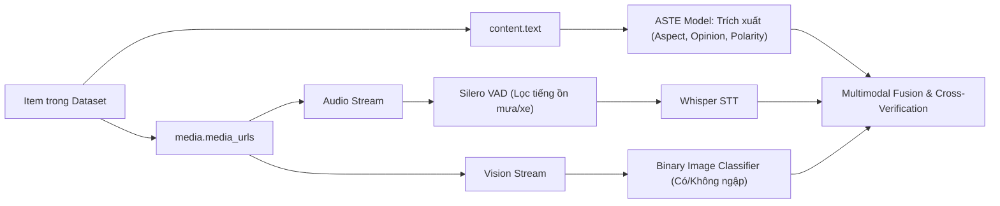

# 🌊 HCMC Urban Flood Annotated Dataset (v1)

> **File dữ liệu chính:** `hcmc_flood_annotated_v1.json`  
> **Phiên bản:** v1.0 (Đã làm sạch, khử trùng 100%, gán nhãn ASTE toàn diện & cập nhật địa giới hành chính mới TP.HCM).  
> **Mục tiêu:** Phục vụ huấn luyện mô hình và kiểm thử thực nghiệm (*Benchmark*) cho bài báo khoa học về **Multimodal Aspect Sentiment Triplet Extraction (M-ABSA / ASTE)** trong bài toán cảnh báo ngập lụt đô thị.

---

## 📊 1. Thống kê tập dữ liệu (Dataset Statistics)

| Chỉ số | Số lượng / Tỷ lệ | Ghi chú kỹ thuật |
| :--- | :--- | :--- |
| **Tổng số mẫu (Total Items)** | **2,854** | Đã khử trùng lặp 100% bằng URL và MD5 Content Hash |
| **Google News (Sentence-level)** | **2,242 câu** | Tách từ 304 bài báo gốc, ghép ngữ cảnh trọn vẹn, lọc sạch chú thích ảnh |
| **TikTok Videos (Multimodal)** | **525 videos** | Giữ nguyên link CDN video trực tiếp và ảnh bìa |
| **Facebook Posts** | **87 posts** | Bài phản ánh thực tế từ cộng đồng |
| **Tỷ lệ gán nhãn ASTE Triplet** | **100.0% (2,854/2,854)** | Không có mẫu nào bị rỗng `aste_triplets` |
| **Cập nhật sáp nhập Xã/Phường** | **100% chuẩn NQ 1278** | Ánh xạ chuẩn 80 phường cũ thành 39 phường mới tại TP.HCM |

---

## 🛠️ 2. Tích hợp Pipeline Multimodal AI

Mỗi item trong dataset được cấu trúc để nạp trực tiếp vào 3 luồng trong kiến trúc AI:



1. **Luồng Text (ASTE):** Dùng trực tiếp `content.text`. Văn bản đã được chuẩn hóa Unicode NFC, loại bỏ rác báo chí và câu cụt.
2. **Luồng Audio (VAD + ASR Whisper):** Khi `media.has_media == True`, tải video từ `media.media_urls` $\rightarrow$ tách audio $\rightarrow$ đưa qua **Silero VAD** $\rightarrow$ đưa qua **Whisper** để sinh transcript bổ trợ.
3. **Luồng Vision (Image Classifier):** Trích xuất frames từ video hoặc ảnh bìa trong `media.media_urls` để xác thực chéo có cảnh ngập thực tế hay không.

---

## 📋 3. Chi tiết Cấu trúc JSON Schema

| Trường thuộc tính | Kiểu dữ liệu | Ý nghĩa & Mục đích sử dụng |
| :--- | :--- | :--- |
| `id` | `string` | Định danh duy nhất cho từng câu/đoạn (dùng để đo F1-Score độc lập). |
| `parent_id` | `string` | Định danh bài viết / video gốc (dùng để truy vết nguồn gốc - provenance). |
| `source.platform` | `string` | Nền tảng thu thập (`news`, `tiktok`, `facebook`). |
| `source.author` | `string` | Tác giả hoặc tên trang tin tức. |
| `source.url` | `string` | Link gốc bài đăng để đối chiếu. |
| `published_at` | `string (ISO-8601)`| Thời gian đăng tải chuẩn UTC (ví dụ: `2026-09-30T14:36:00+00:00`). |
| `content.title` | `string` | Tiêu đề bài viết (rỗng nếu là bài TikTok/Facebook). |
| `content.text` | `string` | **Văn bản phục vụ trực tiếp mô hình ASTE.** |
| `location.locations` | `list[string]` | Danh sách tên đường / công trình ngập cụ thể (nếu nhận diện được). |
| `location.ward` | `string` | **Đơn vị hành chính cấp Phường/Xã chuẩn mới sau sáp nhập.** |
| `location.legacy_ward`| `string` | Tên phường cũ trước sáp nhập (lưu vết lịch sử). |
| `location.is_merged` | `boolean` | `true` nếu phường này vừa trải qua sáp nhập theo NQ 1278. |
| `location.city` | `string` | Tên đô thị trực thuộc (`Hồ Chí Minh`). |
| `location.legacy_district`| `string` | Quận/Huyện cũ (chỉ giữ làm tham chiếu). |
| `media.has_media` | `boolean` | Đánh dấu bài viết có kèm ảnh hoặc video hay không. |
| `media.media_urls` | `list[string]` | **Danh sách URL trực tiếp đến video CDN / ảnh cho luồng Multimodal.** |
| `aste_triplets` | `list[object]` | **Danh sách các bộ ba `{aspect, opinion, polarity}`.** |

---

## 📌 4. Ví dụ Mẫu Dữ liệu Thực tế

### 🔹 Ví dụ 1: Câu bóc tách từ Google News (Text ASTE)
```json
{
  "id": "news_e20110e6bb_s01",
  "parent_id": "news_e20110e6bb",
  "source": {
    "platform": "news",
    "author": "Báo Thanh Niên",
    "url": "https://thanhnien.vn/ngap-nang-tren-duong-phan-huy-ich-o-tphcm-nuoc-tran-vao-trong-xe-buyt-185260930213109957.htm"
  },
  "published_at": "2026-09-30T14:36:00+00:00",
  "content": {
    "title": "Ngập nặng trên đường Phan Huy Ích ở TP.HCM...",
    "text": "Tối 30.9, video trên mạng xã hội cho thấy tuyến đường Phan Huy Ích ngập sâu 1 mét sau mưa lớn."
  },
  "location": {
    "locations": ["Phan Huy Ích"],
    "ward": "Phường 15",
    "legacy_ward": "Phường 14",
    "is_merged": true,
    "city": "Hồ Chí Minh",
    "legacy_district": "Quận Gò Vấp"
  },
  "media": {
    "has_media": false,
    "media_urls": []
  },
  "aste_triplets": [
    {
      "aspect": "Phan Huy Ích",
      "opinion": "ngập sâu diện rộng",
      "polarity": "NEG"
    }
  ]
}
```

### 🔹 Ví dụ 2: Video từ TikTok (Multimodal: Audio + Vision)
```json
{
  "id": "tiktok_7688379058056482068",
  "parent_id": "tiktok_7688379058056482068",
  "source": {
    "platform": "tiktok",
    "author": "tintuc_saigon",
    "url": "https://www.tiktok.com/@tintuc_saigon/video/7688379058056482068"
  },
  "published_at": "2026-09-22T15:17:30+00:00",
  "content": {
    "title": "",
    "text": "Đường Võ Văn Ngân nước chảy như thác đổ, nhiều xe máy chết máy dắt bộ bì bõm."
  },
  "location": {
    "locations": ["Võ Văn Ngân"],
    "ward": "Phường Linh Chiểu",
    "legacy_ward": "Phường Linh Chiểu",
    "is_merged": false,
    "city": "Hồ Chí Minh",
    "legacy_district": "TP. Thủ Đức"
  },
  "media": {
    "has_media": true,
    "media_urls": [
      "https://v16-webapp-prime.tiktokcdn.com/video/...mp4",
      "https://p16-sign-va.tiktokcdn.com/...image"
    ]
  },
  "aste_triplets": [
    {
      "aspect": "Võ Văn Ngân",
      "opinion": "nước ngập làm chết máy",
      "polarity": "NEG"
    },
    {
      "aspect": "phương tiện giao thông",
      "opinion": "phải bì bõm dắt bộ",
      "polarity": "NEG"
    }
  ]
}
```

---

## 🚀 5. Quickstart: Nạp Dữ Liệu bằng Python

```python
import json

# 1. Đọc dữ liệu
with open("data/processed/hcmc_flood_annotated_v1.json", "r", encoding="utf-8") as f:
    dataset = json.load(f)

print(f"Tổng số mẫu: {len(dataset)}")

# 2. Lấy dữ liệu cho bài toán ASTE thuần văn bản
text_samples = [
    {
        "text": item["content"]["text"],
        "triplets": item["aste_triplets"]
    }
    for item in dataset
]

# 3. Lấy dữ liệu cho bài toán Multimodal (Audio VAD + Vision)
multimodal_samples = [
    {
        "text": item["content"]["text"],
        "media_urls": item["media"]["media_urls"],
        "triplets": item["aste_triplets"]
    }
    for item in dataset if item["media"]["has_media"]
]

print(f"Số mẫu có media cho Multimodal AI: {len(multimodal_samples)}")
```
