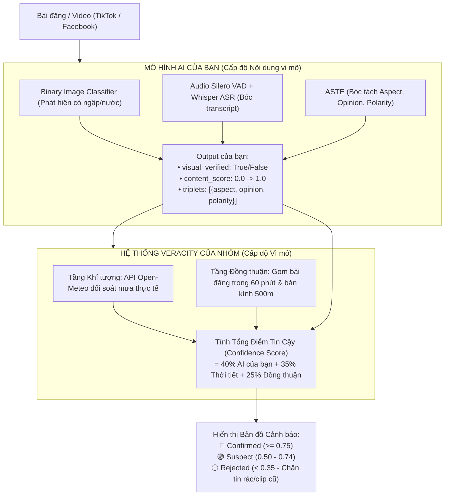

# 🤖 HƯỚNG DẪN TÍCH HỢP MÔ HÌNH MULTIMODAL AI VÀO HỆ THỐNG XÁC THỰC
*(Dành riêng cho Hưng phụ trách phần AI: Image Classifier + Whisper ASR + ASTE)*

Tài liệu này hướng dẫn cách kết nối mô hình Multimodal AI của bạn vào hệ thống **Xác thực Dữ liệu & Phòng chống Báo cáo Sai lệch / Tin giả (Data Veracity & Fake Report Mitigation)**.

---

## 🏗️ 1. Kiến trúc Hệ thống Tổng thể

Hệ thống hoạt động theo nguyên tắc **phân tách trách nhiệm (Separation of Concerns)**:



* **Phần của Hưng:** Tập trung 100% vào việc tối ưu độ chính xác của 3 mô hình con (Image Classifier, VAD+Whisper, ASTE) trên từng bài đăng.
* **Phần của hệ thống:** Tự động lo việc kiểm tra thời tiết ngoài đời, gom cụm nhiều người đăng trong 60 phút, và hiển thị bản đồ nhiệt cảnh báo.

---

## 🎯 2. Điểm cắm Hàm duy nhất trong Code

Mọi thứ đã được dựng sẵn dưới dạng cắm-rút (Plug-and-Play). Bạn chỉ cần cắm hàm dự đoán của bạn vào **DUY NHẤT MỘT NƠI**:

* **File:** `pipeline/veracity_checker.py`
* **Class:** `VeracityChecker`
* **Hàm:** `evaluate_content_ai(self, event: Dict[str, Any]) -> Dict[str, Any]`

### Code mẫu trước và sau khi cắm mô hình:

```python
# =========================================================================
# FILE: pipeline/veracity_checker.py (Dòng ~50)
# =========================================================================

    def evaluate_content_ai(self, event: Dict[str, Any]) -> Dict[str, Any]:
        """
        Đánh giá độ tin cậy từ nội dung đa phương thái (Chữ, Âm thanh, Hình ảnh).
        """
        
        # -------------------------------------------------------------
        # [KHI BẠN HOÀN THÀNH MÔ HÌNH AI, HÃY MỞ KHỐI NÀY VÀ THAY THẾ]:
        # -------------------------------------------------------------
        # from your_ai_package import run_multimodal_inference
        # 
        # text = event.get("text", "")
        # media_urls = event.get("media_urls", []) or [event.get("video_url")]
        # 
        # ai_res = run_multimodal_inference(text=text, media_urls=media_urls)
        # 
        # return {
        #     "source": "friend_multimodal_ai",
        #     "visual_verified": ai_res["has_water"],       # bool: True nếu ảnh/video có ngập
        #     "content_score": ai_res["confidence"],        # float (0.0 đến 1.0)
        #     "triplets": ai_res["triplets"]                # list: [{aspect, opinion, polarity}]
        # }
        
        # -------------------------------------------------------------
        # [CƠ CHẾ BASELINE HIỆN TẠI ĐANG CHẠY]:
        # -------------------------------------------------------------
        has_media = bool(event.get("media_urls") or event.get("video_url") or event.get("media", {}).get("has_media"))
        text = str(event.get("text", "")).lower()

        visual_verified = has_media
        content_score = 0.75 if has_media else 0.50

        if any(k in text for k in ["chết máy", "lút bánh", "dắt bộ", "bì bõm"]):
            content_score = min(1.0, content_score + 0.15)

        return {
            "source": "heuristic_baseline",
            "visual_verified": visual_verified,
            "content_score": round(content_score, 2),
            "triplets": event.get("aste_triplets", [])
        }
```

---

## 📦 3. Quy chuẩn Dữ liệu Vào / Ra (Data Contract)

### Dữ liệu đầu vào hàm của bạn nhận được (`event`):
```python
event = {
    "id": "tiktok_7688379058",
    "text": "Đường Võ Văn Ngân ngập lút bánh xe, chết máy hàng loạt",
    "media_urls": [
        "https://v16-webapp-prime.tiktokcdn.com/video/demo.mp4",
        "https://p16-sign-va.tiktokcdn.com/cover/demo.jpg"
    ],
    "video_url": "https://www.tiktok.com/@user/video/7688379058",
    "lat": 10.8505,
    "lon": 106.7664,
    "timestamp": 1727850000
}
```

### Dữ liệu đầu ra hàm của bạn cần trả về:
```python
{
    "source": "friend_multimodal_ai",
    "visual_verified": True,              # True nếu Image Classifier thấy có ngập nước
    "content_score": 0.88,                # Độ tự tin tổng hợp từ Vision + Audio + Text (0.0 - 1.0)
    "triplets": [                         # Bộ ba nhãn ASTE do mô hình của bạn trích xuất
        {
            "aspect": "Đường Võ Văn Ngân",
            "opinion": "ngập lút bánh xe",
            "polarity": "NEG"
        }
    ]
}
```

---

## ⚡ 4. Cách Chạy Thử Nghiệm Ngay Lập Tức

Để kiểm tra toàn bộ module Veracity Checker hoạt động, bạn chỉ cần mở terminal và chạy lệnh:

```bash
python -c "from pipeline.veracity_checker import VeracityChecker; v = VeracityChecker(); res = v.verify_event({'id': 'test_1', 'text': 'Võ Văn Ngân ngập sâu', 'lat': 10.8505, 'lon': 106.7664, 'media_urls': ['https://tiktok.com/demo.mp4']}); print('Kết quả xác thực:', res['veracity'])"
```

Kết quả in ra sẽ gồm đầy đủ:
* `confidence_score`: Điểm tin cậy (0.0 - 1.0)
* `status`: `confirmed` | `suspect` | `unverified` | `rejected`
* `evidence_count`: Số lượng bài đăng đồng thuận trong 60 phút
* `weather_check`: Đối soát lượng mưa từ trạm khí tượng
* `content_check`: Kết quả từ mô hình AI của bạn

---
*Mọi thắc mắc trong quá trình tích hợp, hãy trao đổi trực tiếp để cùng tối ưu pipeline nhé!*
