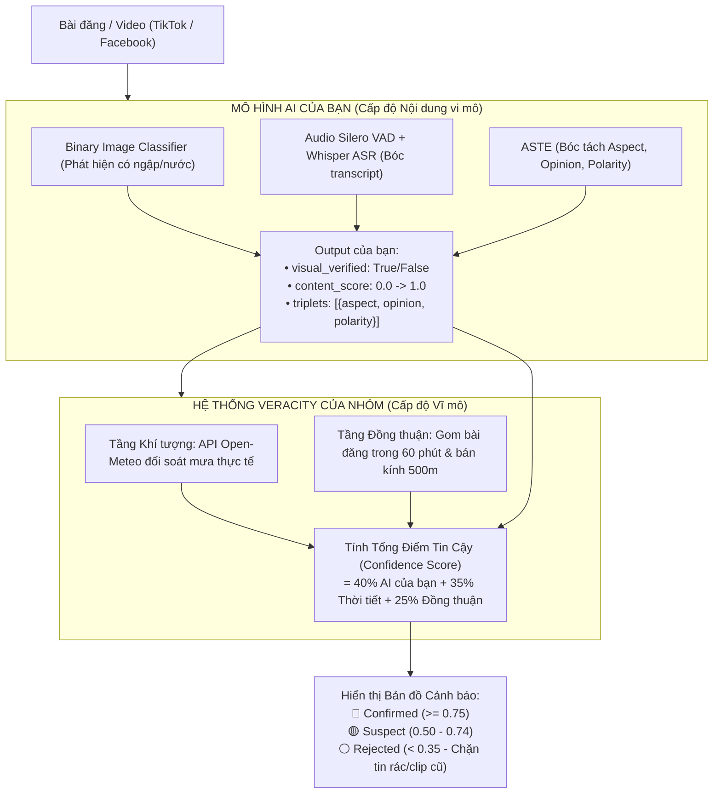

# 🤖 HƯỚNG DẪN TÍCH HỢP MÔ HÌNH MULTIMODAL AI VÀO HỆ THỐNG XÁC THỰC
*(Dành riêng cho Hưng phụ trách phần AI: Image Classifier + Whisper ASR + ASTE)*

Tài liệu này hướng dẫn cách kết nối mô hình Multimodal AI của bạn vào hệ thống **Xác thực Dữ liệu & Phòng chống Báo cáo Sai lệch / Tin giả (Data Veracity & Fake Report Mitigation)**.

---

## 🏗️ 1. Kiến trúc Hệ thống Tổng thể

Hệ thống hoạt động theo nguyên tắc **phân tách trách nhiệm (Separation of Concerns)**:



* **Phần của Hưng:** Tập trung 100% vào việc tối ưu độ chính xác của 3 mô hình con (Image Classifier, VAD+Whisper, ASTE) trên từng bài đăng.
* **Phần của hệ thống:** Tự động lo việc kiểm tra thời tiết ngoài đời, gom cụm nhiều người đăng trong 60 phút, và hiển thị bản đồ nhiệt cảnh báo.

---

## 🎯 2. Điểm cắm Hàm duy nhất trong Code

Mọi thứ đã được dựng sẵn dưới dạng cắm-rút (Plug-and-Play). Bạn chỉ cần cắm hàm dự đoán của bạn vào **DUY NHẤT MỘT NƠI**:

* **File:** `pipeline/veracity_checker.py`
* **Class:** `VeracityChecker`
* **Hàm:** `evaluate_content_ai(self, event: Dict[str, Any]) -> Dict[str, Any]`

### Code mẫu trước và sau khi cắm mô hình:

```python
# =========================================================================
# FILE: pipeline/veracity_checker.py (Dòng ~50)
# =========================================================================

    def evaluate_content_ai(self, event: Dict[str, Any]) -> Dict[str, Any]:
        """
        [CHỖ NÀY DÀNH CHO HƯNG]
        Hưng chỉ cần cắm hàm dự đoán của 3 mô hình con vào đây:
        1. Image Classifier: Trả về visual_verified (True/False)
        2. Whisper ASR: Trích xuất transcript từ giọng nói video
        3. ASTE: Trích xuất bộ ba (aspect, opinion, polarity)
        """
        text = event.get("text", "").lower()
        media_urls = event.get("media_urls", [])

        # Heuristic tạm thời trước khi có model của Hưng:
        visual_verified = len(media_urls) > 0
        content_score = 0.6 if visual_verified else 0.4
        if any(k in text for k in ["chết máy", "lút bánh", "dắt bộ", "bì bõm"]):
            content_score = min(1.0, content_score + 0.15)

        return {
            "source": "heuristic_baseline",
            "visual_verified": visual_verified,
            "content_score": round(content_score, 2),
            "triplets": event.get("aste_triplets", [])
        }
```

---

## 📦 3. Quy chuẩn Dữ liệu Vào / Ra (Data Contract)

### Dữ liệu đầu vào hàm của bạn nhận được (`event`):
```python
event = {
    "id": "tiktok_7688379058",
    "text": "Đường Võ Văn Ngân ngập lút bánh xe, chết máy hàng loạt",
    "media_urls": [
        "https://v16-webapp-prime.tiktokcdn.com/video/demo.mp4",
        "https://p16-sign-va.tiktokcdn.com/cover/demo.jpg"
    ],
    "video_url": "https://www.tiktok.com/@user/video/7688379058",
    "lat": 10.8505,
    "lon": 106.7664,
    "timestamp": 1727850000
}
```

### Dữ liệu đầu ra hàm của bạn cần trả về:
```python
{
    "source": "friend_multimodal_ai",
    "visual_verified": True,              # True nếu Image Classifier thấy có ngập nước
    "content_score": 0.88,                # Độ tự tin tổng hợp từ Vision + Audio + Text (0.0 - 1.0)
    "triplets": [                         # Bộ ba nhãn ASTE do mô hình của bạn trích xuất
        {
            "aspect": "Đường Võ Văn Ngân",
            "opinion": "ngập lút bánh xe",
            "polarity": "NEG"
        }
    ]
}
```

---

## 🌐 4. Bản chất Vấn đề Media & Lỗi HTTP 403 Forbidden (Root Cause & Solution)

### A. Vấn đề Kỹ thuật Gốc rễ
Khi làm việc với liên kết đa phương tiện từ TikTok (`tiktokcdn-us.com`) hoặc Facebook (`fbcdn.net`), người dùng thường gặp tình trạng bị từ chối truy cập:
```
Quyền truy cập p19-common-sign.tiktokcdn-us.com bị từ chối
HTTP ERROR 403
```
Nguyên nhân gồm 2 rào cản bảo mật từ các nền tảng:
1. **Anti-Hotlinking (Kiểm tra Header `Referer`):** Máy chủ CDN của TikTok chỉ chấp nhận yêu cầu tải nếu request xuất phát từ chính ứng dụng TikTok. Khi ứng dụng ngoài hoặc lệnh `requests.get()` không đính kèm `Referer: https://www.tiktok.com/`, CDN sẽ lập tức chặn và trả về `403 Forbidden`.
2. **Signed Token Hết hạn (`x-expires`, `x-signature`):** Các URL trực tiếp của CDN chỉ có giá trị tạm thời trong vài giờ hoặc vài ngày. Sau khoảng thời gian này, token hết hạn và link trở nên vô hiệu.

### B. Tại sao KHÔNG NÊN tải toàn bộ Video offline về ổ cứng?
* Tải 1,500 – 2,000 video full chất lượng cao (30MB – 50MB mỗi video) sẽ tiêu tốn từ **50GB đến 100GB** bộ nhớ lưu trữ, gây tràn ổ đĩa trên máy tính cá nhân.
* Quan trọng hơn, **mô hình AI của bạn không cần toàn bộ video**:
  * **Whisper ASR / Silero VAD:** Chỉ cần luồng âm thanh **Mono 16kHz** (chỉ tốn ~200KB cho 30 giây clip).
  * **Image Classifier:** Chỉ cần **1 bức ảnh Thumbnail/Keyframe đại diện** (chỉ tốn ~50KB).

---

### C. Giải pháp Chuẩn mực: In-Memory Streaming (0 MB Disk, Bypass 403)
Hệ thống đã triển khai sẵn module tiện ích **[`pipeline/multimodal_streamer.py`](file:///d:/SE363_RAWDATA/pipeline/multimodal_streamer.py)**. 

Module này dùng `yt-dlp` stream trực tiếp Audio và Thumbnail vào **RAM (In-Memory Buffer)** mà **không ghi bất kỳ byte nào xuống đĩa cứng**:

```python
import io
from PIL import Image
from pipeline.multimodal_streamer import get_multimodal_features_in_memory

# 1. Lấy dữ liệu đa phương tiện trực tiếp trên RAM bằng Canonical URL:
media_data = get_multimodal_features_in_memory("https://www.tiktok.com/@vtv24news/video/7418721644783324423")

# 2. Xử lý Âm thanh với Whisper ASR (0 MB ổ đĩa):
if media_data["has_audio"]:
    audio_bytes = media_data["audio_bytes"]     # Kích thước chỉ ~200KB trên RAM
    # Bạn có thể đưa audio_bytes vào io.BytesIO(audio_bytes) để Whisper giải mã
    print(f"-> Audio bytes sẵn sàng cho Whisper: {len(audio_bytes)} bytes")

# 3. Xử lý Thị giác với Image Classifier (0 MB ổ đĩa):
if media_data["has_thumbnail"]:
    thumb_bytes = media_data["thumbnail_bytes"] # Kích thước chỉ ~50KB trên RAM
    image = Image.open(io.BytesIO(thumb_bytes))
    # Đưa image vào PyTorch transforms -> ResNet / CLIP để kiểm tra ngập nước
    print(f"-> Ảnh keyframe sẵn sàng cho Vision Classifier: {image.size}")
```

#### Ưu thế vượt trội của giải pháp:
* **Tốn 0 MB dung lượng ổ cứng:** Dữ liệu nằm trên RAM dạng buffer và tự động giải phóng sau khi mô hình suy luận xong.
* **Miễn nhiễm 100% với lỗi HTTP 403:** `yt-dlp` tự động cập nhật chữ ký số và giải mã luồng video hợp lệ từ TikTok/Facebook mà không lo link CDN bị hết hạn.

---

## ⚡ 5. Cách Chạy Thử Nghiệm Ngay Lập Tức

Để kiểm tra toàn bộ module Veracity Checker hoạt động, bạn chỉ cần mở terminal và chạy lệnh:

```bash
python -c "from pipeline.veracity_checker import VeracityChecker; v = VeracityChecker(); res = v.verify_event({'id': 'test_1', 'text': 'Võ Văn Ngân ngập sâu', 'lat': 10.8505, 'lon': 106.7664, 'media_urls': ['https://tiktok.com/demo.mp4']}); print('Kết quả xác thực:', res['veracity'])"
```

Kết quả in ra sẽ gồm đầy đủ:
* `confidence_score`: Điểm tin cậy (0.0 - 1.0)
* `status`: `confirmed` | `suspect` | `unverified` | `rejected`
* `evidence_count`: Số lượng bài đăng đồng thuận trong 60 phút
* `weather_check`: Đối soát lượng mưa từ trạm khí tượng
* `content_check`: Kết quả từ mô hình AI của bạn

---
*Mọi thắc mắc trong quá trình tích hợp, hãy trao đổi trực tiếp để cùng tối ưu pipeline nhé!*
