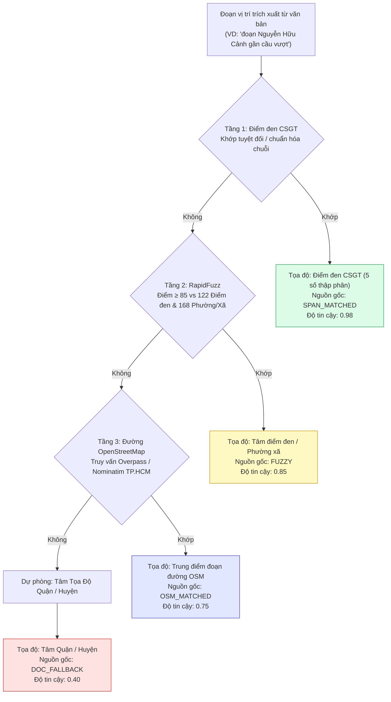
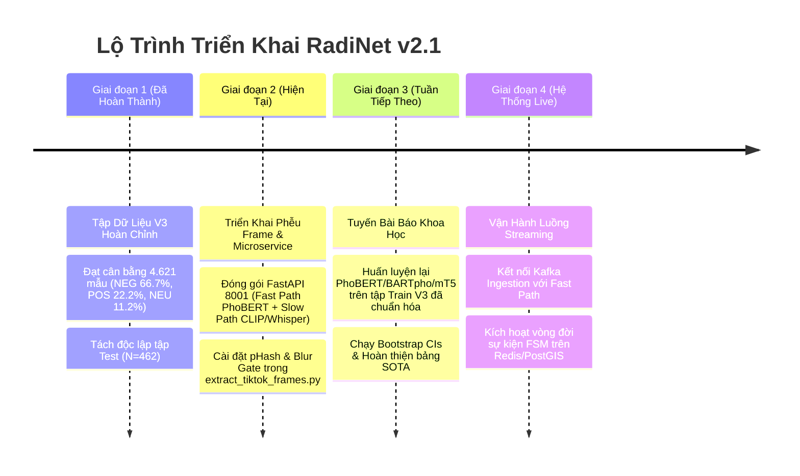

# Kiến Trúc RadiNet v2 & Lộ Trình Triển Khai Huấn Luyện AI
**Phiên bản tài liệu:** 2.1 (Reconciled & System-Paper Decoupled)  
**Hệ thống áp dụng:** Hệ thống Thu thập Dữ liệu Thời gian thực, Dịch vụ Trích xuất AI, Xác thực Địa lý (GIS), và Bảng điều khiển Giám sát Ngập lụt RadiNet  
**Thời gian cập nhật:** Tháng 10/2026  
**Trạng thái:** Bản thiết kế Kiến trúc Chính thức, Đồng bộ Thực nghiệm & Sẵn sàng Triển khai  

---

## 1. Đánh Giá Tổng Quan: Sơ Đồ Kiến Trúc Cũ Có Còn Hợp Lệ Không?

### Kết Luận: **CÓ — Hoàn toàn Hợp lệ về mặt Kiến trúc, Nâng cấp 4 Mắt xích Cốt lõi & Chuẩn hóa Phễu Frame**

Mô hình kiến trúc 6 giai đoạn (Nguồn dữ liệu $\rightarrow$ Thu nạp $\rightarrow$ Trích xuất Đa phương thức $\rightarrow$ Dịch vụ AI Trích xuất $\rightarrow$ Xác thực & Tổng hợp $\rightarrow$ Phục vụ & Trực quan hóa) là **hoàn toàn chính xác, tối ưu về mặt vận hành và bám sát các nghiên cứu chuẩn mực về Social Sensing (Cảm biến Xã hội) trên thế giới**. Thiết kế luồng xử lý kép (Fast Path xử lý văn bản tức thì vs. Slow Path xử lý video đa khung hình và ASR âm thanh), cơ chế kiểm chứng chéo đa tài khoản, đối soát dữ liệu vật lý (mưa/triều cường) và hàng đợi kiểm duyệt bán tự động là mô hình tiêu chuẩn công nghiệp.

Tuy nhiên, từ kết quả rà soát sâu 4.621 mẫu gán nhãn, quy chuẩn quản trị cực tính cảm xúc ASTE và hạ tầng định vị GIS của TP.HCM, **4 mắt xích cốt lõi** cùng **quy trình phễu lọc khung hình video (Frame Pipeline)** cần được chuẩn hóa để nâng cấp lên **Sơ Đồ Kiến Trúc v2.1**:

| Mắt xích (Node) | Sơ đồ v1 (Ban đầu) | Sơ đồ v2.1 (Nâng cấp & Hiệu chỉnh) | Lý do Kỹ thuật & Giá trị Học thuật |
| :--- | :--- | :--- | :--- |
| **`VI` (Xử lý Video & Frame)** | `OpenCV 0.5 FPS, CLIP top-3` | **Phễu Lọc Khung Hình Đa Tầng**: `ffprobe` $\rightarrow$ Lấy mẫu $0.5\text{ FPS}$ (bỏ $15\%$ intro/outro) $\rightarrow$ Khử trùng lặp `pHash` (Hamming $\le 8$) $\rightarrow$ Cổng lọc mờ `Laplacian` & phơi sáng $\rightarrow$ Chọn Top-3 bằng `CLIP MMR` (Diversity-aware) | **Khắc phục lỗi trùng lặp khung hình**: CLIP xếp hạng theo độ tương quan ngập lụt chứ không xét tính đa dạng. Nếu không có `pHash` và cổng lọc mờ, Top-3 sẽ chọn 3 khung hình giống hệt nhau ở góc quay đẹp nhất hoặc chọn nhầm khung hình mờ nhòe do rung lắc dưới mưa. |
| **`TR` (Bộ ba AI trích xuất)** | `street / severity / level` | `aspect + opinion + polarity + category + severity + confidence` | **Tách rời Cực tính khỏi Ngập lụt**: Cực tính thể hiện *thái độ đánh giá* của người viết đối với thực thể (khen trạm bơm/thoát nước vs phàn nàn), không đồng nghĩa với có ngập hay không. Tầng điều hướng phía sau sẽ phụ trách kích hoạt cảnh báo. |
| **`GR` (Định vị Địa lý)** | *Ngầm định / Chưa rõ ràng* | **Dịch vụ Định vị Địa lý & Xác thực Nguồn gốc (GIS Grounding)**: `rapidfuzz` $\rightarrow$ 122 Điểm đen CSGT $\rightarrow$ 168 Phường/Xã NQ-1685 $\rightarrow$ Bộ nhớ đệm động $\rightarrow$ OSM $\rightarrow$ Tọa độ 5 số thập phân + Nhãn nguồn gốc (`SPAN_MATCHED`, `FUZZY`, `OSM_MATCHED`, `DOC_FALLBACK`) | Mọi thực thể trích xuất bắt buộc phải gắn với tọa độ chuẩn và cấp độ tin cậy địa lý có thể kiểm toán. Đồng bộ 4 nhãn enum tương ứng với 4 tầng tra cứu. |
| **`AG` (Bộ tổng hợp Sự kiện)** | Đếm tĩnh `3+ bài / 60 phút` | **Máy Trạng thái Quản lý Vòng đời Sự kiện (FSM)**: `DETECTED` $\rightarrow$ `ACTIVE` $\rightarrow$ `RESOLVING` $\rightarrow$ `CLOSED` | Tiếp nhận các bộ ba `POS` ("hết ngập", "nước rút") để chuyển trạng thái điểm ngập từ Đang ngập sang Đang rút nước, chuyển màu đường trên bản đồ từ Đỏ sang Xanh, ngăn chặn cảnh báo ảo kéo dài. |
| **`FC` (Chuỗi Dự phòng)** | Danh sách tĩnh: fine-tuned, LLM, rules | **Chuỗi Leo thang Tin cậy Chuẩn hóa**: PhoBERT Fast Path ($\le 35\text{ms}$) $\xrightarrow{\text{conf} < 0.70}$ LLM Fallback (Gemma-26B/Qwen-27B) $\xrightarrow{\text{timeout}}$ Regex Luật Từ điển | Đảm bảo độ trễ p95 $\le 35\text{ms}$ cho 85%+ lưu lượng streaming, đồng thời xử lý an toàn các bài đăng ngữ nghĩa phức tạp nhờ LLM fallback. |

---

## 2. Sơ Đồ Kiến Trúc RadiNet v2.1

```mermaid
flowchart TB
    subgraph S1["1 - Nguồn Dữ Liệu (Data Sources)"]
        FB["Facebook<br>bài viết cá nhân + nhóm + fanpage"]
        TT["TikTok<br>luồng video ngập lụt thực tế"]
        NW["Báo chí Chính thống<br>danh sách cấm đường & bản tin triều cường"]
    end

    subgraph S2["2 - Thu Nạp & Xử Lý Luồng (Ingestion)"]
        CR["Bộ Thu Thập (Crawlers)<br>thăm dò chu kỳ 5-15 phút"]
        KQ[["Kafka / Redis Stream<br>hàng đợi & băm chống trùng lặp URL"]]
    end

    subgraph S3["3 - Trích Xuất Đa Phương Thức (Modality Extraction)"]
        TX["Khai phá Văn bản<br>chuẩn hóa teencode, ánh xạ emoji, tiêu đề"]
        AU["Xử lý Âm thanh<br>FFmpeg demux → PhoWhisper ASR (16kHz mono)"]
        VI["Xử lý Video (Phễu Đa Tầng)<br>ffprobe → 0.5 FPS → pHash Dedup → Blur Gate → CLIP MMR top-3"]
    end

    subgraph S4["4 - Dịch Vụ AI Trích Xuất (AI Microservice Port 8001)"]
        FP["Luồng Nhanh Fast Path (≤35ms)<br>PhoBERT-base Span/Table Head (Zero Lexical Hallucination)"]
        SP["Luồng Chậm Slow Path (~1.5s - 5.0s)<br>Hợp nhất Đa phương thức (Text + ASR + CLIP Vectors + BARTpho)"]
        FC["Chuỗi Dự phòng Bậc thang<br>PhoBERT → LLM (Gemma/Qwen) → Regex Luật"]
        TR["Bộ Ba Dữ Liệu Hoàn Chỉnh<br>aspect + opinion + polarity + category + severity + conf"]
    end

    subgraph S5["5 - Định Vị GIS, Xác Thực & Tổng Hợp"]
        PP["Xác Thực Cấp Bài Đăng (Provenance)<br>băm ảnh phash so kho tư liệu cũ, độ uy tín nick, tem giờ"]
        GR["Định Vị Tọa Độ & Nguồn Gốc (GIS)<br>122 CSGT • 168 đơn vị NQ1685 • OSM<br>xuất (lat, lon) + nhãn provenance"]
        CO["Kiểm Chứng Không - Thời Gian<br>≥2 tài khoản độc lập trong bán kính r ≤ 500m"]
        PH["Kiểm Tra Tính Hợp Lý Vật Lý<br>radar mưa Open-Meteo + mô hình triều cường + tiền nghiệm 122 điểm"]
        AG["Máy Trạng Thái Quản Lý Vòng Đời<br>DETECTED → ACTIVE → RESOLVING → CLOSED"]
    end

    subgraph S6["6 - Phục Vụ & Vận Hành (Serving)"]
        DB[("PostGIS (Không gian) +<br>Elasticsearch (Tìm kiếm)")]
        DA["Bản Đồ Cảnh Báo Trực Tiếp<br>heatmap ngập, đường đỏ/xanh, gợi ý lộ trình"]
        HR["Hàng Đợi Kiểm Duyệt Thủ Công<br>hậu kiểm tọa độ & bài viết tranh chấp"]
    end

    %% Luồng thu nạp
    FB & TT & NW --> CR
    CR --> KQ
    KQ --> TX & AU & VI

    %% Luồng AI
    TX --> FP
    AU & VI --> SP
    FP -->|độ tin cậy ≥ 0.70| TR
    FP -->|độ tin cậy < 0.70 / từ mới| FC
    SP --> FC
    FC --> TR

    %% Luồng xác thực
    TR --> PP
    PP -.->|nghi vấn video cũ / câu view| HR
    PP -->|xác nhận tư liệu mới| GR
    GR --> CO
    CO --> PH
    PH --> AG
    NW -.->|báo chí xác thực (bỏ qua bước chờ)| AG

    %% Luồng phục vụ
    AG --> DB
    DB --> DA
    AG -.->|trường hợp tranh chấp độ tin cậy thấp| HR

    %% Định dạng màu sắc
    style S1 fill:#F8FAFC,stroke:#CBD5E1,stroke-width:1.5px
    style S2 fill:#F8FAFC,stroke:#CBD5E1,stroke-width:1.5px
    style S3 fill:#F8FAFC,stroke:#CBD5E1,stroke-width:1.5px
    style S4 fill:#F0FDF4,stroke:#10B981,stroke-width:2px
    style S5 fill:#EFF6FF,stroke:#3B82F6,stroke-width:2px
    style S6 fill:#F8FAFC,stroke:#CBD5E1,stroke-width:1.5px

    style TR fill:#D1FAE5,stroke:#059669,stroke-width:2px,color:#064E3B
    style GR fill:#DBEAFE,stroke:#2563EB,stroke-width:2px,color:#1E3A8A
    style AG fill:#FEF3C7,stroke:#D97706,stroke-width:2px,color:#78350F
    style DA fill:#EEF2FF,stroke:#4F46E5,stroke-width:2px,color:#1E1B4B
    style HR fill:#FFF7ED,stroke:#EA580C,stroke-width:1.5px,color:#7C2D12
```

---

## 3. Tách Rời Tuyến Vận Hành Hệ Thống (System Track) & Tuyến Nghiên Cứu Bài Báo (Paper Track)

Nhằm tránh việc trộn lẫn giữa các yêu cầu vận hành thời gian thực và bài toán đánh giá học thuật độc lập, kiến trúc RadiNet v2.1 **tách rời hoàn toàn thành hai tuyến công việc (Workstreams)** chia sẻ chung tập dữ liệu cốt lõi HCMC Flood V3:

```
                                  TẬP DỮ LIỆU HCMC FLOOD V3
                                   (4.621 mẫu, Split 80/10/10)
                                          │
                   ┌──────────────────────┴──────────────────────┐
                   ▼                                             ▼
     [ TUYẾN KỸ THUẬT HỆ THỐNG ]                   [ TUYẾN BÀI BÁO KHOA HỌC ]
      (System Operational Track)                    (Academic Paper Track)
      • Fast Path: PhoBERT-base-v2                  • Ma trận đối sánh 2×2 (7 Mô hình)
      • Slow Path: CLIP + PhoWhisper + BARTpho      • Extractive: PhoBERT, XLM-R, XLM-V (778M)
      • API Serving: FastAPI Port 8001              • Generative: BARTpho, mT5-base (580M - SOTA)
      • SLAs: Fast ≤35ms | Slow ≤10.0s              • LLMs: Gemma-26B / Qwen-27B (0-shot & 5-shot)
      • Mục tiêu: Độ trễ thấp, Zero OOM, GIS live   • Mục tiêu: Strict Exact Match F1, Bootstrap CI
```

---

### 3.1 Tuyến 1: Danh Mục Mô Hình Vận Hành Hệ Thống (System Serving Suite)

Tập trung vào tính ổn định, độ trễ và khả năng phục vụ luồng streaming liên tục:

| STT | Mã Node | Mô hình Vận hành | Nhóm Kiến trúc | Vai trò Kỹ thuật trong RadiNet | Độ trễ p95 / VRAM (FP16) |
| :---: | :---: | :--- | :--- | :--- | :--- |
| **M1** | **`FP`** | **`vinai/phobert-base-v2`** | Discriminative (RoBERTa + Span Head) | **Fast Path chính**: Trích xuất bộ ba cực nhanh cho 85%+ bài viết có text | $\le 35\text{ms}$ (GPU) / $\le 50\text{ms}$ (CPU INT8)<br>$\sim 0.6\text{ GB}$ VRAM |
| **M2** | **`AU`** | **`vinai/phowhisper-base`** | Audio Speech-to-Text | **Slow Path Audio**: Bóc băng lời nói từ video TikTok không caption | $\sim 800\text{ms} - 1.500\text{ms}$<br>$\sim 0.8\text{ GB}$ VRAM |
| **M3** | **`VI`** | **`openai/clip-vit-base-patch32`** | Vision Transformer | **Slow Path Vision**: Thẩm định ngập lụt Top-3 khung hình & xuất vector 512D | $\sim 20\text{ms} - 45\text{ms}$ (GPU)<br>$\sim 0.7\text{ GB}$ VRAM |
| **M4** | **`SP`** | **`vinai/bartpho-syllable`** | Generative Seq2Seq | **Slow Path Fusion**: Trích xuất bộ ba trên ngữ cảnh hợp nhất (Caption + ASR) | $\sim 250\text{ms} - 350\text{ms}$<br>$\sim 1.1\text{ GB}$ VRAM |
| **M5** | **`FC`** | **`Qwen3.8-27B` / `Gemma-4-26B`** | LLM API Fallback | **Tầng Dự phòng**: Kích hoạt khi Fast Path có confidence $< 0.70$ | $\sim 1.200\text{ms} - 2.500\text{ms}$ (API)<br>Không tốn VRAM cục bộ |

> **Tổng ngân sách VRAM**: Toàn bộ 4 mô hình M1 $\rightarrow$ M4 khi nạp đồng thời ở chế độ **FP16** chỉ chiếm **$3.2\text{ GB} - 3.8\text{ GB}$ VRAM**, vận hành tuyệt đối an toàn trên GPU 11GB (RTX 2080 Ti) với hơn $7\text{ GB}$ dung lượng đệm dự phòng.

---

### 3.2 Tuyến 2: Ma Trận Thực Nghiệm Báo Cáo Khoa Học (Academic Paper Benchmark Matrix)

Tuyến bài báo đánh giá nghiêm ngặt theo tiêu chuẩn **Strict Exact Match Micro Triplet F1** trên tập kiểm thử độc lập Test Split ($N = 462$ câu văn bản, 636 bộ ba nhãn vàng):

| Tập Ngữ Liệu Tiền Huấn Luyện \ Dạng Thức | Trích Xuất (Joint BIO + Span-Pair) | Sinh Chuỗi (Generative Seq2Seq) |
| :--- | :--- | :--- |
| **Đặc thù Tiếng Việt** *(Tin tức báo chí: Báo Mới, VnExpress)* | **PhoBERT-base** (135M, F1: 31.99%)<br>**PhoBERT-large** (370M, F1: 31.38%) | **BARTpho-word** (139M, F1: 36.32%)<br>**BARTpho-syllable** (139M, F1: 36.09%) |
| **Đa Ngữ** *(Dữ liệu cào Web: Common Crawl, mC4)* | **XLM-R-base** (278M, F1: 36.67%)<br>**XLM-V-base** (778M, 902k vocab, F1: **39.58%**) | **mT5-base** (580M, F1: **42.65%** 🏆) |

#### Các Hàng Mở Rộng Ngoài Lưới (Off-Grid Baselines):
* **Heuristic Baseline (Đường sàn thực nghiệm)**: F1 = $15.15\%$ (P: $10.47\%$, R: $27.40\%$).
* **LLM Zero-Shot**: **Gemma-4-26B** (F1: $18.32\%$) và **Qwen3.8-27B** (F1: $15.58\%$). *(Khẳng định thực nghiệm: LLM 27B không tinh chỉnh chỉ đạt ngang tầm từ điển tra cứu tĩnh trên bài toán trích xuất ranh giới nghiêm ngặt).*
* **LLM Few-Shot ($k=5$) & QLoRA Tuning**: Đang hoàn thiện đo lường trên bộ prompt tiêu chuẩn.

---

## 4. Đặc Tả Chi Tiết Phễu Lọc Khung Hình Video (Reconciled Node `VI` Spec)

Để khắc phục nhược điểm của việc gửi thẳng khung hình $0.5\text{ FPS}$ vào CLIP (dẫn tới việc chọn 3 khung hình giống hệt nhau hoặc chọn phải khung hình mờ nhòe do rung lắc), Node **`VI`** triển khai **Phễu Lọc Khung Hình 5 Giai Đoạn**:

```
Video gốc (TikTok/FB)
     │
     ▼
[ 1. Giai đoạn Kiểm định & Dò thông số (ffprobe) ]
     │ • Kiểm tra tính toàn vẹn (reject video lỗi / 0 byte)
     │ • Đọc metadata: thời lượng, FPS thực tế, hướng quay (rotation)
     ▼
[ 2. Giai đoạn Lấy mẫu Phân đoạn (OpenCV 0.5 FPS) ]
     │ • Loại bỏ 15% thời lượng đầu (tránh intro card, mặt người nói)
     │ • Loại bỏ 15% thời lượng cuối (tránh watermark, logo follow, màn hình đen)
     │ • Lấy mẫu đều đặn 1 frame mỗi 2 giây trong khoảng [15%, 85%]
     ▼
[ 3. Giai đoạn Khử trùng lặp Thị giác (pHash Clustering) ]
     │ • Tính Perceptual Hash (ImageHash 64-bit) cho từng candidate frame
     │ • Gom cụm các frame có khoảng cách Hamming ≤ 8
     │ • Giữ lại frame có độ nét cao nhất trong mỗi cụm (loại bỏ góc quay trùng)
     ▼
[ 4. Giai đoạn Cổng Kiểm định Chất lượng (Quality Gates) ]
     │ • Cổng lọc mờ (Blur Gate): Phương sai Laplacian var(Laplacian) ≥ 100.0
     │ • Cổng phơi sáng (Exposure Gate): 35 ≤ Độ sáng trung bình ≤ 225
     ▼
[ 5. Giai đoạn Chọn lọc Đa dạng Ngập lụt (CLIP MMR Selection) ]
     │ • Tính điểm tương quan ngập với bộ prompt đóng băng (CANDIDATE_LABELS)
     │ • Chọn Top-3 bằng thuật toán MMR (Maximal Marginal Relevance, λ = 0.65):
     │   Score(f) = CLIP_Flood(f) - λ * max_sim(f, selected_frames)
     ▼
Xuất 2 Sản Phẩm Đầu Ra:
  ├── Sản phẩm 1 (Cho Model AI): Tensor nhúng [3, 512] nạp vào BARTpho
  └── Sản phẩm 2 (Cho Dashboard/Human): Bộ ảnh phân bổ theo dòng thời gian (Temporal Buckets)
```

### Bộ Nhãn Prompt CLIP Đóng Băng (Frozen Candidate Labels):
Để đảm bảo điểm số Zero-shot CLIP không bị dao động giữa các phiên thực nghiệm, hệ thống cố định 3 prompt sau:
```python
CLIP_CANDIDATE_LABELS = [
    "a flooded street in a city with deep standing water and submerged vehicles", # Index 0: Điểm ngập
    "a normal dry city road with clear traffic",                                  # Index 1: Đường khô ráo
    "an indoor room, food dish, or personal selfie"                               # Index 2: Không liên quan
]
```

### Xử lý Định dạng Khung hình Đứng ($9:16$ Vertical Video):
Video TikTok/Shorts có tỉ lệ $9:16$, trong đó phần ngập lụt (mặt đường, bánh xe) nằm chủ yếu ở **$66\%$ phần dưới (lower two-thirds)** của khung hình. Phễu trích xuất thực hiện cắt ưu tiên phần dưới trước khi co về kích thước $224 \times 224$ của CLIP, ngăn chặn việc cắt xén mất mặt đường ngập.

---

## 5. Đặc Tả Kiến Trúc Fast Path vs. Slow Path & Đánh Giá Ảo Giác

### 5.1 Luồng Nhanh Fast Path: Triệt Tiêu Ảo Giác Từ Vựng (Zero Lexical Hallucination)
* **Mô hình**: `vinai/phobert-base-v2` kết hợp đầu phân loại bảng cặp token (Span-based Table-Filling Head).
* **Bản chất phòng chống ảo giác**:
  - Khác với mô hình sinh tự hồi quy (Seq2Seq) có thể "bịa" ra tên đường không tồn tại, mô hình dạng Span chỉ gán nhãn vị trí chỉ số bắt đầu và kết thúc (`aspect_span = (start, end)`) trên chính câu văn đầu vào.
  - **Khẳng định học thuật chuẩn mực**: Mô hình **triệt tiêu hoàn toàn ảo giác từ vựng (Zero Lexical Hallucination)** đối với thực thể tên đường, đảm bảo tên đường đưa vào tra cứu GIS là $100\%$ nguyên văn. *(Lưu ý: Mô hình vẫn có thể mắc lỗi ghép cặp quan hệ hoặc phân loại cực tính nhầm — Relation/Polarity Misclassification).*
* **Tối ưu hóa Phục vụ (Serving Optimization)**:
  - Trên GPU: Chạy trực tiếp qua PyTorch FP16 ($\sim 3\text{ms} - 5\text{ms}$).
  - Trên CPU: Xuất mô hình sang định dạng **ONNX Runtime INT8 Quantization** để đảm bảo độ trễ p95 $\le 50\text{ms}$. *(Lưu ý: Không dùng ONNX FP16 trên CPU vì các tập lệnh AVX/VNNI tối ưu tốt nhất cho định dạng số nguyên INT8; FP16 trên CPU sẽ bị suy hao hiệu năng do phải giải lập phần mềm).*

### 5.2 Luồng Chậm Slow Path: Dung Hợp Thực Tế & Phân Định Tin Tái Sử Dụng
* **Mô hình**: Hợp nhất `CLIP ViT-B/32` (Thị giác) + `PhoWhisper-base` (Âm thanh) + `BARTpho-syllable` (ASTE).
* **Giải pháp Dung hợp Khả thi (Late Fusion / Post-hoc Verification)**:
  - Do tập dữ liệu HCMC Flood V3 không có dữ liệu huấn luyện ghép cặp video-caption quy mô hàng trăm nghìn mẫu để huấn luyện từ đầu một tầng chiếu đa phương thức (cross-attention projection layer), hệ thống áp dụng cơ chế **Dung hợp Hậu kỳ (Late Fusion / Post-hoc Verification)**:
    1. `PhoWhisper` bóc tách lời thoại thành văn bản phụ trợ.
    2. Ghép nối văn bản: `Văn bản gốc + " . Lời thoại: " + Audio_Transcript`.
    3. `BARTpho` thực hiện trích xuất bộ ba ASTE trên ngữ cảnh đã làm giàu.
    4. Điểm thị giác từ `CLIP` đóng vai trò là **Hệ số Thẩm định Khách quan (Visual Verification Gating)** để nhân trọng số vào `content_confidence_score`.
* **Phân định Rạch Ròi Tin Tái Sử Dụng (Recycled / Stale Video)**:
  > [!WARNING]
  > **Quy tắc An toàn Nghiệp vụ**: Nhãn `is_genuine_incident` (Sự kiện có thật tại thời điểm hiện tại) **TUYỆT ĐỐI KHÔNG ĐƯỢC SUY DIỄN TỪ CLIP HOẶC WHISPER**.
  > Một video ngập lụt kinh hoàng quay từ bão năm 2022 được đăng lại vào năm 2026 sẽ đạt điểm thị giác CLIP ngập $99\%$ (vì hình ảnh thực sự chứa cảnh ngập sâu). Tính xác thực của sự kiện bắt buộc phải được thẩm định bởi Node **`PP`** (So khớp hàm băm ảnh pHash với kho lưu trữ clip lịch sử) kết hợp Tầng Khí tượng (Open-Meteo) và Tầng Đồng thuận Không - Thời gian.

---

## 6. Tầng Điều Hướng Quyết Định & Bảng Quy Chuẩn Mực Nước

### 6.1 Tiền Xử Lý Chuẩn Hóa Tiếng Lóng & Biểu Tượng Cảm Xúc (Teencode & Emoji Mapping)
Để đảm bảo các quy tắc điều hướng hoạt động chính xác trên ngôn ngữ mạng xã hội, quy trình tiền xử lý phải chạy **TRƯỚC** khi câu văn được đưa vào bộ luật điều hướng:

1. **Từ điển Ánh xạ Biểu Tượng Cảm Xúc (Emoji-to-Text Mapping)**:
   Do bộ từ vựng BPE của PhoBERT/BARTpho bị đóng băng (pinned vocabulary), thay vì cố gắng thêm emoji vào tokenizer, hệ thống ánh xạ emoji thành cụm từ ngữ nghĩa:
   - 🌊 $\rightarrow$ `ngập lênh láng`
   - 🌧️ $\rightarrow$ `mưa lớn`
   - 🛵 $\rightarrow$ `xe máy`
   - 🏊‍♂️ $\rightarrow$ `bì bõm lội nước`
   - ⛔ $\rightarrow$ `cấm đường`

2. **Chuẩn hóa Tiếng lóng Mạng xã hội**:
   Ánh xạ các cụm từ địa phương và tiếng lóng:
   - `nước tới háng` $\rightarrow$ `ngập sâu nửa mét`
   - `ngập sml` / `ngập banh xác` $\rightarrow$ `ngập rất nặng`
   - `chết máy` $\rightarrow$ `xe chết máy`

---

### 6.2 Bảng Quy Chuẩn Đo Lường Mực Nước Thực Tế $\rightarrow$ Cấp Độ Nghiêm Trọng (Severity Table)

Để chấm dứt tình trạng mập mờ giữa câu trung tính NEU đo lường và cảnh báo khẩn cấp (ví dụ: *"đường ngập 50cm"*), hệ thống ban hành bảng đối soát mực nước chuẩn:

| Khoảng Mực Nước Đo Lường | Từ Vựng Hiện Trường Đặc Trưng | Cấp Độ Nghiêm Trọng (`severity`) | Tín Hiệu Bản Đồ (`IncidentSignal`) | Màu Hiển Thị GIS |
| :---: | :--- | :---: | :---: | :---: |
| **$\ge 50\text{ cm}$** | *"ngập lút bánh"*, *"nước tới yên xe"*, *"chết máy hàng loạt"*, *"tràn vào nhà"*, *"như biển nước"* | **`HIGH`** | **`FLOOD_EMERGENCY`** | 🔴 Đỏ đậm (Nhấp nháy) |
| **$20\text{ cm} - 49\text{ cm}$** | *"ngập nửa bánh xe"*, *"bì bõm dắt bộ"*, *"ngập sâu vỉa hè"*, *"di chuyển khó khăn"* | **`MEDIUM`** | **`FLOOD_WARNING`** | 🟡 Vàng cam |
| **$< 20\text{ cm}$** | *"ngập mấp mé"*, *"đọng vũng"*, *"nước ngập nhẹ"*, tin dự báo, số liệu trạm đo thấp | **`LOW`** | **`INFORMATION_ONLY`** | ⚪ Xám nhạt |
| **$0\text{ cm}$ (Nước rút)** | *"nước rút hết"*, *"đường khô ráo"*, *"hết ngập"*, *"thông thoáng"*, *"chạy bình thường"* | **`RECOVERED`** | **`FLOOD_RESOLVED`** | 🟢 Xanh lục (Giải tỏa) |

---

### 6.3 Mã Nguồn Bộ Điều Hướng Quyết Định (Reconciled Schema v3)

```python
"""
Mô-đun Điều hướng Quyết định RadiNet v2.1
Đồng bộ 4 nhãn grounding_provenance và bảng ánh xạ mực nước chuẩn.
"""
from dataclasses import dataclass
from typing import Optional, Literal, List
from enum import Enum

class IncidentSignal(Enum):
    FLOOD_EMERGENCY = "FLOOD_EMERGENCY"       # Báo động Đỏ: ngập nặng, phương tiện chết máy
    FLOOD_WARNING = "FLOOD_WARNING"           # Báo động Vàng: ngập vừa, nước đang dâng
    FLOOD_RESOLVED = "FLOOD_RESOLVED"         # Tín hiệu Xanh: nước đã rút, đường thông thoáng
    INFORMATION_ONLY = "INFORMATION_ONLY"     # Thông tin tham khảo: mực nước thấp, dự báo
    IGNORE_SUPPRESS = "IGNORE_SUPPRESS"       # Bỏ qua: tin rác, hỏi han, không liên quan

RESOLUTION_KEYWORDS = {
    "hết ngập", "rút hết", "nước rút", "khô ráo", "thông thoáng", 
    "chạy bình thường", "hết kẹt", "đi lại bình thường", "nước đã rút", "khô queo"
}

FLOOD_KEYWORDS = {
    "ngập sâu", "ngập nặng", "ngập nửa bánh", "mênh mông", "chết máy",
    "ngập lụt", "dâng cao", "chìm trong biển nước", "ngập lênh láng", "sóng đánh"
}

@dataclass
class TripletResult:
    aspect: str                   # Tên thực thể có thật trong câu (Verbatim Span)
    opinion: str                  # Từ ngữ đánh giá / đo lường
    polarity: Literal["POS", "NEU", "NEG"]
    aspect_category: Literal[
        "LOCATION_STREET",        # Tuyến đường, giao lộ, cầu
        "LOCATION_ADMIN",         # Phường, Quận, Khu vực
        "HYDROLOGY",              # Sông, kênh, rạch, hồ điều tiết
        "INFRASTRUCTURE_DRAINAGE",# Trạm bơm, nắp cống, miệng ga, van ngăn triều
        "RESPONSE_ENTITY"         # CSGT, lực lượng thoát nước đô thị
    ]
    severity: Literal[
        "HIGH",                   # Ngập >= 50cm, chết máy, tràn vào nhà
        "MEDIUM",                 # Ngập 20-49cm, nửa bánh xe
        "LOW",                    # Ngập < 20cm, mấp mé, đọng vũng
        "RECOVERED"               # Nước rút hết, đường khô ráo
    ]
    grounding_provenance: Literal[
        "SPAN_MATCHED",           # Trùng khớp tuyệt đối tim đường 122 CSGT (Tier 1)
        "FUZZY",                  # Khớp mờ danh bạ / viết tắt rapidfuzz >= 85 (Tier 2)
        "OSM_MATCHED",            # Khớp trung điểm tuyến đường OpenStreetMap (Tier 3)
        "DOC_FALLBACK"            # Fallback tâm Phường/Quận nhắc trong bài (Tier 4)
    ]
    confidence: float             # Điểm tin cậy [0.0 - 1.0]

def route_triplet_to_signal(t: TripletResult) -> IncidentSignal:
    opinion_clean = t.opinion.lower()
    
    # Quy tắc 1: Tín hiệu giải tỏa (POS + từ vựng nước rút hoặc severity RECOVERED)
    if t.polarity == "POS" and (t.severity == "RECOVERED" or any(k in opinion_clean for k in RESOLUTION_KEYWORDS)):
        return IncidentSignal.FLOOD_RESOLVED

    # Quy tắc 2: Tình huống ngập khẩn cấp (HIGH hoặc từ vựng ngập sâu)
    # Câu NEU đo lường: "đường ngập 50cm" có severity=HIGH -> kích hoạt Báo động Đỏ
    if t.severity == "HIGH" or any(k in opinion_clean for k in FLOOD_KEYWORDS):
        return IncidentSignal.FLOOD_EMERGENCY

    # Quy tắc 3: Cảnh báo mức độ vừa (MEDIUM hoặc đo đạc NEU có từ ngập)
    if t.severity == "MEDIUM" or (t.polarity == "NEU" and "ngập" in opinion_clean):
        return IncidentSignal.FLOOD_WARNING

    # Quy tắc 4: Thông tin tham khảo (mức thấp hoặc tin dự báo)
    if t.severity == "LOW" or t.polarity == "NEU":
        return IncidentSignal.INFORMATION_ONLY

    # Quy tắc 5: Phàn nàn tiêu cực chung chung không rõ mức độ ngập
    if t.polarity == "NEG":
        if "ngập" in opinion_clean:
            return IncidentSignal.FLOOD_WARNING
        return IncidentSignal.IGNORE_SUPPRESS

    return IncidentSignal.IGNORE_SUPPRESS
```

---

## 7. Quy Trình Định Vị Địa Lý & Xác Thực Nguồn Gốc Tọa Độ (`GR`)

Mọi thực thể vị trí trích xuất từ bài viết đều phải được gán tọa độ vật lý `(vĩ độ, kinh độ)` kèm theo 1 trong 4 nhãn nguồn gốc (provenance) đồng bộ tuyệt đối:



---

## 8. Lộ Trình Triển Khai Kỹ Thuật (Reconciled Roadmap)



### Checklist Nhiệm Vụ Cụ Thể Theo Tuyến:

#### A. Tuyến Kỹ thuật Hệ thống (System Track):
- [x] Đóng gói Microservice FastAPI tại `bigdata/ai_service/ai_microservice.py` hỗ trợ 2 nhánh `/predict-fast` và `/predict-slow`.
- [x] Tối ưu VRAM chạy chế độ FP16 đạt $\sim 1.2\text{ GB}$ VRAM trên RTX 2080 Ti.
- [ ] Cập nhật `scripts/extract_tiktok_frames.py` với phễu lọc 5 giai đoạn (`pHash` Hamming $\le 8$, `Laplacian var` $\ge 100$, bỏ $15\%$ đầu/cuối).
- [ ] Tích hợp bảng log phễu (Funnel Logging) thống kê tỷ lệ loại bỏ frame (Sampled $\rightarrow$ Deduped $\rightarrow$ Quality-passed $\rightarrow$ Selected).
- [ ] Đảm bảo nhãn `is_genuine_incident` được điều hướng qua tầng băm ảnh kho lưu trữ `PP`, không dựa thuần túy vào điểm thị giác CLIP.

#### B. Tuyến Nghiên cứu Bài báo Khoa học (Paper Track):
- [x] Khóa tập kiểm thử độc lập Test Split ($N = 462$ câu văn bản, 636 bộ ba nhãn vàng).
- [x] Thiết lập bảng đối sánh thực nghiệm 7 mô hình hoàn chỉnh tại `AI/results/BENCHMARK_TABLE.md`.
- [ ] Xác nhận toàn bộ các mô hình cơ sở (`PhoBERT`, `BARTpho`, `XLM-R`, `XLM-V`, `mT5-base`) được huấn luyện nhất quán trên file `data/processed/splits/train.json` mới nhất.
- [ ] Chạy đo lường khoảng tin cậy Bootstrap 95% và kiểm định ý nghĩa thống kê paired-bootstrap.
- [ ] Đo lường bổ sung các phép thử Few-Shot ($k=5$) trên Gemma-4-26B và Qwen3.8-27B.
