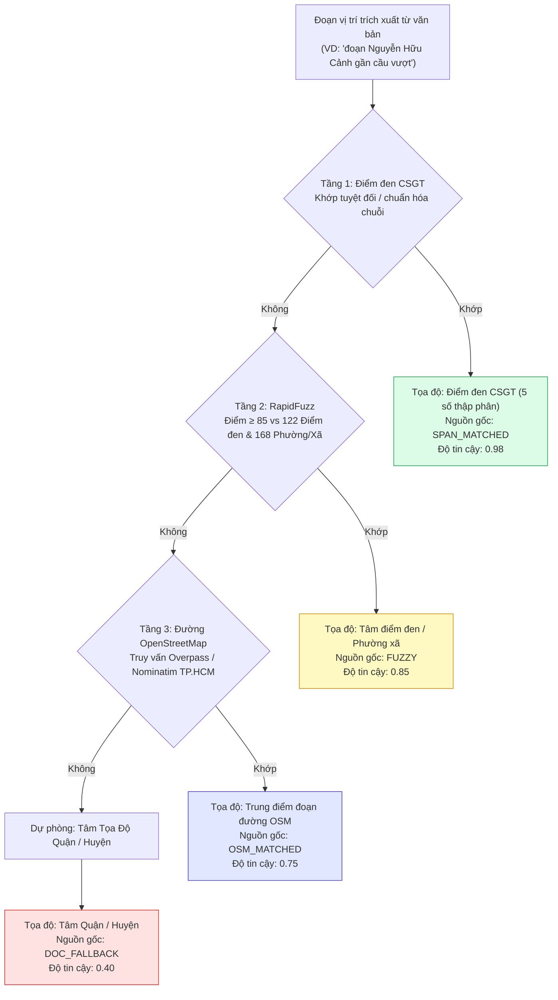
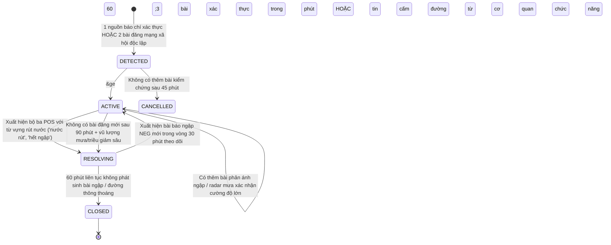
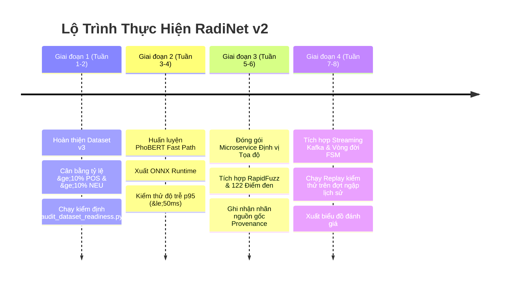

# Kiến Trúc RadiNet v2 & Lộ Trình Triển Khai Huấn Luyện AI
**Phiên bản tài liệu:** 2.0  
**Hệ thống áp dụng:** Hệ thống Thu thập Dữ liệu Thời gian thực, Dịch vụ Trích xuất AI, Xác thực Địa lý (GIS), và Bảng điều khiển Giám sát Ngập lụt RadiNet  
**Thời gian:** Tháng 10/2026  
**Trạng thái:** Bản thiết kế Kiến trúc Chính thức & Sẵn sàng Triển khai  

---

## 1. Đánh Giá Tổng Quan: Sơ Đồ Kiến Trúc Cũ Có Còn Hợp Lệ Không?

### Kết Luận: **CÓ — Hoàn toàn Hợp lệ về mặt Kiến trúc, Nâng cấp 4 Thành phần Cốt lõi (v2)**

Mô hình kiến trúc 6 giai đoạn (Nguồn dữ liệu $\rightarrow$ Thu nạp $\rightarrow$ Trích xuất Đa phương thức $\rightarrow$ Dịch vụ AI Trích xuất $\rightarrow$ Xác thực & Tổng hợp $\rightarrow$ Phục vụ & Trực quan hóa) là **hoàn toàn chính xác, tối ưu về mặt vận hành và bám sát các nghiên cứu chuẩn mực về Social Sensing (Cảm biến Xã hội) trên thế giới**. Thiết kế luồng xử lý kép (Fast Path xử lý văn bản tức thì vs. Slow Path xử lý video đa khung hình và ASR âm thanh), cơ chế kiểm chứng chéo đa tài khoản, đối soát dữ liệu vật lý (mưa/triều cường) và hàng đợi kiểm duyệt bán tự động là mô hình tiêu chuẩn công nghiệp.

Tuy nhiên, từ kết quả rà soát sâu 3.922 mẫu gán nhãn, quy chuẩn quản trị cực tính cảm xúc ASTE và hạ tầng định vị GIS của TP.HCM, **4 mắt xích cụ thể** cần được cập nhật để nâng cấp từ sơ đồ ban đầu lên **Sơ Đồ Kiến Trúc v2 (Bản Đặc tả Sản phẩm & Công bố Khoa học)**:

| Mắt xích (Node) | Sơ đồ v1 (Ban đầu) | Sơ đồ v2 (Nâng cấp) | Lý do Kỹ thuật & Giá trị Học thuật |
| :--- | :--- | :--- | :--- |
| **`TR` (Bộ ba AI trích xuất)** | `street / severity / level` | `aspect + opinion + polarity + category + severity + confidence` | **Tách rời Cực tính khỏi Ngập lụt**: Cực tính thể hiện *thái độ đánh giá* của người viết đối với thực thể (khen trạm bơm/thoát nước vs phàn nàn), không đồng nghĩa với có ngập hay không. Tầng điều hướng phía sau sẽ phụ trách kích hoạt cảnh báo. |
| **`GR` (Định vị Địa lý)** *(Mới)* | *Ngầm định / Chưa rõ ràng* | **Dịch vụ Định vị Địa lý & Xác thực Nguồn gốc (GIS Grounding)**: `rapidfuzz` $\rightarrow$ 122 Điểm đen CSGT $\rightarrow$ 168 Phường/Xã NQ-1685 $\rightarrow$ Bộ nhớ đệm động $\rightarrow$ OSM $\rightarrow$ Tọa độ 5 số thập phân + Nhãn nguồn gốc (`SPAN_MATCHED`, `FUZZY`, `DOC_FALLBACK`) | Đây là thế mạnh cạnh tranh lớn nhất của RadiNet so với các nghiên cứu khác. Mọi thực thể trích xuất bắt buộc phải gắn với tọa độ chuẩn và cấp độ tin cậy địa lý có thể kiểm toán. |
| **`AG` (Bộ tổng hợp Sự kiện)** | Đếm tĩnh `3+ bài / 60 phút` | **Máy Trạng thái Quản lý Vòng đời Sự kiện**: `DETECTED` $\rightarrow$ `ACTIVE` $\rightarrow$ `RESOLVING` $\rightarrow$ `CLOSED` | Tiếp nhận các bộ ba `POS` ("hết ngập", "nước rút") để chuyển trạng thái điểm ngập từ Đang ngập sang Đang rút nước, chuyển màu đường trên bản đồ từ Đỏ sang Xanh, ngăn chặn cảnh báo ảo kéo dài. |
| **`FC` (Chuỗi Dự phòng)** | Danh sách tĩnh: fine-tuned, LLM, rules | **Chuỗi Leo thang Tin cậy Chuẩn hóa**: PhoBERT ONNX ($\le 50\text{ms}$) $\xrightarrow{\text{conf} < 0.70}$ LLM API (Gemini/Qwen) $\xrightarrow{\text{hết giờ}}$ Regex Luật Từ điển | Đảm bảo độ trễ p95 $\le 50\text{ms}$ cho 90%+ lưu lượng streaming, đồng thời xử lý an toàn các bài đăng đa phương thức phức tạp nhờ LLM fallback. |

---

## 2. Sơ Đồ Kiến Trúc RadiNet v2

```mermaid
flowchart TB
    subgraph S1["1 - Nguồn Dữ Liệu (Data Sources)"]
        FB["Facebook<br>bài viết cá nhân + nhóm + fanpage"]
        TT["TikTok<br>luồng video ngập lụt thực tế"]
        NW["Báo chí Chính thống<br>danh sách cấm đường & bản tin triều cường"]
    end

    subgraph S2["2 - Thu Nạp & Xử Lý Luồng (Ingestion)"]
        CR["Bộ Thu Thập (Crawlers)<br>thăm dò chu kỳ 5-15 phút"]
        KQ[["Kafka / Redis Stream<br>hàng đợi & băm chống trùng lặp"]]
    end

    subgraph S3["3 - Trích Xuất Đa Phương Thức (Modality Extraction)"]
        TX["Khai phá Văn bản<br>tiêu đề, chú thích, emoji, bình luận"]
        AU["Xử lý Âm thanh<br>PhoWhisper ASR (16kHz mono)"]
        VI["Xử lý Video<br>OpenCV 0.5 FPS, CLIP top-3 khung hình"]
    end

    subgraph S4["4 - Dịch Vụ AI Trích Xuất (GPU Workers)"]
        FP["Luồng Nhanh Fast Path (&le;50ms)<br>PhoBERT-base Span / Table-Filling"]
        SP["Luồng Chậm Slow Path (~500ms)<br>Hợp nhất Đa phương thức (Text + ASR + Frames)"]
        FC["Chuỗi Dự phòng Bậc thang<br>PhoBERT &rarr; LLM (Gemini/Qwen) &rarr; Regex Luật"]
        TR["Bộ Ba Dữ Liệu Hoàn Chỉnh<br>aspect + opinion + polarity + category + severity + conf"]
    end

    subgraph S5["5 - Định Vị GIS, Xác Thực & Tổng Hợp"]
        PP["Xác Thực Cấp Bài Đăng<br>băm ảnh phash, độ uy tín tài khoản, tem giờ"]
        GR["Định Vị Tọa Độ & Nguồn Gốc (GIS)<br>122 CSGT &bull; 168 đơn vị NQ1685 &bull; OSM<br>xuất (lat, lon) + nhãn provenance"]
        CO["Kiểm Chứng Không - Thời Gian<br>&ge;2 tài khoản độc lập trong bán kính r &le; 500m"]
        PH["Kiểm Tra Tính Hợp Lý Vật Lý<br>radar mưa + mô hình triều cường + tiền nghiệm 122 điểm"]
        AG["Máy Trạng Thái Quản Lý Vòng Đời<br>DETECTED &rarr; ACTIVE &rarr; RESOLVING &rarr; CLOSED"]
    end

    subgraph S6["6 - Phục Vụ & Vận Hành (Serving)"]
        DB[("PostGIS (Không gian) +<br>Elasticsearch (Tìm kiếm)")]
        DA["Bản Đồ Cảnh Báo Trực Tiếp<br>heatmap ngập, đường đỏ/xanh, gợi ý lộ trình"]
        HR["Hàng Đợi Kiểm Duyệt Thủ Công<br>hậu kiểm tọa độ & bài viết tranh chấp"]
    end

    %% Luồng thu nạp
    FB & TT & NW --> CR
    CR --> KQ
    KQ --> TX & AU & VI

    %% Luồng AI
    TX --> FP
    AU & VI --> SP
    FP -->|độ tin cậy &ge; 0.70| TR
    FP -->|độ tin cậy < 0.70 / từ mới| FC
    SP --> FC
    FC --> TR

    %% Luồng xác thực
    TR --> PP
    PP -.->|nghi vấn ảnh cũ / spam| HR
    PP --> GR
    GR --> CO
    CO --> PH
    PH --> AG
    NW -.->|báo chí xác thực (bỏ qua bước chờ)| AG

    %% Luồng phục vụ
    AG --> DB
    DB --> DA
    AG -.->|trường hợp tranh chấp độ tin cậy thấp| HR

    %% Định dạng màu sắc
    style S1 fill:#F8FAFC,stroke:#CBD5E1,stroke-width:1.5px
    style S2 fill:#F8FAFC,stroke:#CBD5E1,stroke-width:1.5px
    style S3 fill:#F8FAFC,stroke:#CBD5E1,stroke-width:1.5px
    style S4 fill:#F0FDF4,stroke:#10B981,stroke-width:2px
    style S5 fill:#EFF6FF,stroke:#3B82F6,stroke-width:2px
    style S6 fill:#F8FAFC,stroke:#CBD5E1,stroke-width:1.5px

    style TR fill:#D1FAE5,stroke:#059669,stroke-width:2px,color:#064E3B
    style GR fill:#DBEAFE,stroke:#2563EB,stroke-width:2px,color:#1E3A8A
    style AG fill:#FEF3C7,stroke:#D97706,stroke-width:2px,color:#78350F
    style DA fill:#EEF2FF,stroke:#4F46E5,stroke-width:2px,color:#1E1B4B
    style HR fill:#FFF7ED,stroke:#EA580C,stroke-width:1.5px,color:#7C2D12
```

---

## 3. Hệ Thống Mô Hình Cơ Sở (Baselines) & Kế Hoạch Huấn Luyện AI

Để đáp ứng cả hai mục tiêu: **(1) Vận hành hệ thống streaming thời gian thực RadiNet** và **(2) Viết bài báo khoa học chuẩn mực quốc tế (với bảng so sánh SOTA thuyết phục)**, hệ thống áp dụng một tổ hợp mô hình cơ sở (Baseline Suite) chuyên biệt.

---

### 3.1 Danh Mục Mô Hình Cơ Sở (Baseline Suite)

| STT | Mô hình Baseline | Nhóm Kiến trúc | Vai trò trong RadiNet | Vai trò trong Bài báo Khoa học | Độ trễ p95 / VRAM |
| :---: | :--- | :--- | :--- | :--- | :--- |
| **B1** | **`vinai/phobert-base-v2`** *(Bắt buộc)* | **Discriminative**<br>(RoBERTa + Span/Table Head) | **Fast Path chính**: Trích xuất bộ ba cực nhanh cho luồng Kafka streaming ($\le 35\text{ms}$) | Đại diện nhóm **Span-based / Table-Filling ASTE** (không hallucination) | $\le 35\text{ms}$ (GPU)<br>$\sim 4\text{ GB}$ VRAM |
| **B2** | **`vinai/bartpho-syllable`** *(Bắt buộc)* | **Generative Seq2Seq**<br>(BART tiếng Việt) | **Slow Path**: Xử lý bài dài, câu ngữ pháp phức tạp, dung hợp text + frames | Đại diện SOTA nhóm **Text-to-Triplet Generative ASTE** | $\sim 280\text{ms}$ (GPU)<br>$\sim 7\text{ GB}$ VRAM |
| **B3** | **`VietAI/vit5-base`** *(Đối trọng)* | **Generative Seq2Seq**<br>(Google T5 tiếng Việt) | Dự phòng kiểm chứng chéo mô hình sinh | **Mô hình đối trọng (Comparative Baseline)** so sánh trực tiếp với BARTpho | $\sim 260\text{ms}$ (GPU)<br>$\sim 6\text{ GB}$ VRAM |
| **B4** | **`Gemini 1.5 Flash` / `Qwen 2.5 7B`** *(Baseline)* | **Large Language Model**<br>(Zero-shot / 5-shot Prompting) | **Tầng Dự phòng (Fallback)**: Kích hoạt khi Fast Path có confidence $< 0.70$ | **LLM Baseline**: Chứng minh mô hình fine-tuned vượt trội hơn LLM tổng quát | $\sim 1.200\text{ms}$ (API)<br>Không tốn GPU |
| **B5** | **`vinai/phowhisper-base`** | **Audio ASR**<br>(Whisper tiếng Việt) | Gỡ băng âm thanh 16kHz từ video TikTok thành văn bản | Đánh giá độ suy hao trích xuất khi văn bản bị lỗi chính tả từ ASR | $\sim 150\text{ms}$ (GPU)<br>$\sim 4\text{ GB}$ VRAM |
| **B6** | **`openai/clip-vit-base-patch32`** | **Vision Encoder**<br>(CLIP ViT-B/32) | Trích xuất vector đặc trưng $512\text{D}$ từ 3 khung hình video tiêu biểu | Cung cấp tín hiệu thị giác đối soát với văn bản trong Slow Path | $\sim 45\text{ms}$ (GPU)<br>$\sim 3\text{ GB}$ VRAM |

---

### 3.2 Đặc Tả Cấu Trúc Dữ Liệu Đầu Vào (Input Schema) & Đầu Ra (Output Schema)

Mỗi họ mô hình trong hệ thống tiếp nhận định dạng dữ liệu và trả về kết quả theo các schema nghiêm ngặt:

#### A. Mô hình Sinh Tuyến Tính Generative ASTE (`BARTpho-syllable` & `ViT5-base`)
*Áp dụng trong mã nguồn: [`finetune/prepare_dataset.py`](file:///home/counting/Workspaces/ryan/RadiNet/finetune/prepare_dataset.py) và [`finetune/train_generative_aste.py`](file:///home/counting/Workspaces/ryan/RadiNet/finetune/train_generative_aste.py)*

* **Input Schema (Đầu vào mô hình)**:
  - **Dạng chuỗi (Text String)**: Văn bản câu văn hoặc phụ đề TikTok đã được chuẩn hóa NFC, loại bỏ URL/hashtag rác.
    ```text
    "<s> Đường Võ Văn Ngân nước chảy như thác đổ, xe máy chết máy dắt bộ bì bõm. </s>"
    ```
  - **Dạng Tensor (PyTorch Input Batch)**:
    - `input_ids`: `torch.LongTensor` kích thước `[batch_size, max_seq_len]`, với `max_seq_len = 256`. Token hóa qua BPE/SentencePiece Tokenizer tương ứng.
    - `attention_mask`: `torch.LongTensor` kích thước `[batch_size, max_seq_len]`, gồm các giá trị `1` (token thật) và `0` (padding token).

* **Output Schema (Đầu ra mô hình)**:
  - **Dạng chuỗi mục tiêu (Target Text String)**: Chuỗi tuyến tính hóa các bộ ba phân cách bởi dấu gạch đứng `|` và dấu chấm phẩy `;`:
    ```text
    "(Võ Văn Ngân | nước chảy như thác đổ | NEG) ; (xe máy | chết máy dắt bộ | NEG)"
    ```
    *Quy tắc*: Nếu văn bản không có bất kỳ bộ ba ngập lụt nào, chuỗi mục tiêu là `"None"`.
  - **Dạng Tensor Huấn luyện (Labels)**:
    - `labels`: `torch.LongTensor` kích thước `[batch_size, max_target_len]`, với `max_target_len = 128`. Các vị trí padding được gán nhãn `-100` để bỏ qua tính Cross-Entropy Loss.
  - **Dạng Cấu trúc Phân giải (Parsed JSON Objects)**: Hàm [`parse_triplets_from_string()`](file:///home/counting/Workspaces/ryan/RadiNet/finetune/inference.py#L24-L65) giải mã chuỗi thành danh sách Python dict:
    ```json
    [
      {
        "aspect": "Võ Văn Ngân",
        "opinion": "nước chảy như thác đổ",
        "polarity": "NEG"
      },
      {
        "aspect": "xe máy",
        "opinion": "chết máy dắt bộ",
        "polarity": "NEG"
      }
    ]
    ```

---

#### B. Mô hình Trích Xuất Dựa Trên Đoạn Văn Span-Based / Table-Filling (`PhoBERT-base-v2` Fast Path)
*Áp dụng cho luồng Streaming thời gian thực: Độ trễ $\le 35\text{ms}$, triệt tiêu 100% ảo giác (zero-hallucination).*

* **Input Schema (Đầu vào mô hình)**:
  - **Văn bản gốc kèm BPE Tokenizer**:
    ```text
    <s> Đường Võ Văn Ngân nước ngập sâu lút bánh xe </s>
    ```
  - **Dạng Tensor**:
    - `input_ids`: `torch.LongTensor [batch_size, seq_len]`.
    - `attention_mask`: `torch.LongTensor [batch_size, seq_len]`.
    - `token_type_ids`: `torch.LongTensor [batch_size, seq_len]` (nếu dùng RoBERTa segment).

* **Output Schema (Đầu ra mô hình)**:
  - **Ma trận Quan hệ Cặp Token (Token-Pair Table Matrix)**: Tensor dự đoán $Y \in \mathbb{R}^{\text{batch\_size} \times L \times L \times C}$, với $L$ là số lượng token trong câu và $C = 6$ lớp nhãn quan hệ:
    - `0: NONE` — Không có quan hệ giữa token $i$ và token $j$.
    - `1: ASPECT` — Đường chéo chính $[i, j]$ đánh dấu biên thực thể (Vị trí bắt đầu $\rightarrow$ kết thúc của Aspect: e.g. `[Võ, Ngân]`).
    - `2: OPINION` — Đường chéo chính $[i, j]$ đánh dấu biên từ ngữ đánh giá (Vị trí của Opinion: e.g. `[ngập, sâu]`).
    - `3: A-O-POS` — Quan hệ có hướng liên kết Aspect $i$ với Opinion $j$ có cực tính Tích cực (POS).
    - `4: A-O-NEU` — Quan hệ có hướng liên kết Aspect $i$ với Opinion $j$ có cực tính Trung tính (NEU).
    - `5: A-O-NEG` — Quan hệ có hướng liên kết Aspect $i$ với Opinion $j$ có cực tính Tiêu cực (NEG).
  - **Dạng Trích xuất Trực tiếp (Span Boundaries Output)**:
    ```python
    {
      "aspect_span": (1, 4),        # Token 1 đến 4: "Võ Văn Ngân"
      "opinion_span": (5, 9),       # Token 5 đến 9: "ngập sâu lút bánh xe"
      "polarity": "NEG",
      "confidence": 0.942           # Xác suất softmax của ô liên kết
    }
    ```
    *Ưu điểm tuyệt đối*: Aspect luôn là chuỗi con chính xác trong văn bản $\rightarrow$ Đưa trực tiếp vào thuật toán tra cứu GIS mà không cần chuẩn hóa lại.

---

#### C. Mô hình Đa Phương Thức Slow Path (`BARTpho` + `CLIP` + `PhoWhisper`)
*Áp dụng cho các video TikTok phức tạp hoặc bài đăng có mâu thuẫn giữa hình ảnh và lời thoại.*

* **Input Schema (Đầu vào đa phương thức)**:
  ```python
  {
      # 1. Văn bản chú thích (Caption/Title)
      "caption_input_ids": torch.LongTensor [batch_size, 128],
      
      # 2. Âm thanh gỡ băng từ PhoWhisper (16kHz audio transcript)
      "asr_input_ids": torch.LongTensor [batch_size, 128],
      
      # 3. Vector nhúng 3 khung hình ngập trích xuất bởi OpenCV + CLIP ViT-B/32
      "visual_embeddings": torch.FloatTensor [batch_size, 3, 512],
      
      # 4. Mặt nạ chú ý đa phương thức (Cross-modal Attention Mask)
      "multimodal_attention_mask": torch.LongTensor [batch_size, 128 + 128 + 3]
  }
  ```

* **Output Schema (Đầu ra đa phương thức)**:
  - Chuỗi bộ ba chuẩn kèm **Điểm Nhất Quán Đa Phương Thức (Cross-modal Veracity Score)**:
    ```python
    {
      "triplets": [
        {"aspect": "Nguyễn Văn Hưởng", "opinion": "ngập sâu bì bõm", "polarity": "NEG"}
      ],
      "cross_modal_metrics": {
        "text_audio_similarity": 0.89,   # Lời thoại trùng khớp nội dung caption
        "visual_flood_confidence": 0.92, # Khung hình thực sự chứa nước ngập và xe máy
        "is_genuine_incident": True      # Xác nhận không phải video ghép cảnh cũ
      }
    }
    ```

---

#### D. Mô hình Ngôn Ngữ Lớn LLM Fallback (`Gemini 1.5 Flash` / `Qwen 2.5 7B`)
*Áp dụng trong Tầng Dự phòng (Fallback Chain) khi Fast Path có confidence $< 0.70$.*

* **Input Schema (Prompt Đầu vào)**:
  - **System Instruction**: Hướng dẫn phân loại theo taxonomy 5 nhóm thực thể, 3 mức nghiêm trọng và quy tắc tách rời cực tính cảm xúc.
  - **User Content**: Đoạn văn bản kèm yêu cầu trả về duy nhất định dạng JSON RFC-8259:
    ```text
    Trích xuất các bộ ba ngập lụt từ câu sau dưới dạng JSON:
    "Đoạn Thảo Điền năm nay lắp máy bơm thấy nước rút nhanh hẳn, bà con ai cũng khen."
    ```

* **Output Schema (JSON Chuẩn theo Schema v3 Đồng Nhất)**:
  ```json
  [
    {
      "aspect": "Thảo Điền",
      "opinion": "nước rút nhanh hẳn",
      "polarity": "POS",
      "aspect_category": "LOCATION_ADMIN",
      "severity": "RECOVERED",
      "grounding_provenance": "SPAN_MATCHED",
      "confidence": 0.96
    }
  ]
  ```

---

### 3.3 Lựa Chọn Kiến Trúc Vận Hành: Fast Path vs. Slow Path

```
                                  Bài Đăng Đầu Vào
                                         │
                         Có phải video/audio không chú thích?
                                   ┌─────┴─────┐
                                  CÓ          KHÔNG
                                   │           │
                                   ▼           ▼
                           [ Luồng Chậm ]  [ Luồng Nhanh ]
                            Multi-Modal    PhoBERT-base
                            Seq2Seq        Span / Table
                            (BARTpho)     (Độ trễ ≤50ms)
```

1. **Luồng Nhanh Fast Path (Xương sống vận hành chính)**:
   - **Mô hình**: `vinai/phobert-base-v2` (B1) kết hợp đầu phân loại cặp token / điền bảng (Span-based Table-Filling).
   - **Đặc tính**: Độ trễ $\le 35\text{ms}$ trên GPU RTX 2080 Ti ($\le 60\text{ms}$ trên ONNX CPU), không sinh ảo tên đường, bảo đảm bảo toàn chuỗi ký tự phục vụ tra cứu GIS.
2. **Luồng Chậm Slow Path (Bài viết phức tạp & Đa phương thức)**:
   - **Mô hình**: `vinai/bartpho-syllable` (B2) kết hợp CLIP ViT-B/32 (B6) và PhoWhisper (B5).
   - **Đặc tính**: Độ trễ $\sim 450\text{ms}$, dùng để phân giải video TikTok không có caption hoặc bài đăng nghi vấn thông tin giả mạo.

---

### 3.4 Chiến Lược Tăng Cường Dữ Liệu & Tối Ưu Huấn Luyện

#### A. Tăng Cường Dữ Liệu Xử Lý Nhiễu Mạng Xã Hội (Facebook, TikTok)
Ngôn ngữ mạng xã hội tại TP.HCM thường gõ tắt, thiếu dấu tiếng Việt, hoặc sử dụng tiếng lóng:
1. **Diacritic Dropout (Xóa dấu ngẫu nhiên)**: Trong quá trình huấn luyện, áp dụng xác suất $20\%$ gỡ bỏ dấu tiếng Việt trên các từ ngẫu nhiên (ví dụ: `Nguyễn Hữu Cảnh` $\rightarrow$ `Nguyen Huu Canh`) giúp mô hình nhận diện chính xác ngay cả khi người dân gõ vội lúc đang chạy xe dưới mưa.
2. **Chuẩn hóa Tiếng lóng (Teencode Normalization)**: Tạo từ điển tiền xử lý ánh xạ các từ ngập lóng phổ biến (`ngâp`, `ngập sml`, `nước tới háng`, `chết máy`, `ngập banh xác`).
3. **Bảo tồn Vector Nhúng Biểu Tượng Cảm Xúc (Emoji Retention)**: Giữ nguyên các emoji đặc trưng (🌊, 🌧️, 🛵, 🏊‍♂️, ⛔) trong bộ từ vựng Tokenizer thay vì biến thành `<unk>`, bởi emoji phản ánh cực kỳ rõ nét mức độ nghiêm trọng của điểm ngập.

#### B. Hàm Mất Mát Đa Nhiệm & Hiệu Chuẩn Điểm Tin Cậy (Temperature Scaling)
```python
# Hàm mất mát kết hợp trích xuất biên thực thể (Aspect/Opinion) và phân loại cực tính (Polarity)
Loss_total = Loss_span_aspect + Loss_span_opinion + alpha * Loss_relation_polarity
```
- **Hiệu chuẩn Xác suất (Temperature Scaling - $T$)**: Hiệu chỉnh phân phối xác suất đầu ra trên tập Validation:
  $$\hat{P}(y|x) = \text{softmax}(z / T)$$
  Việc hiệu chuẩn đảm bảo khi mô hình dự đoán độ tin cậy $0.70$, xác suất chính xác thực nghiệm đúng bằng $70\%$, giúp ngưỡng kích hoạt chuyển giao sang LLM fallback vận hành hoàn toàn chuẩn xác.

---

## 4. Tầng Điều Hướng Quyết Định: Tách Rời Cực Tính Cảm Xúc Khỏi Sự Kiện Ngập

Quy tắc cốt lõi trong tài liệu quản trị là: **Cực tính cảm xúc (Polarity) KHÔNG ĐỒNG NGHĨA với sự xuất hiện của ngập lụt**. Tầng điều hướng sẽ tiếp nhận đầu ra của AI và phân loại hành động nghiệp vụ theo chuẩn Schema v3:

```python
"""
Mô-đun Điều hướng Quyết định RadiNet (Decision Routing Module)
Tách rời thái độ cảm xúc khỏi quy trình kích hoạt cảnh báo ngập lụt trên bản đồ.
Đồng bộ 100% với Schema v3 quy định trong HUONG_DAN_SUA_DATASET_ASTE_V3.md
"""
from dataclasses import dataclass
from typing import Optional, Literal
from enum import Enum

class IncidentSignal(Enum):
    FLOOD_EMERGENCY = "FLOOD_EMERGENCY"       # Báo động Đỏ: ngập sâu, phương tiện chết máy
    FLOOD_WARNING = "FLOOD_WARNING"           # Báo động Vàng: ngập vừa, nước đang dâng
    FLOOD_RESOLVED = "FLOOD_RESOLVED"         # Tín hiệu Xanh: nước đã rút, đường thông thoáng
    INFORMATION_ONLY = "INFORMATION_ONLY"     # Thông tin tham khảo: bản tin triều, dự báo
    IGNORE_SUPPRESS = "IGNORE_SUPPRESS"       # Bỏ qua: tin rác, hỏi bâng quơ, không liên quan

# Tập từ khóa thể hiện nước rút / đường thông
RESOLUTION_KEYWORDS = {
    "hết ngập", "rút hết", "nước rút", "khô ráo", "thông thoáng", 
    "chạy bình thường", "hết kẹt", "đi lại bình thường", "nước đã rút", "khô queo"
}

# Tập từ khóa thể hiện ngập nghiêm trọng
FLOOD_KEYWORDS = {
    "ngập sâu", "ngập nặng", "ngập nửa bánh", "mênh mông", "chết máy",
    "ngập lụt", "dâng cao", "chìm trong biển nước", "ngập lênh láng", "sóng đánh"
}

@dataclass
class TripletResult:
    aspect: str                   # Tên thực thể có thật trong câu (Verbatim Span)
    opinion: str                  # Từ ngữ đánh giá / đo lường
    polarity: Literal["POS", "NEU", "NEG"]  # Cực tính cảm xúc (Thái độ đối với Aspect)
    aspect_category: Literal[     # 5 nhóm thực thể chuẩn Schema v3 (TUYỆT ĐỐI KHÔNG GÁN XE CỘ)
        "LOCATION_STREET",        # Tuyến đường, giao lộ, cầu
        "LOCATION_ADMIN",         # Phường, Quận, Khu vực
        "HYDROLOGY",              # Sông, kênh, rạch, hồ điều tiết
        "INFRASTRUCTURE_DRAINAGE",# Trạm bơm, nắp cống, miệng ga, van ngăn triều
        "RESPONSE_ENTITY"         # Lực lượng ứng trực thoát nước, CSGT điều tiết
    ]
    severity: Literal[            # 4 cấp độ nghiêm trọng chuẩn Schema v3
        "HIGH",                   # Ngập nặng, xe chết máy, tràn vào nhà
        "MEDIUM",                 # Ngập nửa bánh xe, di chuyển khó khăn
        "LOW",                    # Ngập mấp mé vỉa hè, đọng vũng
        "RECOVERED"               # Nước rút hết, đường khô ráo (dành cho POS)
    ]
    grounding_provenance: Literal[
        "SPAN_MATCHED",           # Trùng khớp tuyệt đối tim đường 122 CSGT / OSM
        "FUZZY",                  # Khớp mờ danh bạ / viết tắt (rapidfuzz >= 85)
        "DOC_FALLBACK"            # Fallback tâm Phường/Quận nhắc trong bài viết
    ]
    confidence: float             # Điểm tin cậy [0.0 - 1.0]

def route_triplet_to_signal(t: TripletResult) -> IncidentSignal:
    opinion_clean = t.opinion.lower()
    
    # Quy tắc 1: Tín hiệu giải tỏa (Thái độ POS + từ vựng nước rút / severity RECOVERED)
    # Tín hiệu này chuyển đường từ màu ĐỎ sang màu XANH trên bản đồ
    if t.polarity == "POS" and (t.severity == "RECOVERED" or any(k in opinion_clean for k in RESOLUTION_KEYWORDS)):
        return IncidentSignal.FLOOD_RESOLVED

    # Quy tắc 2: Tình huống ngập khẩn cấp (severity HIGH hoặc từ vựng nghiêm trọng)
    # Ví dụ: "đường ngập 50cm" là câu trung tính (NEU) nhưng là điểm ngập khẩn cấp trên GIS!
    if t.severity == "HIGH" or any(k in opinion_clean for k in FLOOD_KEYWORDS):
        return IncidentSignal.FLOOD_EMERGENCY

    # Quy tắc 3: Cảnh báo mức độ vừa (severity MEDIUM hoặc bài đo đạc NEU có từ ngập)
    if t.severity == "MEDIUM" or (t.polarity == "NEU" and "ngập" in opinion_clean):
        return IncidentSignal.FLOOD_WARNING

    # Quy tắc 4: Thông tin tham khảo (mức thấp hoặc tin dự báo)
    if t.severity == "LOW" or t.polarity == "NEU":
        return IncidentSignal.INFORMATION_ONLY

    # Quy tắc 5: Phàn nàn chung chung không rõ mức độ ngập
    if t.polarity == "NEG":
        if "ngập" in opinion_clean:
            return IncidentSignal.FLOOD_WARNING
        return IncidentSignal.IGNORE_SUPPRESS

    return IncidentSignal.IGNORE_SUPPRESS
```

---

## 5. Quy Trình Định Vị Địa Lý & Xác Thực Nguồn Gốc Tọa Độ (`GR`)

Mọi thực thể vị trí trích xuất từ bài viết đều phải được gán tọa độ vật lý `(vĩ độ, kinh độ)` kèm theo nhãn nguồn gốc (provenance) để đảm bảo tính minh bạch:



### 3 Cấp Độ Nguồn Gốc Tọa Độ (Grounding Provenance) Chuẩn Hóa Schema v3
1. **`SPAN_MATCHED`**: Trùng khớp chuẩn xác từng ký tự (Verbatim Span) trong văn bản với 122 điểm đen CSGT hoặc tuyến đường trên OpenStreetMap TP.HCM (Độ tin cậy: 0.85 – 0.98).
2. **`FUZZY`**: Khớp mờ danh bạ hoặc từ viết tắt/sai chính tả (ví dụ: *"TXS"* $\rightarrow$ *"Trần Xuân Soạn"*, độ tương đồng Levenshtein $\ge 85\%$) (Độ tin cậy: 0.75 – 0.85).
3. **`DOC_FALLBACK`**: Bài viết không nêu tên đường cụ thể (*"Khu tôi nước ngập lút bánh"*), gán tọa độ tâm Phường/Xã hoặc Quận theo ngữ cảnh bài viết (Độ tin cậy: 0.40 – 0.65).

---

## 6. Máy Trạng Thái Quản Lý Vòng Đời Sự Kiện Ngập Lụt (`AG`)

Thay vì chỉ đếm bài viết tĩnh ("3 bài trong 60 phút"), RadiNet v2 quản lý sự kiện theo **Máy Trạng Thái Hữu Hạn (FSM)** cho từng bán kính địa lý ($r = 500\text{m}$):



### Quy Tắc Chuyển Trạng Thái:
- **Ngưỡng kiểm chứng độc lập**: Cần tối thiểu 2 tài khoản người dùng khác nhau hoặc 1 cơ quan báo chí chính thống (`VnExpress`, `Tuổi Trẻ`, `Thanh Niên`) để đưa sự kiện từ `DETECTED` lên `ACTIVE`.
- **Cơ chế chuyển màu từ Đỏ sang Xanh**: Khi một bài đăng `POS` ("đường Nguyễn Hữu Cảnh nước đã rút hết") xuất hiện tại khu vực đang có sự kiện `ACTIVE`:
  - Sự kiện lập tức chuyển sang trạng thái `RESOLVING`.
  - Trên Dashboard, biểu tượng chuyển sang trạng thái Nhấp nháy Xanh/Vàng ("Đang rút nước").
  - Nếu sau 30 phút theo dõi không có bài đăng `NEG` nào phản ánh ngập lại, tuyến đường chính thức chuyển sang màu Xanh (`CLOSED`).

---

## 7. Lộ Trình Triển Khai & Checklist Kỹ Thuật Chi Tiết

Để đưa hệ thống RadiNet từ mã nguồn hiện tại đến phiên bản v2 hoàn chỉnh sẵn sàng công bố bài báo khoa học và vận hành thực tế, dưới đây là 4 giai đoạn cụ thể:



### Giai đoạn 1: Chuẩn hóa Dữ liệu v3 (Tầng Dữ Liệu)
- [ ] Chạy script `python scripts/crawl_targeted_pos.py` để cào bổ sung 500+ mẫu `POS` từ các bài báo khánh thành cống thoát nước, nạo vét kênh rạch, nước rút nhanh.
- [ ] Cân bằng phân phối nhãn đạt tối thiểu **10% POS** và **10% NEU** trong file `hcmc_flood_annotated_v3.json`.
- [ ] Rà soát tự động đảm bảo 100% không còn hiện tượng dính từ thừa (prepositional noise) bằng công cụ `scripts/audit_dataset_readiness.py`.

### Giai đoạn 2: Huấn luyện Mô Hình AI & Tối Ưu Tốc Độ (Tầng AI)
- [ ] Cập nhật file `finetune/prepare_dataset.py` để hỗ trợ định dạng nhãn Token Classification / Span-based Table-Filling.
- [ ] Huấn luyện `vinai/phobert-base-v2` với kỹ thuật Diacritic Dropout ($p=0.20$) trên GPU.
- [ ] Xuất mô hình sang định dạng **ONNX Runtime** với tối ưu FP16 để bảo đảm độ trễ dưới 50ms khi xử lý luồng streaming.
- [ ] Thực hiện hiệu chuẩn xác suất (Temperature Scaling) để lấy điểm `confidence` chuẩn.

### Giai đoạn 3: Tích hợp Định Vị Địa Lý & Tầng Điều Hướng (Tầng Lõi Nghiệp Vụ)
- [ ] Đóng gói kịch bản [`demo_extract_street_coordinates.py`](file:///home/counting/Workspaces/ryan/RadiNet/scripts/demo_extract_street_coordinates.py) thành lớp dịch vụ `GeoGroundingService`.
- [ ] Tích hợp logic `route_triplet_to_signal` vào tiến trình xử lý đầu ra của mô hình AI.
- [ ] Xây dựng cây tìm kiếm không gian KD-Tree cho 122 điểm đen CSGT để tối ưu tốc độ tra cứu tọa độ.

### Giai đoạn 4: Vận Hành Streaming & Tái Hiện Thực Nghiệm (Tầng Hệ Thống & Bài Báo)
- [ ] Kết nối hàng đợi Kafka Ingestion với nhóm tiến trình xử lý GPU Fast Path.
- [ ] Lưu trữ và cập nhật trạng thái FSM của các điểm ngập trên Redis / PostGIS.
- [ ] Thực hiện thực nghiệm **Episode Replay Evaluation** trên các đợt ngập lịch sử (Đợt bão Yagi tháng 09/2024, đợt triều cường rằm tháng 9 Âm lịch năm 2024).
- [ ] Đo lường độ phủ không gian (Spatial Recall) đối chiếu với danh sách cấm đường trên báo chính thống và tính Macro-F1 trên cả 3 lớp cảm xúc (NEG, NEU, POS).

---

## 8. Danh Mục Mã Nguồn & Công Cụ Tham Chiếu

- **Kiểm định dữ liệu**: [`RadiNet/scripts/audit_dataset_readiness.py`](file:///home/counting/Workspaces/ryan/RadiNet/scripts/audit_dataset_readiness.py)
- **Chuẩn bị tập huấn luyện**: [`RadiNet/finetune/prepare_dataset.py`](file:///home/counting/Workspaces/ryan/RadiNet/finetune/prepare_dataset.py)
- **Huấn luyện mô hình cơ sở**: [`RadiNet/finetune/train_generative_aste.py`](file:///home/counting/Workspaces/ryan/RadiNet/finetune/train_generative_aste.py)
- **Trích xuất tọa độ địa lý**: [`RadiNet/scripts/demo_extract_street_coordinates.py`](file:///home/counting/Workspaces/ryan/RadiNet/scripts/demo_extract_street_coordinates.py)
- **Trích xuất khung hình TikTok**: [`RadiNet/scripts/extract_tiktok_frames.py`](file:///home/counting/Workspaces/ryan/RadiNet/scripts/extract_tiktok_frames.py)
- **Đặc tả quy chuẩn cực tính cảm xúc**: [`RadiNet/documents/ASTE_POLARITY_AND_ASPECT_SPECIFICATION.md`](file:///home/counting/Workspaces/ryan/RadiNet/documents/ASTE_POLARITY_AND_ASPECT_SPECIFICATION.md)
