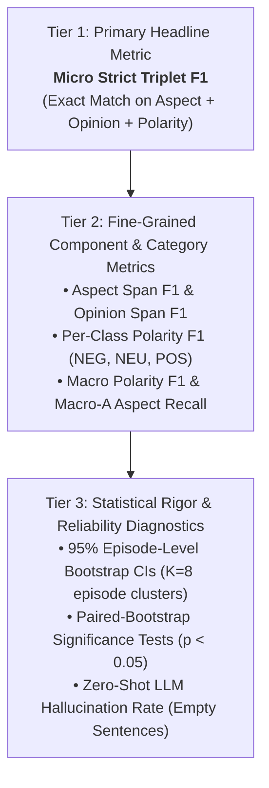

# Mathematical Formulations and Evaluation Protocol for ASTE Benchmark

> **Document Version:** 1.0  
> **Target Problem:** Aspect-Sentiment-Opinion Triplet Extraction (ASTE)  
> **Dataset:** HCMC Urban Flood ASTE Dataset V3  
> **Evaluation Partition:** Test Split ($N = 462$ sentences, $636$ gold triplets across 8 disaster episode clusters / 70 independent event dates)  
> **Benchmark Reference:** [`AI/results/BENCHMARK_TABLE.md`](file:///home/counting/Workspaces/ryan/RadiNet/AI/results/BENCHMARK_TABLE.md)  
> **Code Implementation:** [`scripts/benchmark_heuristic_baseline.py`](file:///home/counting/Workspaces/ryan/RadiNet/scripts/benchmark_heuristic_baseline.py#L49-L54)

---

## 1. Formal Problem Definition

Let an input crisis document (sentence or social media post) be represented as an ordered sequence of $n$ tokens:
$$S = (w_1, w_2, \dots, w_n)$$

The goal of Aspect-Sentiment-Opinion Triplet Extraction (ASTE) is to extract a set of sentiment triplets:
$$\mathcal{T} = \{T_1, T_2, \dots, T_k\}$$

Each triplet $T_k$ is a 3-tuple:
$$T_k = (A_k,\, O_k,\, P_k)$$

where:
1. **Aspect Term ($A_k$):** A continuous token span $S[s_a : e_a]$ identifying the disaster entity, geographic location, or infrastructure element (e.g., *"đường Nguyễn Hữu Cảnh"*, *"cống thoát nước"*, *"triều cường"*).
2. **Opinion Term ($O_k$):** A continuous token span $S[s_o : e_o]$ expressing an evaluation, state, or description of the aspect (e.g., *"ngập sâu"*, *"tắc nghẽn"*, *"nước rút hết"*).
3. **Sentiment Polarity ($P_k$):** A categorical sentiment label:
   $$P_k \in \{\text{NEG}, \text{POS}, \text{NEU}\}$$
   * $\text{NEG}$ (Negative): Flooding, vehicle stalling, traffic jams, severe water logging.
   * $\text{POS}$ (Positive): Water receded, clear roads, functional pumps, flood prevention success.
   * $\text{NEU}$ (Neutral): Factual water level measurements, tidal forecasts, objective reports.

---

## 2. Metric Hierarchy in the RadiNet Benchmark

The benchmark establishes a clear 3-tiered evaluation hierarchy:



---

## 3. Tier 1: Strict Exact-Match Triplet Metrics (Primary)

### 3.1 Definition of "Strict Match" and Canonicalization Pipeline

Under standard academic ASTE benchmark protocols (Peng et al., 2020; Xu et al., 2020; SemEval-2014 Task 4), evaluation is performed **strictly on a per-sentence basis**. 

To guarantee reproducibility and eliminate encoding/formatting artifacts, all string spans (both gold targets and model predictions) undergo an identical **Canonicalization Pipeline** $\pi(\cdot)$ before evaluation:

$$\pi(x) = \text{case\_fold}\Big(\text{collapse\_internal\_whitespace}\big(\text{strip}\big(\text{unicodedata.normalize}(\text{"NFC"},\, x)\big)\big)\Big)$$

1. **Unicode NFC Normalization:** Resolves Vietnamese combining accents (converting decomposed NFD characters into standard precomposed NFC codepoints).
2. **Whitespace Stripping & Internal Collapse:** Strips leading/trailing spaces and collapses consecutive whitespace (`\s+`) into a single space.
3. **Case-Folding:** Case-folds all characters to lowercase to evaluate semantic span extraction independently of capitalization casing.

A predicted triplet $\hat{T} = (\hat{A}, \hat{O}, \hat{P})$ for a sentence $s$ is counted as a **True Positive (TP)** if and only if **all three components simultaneously match** an unassigned gold triplet $T^* = (A^*, O^*, P^*)$ in the same sentence $s$:

$$\hat{T} \in \mathcal{G}(s) \iff \left( \pi(\hat{A}) == \pi(A^*) \right) \;\land\; \left( \pi(\hat{O}) == \pi(O^*) \right) \;\land\; \left( \hat{P} == P^* \right)$$

* No partial credit is awarded for overlapping spans or 2-out-of-3 component matches.

### 3.2 Formal Mathematical Formulas (Per-Sentence Matching, Multiset Aggregation)

Let:
* $\mathcal{S}$ be the set of all test sentences ($|\mathcal{S}| = 462$).
* $\mathcal{G}(s)$ be the set of gold triplets for sentence $s$.
* $\mathcal{P}(s)$ be the set of predicted triplets for sentence $s$.
* $\mathcal{G} = \biguplus_{s \in \mathcal{S}} \mathcal{G}(s)$ be the multiset collection of all gold triplets across the test partition ($|\mathcal{G}| = 636$).
* $\mathcal{P} = \biguplus_{s \in \mathcal{S}} \mathcal{P}(s)$ be the multiset collection of all predicted triplets ($|\mathcal{P}| = N_{\text{pred}}$).

The evaluation aggregates matching counts across all sentences:

$$\text{TP}_{\text{strict}} = \sum_{s \in \mathcal{S}} \big| \mathcal{P}(s) \cap \mathcal{G}(s) \big|$$

$$\text{FP}_{\text{strict}} = |\mathcal{P}| - \text{TP}_{\text{strict}} = \sum_{s \in \mathcal{S}} \big( |\mathcal{P}(s)| - |\mathcal{P}(s) \cap \mathcal{G}(s)| \big)$$

$$\text{FN}_{\text{strict}} = |\mathcal{G}| - \text{TP}_{\text{strict}} = \sum_{s \in \mathcal{S}} \big( |\mathcal{G}(s)| - |\mathcal{P}(s) \cap \mathcal{G}(s)| \big)$$

From these counts, the three core metrics are computed:

$$\textbf{Strict Precision (P)} = \frac{\text{TP}_{\text{strict}}}{|\mathcal{P}|} = \frac{\text{TP}_{\text{strict}}}{\text{TP}_{\text{strict}} + \text{FP}_{\text{strict}}}$$

$$\textbf{Strict Recall (R)} = \frac{\text{TP}_{\text{strict}}}{|\mathcal{G}|} = \frac{\text{TP}_{\text{strict}}}{\text{TP}_{\text{strict}} + \text{FN}_{\text{strict}}}$$

$$\textbf{Strict Triplet F1} = \frac{2 \cdot \text{P} \cdot \text{R}}{\text{P} + \text{R}} = \frac{2 \cdot \text{TP}_{\text{strict}}}{2 \cdot \text{TP}_{\text{strict}} + \text{FP}_{\text{strict}} + \text{FN}_{\text{strict}}}$$

*Edge cases:* If $|\mathcal{P}| = 0$, $\text{Precision} = 0.0$. If $|\mathcal{G}| = 0$, $\text{Recall} = 0.0$. If $\text{P} + \text{R} = 0$, $\text{F1} = 0.0$.

---

## 4. Tier 2: Span Boundary & Polarity Component Metrics

### 4.1 Aspect Span Extraction Metrics (`A-F1`)
Measures the model's ability to locate flood-related entities within each sentence, evaluated as sentence-unique mentions aggregated as a multiset:

$$\mathcal{G}_{\text{aspect}}(s) = \{ \pi(A) \mid (A, O, P) \in \mathcal{G}(s) \}, \quad \mathcal{P}_{\text{aspect}}(s) = \{ \pi(\hat{A}) \mid (\hat{A}, \hat{O}, \hat{P}) \in \mathcal{P}(s) \}$$

$$\text{TP}_{\text{asp}} = \sum_{s \in \mathcal{S}} \big| \mathcal{P}_{\text{aspect}}(s) \cap \mathcal{G}_{\text{aspect}}(s) \big|$$

$$\text{P}_{\text{asp}} = \frac{\text{TP}_{\text{asp}}}{\sum_{s} |\mathcal{P}_{\text{aspect}}(s)|}, \quad \text{R}_{\text{asp}} = \frac{\text{TP}_{\text{asp}}}{\sum_{s} |\mathcal{G}_{\text{aspect}}(s)|}, \quad \textbf{Aspect F1} = \frac{2 \cdot \text{P}_{\text{asp}} \cdot \text{R}_{\text{asp}}}{\text{P}_{\text{asp}} + \text{R}_{\text{asp}}}$$

### 4.2 Opinion Span Extraction Metrics (`O-F1`)
Measures the model's ability to locate flood sentiment and condition expressions per sentence:

$$\mathcal{G}_{\text{opinion}}(s) = \{ \pi(O) \mid (A, O, P) \in \mathcal{G}(s) \}, \quad \mathcal{P}_{\text{opinion}}(s) = \{ \pi(\hat{O}) \mid (\hat{A}, \hat{O}, \hat{P}) \in \mathcal{P}(s) \}$$

$$\text{TP}_{\text{opi}} = \sum_{s \in \mathcal{S}} \big| \mathcal{P}_{\text{opinion}}(s) \cap \mathcal{G}_{\text{opinion}}(s) \big|$$

$$\text{P}_{\text{opi}} = \frac{\text{TP}_{\text{opi}}}{\sum_{s} |\mathcal{P}_{\text{opinion}}(s)|}, \quad \text{R}_{\text{opi}} = \frac{\text{TP}_{\text{opi}}}{\sum_{s} |\mathcal{G}_{\text{opinion}}(s)|}, \quad \textbf{Opinion F1} = \frac{2 \cdot \text{P}_{\text{opi}} \cdot \text{R}_{\text{opi}}}{\text{P}_{\text{opi}} + \text{R}_{\text{opi}}}$$

---

### 4.3 Per-Class Polarity F1 (`NEG`, `NEU`, `POS`)

Within each sentence $s$, triplets are partitioned by polarity $c \in \{\text{NEG}, \text{NEU}, \text{POS}\}$:

$$\mathcal{G}_c(s) = \{ (A, O, P) \in \mathcal{G}(s) \mid P = c \}, \quad \mathcal{P}_c(s) = \{ (\hat{A}, \hat{O}, \hat{P}) \in \mathcal{P}(s) \mid \hat{P} = c \}$$

For each class $c$:
$$\text{TP}_c = \sum_{s \in \mathcal{S}} \big| \mathcal{P}_c(s) \cap \mathcal{G}_c(s) \big|$$
$$\text{P}_c = \frac{\text{TP}_c}{\sum_{s} |\mathcal{P}_c(s)|}, \quad \text{R}_c = \frac{\text{TP}_c}{\sum_{s} |\mathcal{G}_c(s)|}, \quad \textbf{F1}_c = \frac{2 \cdot \text{P}_c \cdot \text{R}_c}{\text{P}_c + \text{R}_c}$$

**Test Class Support in HCMC Flood V3:**
* $\text{NEG}: n = 424$ ($66.7\%$)
* $\text{POS}: n = 141$ ($22.2\%$)
* $\text{NEU}: n = 71$ ($11.2\%$)
*(All classes satisfy $n \ge 30$, ensuring stable harmonic mean estimation).*

---

### 4.4 Macro Polarity F1 (`Macro-Pol`)

Because crisis datasets are naturally skewed towards negative reports (floods causing damage), standard micro-averaged F1 can be artificially inflated by a model that only predicts `NEG`. 

The **Macro Polarity F1** is the unweighted arithmetic mean across all three polarity classes:

$$\textbf{Macro Polarity F1} = \frac{\text{F1}_{\text{NEG}} + \text{F1}_{\text{NEU}} + \text{F1}_{\text{POS}}}{3}$$

*Significance:* A model cannot achieve a high Macro Polarity F1 without effectively learning the underrepresented positive and neutral situations.

---

### 4.5 Taxonomic Category Recall & F1 (`Macro-A`)

To understand domain-specific performance, the benchmark evaluates Aspect Extraction across the 5 primary taxonomic classes:

$$\mathcal{C} = \{\text{LOC-STREET}, \text{LOC-ADMIN}, \text{HYDRO}, \text{DRAINAGE}, \text{AUTH-RESP}\}$$

For each category $c \in \mathcal{C}$, let $\mathcal{G}_{\text{asp}, c}(s)$ be the set of aspect spans in sentence $s$ labeled with category $c$:
$$\text{TP}_{\text{asp}, c} = \sum_{s \in \mathcal{S}} \big| \mathcal{P}_{\text{aspect}}(s) \cap \mathcal{G}_{\text{asp}, c}(s) \big|$$

$$\textbf{Recall}(c) = \frac{\text{TP}_{\text{asp}, c}}{\sum_{s \in \mathcal{S}} |\mathcal{G}_{\text{asp}, c}(s)|}, \quad \textbf{Precision}(c) = \frac{\text{TP}_{\text{asp}, c}}{\sum_{s \in \mathcal{S}} |\mathcal{P}_{\text{asp}, c}(s)|}, \quad \textbf{F1}(c) = \frac{2 \cdot \text{P}_c \cdot \text{R}_c}{\text{P}_c + \text{R}_c}$$

The **Macro-A Aspect Recall** summarizes recall across the taxonomy:

$$\textbf{Macro-A} = \frac{1}{|\mathcal{C}|} \sum_{c \in \mathcal{C}} \text{Recall}(c)$$

---

## 5. Tier 3: Statistical Rigor & Diagnostic Metrics

### 5.1 Episode-Level Bootstrap Resampling (Confidence Intervals)

* **Problem with Sentence-Level Bootstrapping:** Social crisis posts gathered during the same disaster episode exhibit strong **spatial-temporal autocorrelation** (e.g., multiple tweets referencing Typhoon No. 4 in September 2026). Resampling individual sentences violates the independent and identically distributed (i.i.d.) assumption and yields artificially narrow confidence intervals.
* **Solution (Episode-Level Resampling):**
  1. Let the test set be composed of $K = 8$ discrete disaster episode clusters (spanning 70 event dates):
     $$\mathcal{E} = \{E_1, E_2, \dots, E_K\}$$
  2. For $b = 1, \dots, B$ iterations ($B = 10,000$):
     * Sample $K$ episodes with replacement: $\mathcal{E}^{(b)} = \{E^*_{b,1}, \dots, E^*_{b,K}\}$.
     * Aggregate all test sentences belonging to the sampled episodes.
     * Compute the metrics $\theta_{\text{strict}}^{(b)} = \text{Strict-F1}(\mathcal{E}^{(b)})$ and $\theta_{\text{macro}}^{(b)} = \text{Macro-Pol-F1}(\mathcal{E}^{(b)})$.
  3. Sort the bootstrap distribution $\theta^{(1)} \le \theta^{(2)} \le \dots \le \theta^{(B)}$.
  4. The 95% Confidence Interval is given by the empirical percentiles:
     $$\text{CI}_{95\%} = \left[ \theta_{(0.025 \cdot B)},\; \theta_{(0.975 \cdot B)} \right]$$

---

### 5.2 Directional Paired-Bootstrap Hypothesis Testing with Continuity Correction

To evaluate whether the observed improvements in Contrast **C2** ($\text{PhoBERT} \leftrightarrow \text{XLM-R}$) and Contrast **C3** ($\text{XLM-R} \leftrightarrow \text{XLM-V}$) are statistically significant:

* **Pre-registered Directional Hypotheses:** One-tailed testing is adopted because the research questions are directional:
  * $H_{1, \text{C2}}$: Multilingual web-crawl pretraining outperforms Vietnamese-specific news pretraining on informal crisis text ($\text{F1}_{\text{XLM-R}} > \text{F1}_{\text{PhoBERT}}$).
  * $H_{1, \text{C3}}$: 1M-token vocabulary outperforms 250k vocabulary on subword coverage ($\text{F1}_{\text{XLM-V}} > \text{F1}_{\text{XLM-R}}$).
* For each bootstrap replicate $\mathcal{E}^{(b)}$, compute the performance difference:
  $$\Delta \text{F1}^{(b)} = \text{F1}_{\text{Model 2}}(\mathcal{E}^{(b)}) - \text{F1}_{\text{Model 1}}(\mathcal{E}^{(b)})$$
* **Koehn (2004) Continuity Correction:** To avoid reporting an unrounded $p = 0.0000$ when no bootstrap replicate violates the condition, we apply the standard Koehn (2004) continuity correction:
  $$p = \frac{1 + \sum_{b=1}^B \mathbb{I}\left( \Delta \text{F1}^{(b)} \le 0 \right)}{B + 1}$$
* With $B = 10,000$, the minimum reportable $p$-value is $p < 0.0001$. Improvements with $p < 0.05$ are marked as statistically significant ($*$).

---

### 5.3 Zero-Shot LLM Hallucination Count Diagnostic

Evaluates the susceptibility of Large Language Models to over-generate triplets on non-flood or benign sentences.

Let $\mathcal{S}_{\text{empty}} \subset \mathcal{S}_{\text{test}}$ be the subset of test sentences containing exactly zero gold triplets ($|\mathcal{G}(s)| = 0$, $N_{\text{empty}} = 4$ in the test split; $99.1\%$ of the test set contains active crisis mentions):

$$\textbf{Hallucination Count} = \sum_{s \in \mathcal{S}_{\text{empty}}} \mathbb{I}(|\mathcal{P}(s)| > 0) \quad \text{out of } |\mathcal{S}_{\text{empty}}| \text{ empty sentences}$$

* **Empirical Observations:**
  * Gemma-4-26B: **1 of 4 empty sentences** ($25.0\%$) emitted hallucinated triplets.
  * Qwen3.8-27B: **1 of 4 empty sentences** ($25.0\%$) emitted hallucinated triplets.
  * Fine-Tuned mT5 / BARTpho: **0 of 4 empty sentences** ($0.0\%$) emitted hallucinations.
  2. For $b = 1, \dots, B$ iterations ($B = 10,000$):
     * Sample $K$ episodes with replacement: $\mathcal{E}^{(b)} = \{E^*_{b,1}, \dots, E^*_{b,K}\}$.
     * Aggregate all test sentences belonging to the sampled episodes.
     * Compute the metric $\theta^{(b)} = \text{Strict-F1}(\mathcal{E}^{(b)})$.
  3. Sort the bootstrap distribution $\theta^{(1)} \le \theta^{(2)} \le \dots \le \theta^{(B)}$.
  4. The 95% Confidence Interval is given by the empirical percentiles:
     $$\text{CI}_{95\%} = \left[ \theta_{(0.025 \cdot B)},\; \theta_{(0.975 \cdot B)} \right]$$

---

### 5.2 Paired-Bootstrap Hypothesis Testing for Headline Contrasts

To evaluate whether the observed improvements in Contrast **C2** ($\text{PhoBERT} \leftrightarrow \text{XLM-R}$) and Contrast **C3** ($\text{XLM-R} \leftrightarrow \text{XLM-V}$) are statistically significant:

* For each bootstrap replicate $\mathcal{E}^{(b)}$, compute the performance difference between Model 1 and Model 2:
  $$\Delta \text{F1}^{(b)} = \text{F1}_{\text{Model 2}}(\mathcal{E}^{(b)}) - \text{F1}_{\text{Model 1}}(\mathcal{E}^{(b)})$$
* The one-tailed paired-bootstrap $p$-value is:
  $$p = \frac{1}{B} \sum_{b=1}^B \mathbb{I}\left( \Delta \text{F1}^{(b)} \le 0 \right)$$
* If $p < 0.05$, the improvement is marked as statistically significant ($*$).

---

### 5.3 Zero-Shot LLM Hallucination Rate (`HR`)

Evaluates the susceptibility of Large Language Models to over-generate triplets on benign, informative, or non-flood sentences.

Let $\mathcal{S}_{\text{empty}} \subset \mathcal{S}_{\text{test}}$ be the subset of test sentences containing exactly zero gold triplets ($|\mathcal{G}(s)| = 0$, $N_{\text{empty}} = 4$ in test split):

$$\textbf{Hallucination Rate (HR)} = \frac{\sum_{s \in \mathcal{S}_{\text{empty}}} \mathbb{I}(|\mathcal{P}(s)| > 0)}{|\mathcal{S}_{\text{empty}}|} \times 100\%$$

* **Observed Empirical Value:**
  * Gemma-4-26B: $1/4 = \mathbf{25.0\%}$
  * Qwen3.8-27B: $1/4 = \mathbf{25.0\%}$
  * Fine-Tuned mT5 / BARTpho: $0/4 = \mathbf{0.0\%}$

---

## 6. Comprehensive Numerical Walkthrough

Consider a miniature test evaluation containing 2 sentences:

### Test Sentence 1:
> *"Đường Nguyễn Hữu Cảnh ngập sâu, nhiều xe máy chết máy."*
* **Gold Triplets ($\mathcal{G}_1$):**
  * $G_1 = (\text{"Nguyễn Hữu Cảnh"},\, \text{"ngập sâu"},\, \text{NEG})$
  * $G_2 = (\text{"xe máy"},\, \text{"chết máy"},\, \text{NEG})$

### Test Sentence 2:
> *"Khu vực cầu vượt Hàng Xanh đã thông thoáng trở lại."*
* **Gold Triplets ($\mathcal{G}_2$):**
  * $G_3 = (\text{"cầu vượt Hàng Xanh"},\, \text{"thông thoáng"},\, \text{POS})$

**Total Gold Set:** $|\mathcal{G}| = 3$ triplets ($\text{NEG} = 2$, $\text{POS} = 1$, $\text{NEU} = 0$).

---

### Model Predictions:
* On Sentence 1:
  * $P_1 = (\text{"Nguyễn Hữu Cảnh"},\, \text{"ngập sâu"},\, \text{NEG}) \rightarrow$ Exact Match with $G_1$ $\Rightarrow$ **TP**
  * $P_2 = (\text{"đường Nguyễn Hữu Cảnh"},\, \text{"ngập"},\, \text{NEG}) \rightarrow$ Boundary mismatch on both terms $\Rightarrow$ **FP**
  * $P_3 = (\text{"xe máy"},\, \text{"chết máy"},\, \text{NEG}) \rightarrow$ Exact Match with $G_2$ $\Rightarrow$ **TP**
* On Sentence 2:
  * $P_4 = (\text{"cầu vượt Hàng Xanh"},\, \text{"thông thoáng"},\, \text{NEU}) \rightarrow$ Polarity mismatch (`NEU` vs `POS`) $\Rightarrow$ **FP**

**Total Predictions:** $|\mathcal{P}| = 4$ triplets.

---

### Metric Computation:
1. **Counts:**
   * $\text{TP}_{\text{strict}} = 2$ ($P_1, P_3$)
   * $\text{FP}_{\text{strict}} = 2$ ($P_2, P_4$)
   * $\text{FN}_{\text{strict}} = 1$ ($G_3$ was missed due to polarity error)

2. **Strict Metrics:**
   $$\text{Precision} = \frac{2}{4} = 50.00\%$$
   $$\text{Recall} = \frac{2}{3} = 66.67\%$$
   $$\textbf{Strict Triplet F1} = \frac{2 \cdot \text{P} \cdot \text{R}}{\text{P} + \text{R}} = \frac{2 \times 50.00\% \times 66.67\%}{50.00\% + 66.67\%} = \mathbf{57.14\%}$$

3. **Per-Class Polarity F1:**
   * **NEG:** $\text{Gold} = 2$, $\text{Pred} = 3$, $\text{TP} = 2$.
     $$\text{P}_{\text{NEG}} = \frac{2}{3} = 66.67\%, \quad \text{R}_{\text{NEG}} = \frac{2}{2} = 100.0\%, \quad \text{F1}_{\text{NEG}} = \mathbf{80.00\%}$$
   * **POS:** $\text{Gold} = 1$, $\text{Pred} = 0$, $\text{TP} = 0$.
     $$\text{F1}_{\text{POS}} = \mathbf{0.00\%}$$
   * **NEU:** $\text{Gold} = 0$, $\text{Pred} = 1$, $\text{TP} = 0$.
     $$\text{F1}_{\text{NEU}} = \mathbf{0.00\%}$$

4. **Macro Polarity F1:**
   $$\textbf{Macro Polarity F1} = \frac{80.00\% + 0.00\% + 0.00\%}{3} = \mathbf{26.67\%}$$

*(Notice how Macro Polarity F1 correctly exposes the model's inability to recognize positive states, dropping from 57.14% down to 26.67%).*

---

## 7. Python Implementation Reference

The formulas above are implemented programmatically in the benchmark evaluation suite as follows:

```python
from typing import Tuple, Dict, Any, Set

def prf(gold: int, pred: int, correct: int) -> Tuple[float, float, float]:
    """Calculate Precision, Recall, and F1 with division-by-zero protection."""
    p = (correct / pred * 100) if pred > 0 else 0.0
    r = (correct / gold * 100) if gold > 0 else 0.0
    f = (2 * p * r / (p + r)) if (p + r) > 0 else 0.0
    return round(p, 2), round(r, 2), round(f, 2)

def evaluate_aste_strict(
    gold_triplets_per_sample: list[Set[Tuple[str, str, str]]],
    pred_triplets_per_sample: list[Set[Tuple[str, str, str]]]
) -> Dict[str, Any]:
    n_gold = sum(len(g) for g in gold_triplets_per_sample)
    n_pred = sum(len(p) for p in pred_triplets_per_sample)
    n_correct = sum(len(g.intersection(p)) for g, p in zip(gold_triplets_per_sample, pred_triplets_per_sample))

    p, r, f1 = prf(n_gold, n_pred, n_correct)
    return {
        "Strict_Precision": p,
        "Strict_Recall": r,
        "Strict_F1": f1,
        "Gold_Count": n_gold,
        "Pred_Count": n_pred,
        "Correct_Count": n_correct
    }
```
