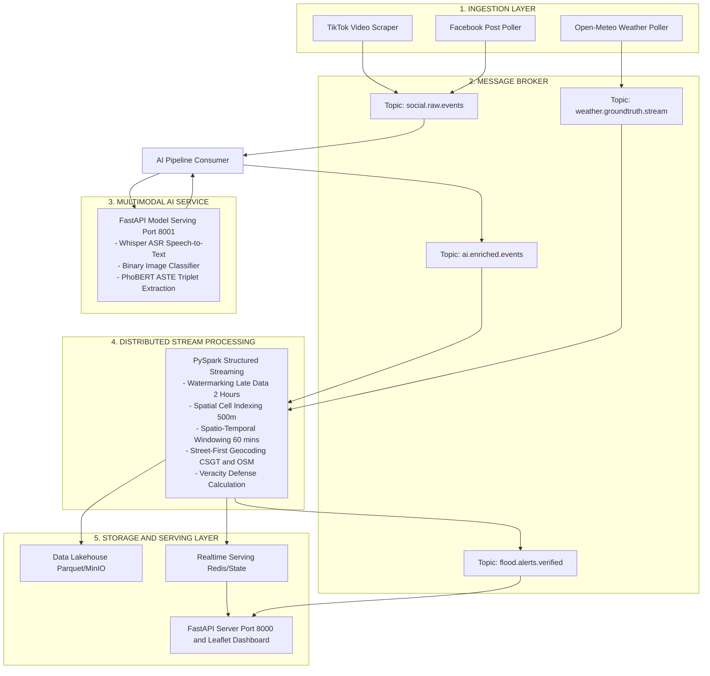

# 🗺️ ĐỒ ÁN SE363 - LỘ TRÌNH KỸ THUẬT NÂNG CẤP KIẾN TRÚC BIG DATA & MULTIMODAL AI
**Hệ thống Giám sát Đô thị & Cảnh báo Ngập lụt TP.HCM Thời gian thực qua Dữ liệu Mạng xã hội**
*Tài liệu Kế hoạch Kỹ thuật Chi tiết (Technical Roadmap & Architecture Blueprint)*

---

## 📑 MỤC LỤC
1. [Bối cảnh Dự án & Mục tiêu Chuyển đổi](#1-bối-cảnh-dự-án--mục-tiêu-chuyển-đổi)
2. [Nguyên tắc Thiết kế Cốt lõi (Guiding Architectural Principles)](#2-nguyên-tắc-thiết-kế-cốt-lõi)
3. [Sơ đồ Kiến trúc Big Data Mục tiêu (Target Architecture)](#3-sơ-đồ-kiến-trúc-big-data-mục-tiêu)
4. [Kế hoạch Triển khai theo Từng Phase (Detailed Phased Roadmap)](#4-kế-hoạch-triển-khai-theo-từng-phase)
   - [Phase 1: Đóng gói Dataset & Khung AI Model Serving (FastAPI)](#phase-1-đóng-gói-dataset--khung-ai-model-serving-fastapi)
   - [Phase 2: Thiết lập Message Broker với Apache Kafka (Event-Driven Ingestion)](#phase-2-thiết-lập-message-broker-với-apache-kafka)
   - [Phase 3: Xây dựng Bộ Xử lý Dòng PySpark Structured Streaming](#phase-3-xây-dựng-bộ-xử-lý-dòng-pyspark-structured-streaming)
   - [Phase 4: Tích hợp Serving/Storage Layer & Hoàn thiện Dashboard](#phase-4-tích-hợp-servingstorage-layer--hoàn-thiện-dashboard)
   - [Phase 5: Kiểm thử Chịu tải (Benchmark) & Chuẩn bị Báo cáo Đồ án](#phase-5-kiểm-thử-chịu-tải-benchmark--chuẩn-bị-báo-cáo-đồ-án)
5. [Ma trận Phân bổ Tài nguyên Phần cứng (Hardware Allocation Matrix)](#5-ma-trận-phân-bổ-tài-nguyên-phần-cứng)
6. [Quản trị Rủi ro & Phương án Dự phòng (Contingency Plan)](#6-quản-trị-rủi-ro--phương-án-dự-phòng)

---

## 1. Bối cảnh Dự án & Mục tiêu Chuyển đổi

### 1.1. Thực trạng Hiện tại (Current State)
* Hệ thống đã hoàn thiện toàn bộ **Business Logic cốt lõi**:
  * Động cơ GIS phân tầng nghiêm ngặt (Street-first, 122 điểm CSGT chuẩn tim đường OpenStreetMap Highway, 168 ĐVHC TP.HCM theo NQ 1685).
  * Bộ lọc tin rác, bất động sản, quảng cáo và kiểm tra độ tin cậy khí tượng (Open-Meteo).
  * Giao diện Leaflet Web Dashboard hiển thị bản đồ nhiệt (Heatmap) và tin tức thời gian thực.
* **Hạn chế & Thách thức**:
  * **Kiến trúc luồng**: Toàn bộ luồng dữ liệu hiện đang chạy dạng **Python In-Memory Scripting (Monolith)**. Để đáp ứng chuẩn mực môn học **SE363 (Công nghệ Dữ liệu lớn)**, hệ thống cần được nâng cấp sang kiến trúc phân tán với **Apache Kafka** và **PySpark Structured Streaming**.
  * **Chất lượng Dataset tĩnh hiện có**: Tập dữ liệu mẫu (`data/processed/hcmc_flood_annotated_v1.json`) hiện có tỷ lệ bài báo chí từ **Google News chiếm tỷ trọng quá lớn (> 70%)**. Văn phong báo chí quá chỉn chu, thiếu chất liệu đời thường của mạng xã hội (video ngắn người dân tự quay, âm thanh tiếng mưa/tiếng nói hiện trường, teencode, hashtag). Điều này chưa tối ưu cho việc huấn luyện các mô hình AI đa phương thái (Whisper ASR, Image Classifier) của Hưng.

### 1.2. Phân công Phối hợp Nhóm
* **Bạn (Big Data & Streaming Lead)**:
  * Phụ trách hạ tầng Big Data (Docker Compose Kafka, PySpark Structured Streaming, Storage Sinks).
  * Tích hợp động cơ GIS, thuật toán đồng thuận không - thời gian và hệ thống xác thực (Veracity).
  * Cầu nối dữ liệu cấp phát dataset và cắm API model AI.
* **Hưng (Multimodal AI Lead)**:
  * Huấn luyện và đóng gói 3 mô hình con:
    1. *Binary Image Classifier* (Xác thực hình ảnh ngập nước $\rightarrow$ `visual_verified`).
    2. *Silero VAD + Whisper ASR* (Bóc transcript tiếng Việt từ âm thanh video TikTok).
    3. *PhoBERT ASTE* (Trích xuất bộ ba `Aspect - Opinion - Polarity`).
  * Triển khai HTTP Inference Server (FastAPI) để phục vụ dự đoán độc lập.

---

## 2. Nguyên tắc Thiết kế Cốt lõi

Để đảm bảo dự án phát triển nhanh, an toàn và không gây rủi ro mất mát code:

1. **Bảo tồn 100% Logic Nghiệp vụ (Strangler Fig Pattern)**:
   * **Tuyệt đối không đập đi xây lại**. Toàn bộ logic GIS trong `core/gazetteer.py`, `core/admin_resolver.py` và `pipeline/veracity_checker.py` sẽ được kế thừa nguyên vẹn.
   * Hệ thống Python độc lập hiện tại vẫn được giữ nguyên làm **bản backup dự phòng an toàn 100%**. Module Big Data mới sẽ được xây dựng song song.
2. **Tách rời Hoàn toàn Tác vụ Nặng (Decoupled Heavy AI Serving)**:
   * Đúng theo định hướng của Hưng: **Không load model AI bên trong worker PySpark** (tránh OOM RAM và khóa nghẽn GPU).
   * Model AI được host thành một **HTTP REST Service riêng biệt**, tải model vào bộ nhớ một lần duy nhất lúc khởi động và phục vụ inference qua API.
3. **Micro-batch Adapter với PySpark `foreachBatch`**:
   * Tận dụng tính năng `foreachBatch` của PySpark để bọc và gọi trực tiếp các module Python hiện có, giúp mã nguồn Spark ngắn gọn, tường minh và tái sử dụng triệt để thuật toán.

---

## 3. Sơ đồ Kiến trúc Big Data Mục tiêu

### 3.1. Sơ đồ Trực quan Dạng Hộp (Universal Architecture Box Diagram)
*(Hiển thị 100% rõ nét trên mọi trình xem Markdown: PyCharm, VS Code, GitHub, Notepad)*

```text
+--------------------------------------------------------------------------------------------------+
|                                1. INGESTION LAYER (Thu thập)                                     |
|    [ TikTok Video Scraper ]       [ Facebook Post Poller ]       [ Open-Meteo Weather Poller ]   |
+--------------------------------------------------------------------------------------------------+
                                                │
                                                ▼  (Kafka Producers đẩy raw JSON)
+--------------------------------------------------------------------------------------------------+
|                            2. MESSAGE BROKER (Apache Kafka KRaft)                                |
|    • Topic: social.raw.events             • Topic: weather.groundtruth.stream                    |
|    • Topic: ai.enriched.events            • Topic: flood.alerts.verified                         |
+--------------------------------------------------------------------------------------------------+
         │                                              ▲
         │ (Consumer đọc tin thô)                       │ (Đẩy sự kiện đã gán nhãn AI)
         ▼                                              │
+--------------------------------------------------------------------------------------------------+
|                          3. MULTIMODAL AI SERVICE (Hưng phụ trách)                               |
|                     FastAPI Model Serving (Port 8001 / HTTP Microservice)                        |
|    • Whisper ASR (Speech-to-Text)       • Binary Image Classifier (Vision ngập nước)             |
|    • PhoBERT ASTE (Aspect-Opinion-Sentiment Triplet Extraction)                                  |
+--------------------------------------------------------------------------------------------------+
                                                │
                                                ▼ (Spark Streaming đọc từ ai.enriched.events)
+--------------------------------------------------------------------------------------------------+
|                      4. DISTRIBUTED STREAM PROCESSING (PySpark Streaming)                        |
|    • Watermarking (2 Hours) & Spatio-Temporal Sliding Window (60 mins)                           |
|    • Spatial Cell Indexing (Uber H3 / Geohash 500m)                                              |
|    • Street-First GIS Geocoding (122 CSGT + Tim đường OSM Highway)                               |
|    • Multi-tier Veracity Calculation (Confidence Score >= 0.75 -> Confirmed)                     |
+--------------------------------------------------------------------------------------------------+
                                                │
                                                ▼ (Spark foreachBatch Sinks)
+--------------------------------------------------------------------------------------------------+
|                                5. STORAGE & SERVING LAYER                                        |
|    [ Data Lakehouse (Parquet/MinIO) ]  <-- (Cold Path: Lưu trữ lịch sử ngập lụt phục vụ Analytics)|
|    [ Realtime Serving (Redis/State) ]  <-- (Hot Path: Quản lý các điểm cảnh báo đang hoạt động)  |
|                                                │                                                 |
|                                                ▼                                                 |
|           [ FastAPI WebSocket Server (Port 8000) --> Leaflet Realtime Heatmap ]                  |
+--------------------------------------------------------------------------------------------------+
```

### 3.2. Sơ đồ Luồng Đồ họa Mermaid (Dành cho trình xem có bật Mermaid)



---

## 4. Kế hoạch Triển khai theo Từng Phase

```
[Phase 1] Chuẩn bị Dataset & Khung AI Server (FastAPI)
    │
    ▼
[Phase 2] Dựng Apache Kafka KRaft & Ingestion Producers
    │
    ▼
[Phase 3] Xây dựng Bộ xử lý dòng PySpark Structured Streaming
    │
    ▼
[Phase 4] Tích hợp Storage Lakehouse, Hot Serving & Dashboard
    │
    ▼
[Phase 5] Kiểm thử Chịu tải (Benchmark) & Soạn Báo cáo Đồ án SE363
```

---

### Phase 1: Làm giàu Dataset Đa nền tảng (Crawl TikTok & Facebook) & Đóng gói AI Service (FastAPI)
*Mục tiêu: Thu thập bổ sung bài đăng thực tế từ TikTok và Facebook để cân bằng tỷ trọng với Google News, xuất dataset v2 giàu dữ liệu đa phương thái cho Hưng huấn luyện và dựng sẵn cổng giao tiếp API chuẩn xác.*

* **Công việc cụ thể**:
  1. **Chiến dịch Làm giàu Dữ liệu Mạng xã hội (Dataset Enrichment & Multi-platform Balancing)**:
     * **Vấn đề nhận diện**: Tập dữ liệu hiện tại có tỷ lệ bài viết từ Google News quá áp đảo, thiếu ngôn ngữ đời thường và video hiện trường ngập nước thực tế.
     * **Hành động cụ thể**:
       * Kích hoạt [`TikTokPoller`](file:///D:/SE363_RAWDATA/pipeline/tiktok_poller.py) và [`FacebookPoller`](file:///D:/SE363_RAWDATA/pipeline/facebook_poller.py) cào bổ sung thêm các đợt mưa bão tại TP.HCM.
       * Ưu tiên thu thập các bài đăng có đính kèm video/hình ảnh gốc trực tiếp (video URL, CDN media) để cung cấp tư liệu phong phú cho mô hình **Silero VAD + Whisper ASR** (bóc âm thanh) và **Binary Image Classifier** (quét cảnh ngập) của Hưng.
       * Nâng cấp [`scripts/build_clean_dataset.py`](file:///D:/SE363_RAWDATA/scripts/build_clean_dataset.py) để hợp nhất các đợt cào mới, khử trùng lặp nội dung triệt để, lọc sạch tin rác bất động sản và **tái cân bằng tỷ trọng nguồn**: nâng tỷ lệ bài đăng mạng xã hội (TikTok + Facebook) lên mức **>= 50 - 60%** trong dataset.
       * Xuất ra phiên bản dataset hoàn chỉnh [`data/processed/hcmc_flood_annotated_v2_multimodal.json`](file:///D:/SE363_RAWDATA/data/processed/hcmc_flood_annotated_v1.json) để bàn giao cho Hưng.
  2. **Xây dựng Skeleton AI Server (`ai_service/app.py`)**:
     * Dùng FastAPI tạo endpoint `POST /api/v1/predict`.
     * Cài đặt cơ chế Mock Baseline (dùng tạm bộ Heuristic hiện tại) để kiểm thử thông luồng trước.
     * Khi Hưng hoàn thành model, Hưng chỉ cần nạp checkpoint và thay thế hàm dự đoán.
  3. **Đóng gói Data Contract**:
     * **Input**: `{"id": str, "text": str, "media_urls": list, "video_url": str}`
     * **Output**: `{"visual_verified": bool, "content_score": float, "triplets": list}`
* **Sản phẩm bàn giao (Deliverables)**:
  * File dataset v2 phong phú đa nền tảng (`hcmc_flood_annotated_v2_multimodal.json`) với tỷ lệ mạng xã hội cân bằng bàn giao cho Hưng.
  * Module `ai_service/app.py` chạy độc lập tại cổng `http://localhost:8001`.
* **Definition of Done (DoD)**:
  * Tỷ lệ bài viết từ mạng xã hội (TikTok + Facebook) trong dataset đạt $\ge 50\%$.
  * Bắn thử curl/Postman gửi text và nhận về đúng cấu trúc JSON quy định trong vòng < 100ms.

---

### Phase 2: Thiết lập Message Broker với Apache Kafka (Event-Driven Ingestion)
*Mục tiêu: Đưa toàn bộ việc thu thập dữ liệu về mô hình Hướng sự kiện (Event-Driven Architecture).*

* **Công việc cụ thể**:
  1. **Cấu hình Docker Compose Kafka KRaft**:
     * Tạo file `docker-compose.yml` triển khai cụm Kafka phiên bản mới nhất chạy chế độ **KRaft (không cần Zookeeper)** để tiết kiệm tối đa RAM.
     * Cấp phát tài nguyên: Giới hạn Kafka ở mức **1.5 GB RAM**.
  2. **Khởi tạo các Topics nghiệp vụ**:
     * `social.raw.events`: Chứa bài đăng thô từ TikTok và Facebook.
     * `ai.enriched.events`: Chứa bài đăng đã được AI bổ sung nhãn và transcript.
     * `weather.groundtruth.stream`: Dòng dữ liệu lượng mưa trạm đo từ Open-Meteo.
     * `flood.alerts.verified`: Dòng sự kiện ngập lụt đã qua kiểm định Veracity.
  3. **Viết Kafka Producer Adapter**:
     * Kế thừa [`TikTokPoller`](file:///D:/SE363_RAWDATA/pipeline/tiktok_poller.py) và [`FacebookPoller`](file:///D:/SE363_RAWDATA/pipeline/facebook_poller.py) hiện tại.
     * Đẩy trực tiếp JSON thô vào topic `social.raw.events`.
  4. **Viết AI Ingestion Worker**:
     * Lắng nghe từ `social.raw.events` $\rightarrow$ gọi HTTP `POST /api/v1/predict` sang AI Server $\rightarrow$ đẩy kết quả vào `ai.enriched.events`.
* **Sản phẩm bàn giao (Deliverables)**:
  * File `docker-compose.yml` khởi động cụm Kafka bằng lệnh `docker compose up -d`.
  * Các file `bigdata/producers/social_producer.py` và `bigdata/workers/ai_enricher_worker.py`.
* **Definition of Done (DoD)**: Bài đăng cào về tự động chảy qua Kafka và xuất hiện đầy đủ trong topic `ai.enriched.events`.

---

### Phase 3: Xây dựng Bộ Xử lý Dòng PySpark Structured Streaming
*Mục tiêu: Triển khai động cơ Big Data phân tán xử lý dòng, tính toán cửa sổ trượt và xác thực Veracity.*

* **Công việc cụ thể**:
  1. **Cấu hình PySpark Local Cluster**:
     * Cài đặt `pyspark==3.5.x` kết nối gói `spark-sql-kafka-0-10`.
     * Cấu hình Spark Local với `spark.driver.memory=3g`, `spark.executor.memory=2g`.
  2. **Xây dựng `spark_streaming_engine.py`**:
     * Đọc luồng dữ liệu liên tục từ Kafka topic `ai.enriched.events`.
     * **Watermarking & Late Data**: Thiết lập `withWatermark("create_time", "2 hours")` để xử lý triệt để bài đăng bị trễ mạng.
     * **Spatial Binning (Uber H3 / Geohash 500m)**: Gán tọa độ vào từng ô lưới không gian phục vụ tính toán đồng thuận.
     * **Spatio-Temporal Sliding Window**: Thiết lập `groupBy(window("create_time", "60 minutes", "10 minutes"), "spatial_cell")` để gom cụm các bài đăng độc lập ($N \ge 3$ bài $\rightarrow$ Xác thực tin cậy).
  3. **Áp dụng Micro-batch Adapter (`foreachBatch`)**:
     * Nhận từng micro-batch DataFrame từ Spark.
     * Gọi trực tiếp hàm [`match_hotspot()`](file:///D:/SE363_RAWDATA/core/gazetteer.py) (122 điểm CSGT + Tim đường OSM) và [`RESOLVER`](file:///D:/SE363_RAWDATA/core/admin_resolver.py) (168 ĐVHC NQ 1685).
     * Gọi [`VeracityChecker`](file:///D:/SE363_RAWDATA/pipeline/veracity_checker.py) tính điểm tổng hợp `confidence_score`.
* **Sản phẩm bàn giao (Deliverables)**:
  * File `bigdata/streaming/spark_flood_processor.py`.
* **Definition of Done (DoD)**: Script Spark chạy liên tục, tiêu thụ dữ liệu từ Kafka, in log micro-batch xử lý thành công không bị tràn RAM.

---

### Phase 4: Tích hợp Serving/Storage Layer & Hoàn thiện Dashboard
*Mục tiêu: Đưa kết quả từ PySpark ra kho lưu trữ và hiển thị trực tiếp lên Dashboard Leaflet.*

* **Công việc cụ thể**:
  1. **Lưu trữ Cold Path (Data Lakehouse)**:
     * Trong Spark `foreachBatch`, append dữ liệu ra định dạng **Parquet** phân vùng theo ngày `date=YYYY-MM-DD/` lưu trữ cục bộ (hoặc MinIO bucket `s3a://flood-lakehouse/`).
  2. **Lưu trữ Hot Path (Realtime Serving)**:
     * Đẩy các điểm ngập đang hoạt động (`confirmed`, `suspect`) vào Redis hoặc file trạng thái phục vụ API.
  3. **Cập nhật Web Dashboard**:
     * Dashboard Leaflet hiện tại kết nối nhận dữ liệu từ luồng Big Data mới qua WebSocket / REST API.
  4. **Tích hợp Model thật của Hưng**:
     * Khi Hưng train xong, load trọng số thật vào `ai_service/app.py`. Toàn bộ hệ thống tự động chuyển sang vận hành bằng Deep Learning thật.
* **Sản phẩm bàn giao (Deliverables)**:
  * Giao diện Dashboard hiển thị đầy đủ nhãn ASTE (Aspect, Opinion, Severity) và nhãn Veracity (`Confirmed`, `Suspect`) lấy từ PySpark Streaming.
* **Definition of Done (DoD)**: Bấm cào hoặc phát mô phỏng, dữ liệu đi từ Crawler $\rightarrow$ Kafka $\rightarrow$ AI $\rightarrow$ PySpark $\rightarrow$ Dashboard vẽ điểm ngập trong < 3 giây.

---

### Phase 5: Kiểm thử Chịu tải (Benchmark) & Chuẩn bị Báo cáo Đồ án
*Mục tiêu: Đo đạc số liệu khoa học để đưa vào báo cáo nghiệm thu SE363 đạt điểm tối đa.*

* **Công việc cụ thể**:
  1. **Stress-Testing Pipeline**:
     * Viết script bơm tải mô phỏng 5.000 – 10.000 sự kiện/phút vào Kafka.
     * Đo đạc và vẽ biểu đồ:
       * Tốc độ xử lý (Throughput - records/second).
       * Độ trễ đầu - cuối (End-to-end Latency).
       * Tỷ lệ tiêu hao CPU & RAM của cụm Spark.
  2. **So sánh Đối chứng (Benchmark Comparison)**:
     * Lập bảng so sánh giữa **Python Monolith cũ** và **PySpark + Kafka mới** (về tính sẵn sàng, khả năng chịu lỗi fault-tolerance, xử lý song song).
  3. **Hoàn thiện Báo cáo Đồ án SE363**:
     * Đưa sơ đồ kiến trúc, giải thích các cơ chế Big Data chuyên sâu (Kafka Partitions, Consumer Groups, Spark Watermarking, Micro-batching, Microservice AI Serving).
* **Sản phẩm bàn giao (Deliverables)**:
  * File báo cáo kết quả benchmark và slide thuyết trình đồ án.

---

## 5. Ma trận Phân bổ Tài nguyên Phần cứng

Hệ thống được thiết kế tối ưu riêng cho thông số máy tính hiện tại của bạn (**Intel Core i5-12450HX, 28 GB RAM**):

| Thành phần Dịch vụ | Công nghệ sử dụng | Mức RAM cấp phát | Số Core CPU | Vai trò trong hệ thống |
| :--- | :--- | :---: | :---: | :--- |
| **Apache Kafka Broker** | Kafka 3.7+ (KRaft Mode) | **1.5 GB** | 1 Core | Hàng đợi tin nhắn phân tán |
| **PySpark Streaming Master & Worker** | PySpark 3.5.x | **4.0 GB** | 4 Cores | Xử lý dòng phân tán, Watermark, GIS |
| **AI Model Serving Server (Hưng)** | FastAPI + PyTorch/ONNX | **4.0 - 6.0 GB** | 4 Cores | Chạy Whisper, ViT, PhoBERT ASTE |
| **Web Server & Dashboard API** | FastAPI / Uvicorn | **0.5 GB** | 1 Core | Phục vụ giao diện người dùng Leaflet |
| **Hệ điều hành Windows & Ứng dụng nền** | Windows 11 + Docker Desktop | **6.0 GB** | 2 Cores | Tài nguyên dành riêng cho OS |
| **Bộ nhớ dự phòng (Headroom)** | Free Memory | **10.0 GB** | - | Đảm bảo máy luôn mát, không giật lag |
| **TỔNG CỘNG HỆ THỐNG** | - | **~ 18 GB / 28 GB** | **12 Threads** | **An toàn tuyệt đối (Dư > 10GB RAM)** |

---

## 6. Quản trị Rủi ro & Phương án Dự phòng

| Rủi ro Kỹ thuật | Xác suất | Tác động | Biện pháp Phòng ngừa & Xử lý |
| :--- | :---: | :---: | :--- |
| **Model AI của Hưng bị trễ hạn hoặc nặng máy** | Trung bình | Thấp | Skeleton `ai_service` có sẵn **chế độ Mock Heuristic dự phòng**. Nếu Hưng chưa kịp huấn luyện xong, hệ thống vẫn chạy thông suốt với Kafka + PySpark bằng nhãn giả lập để nộp bài đúng hạn. |
| **Cài đặt Spark hoặc Kafka trên Windows gặp lỗi môi trường** | Thấp | Trung bình | Toàn bộ Kafka được đóng gói trong **Docker Compose**. PySpark chạy chế độ `local[*]` không cần cài Hadoop cục bộ, tránh được 100% lỗi `winutils.exe` phổ biến trên Windows. |
| **PySpark bị nghẽn khi gọi Geocoding mạng ngoài** | Thấp | Cao | Kế thừa cơ chế **Dynamic Cache** và bộ từ điển hạt nhân 122 CSGT in-memory đã tối ưu ở giai đoạn trước, tuyệt đối không gọi HTTP Nominatim đồng bộ trong luồng stream của Spark. |
| **Sự cố sát ngày nộp đồ án** | Rất thấp | Cao | Hệ thống Python Monolith cũ **không bị xóa bỏ**. Luôn có thể khởi động bản demo độc lập hiện tại chỉ bằng 1 dòng lệnh dự phòng. |

---

*Tài liệu này là kim chỉ nam chính thức cho giai đoạn phát triển tiếp theo của Đồ án SE363. Mọi cập nhật về kiến trúc hoặc giao thức dữ liệu sẽ được ghi nhận bổ sung trực tiếp vào tài liệu này.*
