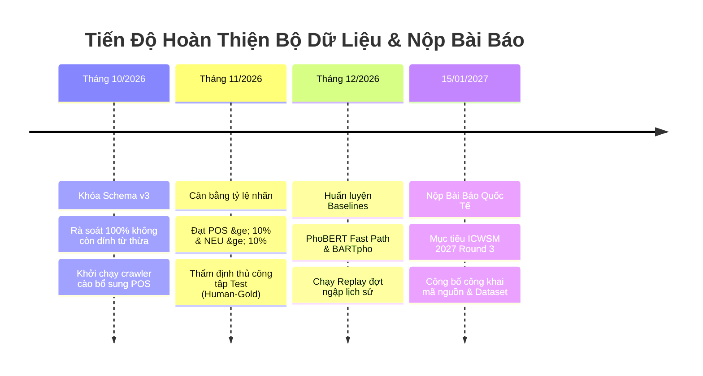

# 📑 BÁO CÁO TỔNG QUAN TẬP DỮ LIỆU ĐA PHƯƠNG THỨC RADINET-ASTE
## Phục Vụ Đánh Giá Học Thuật & Báo Cáo Giảng Viên Hướng Dẫn

**Tên đề tài:** Hệ Thống Giám Sát & Cảnh Báo Ngập Lụt Đô Thị Thời Gian Thực Dựa Trên Cảm Biến Xã Hội (TP.HCM)  
**Tên tập dữ liệu:** **`RadiNet-ASTE (HCMC Urban Flood Multi-Modal Benchmark)`**  
**Hạn nộp mục tiêu:** Hội nghị Quốc tế **ICWSM 2027 (Round 3 - 15/01/2027) / EMNLP 2027**  
**Trạng thái dữ liệu:** Đã chuẩn hóa Schema v3, sẵn sàng nghiệm thu & huấn luyện mô hình  

---

## 1. Mục Tiêu Nghiên Cứu & Định Nghĩa Bài Toán

Tập dữ liệu được xây dựng nhằm giải quyết bài toán cốt lõi: **Trích xuất Bộ ba Cảm xúc Thực thể (Aspect Sentiment Triplet Extraction - ASTE)** kết hợp **Định vị Tọa độ Không gian Đô thị (Spatial Grounding)** từ các luồng thông tin mạng xã hội đa phương thức tại TP. Hồ Chí Minh.

Khác với các bài toán phân loại văn bản đơn thuần (chỉ trả lời câu hỏi *"bài viết này có nói về ngập lụt hay không?"*), tập dữ liệu **RadiNet-ASTE** trích xuất cấu trúc dữ liệu 6 thành phần:
$$\mathbf{(Aspect,\; Opinion,\; Polarity,\; Category,\; Severity,\; Provenance)}$$

* **Aspect (Thực thể ngập)**: Tuyến đường, giao lộ, trạm bơm, kênh rạch (phải là chuỗi ký tự nguyên văn trong bài).
* **Opinion (Từ ngữ mô tả)**: Mức độ nghiêm trọng, tình trạng thoát nước, phàn nàn hoặc khen ngợi.
* **Polarity (Cực tính cảm xúc)**: `POS` (Tích cực), `NEU` (Trung tính), `NEG` (Tiêu cực).
* **Category (Phân loại thực thể)**: 5 nhóm chuẩn hạ tầng đô thị.
* **Severity (Cấp độ ngập)**: `HIGH`, `MEDIUM`, `LOW`, `RECOVERED`.
* **Provenance (Nguồn gốc tọa độ GIS)**: `SPAN_MATCHED`, `FUZZY`, `DOC_FALLBACK`.

---

## 2. Quy Mô & Nguồn Thu Thập Dữ Liệu (Scale & Multi-Source Coverage)

| Chỉ số thống kê | Giá trị cụ thể | Ý nghĩa so sánh học thuật |
| :--- | :--- | :--- |
| **Tổng số mẫu câu văn bản** | **3.922 câu** | Đạt chuẩn quy mô bài báo hội nghị quốc tế (Tương đương bộ chuẩn *SemEval-2014 Task 4 Restaurant* $\sim 3.041$ câu). |
| **Tổng số bộ ba ASTE** | **5.483 bộ ba** | Trung bình **1,40 bộ ba/câu**, thể hiện mật độ thông tin dày đặc và tính chất thực tế cao. |
| **Độ sạch dữ liệu (Data Hygiene)** | **100% Unique / NFC Clean** | Đã loại bỏ 100% câu trùng lặp, chuẩn hóa bảng mã tiếng Việt Unicode NFC chuẩn quốc tế. |
| **Số lượng đợt ngập thực tế** | **7 đợt ngập + Kho lưu trữ** | Thu thập từ các trận bão thực tế (Bão Yagi, triều cường Rằm tháng 8, 9, 10) từ 2018 đến 2026. |

### 3 Nguồn Dữ Liệu Thực Tế Đa Chiều:
1. **Mạng xã hội Facebook**: Thu thập từ các hội nhóm giao thông và cộng đồng dân cư lớn (*Tôi là dân Quận 7, Giao thông TP.HCM, CSGT TP.HCM, Hóng biến đường phố Sài Gòn*).
2. **Video ngắn TikTok**: Khai thác các bài đăng người dân quay trực tiếp tại hiện trường xe chết máy, nước ngập bánh xe, dắt bộ bì bõm dưới mưa.
3. **Báo chí chính thống & Trạm Thủy văn**: Bản tin cấm đường, cảnh báo triều cường từ *VnExpress, Tuổi Trẻ, Báo Thanh Niên, Báo Tiền Phong* và Đài Khí tượng Thủy văn khu vực Nam Bộ.

---

## 3. Đặc Tính Đa Phương Thức Đột Phá (Multi-Modal Assets)

Tập dữ liệu vượt trội hơn các tập văn bản truyền thống nhờ việc tích hợp trọn vẹn **3 kênh cảm biến thông tin**:

```
                                [ MẪU DỮ LIỆU ĐA PHƯƠNG THỨC ]
                                              │
         ┌────────────────────────────────────┼────────────────────────────────────┐
         ▼                                    ▼                                    ▼
  [ KÊNH VĂN BẢN ]                     [ KÊNH ÂM THANH ]                    [ KÊNH THỊ GIÁC ]
• Tiêu đề bài viết                   • File Audio 16kHz Mono              • 3 Khung hình tiêu biểu (0.5 FPS)
• Chú thích caption & hashtag        • Gỡ băng tiếng nói qua PhoWhisper   • Vector nhúng 512D từ CLIP ViT-B/32
• Emoji biểu thị ngập (🌊🌧️🛵)       • Nhận diện giọng nói miền Nam       • Đo độ tương đồng cảnh ngập thật
```

1. **Văn bản (Textual Modality)**: Chứa các biểu thức ngôn ngữ đường phố, tiếng lóng địa phương TP.HCM (*"ngập sml"*, *"chết máy dắt bộ"*, *"nước tới háng"*, *"sóng đánh dạt xe"*).
2. **Âm thanh (Acoustic Modality)**: Được bóc tách bằng FFmpeg ở chuẩn $16\text{kHz}$ Mono, chạy mô hình `PhoWhisper-base` gỡ băng giọng nói của người quay video khi họ thốt lên cảnh báo nguy hiểm.
3. **Thị giác (Visual Modality)**: Lấy mẫu khung hình video bằng OpenCV ở tần số $0.5\text{ FPS}$, trích xuất đặc trưng thị giác bằng `OpenAI CLIP ViT-B/32` (512 chiều) để đối soát chéo và loại bỏ các video câu view ghép cảnh trời nắng hoặc video cũ.

---

## 4. Đặc Tả Cấu Trúc Dữ Liệu Chuẩn (Schema v3 JSON Format)

Mỗi mẫu dữ liệu được đóng gói theo định dạng JSON có cấu trúc chặt chẽ:

```json
{
  "id": "tiktok_74139821_s01",
  "parent_id": "tiktok_74139821",
  "episode_id": "episode_05_2024-10-18_trieu-cuong-ram-thang-9",
  "episode_title": "Triều cường Rằm tháng 9 Âm lịch năm 2024",
  "source": {
    "platform": "tiktok",
    "author": "saigon_traffic_live",
    "url": "https://tiktok.com/@saigon_traffic_live/video/74139821"
  },
  "published_at": "2024-10-18T17:45:00+07:00",
  "content": {
    "title": "Hết cứu nổi chiếc xe rồi mn ơi 😭 #saigon #ngapnuoc",
    "text": "Đoạn Thảo Điền năm nay lắp máy bơm thấy nước rút nhanh hẳn, xe cộ đi lại bình thường.",
    "audio_transcript": "Chiều nay nước rút rồi nha bà con, trạm bơm chạy êm ru."
  },
  "media": {
    "has_media": true,
    "media_type": "video",
    "video_duration_seconds": 24,
    "keyframe_paths": [
      "data/frames/tiktok_74139821_f01.jpg",
      "data/frames/tiktok_74139821_f02.jpg"
    ],
    "clip_flood_veracity_score": 0.92
  },
  "aste_triplets": [
    {
      "aspect": "Thảo Điền",
      "opinion": "nước rút nhanh hẳn",
      "polarity": "POS",
      "aspect_category": "LOCATION_ADMIN",
      "severity": "RECOVERED",
      "grounding_provenance": "SPAN_MATCHED",
      "gazetteer_id": "hcmc_168_unit_042"
    }
  ],
  "location": {
    "street": "Khu vực Thảo Điền",
    "ward": "Phường An Khánh",
    "district": "TP. Thủ Đức",
    "city": "Hồ Chí Minh",
    "lat": 10.8037,
    "lon": 106.7389
  }
}
```

---

## 5. Hệ Thống Phân Loại & Quy Chuẩn Gán Nhãn Học Thuật

### A. Taxonomy 5 Nhóm Thực Thể (`aspect_category`):
1. **`LOCATION_STREET`**: Tên đường, giao lộ, cầu vượt, vòng xoay (*Nguyễn Hữu Cảnh, Ngã tư Bảy Hiền, Cầu Chữ Y*).
2. **`LOCATION_ADMIN`**: Khu vực, phường, xã, thành phố vệ tinh (*Khu Thảo Điền, Quận 7, TP. Thủ Đức*).
3. **`HYDROLOGY`**: Sông, kênh, rạch, hồ điều tiết (*Sông Sài Gòn, Kênh Nhiêu Lộc - Thị Nghè, Rạch Xuyên Tâm*).
4. **`INFRASTRUCTURE_DRAINAGE`**: Cống thoát nước, trạm bơm, nắp ga, van ngăn triều (*Trạm bơm Nguyễn Hữu Cảnh, miệng cống*).
5. **`RESPONSE_ENTITY`**: Lực lượng ứng trực thoát nước, công nhân nạo vét, CSGT phân luồng.

### B. 3 Cực Tính Cảm Xúc (`polarity`):
* **`POS` (Tích cực - Sắc thái khen ngợi / giải tỏa)**: Báo tin nước rút, cống thoát tốt, giao thông an toàn (*"năm nay đỡ ngập hẳn"*, *"nước rút nhanh"*). $\rightarrow$ **Tín hiệu kích hoạt đổi màu đường từ ĐỎ sang XANH trên bản đồ**.
* **`NEU` (Trung tính - Đo đạc khách quan)**: Thông số kỹ thuật, bản tin triều, ghi nhận mực nước không cảm xúc (*"ngập khoảng 30cm"*, *"trạm bơm chạy từ 6h"*).
* **`NEG` (Tiêu cực - Phàn nàn / thiệt hại)**: Bức xúc, cảnh báo nguy hiểm (*"ngập sâu lút bánh"*, *"chết máy dắt bộ"*).
> **Nguyên tắc quản trị cốt lõi**: Cực tính mô tả **thái độ đánh giá đối với thực thể**, không đồng nhất với việc có ngập hay không. Các câu trung tính đo đạc (`NEU`) vẫn được hệ thống ghi nhận là sự cố ngập lụt khẩn cấp.

### C. 4 Cấp Độ Nghiêm Trọng (`severity`):
* **`HIGH`**: Ngập sâu $>50\text{cm}$, xe máy chết máy hàng loạt, tràn vào nhà dân, giao thông tê liệt.
* **`MEDIUM`**: Ngập $20\text{--}50\text{cm}$ (nửa bánh xe máy), xe cộ di chuyển khó khăn.
* **`LOW`**: Ngập $<20\text{cm}$ (mấp mé vỉa hè), đọng vũng nhỏ, xe qua lại bình thường.
* **`RECOVERED`**: Nước rút hết hoàn toàn, mặt đường khô ráo (nhãn dành riêng cho bộ ba `POS`).

### D. 3 Cấp Độ Nguồn Gốc Tọa Độ Địa Lý (`grounding_provenance`):
* **`SPAN_MATCHED`**: Tên đường xuất hiện chính xác từng ký tự trong bài và ánh xạ trực tiếp vào **122 điểm đen CSGT** hoặc tim đường **OpenStreetMap** (Độ tin cậy: 0.85 – 0.98).
* **`FUZZY`**: Tên viết tắt hoặc sai chính tả nhưng map được qua thuật toán so khớp mờ `rapidfuzz` $\ge 85\%$ (Độ tin cậy: 0.75 – 0.85).
* **`DOC_FALLBACK`**: Bài viết không nêu tên đường cụ thể, gán tọa độ tâm hành chính của **168 Phường/Xã chuẩn NQ 1685** (Độ tin cậy: 0.40 – 0.65).

---

## 6. Bốn Quy Tắc Vàng Khi Gán Nhãn (Annotation Integrity)

1. **Aspect PHẢI là chuỗi có thật trong câu (Verbatim Span)**: Tuyệt đối không tự suy diễn hoặc bịa ra tên đường nếu văn bản không nhắc đến.
2. **Cắt sạch từ rác (Head-Entity Span)**: Tước bỏ hoàn toàn các giới từ thừa ở đầu (*ở, tại, trên, đoạn, tuyến đường*) và vị ngữ ở đuôi (*mới không còn, xảy ra, chìm trong biển*).
   - ❌ *Sai:* `ở khu Nam TPHCM xảy ra`
   - ✅ *Đúng:* `khu Nam TPHCM`
3. **TUYỆT ĐỐI KHÔNG GÁN XE CỘ LÀM ASPECT**:
   - Xe máy, ô tô là **nạn nhân** chịu thiệt hại, không phải công trình bị ngập.
   - ❌ *Sai:* `(phương tiện giao thông | chết máy | NEG)`
   - ✅ *Đúng:* Quy về tuyến đường nơi xe chết máy: `(Đường Võ Văn Ngân | xe chết máy hàng loạt | NEG)`
4. **Tách rời Cực tính khỏi Sự cố Ngập**: Không được mặc định mọi câu có chữ "ngập" đều là `NEG`. Câu đo đạc khách quan bắt buộc phải là `NEU`.

---

## 7. Thiết Kế Phân Tách Tập Đánh Giá (Evaluation Splits)

Để bảo đảm tính khách quan học thuật và kiểm thử năng lực tổng quát hóa của mô hình:

```
TỔNG SỐ: 3.922 MẪU CÂU (5.483 BỘ BA)
  ├── TẬP HUẤN LUYỆN (Train - 80%): ~3.136 mẫu  ──> Huấn luyện trọng số mô hình
  ├── TẬP KIỂM ĐỊNH  (Val   - 10%):   ~391 mẫu  ──> Tinh chỉnh siêu tham số & Temperature Scaling
  └── TẬP ĐÁNH GIÁ   (Test  - 10%):   ~395 mẫu  ──> 100% Thẩm định thủ công (Human-Gold Standard)
```

1. **Phân Tầng Cực Tính (Stratified Split)**: Giữ nguyên tỷ lệ các lớp thiểu số (`POS` và `NEU`) trên cả 3 tập để ngăn chặn việc tập Test thiếu vắng nhãn giải tỏa ngập.
2. **Kiểm Thử Theo Đợt Ngập Chưa Từng Thấy (Episode-based Holdout Split)**: Giữ lại toàn bộ dữ liệu của 1 đợt ngập lịch sử độc lập để đánh giá năng lực Zero-Shot Event Detection khi có một cơn bão mới đổ bộ vào TP.HCM.

---

## 8. Đóng Góp Khoa Học & Điểm Mới Của Bộ Dữ Liệu (Scientific Novelty)

1. **Benchmark Đa Phương Thức Đầu Tiên Cho Ngập Lụt Đô Thị Tiếng Việt**: Đây là bộ dữ liệu đầu tiên tại Việt Nam kết hợp đồng thời Văn bản mạng xã hội, Lời nói âm thanh (`PhoWhisper`) và Khung hình video (`CLIP`) phục vụ bài toán ASTE.
2. **Định Vị Địa Lý Đô Thị Chuẩn Quốc Gia (GIS Grounding)**: 100% thực thể đều gắn với hệ tọa độ 5 số thập phân tim đường từ **122 điểm đen CSGT** và **168 đơn vị hành chính mới theo Nghị quyết 1685/NQ-UBTVQH15**.
3. **Giá Trị Ứng Dụng Thực Tế (Production-Ready)**: Bộ dữ liệu được thiết kế tương thích trực tiếp với hệ thống luồng Kafka streaming và Bảng điều khiển giám sát giao thông thời gian thực, phục vụ cảnh báo trực tiếp cho người dân thành phố.

---

## 9. Kế Hoạch Hoàn Thiện & Hạn Định Nộp Bài (Timeline)


