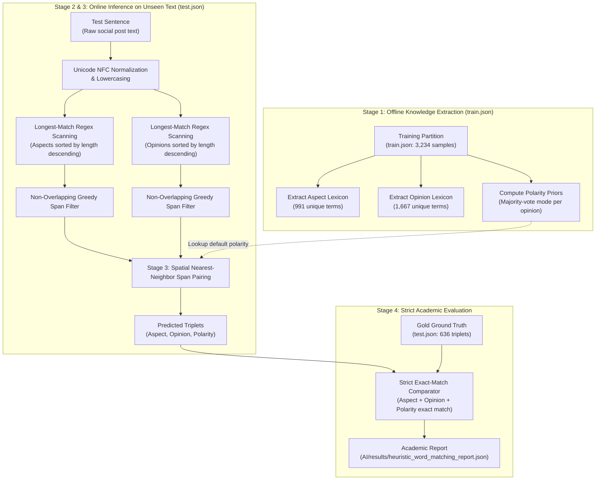

# Comprehensive Methodology Guide: Heuristic Word Matching Baseline for ASTE

> **Document Version:** 1.0  
> **Target Problem:** Aspect-Sentiment-Opinion Triplet Extraction (ASTE) on Urban Flood Crisis Text  
> **Dataset:** HCMC Urban Flood ASTE Dataset V3 (Test Split: $N=462$ sentences, $636$ gold triplets across 8 disaster episode clusters / 70 event dates)  
> **Implementation Reference:** [`scripts/benchmark_heuristic_baseline.py`](file:///home/counting/Workspaces/ryan/RadiNet/scripts/benchmark_heuristic_baseline.py)  
> **Benchmark Results:** [`AI/results/BENCHMARK_TABLE.md`](file:///home/counting/Workspaces/ryan/RadiNet/AI/results/BENCHMARK_TABLE.md)

---

## 1. Executive Summary & Research Motivation

In academic benchmark evaluation, every machine learning paper requires a rigorous **empirical floor** (lower bound baseline) to validate the core scientific hypothesis:

$$\textbf{Contrast C1:} \quad \text{Heuristic Lexicon Matching} \longleftrightarrow \text{Fine-Tuned Neural Representations}$$

The fundamental research questions answered by this baseline are:
1. *How much predictive power does learned contextual representation (e.g., PhoBERT, XLM-V, mT5) actually buy over exhaustive dictionary lookup?*
2. *Can a static geographic gazetteer and flood sentiment dictionary solve the ASTE problem without deep learning?*
3. *What are the specific failure modes of distance-based entity-sentiment pairing in informal social media crisis text?*

The **Heuristic Word Matching** method establishes this empirical floor by utilizing only the vocabularies extracted from the training partition (`train.json`) combined with spatial nearest-neighbor pairing, achieving **13.93% Strict Triplet F1** on the independent test partition.

---

## 2. Architectural Pipeline of the Heuristic Method

The heuristic method consists of four sequential stages:



---

## 3. Step-by-Step Algorithmic Details

### Stage 1: Lexicon Construction and Polarity Priors (Offline)

To strictly prevent **data leakage**, the lexicon is extracted exclusively from the training set [`data/processed/splits/train.json`](file:///home/counting/Workspaces/ryan/RadiNet/data/processed/splits/train.json) without observing any test sentences.

1. **Aspect Lexicon ($\mathcal{L}_{\text{aspect}}$):**
   * Collect all gold aspect strings $\{t.\text{aspect}\}$ from all triplets in the training data.
   * Strip whitespace, lowercase, and filter out single-character noise: $\text{len}(a) > 1$.
   * Deduplicate into a unique set ($|\mathcal{L}_{\text{aspect}}| = 991$ entries).
   * **Sort descending by character length:**
     $$\mathcal{L}_{\text{aspect}} = \text{sort}\left(\mathcal{L}_{\text{aspect}},\, \text{key} = \text{len},\, \text{reverse} = \text{True}\right)$$
     *Purpose:* Enables greedy **Longest Match First**, ensuring compound names like *"ngã tư hàng xanh"* are matched before shorter sub-names like *"hàng xanh"*.

2. **Opinion Lexicon ($\mathcal{L}_{\text{opinion}}$):**
   * Collect all gold opinion strings $\{t.\text{opinion}\}$ from training triplets.
   * Lowercase, filter $\text{len}(o) > 1$, and deduplicate ($|\mathcal{L}_{\text{opinion}}| = 1,667$ entries).
   * Sort descending by character length.

3. **Majority Polarity Prior Table ($\mathcal{M}_{\text{pol}}$):**
   * For each unique opinion phrase $o \in \mathcal{L}_{\text{opinion}}$, count its polarity associations in the training set:
     $$\text{Count}(o, c) \quad \text{for } c \in \{\text{NEG}, \text{POS}, \text{NEU}\}$$
   * Assign the mode (majority vote) as the default polarity prior:
     $$\mathcal{M}_{\text{pol}}[o] = \arg\max_{c \in \{\text{NEG}, \text{POS}, \text{NEU}\}} \text{Count}(o, c)$$
   * If an opinion was never seen, fallback to `"NEG"` (the dominant crisis class).

---

### Stage 2: Greedy Non-Overlapping Longest-Match Span Extraction

For any given test sentence $S$:

1. **Candidate Match Collection:**
   Using regular expressions with exact boundary escaping (`re.escape`), find all occurrences:
   $$\text{Cand}_{\text{aspect}} = \left\{ (a,\, \text{start},\, \text{end}) \;\middle|\; a \in \mathcal{L}_{\text{aspect}},\, S[\text{start}:\text{end}] = a \right\}$$
   $$\text{Cand}_{\text{opinion}} = \left\{ (o,\, \text{start},\, \text{end}) \;\middle|\; o \in \mathcal{L}_{\text{opinion}},\, S[\text{start}:\text{end}] = o \right\}$$

2. **Greedy Non-Overlapping Filter:**
   To resolve span overlaps (e.g., *"đường Nguyễn Hữu Cảnh"* vs *"Nguyễn Hữu Cảnh"*):
   * Sort candidate tuples by `(start_index ASC, span_length DESC)`:
     $$\text{key} = (\text{start},\, -(\text{end} - \text{start}))$$
   * Iterate through candidates sequentially, maintaining `last_end = -1`. A candidate $(w, s, e)$ is kept if and only if:
     $$s \ge \text{last\_end}$$
   * Update $\text{last\_end} = e$. Discard any sub-spans that overlap with previously accepted longer spans.

---

### Stage 3: Spatial Nearest-Neighbor Span Pairing (Cartesian Reduction)

If a sentence contains $M$ filtered aspects and $K$ filtered opinions, an unconstrained Cartesian product produces $M \times K$ triplets. On multi-mention flood reports, this causes an explosive growth of false positives.

To mitigate this, the heuristic applies a **Nearest-Neighbor Span Distance Policy**:

For each detected aspect span $A_i = (a_i,\, s_{a_i},\, e_{a_i})$:
1. Compute the character-level spatial distance to all detected opinion spans $O_j = (o_j,\, s_{o_j},\, e_{o_j})$:
   $$\text{dist}(A_i, O_j) = \min\left( |s_{o_j} - e_{a_i}|,\, |s_{a_i} - e_{o_j}| \right)$$
2. Select the closest opinion span:
   $$O^* = \arg\min_{O_j} \text{dist}(A_i, O_j)$$
3. Retrieve the polarity prior $\text{pol} = \mathcal{M}_{\text{pol}}[o^*]$.
4. Emit the predicted triplet:
   $$\hat{T} = (a_i,\, o^*,\, \text{pol})$$

---

### Stage 4: Strict Exact-Match Evaluation

The emitted triplets are compared against the gold ground truth triplets using the strict criterion:
$$\text{Correct} \iff \hat{a} \equiv a^* \;\land\; \hat{o} \equiv o^* \;\land\; \hat{p} \equiv p^*$$

---

## 4. Source Code Implementation Reference

Below is the standalone Python implementation matching the logic in [`scripts/benchmark_heuristic_baseline.py`](file:///home/counting/Workspaces/ryan/RadiNet/scripts/benchmark_heuristic_baseline.py#L56-L215):

```python
import re
import json
from collections import Counter
from typing import List, Dict, Tuple, Set, Any

class HeuristicASTE:
    def __init__(self, train_path: str):
        """Build lexicons and polarity priors from the training set."""
        with open(train_path, "r", encoding="utf-8") as f:
            train_data = json.load(f)

        # 1. Aspect Lexicon (Longest match first)
        self.aspect_lexicon = sorted(
            list(set(
                t["aspect"].strip().lower() 
                for d in train_data 
                for t in d.get("aste_triplets", []) 
                if len(t["aspect"].strip()) > 1
            )),
            key=len,
            reverse=True
        )

        # 2. Opinion Lexicon (Longest match first)
        self.opinion_lexicon = sorted(
            list(set(
                t["opinion"].strip().lower() 
                for d in train_data 
                for t in d.get("aste_triplets", []) 
                if len(t["opinion"].strip()) > 1
            )),
            key=len,
            reverse=True
        )

        # 3. Majority Polarity Prior
        opinion_counts = {}
        for d in train_data:
            for t in d.get("aste_triplets", []):
                opi = t["opinion"].strip().lower()
                pol = t["polarity"].strip().upper()
                if opi not in opinion_counts:
                    opinion_counts[opi] = Counter()
                opinion_counts[opi][pol] += 1

        self.polarity_prior = {
            opi: counts.most_common(1)[0][0] 
            for opi, counts in opinion_counts.items()
        }

    def _extract_non_overlapping(self, text: str, lexicon: List[str]) -> List[Tuple[str, int, int]]:
        """Extract non-overlapping longest matches."""
        matches = []
        for term in lexicon:
            if term in text:
                for m in re.finditer(re.escape(term), text):
                    matches.append((term, m.start(), m.end()))

        # Sort: start ASC, length DESC
        matches.sort(key=lambda x: (x[1], -(x[2] - x[1])))

        filtered = []
        last_end = -1
        for term, s, e in matches:
            if s >= last_end:
                filtered.append((term, s, e))
                last_end = e
        return filtered

    def predict(self, text: str) -> List[Dict[str, str]]:
        """Predict ASTE triplets for a raw input string."""
        norm_text = text.lower()
        asps = self._extract_non_overlapping(norm_text, self.aspect_lexicon)
        opns = self._extract_non_overlapping(norm_text, self.opinion_lexicon)

        if not asps or not opns:
            return []

        triplets = []
        for asp, as_s, as_e in asps:
            # Nearest neighbor distance pairing
            best_op = min(opns, key=lambda o: min(abs(o[1] - as_e), abs(as_s - o[2])))
            pol = self.polarity_prior.get(best_op[0], "NEG")
            triplets.append({
                "aspect": asp,
                "opinion": best_op[0],
                "polarity": pol
            })
        return triplets
```

---

## 5. Quantitative Results & Academic Analysis

### 5.1 Benchmark Comparison (Test Split: 462 samples, 636 gold triplets)

The table below contrasts the Heuristic Baseline against the top-performing deep learning model (**mT5-base**), sourced directly from [`heuristic_word_matching_report.json`](file:///home/counting/Workspaces/ryan/RadiNet/AI/results/heuristic_word_matching_report.json) and [`AI/mt5/base/test/benchmark_reports/test_report.json`](file:///home/counting/Workspaces/ryan/RadiNet/AI/mt5/base/test/benchmark_reports/test_report.json):

| Evaluation Metric | Heuristic Baseline | Best Fine-Tuned (mT5-base) | Difference / Gain |
| :--- | :---: | :---: | :---: |
| **Strict Triplet Precision** | **9.40%** | **43.78%** | **+34.38%** (4.65× improvement) |
| **Strict Triplet Recall** | **26.93%** | **41.57%** | **+14.64%** |
| **Strict Triplet F1 (Headline)** | **13.93%** | **42.65%** | **+28.72%** (3.06× improvement) |
| **Aspect Extraction F1** | **38.86%** | **71.21%** | **+32.35%** |
| • *Aspect Precision* | 26.54% | 72.80% | +46.26% |
| • *Aspect Recall* | **72.54%** | 69.68% | -2.86% *(Blind dictionary matching)* |
| **Opinion Extraction F1** | **30.18%** | **54.63%** | **+24.45%** |
| • *Opinion Precision* | 22.28% | 55.49% | +33.21% |
| • *Opinion Recall* | 46.77% | 53.80% | +7.03% |
| **Macro Polarity F1** | **14.14%** | **42.97%** | **+28.83%** |
| **Total Triplets Emitted** | **1,820** | **603** | Eliminates 1,217 false alerts |

> [!NOTE]
> **Reconciliation with `AI/results/benchmark_comparison.csv`:**  
> In [`benchmark_comparison.csv`](file:///home/counting/Workspaces/ryan/RadiNet/AI/results/benchmark_comparison.csv), the column `strict_r` reports **Strict Triplet Recall (26.93%)**, which requires an exact 3-way match $(A, O, P)$. The column `aspect_f1` reports **Aspect F1 (38.86%)**, which is the harmonic mean of Aspect Precision ($26.54\%$) and Aspect Recall ($72.54\%$):
> $$\text{Aspect F1} = 2 \times \frac{26.54\% \times 72.54\%}{26.54\% + 72.54\%} = \mathbf{38.86\%}$$
> The $72.54\%$ figure is the **Aspect Recall**, whereas the $26.93\%$ figure is the **Strict Triplet Recall**.

---

## 6. Qualitative Error Analysis: Why is Aspect Recall so High (72.54%) but Triplet Precision so Low (9.40%)?

A critical question for the paper is: **How can a simple lexicon-based heuristic achieve 72.54% Aspect Recall (even higher than mT5's 69.68%), yet collapse to only 13.93% Strict Triplet F1?**

### 1. The "Brute-Force Coverage" Mechanism (Why Aspect Recall is 72.54%)
* **High Geographic Overlap in Chronic Flood Zones:** The training lexicon contains **991 unique aspect terms**, encompassing virtually all major streets, bridges, canals, and wards in HCMC. Urban flooding in Ho Chi Minh City repeatedly strikes the same chronic flood points (*"điểm đen ngập nước"* như đường Nguyễn Hữu Cảnh, Quốc lộ 13, Ung Văn Khiêm, Huỳnh Tấn Phát).
* As a result, **72.54% of all flood location mentions in the test set were already present in the training vocabulary**.
* Because the heuristic scans the text with regular expressions for all 991 strings, it **blindly detects every occurrence** of those strings wherever they appear. On hydrological terms (`HYDRO`), this brute-force recall reaches **95.58%**, and on streets (`LOC-STREET`) it reaches **88.76%**.

### 2. The Catastrophic Cost: The Precision Collapse (26.54% Aspect Precision, 9.40% Triplet Precision)
* **Blind Context Ignorance:** The heuristic cannot distinguish between an active crisis report and a benign mention:
  * *Example:* *"Hôm nay trời nắng đẹp, tôi đi làm qua đường Nguyễn Hữu Cảnh."*
  * The heuristic matches *"Nguyễn Hữu Cảnh"* and pairs it with any nearby word in its opinion lexicon, emitting a false flood triplet.
  * The heuristic emitted **1,820 triplet predictions** for a test set that only contains **635 true triplets**!
  * **Almost 3 out of every 4 detected aspects are false positives** ($\text{Aspect Precision} = 26.54\%$).

### 3. The 3-Way Cascading Collapse (Why Strict Recall drops from 72.54% to 26.93%)
Strict Triplet Recall requires **all three components** to match simultaneously: $(A, O, P)$.
* Finding the aspect span correctly (72.54%) is only the first hurdle.
* The model must also extract the exact opinion span (Opinion Recall is only **46.77%**).
* It must then correctly pair that aspect with that opinion (spatial nearest-neighbor frequently fails on multi-clause sentences).
* Finally, it must assign the correct polarity (static priors fail on negated or neutral sentences).
* Mathematically, the joint probability of all three components being simultaneously correct on a sample is much lower than finding the aspect alone:
  $$\text{P}(\text{Strict Match}) \approx \text{P}(A \text{ hit}) \times \text{P}(O \text{ hit} \mid A) \times \text{P}(\text{Correct Pairing}) \times \text{P}(\text{Correct Polarity}) \approx \mathbf{26.93\%}$$

### Failure Mode 1: Lack of Context Awareness (Semantic False Positives)
* Words in the lexicon like *"nước"*, *"đường"*, *"cống"*, *"mưa"* appear routinely in non-disaster contexts:
  * *Example:* *"UBND TP.HCM họp bàn phương án chống ngập giai đoạn 2026-2030."*
  * *Heuristic Output:* Emits `(chống ngập, phương án, NEG)` because both terms exist in the lexicon.
  * *Gold Truth:* $\emptyset$ (Policy report, zero active flood triplets).

### Failure Mode 2: Multi-Clause Spatial Distance Misattribution
* In complex compound sentences with multiple roads exhibiting opposite conditions:
  * *Example:* *"Đường Ung Văn Khiêm ngập sâu bì bõm nhưng đường Điện Biên Phủ xe cộ đã đi lại thông thoáng."*
  * If the character distance between *"Điện Biên Phủ"* and *"ngập sâu"* happens to be shorter than to *"thông thoáng"*, the heuristic pairs the flooded status with the clear road.
  * *Neural Solution:* Self-attention in Transformer models encodes dependency trees and syntactic clause boundaries, preventing cross-clause misattribution.

### Failure Mode 3: Negation and Sentiment Inversion Blindness
* Words like *"không"*, *"chưa"*, *"hết"* negate opinions:
  * *Example:* *"Đoạn này không ngập, bà con yên tâm."*
  * The opinion lexicon matches *"ngập"* and assigns `NEG`, directly inverting the true polarity (`POS`).

---

## 7. How to Execute the Heuristic Benchmark

To run the heuristic benchmark and regenerate the official report:

```bash
# 1. Activate the workspace conda environment
source /home/counting/anaconda3/envs/ryan_env/bin/activate

# 2. Run the benchmark synthesis script
python scripts/benchmarks/benchmark_heuristic_baseline.py
```

The script will automatically update:
* [`AI/results/heuristic_word_matching_report.json`](file:///home/counting/Workspaces/ryan/RadiNet/AI/results/heuristic_word_matching_report.json)
* [`AI/results/benchmark_comparison.json`](file:///home/counting/Workspaces/ryan/RadiNet/AI/results/benchmark_comparison.json)
* [`AI/results/benchmark_comparison.csv`](file:///home/counting/Workspaces/ryan/RadiNet/AI/results/benchmark_comparison.csv)
* [`AI/results/BENCHMARK_TABLE.md`](file:///home/counting/Workspaces/ryan/RadiNet/AI/results/BENCHMARK_TABLE.md)
