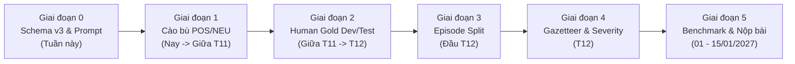

# 📘 HƯỚNG DẪN CHI TIẾT NÂNG CẤP DATASET ASTE LÊN CHUẨN V3
## Lộ Trình Sửa Dataset Để Công Bố Bài Báo Quốc Tế (ICWSM / KDD) & Chuẩn Hóa Hệ Thống Giám Sát Thời Gian Thực (RadiNet)
### *(Tích hợp sâu các nguyên lý kiến trúc & phương pháp luận từ RadiNet Master Notes)*

> **Dành cho**: Bạn phụ trách dữ liệu, gán nhãn AI & Kỹ sư phát triển hệ thống  
> **Mục tiêu**: Khắc phục triệt để lỗi mất cân bằng nhãn chí mạng, chuẩn hóa Schema v3 (bỏ hoàn toàn cấp Quận theo NQ 1685), thống nhất nguyên tắc phân định POS / NEU / NEG theo chuẩn SemEval-2014 Task 4, và hoàn thiện tập Gold Dataset phục vụ nộp bài báo khoa học (Hạn chót: **15/01/2027 - ICWSM 2027 Round 3**).

---

## 🎯 1. Bối Cảnh: Những Gì Đang Rất Tốt & "Tử Huyệt" Cần Sửa Ngay

### ✅ Những thứ ĐÃ LÀM RẤT TỐT (TUYỆT ĐỐI GIỮ NGUYÊN, KHÔNG ĐẬP ĐI LÀM LẠI):
1. **Hạ tầng GIS và Địa danh chuẩn hóa**: 122 điểm ngập chuẩn CSGT (tọa độ GPS 5 số thập phân), cơ chế đối soát OpenStreetMap (tim đường highway), bộ nhớ tự học dynamic cache và **168 Phường/Xã/Thị trấn mới chuẩn Nghị quyết 1685/NQ-UBTVQH15** (đã xóa bỏ hoàn toàn cấp Quận). Đây là điểm sáng vượt trội hơn hẳn các bài báo quốc tế cùng mảng.
2. **Tổ chức theo đợt ngập (Episode-based)**: Đã gom bài viết theo 7 đợt ngập thực tế (`raw/episodes/`) và kho lưu trữ lịch sử (`historical_archive/`).
3. **Quy mô dữ liệu đủ lớn**: 3.922 câu / 5.483 bộ ba ASTE (tương đương quy mô tập chuẩn SemEval-2014 Restaurant $\sim 3\text{K}$ câu).
4. **Kỷ luật kỹ thuật sạch sẽ**: Có sổ nhớ chống trùng lặp (`pipeline_state.json`), nhật ký kiểm toán (`crawl_csgt_audit.json`) và luồng mô phỏng offline.

---

### 🚨 "TỬ HUYỆT" CHÍ MẠNG BẮT BUỘC PHẢI SỬA:
Phân phối nhãn cảm xúc hiện tại:
$$\mathbf{NEG:\; 94.2\%} \quad|\quad \mathbf{NEU:\; 5.5\%} \quad|\quad \mathbf{POS:\; 0.3\%}$$
* **Hậu quả học thuật (Paper)**: Cả tập 5.483 bộ ba chỉ có **16 bộ ba POS** ($0.3\%$). Nếu một mô hình "ngu ngốc" chỉ dự đoán bừa mọi câu là `NEG`, nó vẫn đạt độ chính xác $94\%$. **Reviewer quốc tế sẽ đánh trượt bài báo ngay lập tức vì benchmark bị suy biến (degenerate)**; chỉ số Macro-F1 mất hoàn toàn ý nghĩa.
* **Hậu quả hệ thống (RadiNet)**: Hệ thống không thể học được tín hiệu "giải tỏa ngập" (*nước đã rút*, *hết ngập*, *đường khô ráo*) để hạ nhiệt và chuyển cờ ĐỎ thành XANH trên bản đồ Heatmap, làm tê liệt cơ chế dập tắt cảnh báo (Resolution Engine).
* **Nguyên nhân gốc rễ**: Thiên kiến cào dữ liệu (chỉ tìm từ khóa kêu ca ngập nước nên toàn bài tiêu cực) và Prompt gán nhãn bằng LLM mặc định coi ngập lụt là `NEG`.

---

## 🗺️ LỘ TRÌNH 6 GIAI ĐOẠN CHI TIẾT (ACTION PLAN)



---

## 🛠️ GIAI ĐOẠN 0: CHUẨN HÓA SCHEMA V3 & NGUYÊN TẮC QUYẾT ĐỊNH (MASTER RULES)
*Trước khi gán nhãn thêm bất kỳ câu nào mới, phải chốt cấu trúc dữ liệu v3 và nắm vững các bài kiểm tra ranh giới từ RadiNet Master Notes.*

### 1. Cấu trúc một bộ ba chuẩn trong Schema v3:
Thay vì chỉ lưu `(aspect, opinion, polarity)` thô sơ, bổ sung thêm 4 trường ngữ cảnh:

```json
{
  "aspect": "Trần Xuân Soạn",
  "opinion": "nước đã rút sạch, xe cộ đi lại bình thường",
  "polarity": "POS",
  "aspect_category": "LOCATION_STREET",
  "gazetteer_id": "csgt_tide_01",
  "grounding_provenance": "SPAN_MATCHED",
  "severity": "RECOVERED"
}
```

* **`aspect_category`** (5 nhóm chuẩn & Phân vai luồng hệ thống):
  1. `LOCATION_STREET`: Tên đường, giao lộ, ngã tư, cầu (*Trần Xuân Soạn, Bảy Hiền, Cầu Chữ Y, Hầm chui An Phú*). **Kích hoạt sự cố cấp đường (Primary Trigger $\rightarrow$ Cắm cờ ĐỎ, đo Spatial Recall)**.
  2. `LOCATION_ADMIN`: Phường, Xã, Thị trấn, Khu vực đô thị (*Thảo Điền, An Khánh, Tân Thuận, Bến Cát, Khu Nam TP.HCM*). **Tuyệt đối không dùng cấp Quận theo NQ 1685**. Vai trò: Gom cụm hành chính và định vị dự phòng cấp cơ sở (Fallback localization).
  3. `HYDROLOGY`: Sông, kênh, rạch, hồ, triều cường (*Sông Sài Gòn, Kênh Nhiêu Lộc - Thị Nghè, Rạch Xuyên Tâm, triều cường*). Vai trò: Cung cấp ngữ cảnh tràn bờ, triều dâng.
  4. `INFRASTRUCTURE_DRAINAGE`: Cống kiểm soát triều, trạm bơm, miệng cống, nắp ga, dự án nạo vét (*Trạm bơm Thảo Điền, Cống ngăn triều Mương Chuối, nạo vét rạch*). Vai trò: Tầng giải thích nguyên nhân (Explanation layer) & vật mang POSITIVE chính khi công trình hoàn thành, dùng để xác thực hạ nhiệt (Resolution corroboration), **không cắm cờ đỏ ngập đường**.
  5. `RESPONSE_ENTITY`: Lực lượng ứng phó, công nhân thoát nước, CSGT, đội cứu hộ đô thị. Vai trò: Vật mang POS/NEG đánh giá chất lượng phục vụ của chính quyền.

> [!TIP]
> **Bài Kiểm Tra Quỳ Tím (The Human-Maintenance Litmus Test) phân biệt HYDROLOGY vs. INFRASTRUCTURE_DRAINAGE**:
> *"Thực thể đó có còn tồn tại nếu con người ngừng hoàn toàn việc duy tu, bảo dưỡng không?"*
> - **CÒN TỒN TẠI** (Sông Sài Gòn, Kênh Nhiêu Lộc, hiện tượng triều cường) $\rightarrow$ Gán nhãn `HYDROLOGY`.
> - **KHÔNG CÒN TỒN TẠI / HƯ HỎNG** (Cống ngăn triều, trạm bơm, nắp ga, công trình nạo vét) $\rightarrow$ Gán nhãn `INFRASTRUCTURE_DRAINAGE`.

* **`grounding_provenance`** (Nguồn gốc định vị tọa độ):
  - `SPAN_MATCHED`: Tên đường xuất hiện chính xác từng ký tự trong câu và map thẳng vào CSGT/OSM.
  - `FUZZY`: Tên viết tắt hoặc sai chính tả nhưng map được qua danh bạ (ví dụ: *TXS* $\rightarrow$ *Trần Xuân Soạn*).
  - `DOC_FALLBACK`: Bài viết không nêu tên đường cụ thể (*"Khu tôi nước ngập lút bánh"*), lấy tọa độ mặc định của tâm Phường/Xã đăng bài (Tuyệt đối không lấy tọa độ cấp Quận).
* **`severity`** (Mức độ nghiêm trọng của hiện tượng):
  - `HIGH`: Ngập nặng, tê liệt giao thông, xe chết máy hàng loạt, tràn vào nhà dân.
  - `MEDIUM`: Ngập lút nửa bánh xe, nước dâng chậm, di chuyển khó khăn.
  - `LOW`: Nước mấp mé vỉa hè, đọng vũng nhỏ, phương tiện đi lại chậm.
  - `RECOVERED`: Nước rút hết, đường khô ráo, giao thông thông suốt bình thường (**dành riêng cho POS**).

---

### 2. PHÂN TÍCH CHUYÊN SÂU: GÁN NHÃN POS vs NEU vs NEG
*(Dựa trên chuẩn SemEval-2014 Task 4 và RadiNet Master Notes)*

> [!IMPORTANT]
> **Quy Tắc Quyết Định Cực Tính 1 Câu (The 1-Sentence Polarity Litmus Test)**:  
> *"Trước tiên hãy tự hỏi: Câu văn có chứa sự đánh giá / thẩm định giá trị tường minh (explicit evaluation) đối với Aspect hay không?*  
> *• Nếu CÓ: Dấu của sự đánh giá quyết định nhãn là POSITIVE hay NEGATIVE.*  
> *• Nếu KHÔNG: Nhãn BẮT BUỘC là NEUTRAL bất kể câu văn có nhắc đến từ 'ngập' hay không."*

#### A. Phân Tích Thực Chiến: "Khánh thành cống ngăn triều" vs. "Dự án phát huy hiệu quả"

| Nội dung phản ánh | Nhãn đúng | Giải thích ngữ nghĩa ABSA (Master Notes Rule) | Tác động lên Hệ thống RadiNet |
| :--- | :---: | :--- | :--- |
| **"Khánh thành cống ngăn triều Mương Chuối"** / *"Vận hành thử nghiệm trạm bơm Thảo Điền"* / *"Khởi công nạo vét rạch Xuyên Tâm"* | **`NEU`** | **Thông báo sự kiện hành chính / Kỹ thuật khách quan (Event Announcement)**. Không chứa từ ngữ biểu đạt cảm xúc khen/chê và không phản ánh hiện trạng khô ráo hay ngập của mặt đường tại thời điểm đó. | Không kích hoạt chuyển màu bản đồ ngập. Cung cấp dữ liệu hạ tầng cho lớp layer tĩnh của GIS. |
| **"Dự án chống ngập phát huy hiệu quả, đường Nguyễn Hữu Cảnh không còn ngập"** / *"Nạo vét rạch giúp nước rút nhanh, bà con phấn khởi"* | **`POS`** | **Đánh giá tích cực (Praise) & Xác nhận phục hồi (Recovery)**. Chứa cụm từ thẩm định giá trị tích cực (*phát huy hiệu quả*, *không còn ngập*, *nước rút nhanh*, *phấn khởi*). | Kích hoạt hạ nhiệt cảnh báo ngập trên tuyến đường liên quan (`severity: RECOVERED` hoặc `LOW`). |

#### B. Khung Định Nghĩa Rõ Ràng Cho 3 Lớp Cực Tính:

1. **Nhãn POS (Positive - Tích cực & Phục hồi)**:
   - **Nhóm 1 (POS-RECOVERY - Cốt lõi của Real-time Resolution)**: Phản ánh nước đã rút, đường khô ráo, phương tiện lưu thông bình thường sau mưa/triều cường.
     - *Ví dụ*: `"Đường Trần Xuân Soạn nước đã rút sạch, giao thông thông thoáng"` $\rightarrow$ `aspect: "Trần Xuân Soạn"`, `opinion: "nước đã rút sạch"`, `polarity: "POS"`, `severity: "RECOVERED"`.
   - **Nhóm 2 (POS-PRAISE - Đánh giá cao hạ tầng / Lực lượng ứng trực)**: Khen ngợi công trình vận hành tốt, công nhân/CSGT dầm mưa giúp dân kịp thời.
     - *Ví dụ*: `"Đội CSGT Phường Bến Cát kịp thời đẩy xe giúp người dân qua điểm ngập an toàn"` $\rightarrow$ `aspect: "Đội CSGT"`, `opinion: "kịp thời đẩy xe giúp người dân"`, `polarity: "POS"`, `aspect_category: "RESPONSE_ENTITY"`.

2. **Nhãn NEU (Neutral - Khách quan / Đo đạc / Thông tin thuần túy)**:
   - Các bài viết dự báo thời tiết, đo đạc mực nước kỹ thuật, thông cáo khánh thành dự án không kèm thái độ cảm xúc:
     - *Ví dụ 1*: `"Đài khí tượng Nam Bộ dự báo đỉnh triều lúc 17h đạt mức 1m70"` $\rightarrow$ `aspect: "triều cường"`, `opinion: "đạt mức 1m70"`, `polarity: "NEU"`.
     - *Ví dụ 2*: `"Trạm quan trắc ghi nhận mực nước tại đường Huỳnh Tấn Phát cao 25cm"` $\rightarrow$ `aspect: "Huỳnh Tấn Phát"`, `opinion: "cao 25cm"`, `polarity: "NEU"`, `severity: "LOW"`.
     - *Ví dụ 3*: `"UBND TP.HCM khánh thành cống kiểm soát triều Bến Nghé"` $\rightarrow$ `aspect: "cống kiểm soát triều Bến Nghé"`, `opinion: "khánh thành"`, `polarity: "NEU"`, `aspect_category: "INFRASTRUCTURE_DRAINAGE"`.

3. **Nhãn NEG (Negative - Tiêu cực / Thiệt hại / Khó khăn)**:
   - Phản ánh đường ngập sâu, phương tiện chết máy, giao thông tê liệt, nước tràn vào nhà, người dân bức xúc:
     - *Ví dụ*: `"Đường Võ Văn Ngân ngập lút bánh xe, hàng chục xe máy chết máy la liệt"` $\rightarrow$ `aspect: "Võ Văn Ngân"`, `opinion: "ngập lút bánh xe, chết máy la liệt"`, `polarity: "NEG"`, `severity: "HIGH"`.

#### C. Hai Quy Tắc Biên Tối Quan Trọng (Edge Rules từ Section 2.1 Master Notes):
1. **Quy tắc bài đăng nghi vấn (Interrogative Posts)**:
   - Các câu hỏi thông tin như: *"Đoạn Huỳnh Tấn Phát ngập chưa mn?", "Đường Nguyễn Hữu Cảnh có ngập không ạ?"* $\rightarrow$ **Tuyệt đối KHÔNG kích hoạt tạo điểm ngập trên bản đồ**, chỉ ghi nhận nhu cầu hỏi đáp (`NEU`, không có opinion khẳng định).
2. **Quy tắc tiệm cận không - thời gian của nhãn POS (Spatiotemporal Proximity Rule)**:
   - Một báo cáo `POS` (*"nước đã rút", "đường khô ráo"*) chỉ được bộ máy Resolution Engine coi là **Sự kiện dập tắt sự cố (Resolution Event - chuyển cờ đỏ thành xanh)** khi nó **ở gần về mặt thời gian (trong vòng vài giờ) và không gian với một điểm ngập đang hoạt động (active incident)**.
   - Một bài viết trong mùa khô hoặc bài tổng kết năm (*"Năm nay đường Nguyễn Hữu Cảnh hết ngập hẳn"*) là **Status Update / Praise**, không phải là sự kiện giải tỏa ngập tức thời!

---

### 3. NĂM QUY TẮC VÀNG KHI GÁN NHÃN (ANNOTATION GOLD RULES):

> [!IMPORTANT]
> **Triết lý cốt lõi**: *"Dataset giữ nguyên hiện trường — Hệ thống xử lý ở ranh giới (The dataset keeps the noise verbatim; the system handles noise at its own boundaries, never the data)."*

1. **Quy tắc 1: Aspect & Opinion PHẢI là chuỗi ký tự nguyên văn (Verbatim Span)**:
   - **Tuyệt đối KHÔNG tự ý sửa chính tả, gõ tắt hay từ lóng**: Người viết gõ `"kinh khũng"` thì nhãn giữ nguyên `"kinh khũng"`; gõ `"hầm chui"` giữ nguyên `"hầm chui"`; gõ `"TXS"` giữ nguyên `"TXS"`.
   - **Lý do học thuật**: Nhãn Span là bằng chứng (evidence) trích xuất trực tiếp từ bài viết. Nếu sửa nhãn thành chữ đúng, bạn tạo ra mismatch giữa câu văn và nhãn, khiến mô hình ASTE bị phạt sai khi train. Việc này cũng bảo đảm độ nhất quán **Cohen's Kappa** giữa các annotator.
   - **Chuẩn hóa địa danh để đâu?** Trách nhiệm chuẩn hóa `"TXS"` $\rightarrow$ `"Trần Xuân Soạn"` thuộc về **Tầng Định vị Địa lý GIS (qua thuật toán RapidFuzz và CSGT Hotspot Database)**, tuyệt đối không can thiệp bên trong text span của Dataset!

2. **Quy tắc 2: Kỹ thuật 3 Chốt Chặn Làm Sạch Span (Belt-and-Braces Span Sanitation)**:
   - Ngay từ Prompt LLM: Ra lệnh chỉ lấy Head Entity, không ăn lan sang giới từ (*ở, tại, trên, đoạn, khu vực*) và vị ngữ (*mới không còn, chìm trong biển*).
   - Khi chạy script kiểm toán (Regex Audit) tự động cắt tỉa giới từ thừa, phải áp dụng **3 chốt an toàn**:
     1. `aspect_span` sau khi cắt tỉa vẫn phải là chuỗi con thực sự của câu (`aspect_span in sentence`).
     2. `aspect_span` và `opinion_span` tuyệt đối không được chồng lấn ký tự (no overlap).
     3. Span phải duy nhất và định vị được. Nếu việc cắt bỏ làm span rỗng hoặc chỉ còn vị ngữ (ví dụ *"khu vực ngập"* nếu cắt *"khu vực"* chỉ còn *"ngập"*), thì **giữ nguyên span gốc** và gán cờ `grounding_provenance: "DOC_FALLBACK"` về tâm Phường/Xã.

3. **Quy tắc 3: TUYỆT ĐỐI KHÔNG GÁN XE CỘ LÀM ASPECT**:
   - Xe máy, ô tô là **nạn nhân** chịu ảnh hưởng, không phải thực thể địa lý/công trình bị ngập!
   - ❌ *Sai:* `(phương tiện giao thông | chết máy | NEG)`
   - ✅ *Đúng:* Quy về tuyến đường nơi xe chết máy: `(Đường Võ Văn Ngân | xe chết máy hàng loạt | NEG)`

4. **Quy tắc 4: Polarity = Thái độ đối với Aspect, KHÔNG PHẢI có ngập hay không**:
   - Tuân thủ nghiêm ngặt **Quy tắc quyết định cực tính 1 câu** ở Mục 2.

5. **Quy tắc 5: Chính sách Biểu tượng cảm xúc (Emoji Policy)**:

| Câu hỏi quy chuẩn | Quy tắc thực thi | Giải thích lý do |
| :--- | :---: | :--- |
| **Emoji trong văn bản bài đăng?** | 🟢 **CÓ, giữ nguyên raw** | Gộp các emoji lặp liên tiếp (`😭😭😭` $\rightarrow$ `😭`) để chuẩn hóa biên từ. |
| **Emoji định đoạt cực tính?** | 🟢 **CÓ** | `😭`, `🤬` là bằng chứng tiêu cực (`NEG`); `🎉`, `👍` là bằng chứng tích cực / nước rút (`POS`). |
| **Emoji nằm trong Aspect span?** | 🔴 **KHÔNG BAO GIỜ** | Aspect luôn luôn là danh từ/địa danh bằng chữ. |
| **Emoji nằm trong Opinion span?** | 🟡 **Mặc định là KHÔNG** | Giữ nguyên chữ: lấy `"ngập ghê quá"` chứ không lấy kèm `😭`. |
| ⚠️ **NGOẠI LỆ ĐẮT GIÁ**: | 🟢 **LẤY LÀM OPINION** | Khi bài đăng/bình luận **chỉ có duy nhất emoji mà không có từ ngữ** (Ví dụ: *"Hầm An Phú 😭😭"*), lúc này `😭` **chính là Opinion span**! (Nếu bỏ qua sẽ làm mất thông tin cảnh báo khẩn cấp). |

---

### 4. NGUYÊN TẮC "CỬA MỀM" ĐỐI VỚI 122 ĐIỂM NGẬP CSGT (THE 122-HOTSPOT PRINCIPLE):
*(Chiến lược phòng thủ phản biện học thuật từ Section 3.7 Master Notes)*

> [!WARNING]
> **Tuyệt đối KHÔNG ĐƯỢC biến danh sách 122 điểm ngập CSGT thành một bộ lọc đóng (Hard Gate)**.
> - **Nguy cơ phản biện**: Nếu hệ thống chỉ chấp nhận các bài đăng nằm trong 122 điểm CSGT, độ chính xác (Precision) cao chỉ là do "tự biên tự diễn theo danh sách có sẵn". Reviewer sẽ chất vấn: *"Vậy mạng xã hội phát hiện được điểm ngập mới nào ngoài danh mục hành chính?"*
> - **Quy tắc chuẩn mực**: 122 điểm ngập CSGT chỉ đóng vai trò là **Soft Prior (Ưu tiên tham chiếu mềm)**:
>   1. Ưu tiên map nhanh tọa độ đã kiểm định nếu trùng tên.
>   2. Nếu bài đăng nhắc đến tuyến đường mới chưa có trong danh sách CSGT $\rightarrow$ Hệ thống tự động geocode qua **OpenStreetMap** và nạp vào **Dynamic Highway Cache**.
>   3. Trong bài báo khoa học, chúng ta sẽ tự hào công bố mục: *"Phát hiện N điểm ngập mới trong thực tế mà danh mục chính thức của cơ quan quản lý chưa kịp cập nhật"*!

---

## 🌊 GIAI ĐOẠN 1: CÂN BẰNG LẠI TỶ LỆ NHÃN (REBALANCE - NAY $\rightarrow$ GIỮA T11)

### Mục tiêu cần đạt:
- Bổ sung **+800 đến 1.000 bộ ba `POS`**.
- Bổ sung **+500 đến 800 bộ ba `NEU`**.
- Đưa tỷ lệ phân phối cuối cùng về mức lý tưởng: **$\approx 10–15\%$ POS**, **$\approx 15–20\%$ NEU**, **$\approx 65–75\%$ NEG**.

### Khai thác nguồn dữ liệu ở đâu? (Dựa trên hướng dẫn chuẩn hóa)
1. **Khai thác kho lưu trữ có sẵn (`data/raw/episodes/historical_archive/`)**:
   - Trích xuất các bài báo phản ánh:
     - Nhãn `POS`: *"nạo vét rạch Xuyên Tâm giúp nước rút nhanh"*, *"nâng cấp đường không còn ngập"*, *"dự án chống ngập phát huy hiệu quả"*.
     - Nhãn `NEU`: *"khánh thành cống ngăn triều Mương Chuối"*, *"vận hành cống kiểm soát triều"*, *"kế hoạch triển khai dự án thoát nước"*.
2. **Cào bổ sung có mục tiêu (Targeted Crawl) với bộ từ khóa POS**:
   - Từ khóa tìm kiếm: `"hết ngập"`, `"nước rút"`, `"nước đã rút"`, `"đỡ ngập"`, `"khô ráo"`, `"thông xe"`, `"thông thoáng trở lại"`, `"khen ngợi"`, `"ứng trực kịp thời"`, `"bình yên sau mưa"`.
   - Cào từ các kênh cộng đồng và hội nhóm: *Cảnh sát giao thông TP.HCM*, *Giao thông Quốc lộ 13*, *Hóng biến đường phố Sài Gòn*, các fanpage cộng đồng các Phường trọng điểm (Thảo Điền, Tân Thuận, Hiệp Bình, Bến Cát,...).
3. **Cào bổ sung bài viết NEU**:
   - Bản tin dự báo triều cường của Đài Khí tượng Thủy văn Nam Bộ.
   - Các bài đo đạc kỹ thuật: *"đỉnh triều lúc 17h đạt 1m70"*, *"trạm bơm vận hành từ 6h sáng"*, *"ngập sâu 20-30cm"*.
4. **Rà soát 200 mẫu `NEG` cũ (Kiểm toán thiên kiến LLM - False Negative Audit)**:
   - Bốc ngẫu nhiên 200 câu đang gán `NEG` trong tập hiện tại, 2 annotator người kiểm tra độc lập xem có bao nhiêu câu thực chất là đo đạc khách quan (ví dụ: *"mực nước cao 0.5m"*, *"trạm bơm đang hút nước"*) bị LLM gán nhầm thành `NEG`.
   - Đo tỷ lệ sai lệch để báo cáo trong bài báo khoa học theo phương pháp chuẩn *Gilardi et al., PNAS 2023*.

---

## 🚀 KẾ HOẠCH NÂNG CẤP FILE `scripts/crawl_targeted_pos.py` CHO BUỔI SAU

File `scripts/crawl_targeted_pos.py` hiện tại là một nền tảng tốt (đã có rào 3 lớp bảo vệ, lọc rác thể thao, giải mã RSS Google News). Để tương thích hoàn toàn với hệ thống mới và Schema v3, **cần thực hiện 5 điểm nâng cấp lớn vào buổi làm việc tiếp theo**:

### 1. Xóa Bỏ Hoàn Toàn Cấp "Quận" Theo Nghị Quyết 1685 (NQ 1685):
- **Hiện trạng trong code**: Dòng 102 và dòng 185 vẫn còn chứa `"quận 7"`, `"quận 8"`, `"Tôi là dân Quận 7"`.
- **Nâng cấp**: Thay thế danh sách truy vấn bằng các địa danh cấp Phường/Xã mới và các trục giao thông huyết mạch:
    ```python
    ('site:facebook.com "Phường Tân Thuận" "triều cường" "đã rút"', "facebook"),
    ('site:facebook.com "Phường Thảo Điền" "hết ngập" "thông thoáng"', "facebook"),
    ('site:facebook.com "Phường An Khánh" "nước đã rút" "lưu thông bình thường"', "facebook"),
    ('site:facebook.com "Phường Bến Cát" "nước rút" "khô ráo"', "facebook"),
    ```
- Cập nhật hàm `is_strictly_clean_pos_flood()` sử dụng danh bạ 168 Phường/Xã từ `core/gazetteer.py`.

### 2. Tách Bạch Rõ Ràng Hai Phân Nhánh POS: `POS-RECOVERY` vs `POS-PRAISE`:
- `POS-RECOVERY`: Nhận diện các cụm `"nước đã rút"`, `"khô ráo"`, `"hết ngập"`, `"thông thoáng trở lại"` $\rightarrow$ Gán metadata `severity: "RECOVERED"`, chuẩn bị sẵn sàng cho Resolution Engine dập cờ đỏ trên Heatmap.
- `POS-PRAISE`: Nhận diện các cụm `"khen ngợi"`, `"ứng trực kịp thời"`, `"dự án phát huy hiệu quả"`, `"CSGT giúp dân"` $\rightarrow$ Gán metadata `aspect_category: "RESPONSE_ENTITY"` hoặc `"INFRASTRUCTURE_DRAINAGE"`.

### 3. Tích Hợp Đẩy Dữ Liệu Trực Tiếp Vào Kafka Stream (`social.live.raw`):
- Thêm cờ `--kafka` để khi cần test luồng trực tiếp (Live Mode), dữ liệu POS cào về được bắn thẳng vào Kafka topic `social.live.raw` nhằm kiểm thử tính năng dập tắt sự cố thời gian thực của PySpark Streaming & Leaflet UI.

### 4. Đồng Bộ Hóa Chuẩn Thời Gian & Veracity Check (Open-Meteo):
- Bảo đảm 100% thời gian xuất ra định dạng chuẩn ISO 8601 có timezone UTC+7 (`published_at_utc7`). Cho phép module đối soát khí tượng Open-Meteo truy vấn chính xác lượng mưa tại đúng thời điểm bài viết được đăng tải.

### 5. Cấu Trúc Hóa Dữ Liệu Đầu Ra Theo Chuẩn Schema v3:
- Bổ sung sẵn các trường gợi ý cho quá trình gán nhãn ASTE v3 (gồm cả `aspect_category`, `grounding_provenance`, `severity`).

---

## 👥 GIAI ĐOẠN 2: KIỂM ĐỊNH CHUYÊN GIA (HUMAN GOLD VERIFICATION - GIỮA T11 $\rightarrow$ T12)

Bài báo khoa học đỉnh cao đòi hỏi tập Test phải được **con người xác thực 100% (Human-Gold)**:
- **Tập Train (Huấn luyện)**: Chấp nhận nhãn từ LLM gán tự động (Silver) có rà soát xác suất 10–20%.
- **Tập Dev (Kiểm định) & Test (Đánh giá)**: **100% do 2–3 người thẩm định độc lập**.
- **Đo chỉ số đồng thuận**: Tính chỉ số **Cohen's Kappa** giữa các người gán nhãn (mục tiêu $\kappa \ge 0.65–0.75$). Khi có bất đồng, nhóm trưởng (Adjudicator) sẽ đưa ra phán quyết cuối cùng. Số liệu $\kappa$ này sẽ được đưa thẳng vào Bảng 1 của bài báo quốc tế.

---

## 📅 GIAI ĐOẠN 3: PHÂN CHIA TẬP DỮ LIỆU THEO ĐỢT NGẬP (EPISODE-BASED SPLIT - THÁNG 12)

> [!CAUTION]
> **TUYỆT ĐỐI KHÔNG ĐƯỢC CHIA TẬP TRAIN/DEV/TEST BẰNG HÀM RANDOM SHUFFLE!**

* **Lý do**: Các bài viết trong cùng một cơn bão (ví dụ đợt triều cường cuối tháng 9) sẽ dùng chung từ vựng và nhắc cùng các con đường. Nếu chia random, mô hình sẽ "học vẹt" câu hôm trước để đoán câu hôm sau $\rightarrow$ Điểm F1 cao ảo, bị reviewer phát hiện gian lận rò rỉ dữ liệu (Data Leakage).
* **Cách chia chuẩn khoa học theo thời gian (Temporal/Episode Split)**:
  - **Tập Train (Huấn luyện)**: Gồm `historical_archive/` + `episode_01` + `episode_02` + `episode_03` + `sporadic_flood_events/`.
  - **Tập Dev (Validation)**: Gồm toàn bộ bài viết của `episode_04` (Đợt triều cường Rằm tháng Tám).
  - **Tập Test (Thử nghiệm độc lập)**: Gồm toàn bộ bài viết của `episode_05` (Mưa giông chiều tối 07/10/2026) được người gán nhãn Gold chuẩn 100%.
  - **Điều kiện ràng buộc**: Đảm bảo trong tập Test có **ít nhất $\ge 30$ mẫu POS** và **$\ge 30$ mẫu NEU** để đo đạc chỉ số F1 không bị lỗi chia cho 0.

---

## 🔗 GIAI ĐOẠN 4: GHÉP NỐI VỚI HỆ THỐNG GIÁM SÁT REAL-TIME (THÁNG 12)

Sau khi mô hình ASTE v3 được huấn luyện xong:
1. **Nối với bộ lọc địa lý**: Aspect bóc ra sẽ đi qua hàm `match_hotspot()` để lấy tọa độ GPS chuẩn từ 122 điểm CSGT hoặc OpenStreetMap.
2. **Kích hoạt logic dập tắt sự cố (Resolution Engine)**:
   - Khi mô hình gặp `(Trần Xuân Soạn, ngập sâu 40cm, NEG)` $\rightarrow$ Cắm cờ ĐỎ (Đang ngập nghiêm trọng).
   - Khi mô hình gặp `(Trần Xuân Soạn, nước đã rút sạch thông thoáng, POS)` với `severity: RECOVERED` $\rightarrow$ **Tự động chuyển cờ ĐỎ thành cờ XANH** (Hết ngập, giao thông thông suốt) và xóa điểm nóng trên Heatmap Redis sau chu kỳ quy định.

---

## 📝 GIAI ĐOẠN 5: VIẾT BÀI BÁO, BENCHMARK & NỘP BÀI (CUỐI T12 $\rightarrow$ 15/01/2027)

1. **Chuẩn bị Datasheet**: Viết bảng phễu thu thập dữ liệu (Data Funnel): Từ bao nhiêu bài thô $\rightarrow$ qua lọc spam BĐS còn bao nhiêu $\rightarrow$ gán nhãn được bao nhiêu bộ ba.
2. **Bảng Benchmark so sánh các mô hình**:
   - Rule-based / Regex baseline.
   - PhoBERT / BARTpho fine-tuned.
   - Các mô hình ASTE chuyên dụng (PASTE, STAGE, EMC-GCN).
   - Mô hình LLM Prompting (GPT-4o, Gemini 1.5 Pro, Qwen 2.5) với Zero-shot & Few-shot.
   - Báo cáo chi tiết: **Precision, Recall, F1 riêng biệt cho từng lớp NEG, NEU, POS**.
3. **Đối soát thực địa khách quan (Event Validation)**:
   - So sánh danh sách đường ngập do RadiNet phát hiện với danh sách đường ngập chính thức của Sở GTVT / Viện IRD Pháp (IRD Dataverse `10.23708/8Y16HU`) để chứng minh hệ thống phát hiện nhanh hơn báo đài từ 30–60 phút.
4. **Phạm vi Multimodal**:
   - Bài báo chính (Core Contribution) khẳng định mạnh mẽ vào **Text ASTE** (Tiêu đề + Nội dung bài viết + Transcript bóc từ âm thanh bằng PhoWhisper).
   - Phần hình ảnh/video đóng vai trò phân tích mở rộng (Tier 2 Visual Extension), không ôm đồm để tránh bị bẻ luận điểm.

---

## ✅ CHECKLIST NGHIỆM THU (DEFINITION OF DONE)

Bạn phụ trách dữ liệu chỉ được coi là hoàn thành nhiệm vụ khi đánh dấu `[x]` đủ tất cả các ô dưới đây:

- [ ] **Bỏ hoàn toàn 100% cấp Quận trong dữ liệu và schema**, tuân thủ nghiêm ngặt 168 Phường/Xã/Thị trấn mới theo NQ 1685.
- [ ] **Nhãn POS đạt $\ge 10\%$** và **NEU đạt $\ge 10\%$** (thoát khỏi mức 0.3% / 5.5% hiện tại).
- [ ] **Áp dụng đúng Quy tắc Quyết định Cực tính 1 Câu**: Các bài khánh thành công trình thuần túy gán `NEU`; các bài báo cáo công trình phát huy hiệu quả, giảm ngập rõ rệt gán `POS`.
- [ ] **Phân định đúng ranh giới HYDROLOGY vs. DRAINAGE_INFRASTRUCTURE** qua bài kiểm tra duy trì của con người.
- [ ] **Áp dụng đúng 2 quy tắc biên**: Không kích hoạt sự cố từ câu hỏi nghi vấn; kiểm tra tiệm cận không-thời gian cho nhãn POS phục hồi.
- [ ] 100% các bộ ba tuân thủ Schema v3 (có đủ `aspect_category`, `grounding_provenance`, `severity`).
- [ ] **Tuân thủ nguyên tắc Verbatim Span**: Giữ nguyên văn teencode/lỗi chính tả trong nhãn (`TXS`, `kinh khũng`), không tự ý sửa sai.
- [ ] **Áp dụng kỹ thuật 3 chốt chặn khi regex làm sạch Span**: Đảm bảo là substring, không overlap và không rỗng.
- [ ] **Áp dụng đúng chính sách Emoji**: Gộp emoji lặp (`😭😭😭` $\rightarrow$ `😭`), gán emoji làm Opinion khi câu chỉ có emoji biểu thị thái độ.
- [ ] **Đã loại bỏ 100% xe cộ/phương tiện** ra khỏi nhãn Aspect (quy hết về tên đường/công trình).
- [ ] Tập Test độc lập đạt **100% Human-Gold** được chia theo đợt ngập (Episode Split).
- [ ] Chỉ số tương đồng gán nhãn Cohen's Kappa giữa người đạt $\kappa \ge 0.65$.
- [ ] Báo cáo tỷ lệ kiểm toán thiên kiến LLM (False-Negative Rate) trên 200 mẫu NEG.
- [ ] Bảng Benchmark báo cáo đầy đủ chỉ số F1 của cả 3 lớp cảm xúc.
- [ ] Bản thảo bài báo hoàn thiện nộp đúng cổng **ICWSM 2027 Round 3 (Hạn chót: 15/01/2027)**.
