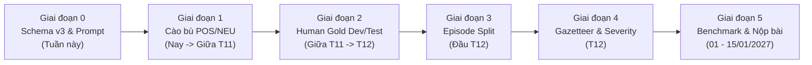

# 📘 HƯỚNG DẪN CHI TIẾT NÂNG CẤP DATASET ASTE LÊN CHUẨN V3
## Lộ Trình Sửa Dataset Để Công Bố Bài Báo Quốc Tế (ICWSM / KDD) & Hoàn Thiện Hệ Thống RadiNet

> **Dành cho**: Bạn phụ trách dữ liệu & gán nhãn AI  
> **Mục tiêu**: Khắc phục triệt để lỗi mất cân bằng nhãn chí mạng, chuẩn hóa Schema v3 và xây dựng tập Gold Dataset phục vụ nộp bài báo khoa học (Hạn chót: **15/01/2027 - ICWSM 2027 Round 3**).

---

## 🎯 1. Bối Cảnh: Những Gì Đang Rất Tốt & "Tử Huyệt" Cần Sửa Ngay

### ✅ Những thứ ĐÃ LÀM RẤT TỐT (TUYỆT ĐỐI GIỮ NGUYÊN, KHÔNG ĐẬP ĐI LÀM LẠI):
1. **Hạ tầng GIS cực mạnh**: 122 điểm ngập chuẩn CSGT (tọa độ GPS 5 số thập phân), cơ chế đối soát OpenStreetMap (tim đường highway), bộ nhớ tự học dynamic cache và 168 phường/xã chuẩn NQ 1685. Đây là điểm sáng vượt trội hơn hẳn các bài báo quốc tế cùng mảng.
2. **Tổ chức theo đợt ngập (Episode-based)**: Đã gom bài viết theo 7 đợt ngập thực tế (`raw/episodes/`) và kho lưu trữ lịch sử (`historical_archive/`).
3. **Quy mô dữ liệu đủ lớn**: 3.922 câu / 5.483 bộ ba ASTE (tương đương quy mô tập chuẩn SemEval-2014 Restaurant $\sim 3\text{K}$ câu).
4. **Kỷ luật kỹ thuật sạch sẽ**: Có sổ nhớ chống trùng lặp (`pipeline_state.json`), nhật ký kiểm toán (`crawl_csgt_audit.json`) và luồng mô phỏng offline.

---

### 🚨 "TỬ HUYỆT" CHÍ MẠNG BẮT BUỘC PHẢI SỬA:
Phân phối nhãn cảm xúc hiện tại:
$$\mathbf{NEG:\; 94.2\%} \quad|\quad \mathbf{NEU:\; 5.5\%} \quad|\quad \mathbf{POS:\; 0.3\%}$$
* **Hậu quả học thuật (Paper)**: Cả tập 5.483 bộ ba chỉ có **16 bộ ba POS** ($0.3\%$). Nếu một mô hình "ngu ngốc" chỉ dự đoán bừa mọi câu là `NEG`, nó vẫn đạt độ chính xác $94\%$. **Reviewer quốc tế sẽ đánh trượt bài báo ngay lập tức vì benchmark bị suy biến (degenerate)**; chỉ số Macro-F1 mất hoàn toàn ý nghĩa.
* **Hậu quả hệ thống (RadiNet)**: Hệ thống không thể học được tín hiệu "giải tỏa ngập" (*nước đã rút*, *hết ngập*) để chuyển màu từ đỏ sang xanh trên bản đồ, làm vô hiệu hóa tính năng dập tắt cảnh báo giả.
* **Nguyên nhân gốc rễ**: Thiên kiến cào dữ liệu (chỉ tìm từ khóa kêu ca ngập nước nên toàn bài tiêu cực) và Prompt gán nhãn bằng LLM mặc định coi ngập lụt là `NEG`.

---

## 🗺️ LỘ TRÌNH 6 GIAI ĐOẠN CHI TIẾT (ACTION PLAN)



---

### 🛠️ GIAI ĐOẠN 0: Chuẩn Hóa SCHEMA V3 (Làm Ngay Tuần Này)
*Trước khi gán nhãn thêm bất kỳ câu nào mới, phải chốt cấu trúc dữ liệu v3.*

#### 1. Cấu trúc một bộ ba chuẩn trong Schema v3:
Thay vì chỉ lưu `(aspect, opinion, polarity)` thô sơ, bổ sung thêm 4 trường ngữ cảnh:

```json
{
  "aspect": "Trần Xuân Soạn",
  "opinion": "nước đã rút sạch, xe cộ đi lại bình thường",
  "polarity": "POS",
  "aspect_category": "LOCATION_STREET",
  "gazetteer_id": "csgt_tide_01",
  "grounding_provenance": "SPAN_MATCHED",
  "severity": "RECOVERED"
}
```

* **`aspect_category`** (5 nhóm chuẩn):
  1. `LOCATION_STREET`: Tên đường, giao lộ, cầu (*Trần Xuân Soạn, Bảy Hiền, Cầu Chữ Y*).
  2. `LOCATION_ADMIN`: Phường, Quận, Khu vực (*Thảo Điền, TP. Thủ Đức, Quận 7*).
  3. `HYDROLOGY`: Sông, kênh, rạch, hồ (*Sông Sài Gòn, Kênh Nhiêu Lộc, Hồ Dầu Tiếng*).
  4. `INFRASTRUCTURE_DRAINAGE`: Cống, trạm bơm, nắp ga (*Trạm bơm Thảo Điền, miệng cống*).
  5. `RESPONSE_ENTITY`: Đội ứng phó, công nhân thoát nước, CSGT.
* **`grounding_provenance`** (Nguồn gốc tọa độ):
  - `SPAN_MATCHED`: Tên đường xuất hiện chính xác từng ký tự trong câu và map thẳng vào CSGT/OSM.
  - `FUZZY`: Tên viết tắt hoặc sai chính tả nhưng map được qua danh bạ (ví dụ: *TXS* $\rightarrow$ *Trần Xuân Soạn*).
  - `DOC_FALLBACK`: Bài viết không nêu tên đường cụ thể (*"Khu tôi nước ngập lút bánh"*), lấy tọa độ mặc định của Phường/Quận đăng bài.
* **`severity`** (Mức độ nghiêm trọng của hiện tượng):
  - `HIGH`: Ngập nặng, tê liệt giao thông, xe chết máy hàng loạt, tràn vào nhà dân.
  - `MEDIUM`: Ngập bánh xe, nước dâng chậm, di chuyển khó khăn.
  - `LOW`: Nước mấp mé vỉa hè, đọng vũng nhỏ.
  - `RECOVERED`: Nước rút hết, đường khô ráo, giao thông thông suốt (dành riêng cho POS).

#### 2. NĂM QUY TẮC VÀNG KHI GÁN NHÃN (ANNOTATION GOLD RULES):

> [!IMPORTANT]
> **Triết lý cốt lõi**: *"Dataset giữ nguyên hiện trường — Hệ thống xử lý ở ranh giới (The dataset keeps the noise verbatim; the system handles noise at its own boundaries, never the data)."*

1. **Quy tắc 1: Aspect & Opinion PHẢI là chuỗi ký tự nguyên văn (Verbatim Span)**:
   - **Tuyệt đối KHÔNG tự ý sửa chính tả, gõ tắt hay từ lóng**: Người viết gõ `"kinh khũng"` thì nhãn giữ nguyên `"kinh khũng"`; gõ `"hẩm chui"` giữ nguyên `"hẩm chui"`; gõ `"Q7"` giữ nguyên `"Q7"`.
   - **Lý do học thuật**: Nhãn Span là bằng chứng (evidence) trong bài, không phải bài tập sửa lỗi văn phạm (edit). Nếu sửa nhãn thành chữ đúng, bạn sẽ tạo ra sự bất nhất (mismatch) giữa câu văn và nhãn, khiến mô hình học vẹt từ không có trong đầu vào. Việc này đồng thời giúp nâng cao chỉ số đồng thuận **Cohen's Kappa** giữa các người gán nhãn vì không phải tranh cãi *"sai đến mức nào thì phải sửa"*.
   - **Chuẩn hóa địa danh để đâu?** Trách nhiệm chuẩn hóa `"Q7"` $\rightarrow$ `"Quận 7"` thuộc về **Tầng Định vị Địa lý GIS (S5 qua thuật toán RapidFuzz)**, tuyệt đối không chuẩn hóa bên trong Dataset!

2. **Quy tắc 2: Tách sạch từ rác (Head-Entity Span)**:
   - Cắt bỏ các giới từ thừa ở đầu (*ở, tại, trên, đoạn, tuyến đường*) và vị ngữ ở đuôi (*mới không còn, xảy ra, chìm trong biển*).
   - ❌ *Sai:* `ở khu Nam TPHCM xảy ra`
   - ✅ *Đúng:* `khu Nam TPHCM`

3. **Quy tắc 3: TUYỆT ĐỐI KHÔNG GÁN XE CỘ LÀM ASPECT**:
   - Xe máy, ô tô là **nạn nhân** chịu ảnh hưởng, không phải công trình bị ngập!
   - ❌ *Sai:* `(phương tiện giao thông | chết máy | NEG)`
   - ✅ *Đúng:* Quy về tuyến đường nơi xe chết máy: `(Đường Võ Văn Ngân | xe chết máy hàng loạt | NEG)`

4. **Quy tắc 4: Polarity = Thái độ đối với Aspect, KHÔNG PHẢI có ngập hay không**:
   - Câu đo đạc khách quan: *"Đường Nguyễn Huệ ngập khoảng 30cm"* $\rightarrow$ Không có cảm xúc khen/chê $\rightarrow$ BẮT BUỘC LÀ `NEU`.
   - Khen ngợi/Nước rút: *"Năm nay đường Nguyễn Hữu Cảnh hết ngập hẳn"* $\rightarrow$ BẮT BUỘC LÀ `POS`.

5. **Quy tắc 5: Chính sách Biểu tượng cảm xúc (Emoji Policy)**:

| Câu hỏi quy chuẩn | Quy tắc thực thi | Giải thích lý do |
| :--- | :---: | :--- |
| **Emoji trong văn bản bài đăng?** | 🟢 **CÓ, giữ nguyên raw** | Gộp các emoji lặp liên tiếp (`😭😭😭` $\rightarrow$ `😭`) để loại bỏ sự mập mờ về biên từ. |
| **Emoji định đoạt cực tính?** | 🟢 **CÓ** | `😭`, `🤬` là bằng chứng tiêu cực (`NEG`); `🎉`, `👍` là bằng chứng nước rút/khen ngợi (`POS`). |
| **Emoji nằm trong Aspect span?** | 🔴 **KHÔNG BAO GIỜ** | Aspect luôn luôn là danh từ/địa danh bằng chữ. |
| **Emoji nằm trong Opinion span?** | 🟡 **Mặc định là KHÔNG** | Giữ nguyên chữ: lấy `"ngập ghê quá"` chứ không lấy kèm `😭`. |
| ⚠️ **NGOẠI LỆ ĐẮT GIÁ**: | 🟢 **LẤY LÀM OPINION** | Khi bình luận **chỉ có duy nhất emoji mà không có từ ngữ** (Ví dụ: *"Hầm An Phú 😭😭"*), lúc này `😭` **chính là Opinion span**! (Nếu bỏ qua sẽ làm mất các phản ánh ngập khẩn cấp trên comment). |

---

#### 3. AN TOÀN KỸ THUẬT KHI TĂNG CƯỜNG DỮ LIỆU & GÓC NHÌN BÀI BÁO:

* **Tăng cường Dữ liệu An toàn (Augmentation Safety)**:
  - **Diacritic-Dropout (Xóa dấu ngẫu nhiên với $p=0.20$)**: Cực kỳ an toàn vì **bảo toàn 100% độ dài ký tự** (`len("Trần") == len("Tran") == 4`), vị trí `start_char` và `end_char` của Span không bị xô lệch. Kỹ thuật này giúp mô hình chống chịu được văn phong gõ vội không dấu của người đi đường.
  - **CẢNH BÁO**: Tuyệt đối **không dùng teencode-mapping tự động lúc train** (như đổi `"không"` $\rightarrow$ `"ko"`), vì độ dài từ bị thay đổi sẽ làm xô lệch toàn bộ Span của các từ phía sau và làm gãy nhãn.
* **Chiến Lược Biến Dữ Liệu Ồn Thành Phát Hiện Khoa Học (Paper Finding)**:
  - Trong bài báo nộp **ICWSM (Track Datasets & Benchmarks)**, đưa 1 bảng phân tích phân rã hiệu năng (Ablation Table) theo loại nhiễu: *Văn bản sạch vs. Teencode vs. Bị xóa dấu vs. Có chứa Emoji*.
  - Kết luận: *"Mô hình giảm $N$ điểm F1 trên bài đăng teencode; nhưng nhờ kỹ thuật Diacritic-Dropout, mô hình lấy lại được $M$ điểm"* $\rightarrow$ Đây là một đóng góp học thuật thực nghiệm có giá trị cao, được các reviewer quốc tế đánh giá rất cao.

---

### 🌊 GIAI ĐOẠN 1: CÂN BẰNG LẠI TỶ LỆ NHÃN (Rebalance - Nay $\rightarrow$ Giữa T11)

#### Mục tiêu cần đạt:
- Bổ sung **+800 đến 1.000 bộ ba `POS`**.
- Bổ sung **+500 đến 800 bộ ba `NEU`**.
- Đưa tỷ lệ phân phối cuối cùng về mức lý tưởng: **$\approx 10–15\%$ POS**, **$\approx 15–20\%$ NEU**, **$\approx 65–75\%$ NEG**.

#### Khai thác nguồn dữ liệu ở đâu?
1. **Khai thác kho lưu trữ có sẵn (`data/raw/episodes/historical_archive/`)**:
   - Tìm các bài báo phản ánh: *"khánh thành cống ngăn triều"*, *"nạo vét rạch Xuyên Tâm giúp nước rút nhanh"*, *"nâng cấp đường không còn ngập"*, *"dự án chống ngập phát huy hiệu quả"*.
2. **Cào bổ sung có mục tiêu (Targeted Crawl) với bộ từ khóa POS**:
   - Từ khóa tìm kiếm: `"hết ngập"`, `"nước rút"`, `"nước đã rút"`, `"đỡ ngập"`, `"khô ráo"`, `"thông xe"`, `"thông thoáng trở lại"`, `"khen ngợi"`, `"ứng trực kịp thời"`, `"bình yên sau mưa"`.
   - Cào từ các hội nhóm Facebook: *Tôi là dân Quận 7*, *Cảnh sát giao thông TP.HCM*, *Giao thông Quốc lộ 13*, *Hóng biến đường phố Sài Gòn*.
3. **Cào bổ sung bài viết NEU**:
   - Bản tin dự báo triều cường của Đài Khí tượng Thủy văn Nam Bộ.
   - Các bài đo đạc: *"đỉnh triều lúc 17h đạt 1m70"*, *"trạm bơm vận hành từ 6h sáng"*, *"ngập sâu 20-30cm"*.
4. **Rà soát 200 mẫu `NEG` cũ**:
   - Bốc ngẫu nhiên 200 câu đang gán `NEG` trong tập hiện tại, kiểm tra xem có câu nào thực chất là đo đạc khách quan (ví dụ: *"mực nước cao 0.5m"*) bị LLM gán nhầm thành `NEG` không $\rightarrow$ Chuyển về đúng `NEU`.

---

### 👥 GIAI ĐOẠN 2: Kiểm Định Chuyên Gia (Human Gold Verification - Giữa T11 $\rightarrow$ T12)

Bài báo khoa học đỉnh cao đòi hỏi tập Test phải được **con người xác thực 100% (Human-Gold)**:
- **Tập Train (Huấn luyện)**: Chấp nhận nhãn từ LLM gán tự động (Silver) có rà soát xác suất 10–20%.
- **Tập Dev (Kiểm định) & Test (Đánh giá)**: **100% do 2–3 người thẩm định độc lập**.
- **Đo chỉ số đồng thuận**: Tính chỉ số **Cohen's Kappa** giữa các người gán nhãn (mục tiêu $\kappa \ge 0.65–0.75$). Khi có bất đồng, nhóm trưởng (Adjudicator) sẽ đưa ra phán quyết cuối cùng. Số liệu $\kappa$ này sẽ được đưa thẳng vào bảng 1 của bài báo.

---

### 📅 GIAI ĐOẠN 3: Phân Chia Tập Dữ Liệu Theo ĐỢT NGẬP (Episode-Based Split - Tháng 12)

> [!CAUTION]
> **TUYỆT ĐỐI KHÔNG ĐƯỢC CHIA TẬP TRAIN/DEV/TEST BẰNG HÀM RANDOM SHUFFLE!**

* **Lý do**: Các bài viết trong cùng một cơn bão (ví dụ đợt triều cường cuối tháng 9) sẽ dùng chung từ vựng và nhắc cùng các con đường. Nếu chia random, mô hình sẽ "học vẹt" câu hôm trước để đoán câu hôm sau $\rightarrow$ Điểm F1 cao ảo, bị reviewer phát hiện gian lận rò rỉ dữ liệu (Data Leakage).
* **Cách chia chuẩn khoa học theo thời gian (Temporal/Episode Split)**:
  - **Tập Train (Huấn luyện)**: Gồm `historical_archive/` + `episode_01` + `episode_02` + `episode_03` + `sporadic_flood_events/`.
  - **Tập Dev (Validation)**: Gồm toàn bộ bài viết của `episode_04` (Đợt triều cường Rằm tháng Tám).
  - **Tập Test (Thử nghiệm độc lập)**: Gồm toàn bộ bài viết của `episode_05` (Mưa giông chiều tối 07/10/2026) được người gán nhãn Gold chuẩn 100%.
  - **Điều kiện ràng buộc**: Đảm bảo trong tập Test có **ít nhất $\ge 30$ mẫu POS** và **$\ge 30$ mẫu NEU** để đo đạc chỉ số F1 không bị lỗi chia cho 0.

---

### 🔗 GIAI ĐOẠN 4: Ghép Nối Với Hệ Thống Giám Sát Real-Time (Tháng 12)

Sau khi mô hình ASTE v3 được huấn luyện xong:
1. **Nối với bộ lọc địa lý**: Aspect bóc ra sẽ đi qua hàm `match_hotspot()` để lấy tọa độ GPS chuẩn từ 122 điểm CSGT hoặc OpenStreetMap.
2. **Kích hoạt logic dập tắt sự cố (Resolution Engine)**:
   - Khi mô hình gặp `(Trần Xuân Soạn, ngập sâu 40cm, NEG)` $\rightarrow$ Cắm cờ ĐỎ (Đang ngập nghiêm trọng).
   - Khi mô hình gặp `(Trần Xuân Soạn, nước đã rút sạch thông thoáng, POS)` $\rightarrow$ **Tự động chuyển cờ ĐỎ thành cờ XANH** (Hết ngập, giao thông thông suốt).

---

### 📝 GIAI ĐOẠN 5: Viết Bài Báo, Benchmark & Nộp Bài (Cuối T12 $\rightarrow$ 15/01/2027)

1. **Chuẩn bị Datasheet**: Viết bảng phễu thu thập dữ liệu (Data Funnel): Từ bao nhiêu bài thô $\rightarrow$ qua lọc spam BĐS còn bao nhiêu $\rightarrow$ gán nhãn được bao nhiêu bộ ba.
2. **Bảng Benchmark so sánh các mô hình**:
   - Rule-based / Regex baseline.
   - PhoBERT / BARTpho fine-tuned.
   - Các mô hình ASTE chuyên dụng (PASTE, STAGE, EMC-GCN).
   - Mô hình LLM Prompting (GPT-4o, Gemini 1.5 Pro, Qwen 2.5) với Zero-shot & Few-shot.
   - Báo cáo chi tiết: **Precision, Recall, F1 riêng biệt cho từng lớp NEG, NEU, POS**.
3. **Đối soát thực địa khách quan (Event Validation)**:
   - So sánh danh sách đường ngập do RadiNet phát hiện với danh sách đường ngập chính thức của Sở GTVT / Viện IRD Pháp (IRD Dataverse `10.23708/8Y16HU`) để chứng minh hệ thống phát hiện nhanh hơn báo đài từ 30–60 phút.
4. **Phạm vi Multimodal**:
   - Bài báo chính (Core Contribution) khẳng định mạnh mẽ vào **Text ASTE** (Tiêu đề + Nội dung bài viết + Transcript bóc từ âm thanh bằng PhoWhisper).
   - Phần hình ảnh/video đóng vai trò phân tích mở rộng (Tier 2 Visual Extension), không ôm đồm để tránh bị bẻ luận điểm.

---

## ✅ CHECKLIST NGHIỆM THU (DEFINITION OF DONE)

Bạn phụ trách dữ liệu chỉ được coi là hoàn thành nhiệm vụ khi đánh dấu `[x]` đủ tất cả các ô dưới đây:

- [ ] **Nhãn POS đạt $\ge 10\%$** và **NEU đạt $\ge 10\%$** (thoát khỏi mức 0.3% / 5.5% hiện tại).
- [ ] 100% các bộ ba: Aspect và Opinion là chuỗi từ có thật trong câu, **không bị chồng lấn (no overlap)**.
- [ ] **Tuân thủ nguyên tắc Verbatim Span**: Giữ nguyên văn teencode/lỗi chính tả trong nhãn (`Q7`, `kinh khũng`), không tự ý sửa sai.
- [ ] **Áp dụng đúng chính sách Emoji**: Gộp emoji lặp (`😭😭😭` $\rightarrow$ `😭`), gán emoji làm Opinion khi câu chỉ có emoji biểu thị thái độ.
- [ ] **Đã loại bỏ 100% xe cộ/phương tiện** ra khỏi nhãn Aspect (quy hết về tên đường).
- [ ] Cắt sạch giới từ thừa ở đầu (*ở, tại*) và vị ngữ thừa ở đuôi (*mới không còn*).
- [ ] Tập Test độc lập đạt **100% Human-Gold** được chia theo đợt ngập (Episode Split).
- [ ] Chỉ số tương đồng gán nhãn Cohen's Kappa giữa người đạt $\kappa \ge 0.65$.
- [ ] Bảng Benchmark báo cáo đầy đủ chỉ số F1 của cả 3 lớp cảm xúc.
- [ ] Bản thảo bài báo hoàn thiện nộp đúng cổng **ICWSM 2027 Round 3 (Hạn chót: 15/01/2027)**.
