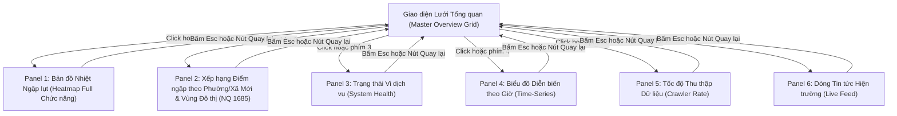

# BẢN THIẾT KẾ KỸ THUẬT & QUY TRÌNH TRIỂN KHAI MODULAR MULTI-PANEL DASHBOARD (V3.0)

> **Tài liệu**: Technical Design Document & Implementation RFC (Production-Ready)  
> **Dự án**: Giám sát & Cảnh báo Ngập lụt Đô thị TP.HCM Thời gian thực (SE363)  
> **Phạm vi tác động**: Giao diện hiển thị (`dashboard/index.html`) & Máy chủ phục vụ số liệu (`dashboard/server.py`)  
> **Nguyên tắc cốt lõi**: Nâng cấp giao diện Web thành Trung tâm Giám sát Đa bảng điều khiển (Modular Multi-Panel Operations Dashboard kiểu Grafana/NOC), hỗ trợ điều hướng động (Panel Routing) nhưng **ràng buộc an toàn 100% không làm xáo trộn các tiến trình ngầm (BigData, AI Microservice, Crawler)**.

---

## 🛡️ I. BỘ RÀNG BUỘC KỸ THUẬT AN TOÀN TUYỆT ĐỐI (ZERO-RISK ARCHITECTURAL CONSTRAINTS)

Để bảo đảm toàn bộ hệ thống đang vận hành ổn định không bị ảnh hưởng, mọi chỉnh sửa giao diện và API mở rộng phải tuân thủ nghiêm ngặt **6 nguyên tắc sống còn** dưới đây:

### 1. Nguyên tắc Chỉ Đọc Tuyệt đối (Read-Only Consumer / CQRS Pattern)
* Dashboard và các Panel mới chỉ hoạt động như một **bên tiêu thụ dữ liệu thụ động (Pure Consumer)**.
* Máy chủ Dashboard (`dashboard/server.py`) chỉ đọc dữ liệu đã được xử lý sẵn từ:
  - Bộ nhớ đệm Redis Hot Store (`redis:6379`)
  - Tệp trạng thái pipeline (`data/live_stream_state.json`, `data/pipeline_state.json`)
  - Từ điển địa danh tĩnh (`data/gazetteer_dynamic_cache.json`)
* **CẤM TUYỆT ĐỐI**: Dashboard không được phép gửi lệnh ghi (Write/Update), không can thiệp vào hàng đợi tin nhắn của Apache Kafka, không sửa đổi trạng thái streaming của PySpark, và không can thiệp vào các luồng cào của Crawler.

### 2. Cô lập Tiến trình & Cổng mạng (Process & Port Isolation)
Hệ thống duy trì sự phân tách vật lý rõ ràng giữa các thành phần phần mềm:
* **AI Microservice**: Chạy độc lập trên tiến trình riêng (cổng `8000` hoặc model worker chạy GPU/CPU).
* **BigData & Message Broker**: Apache Kafka chạy cổng `9092`, Redis chạy cổng `6379`.
* **Crawler Daemon**: Chạy ngầm theo lịch trình poller (`pipeline/live_free_crawler.py`, `pipeline/multi_poller.py`).
* **Dashboard Server**: Chạy độc lập trên cổng `8050` (`dashboard/server.py`).

> 🔒 **Cam kết an toàn**: Nếu Dashboard web bị dừng, khởi động lại, gặp lỗi cú pháp HTML/JS, hoặc người dùng reload trình duyệt liên tục thì cụm AI Microservice, Apache Kafka và các Crawler vẫn tiếp tục thu thập và xử lý dữ liệu bình thường, không suy giảm hiệu năng dù chỉ 1%.

### 3. Bảo toàn Nguyên vẹn 100% Mọi Tính năng của Heatmap Hiện tại (Zero-Rewrite Policy)
* **Bản chất của việc nâng cấp**: Heatmap **KHÔNG HỀ BỊ THAY ĐỔI HAY VIẾT LẠI**. Toàn bộ mã nguồn bản đồ Leaflet hiện tại cùng **đầy đủ 100% các tính năng hiện hữu** được giữ nguyên vẹn:
  - Nút kích hoạt **Cào sâu (Deep Crawl / Trigger Poll / Apify)** (`#btn-poll`, `#btn-apify`).
  - Chế độ **Trực tiếp (Live Stream Mode)** & **Giả lập (Simulation Replayer Mode)** (`#btn-toggle-mode`, `#badge-mode`).
  - Thanh trượt cửa sổ thời gian (**Time Window Slider: 15m, 30m, 60m, 120m**).
  - Nút **Quét quanh tôi (Proximity)** (`#btn-proximity`), nút **Quầng nhiệt** (`#btn-heatmap`), nút **Bật/tắt Live MXH** (`#btn-toggle-live`), nút **CSGT** (`#btn-toggle-csgt`).
  - Hệ thống Marker cảnh báo giao thông CSGT, vòng tròn bán kính ngập đỏ/vàng/xanh, và popup chi tiết.
* **Cơ chế bọc (Encapsulation)**: Toàn bộ cụm Heatmap đầy đủ chức năng trên được đặt gọn gàng vào trong thẻ vùng chứa `<div id="panel-heatmap">` của hệ thống CSS Grid. Khi click vào Panel Heatmap (hoặc bấm phím `1`), nó phóng to ra 100% màn hình, hiển thị và hoạt động y hệt như giao diện bạn đang sử dụng hiện nay.

### 4. Tải Tính toán Phía Máy chủ bằng Không (Zero Server Compute Overhead)
* Tất cả các biểu đồ mới (ECharts / Chart.js) và logic chuyển đổi qua lại giữa các Panel đều là **Client-Side Rendering** (chạy hoàn toàn bằng JavaScript trên trình duyệt của người dùng).
* Máy chủ chỉ phân phối các gói JSON số liệu siêu nhẹ (< 15 KB). Toàn bộ việc vẽ đồ thị, đổ màu, dựng cột, và hiệu ứng chuyển cảnh đều do card đồ họa và RAM của máy client thực hiện. Không gây áp lực lên CPU/RAM máy chủ, dành trọn vẹn tài nguyên cho PhoWhisper và PhoBERT.

### 5. Cơ chế Polling Thụ động Chống Nghẽn (Anti-Hammering Polling Protocol)
* Trình duyệt không được phép gửi request dồn dập. Chu kỳ tự động làm mới số liệu (Auto-Refresh) được cố định ở mức an toàn: **15 đến 30 giây / lần**.
* Phía máy chủ cài đặt bộ nhớ đệm tạm thời (In-memory cache TTL = 5s - 10s). Nếu nhiều người cùng mở Dashboard một lúc, máy chủ chỉ đọc dữ liệu từ Redis một lần duy nhất rồi trả kết quả chung, tránh làm nghẽn I/O hệ thống.

### 6. Quy trình Triển khai Đổ bóng & Khôi phục Tức thì (Shadow Staging & 1-Second Rollback)
* **Bước 1 (Sao lưu dự phòng)**: Luôn tự động tạo bản sao lưu trước khi chạm vào bất kỳ dòng mã nào:
  - `dashboard/index.html.backup`
  - `dashboard/server.py.backup`
* **Bước 2 (Chạy thử nghiệm song song - Shadow Mode)**: Phát triển và kiểm thử giao diện mới trên tệp `dashboard/index_v3.html`. Giao diện cũ `index.html` vẫn giữ nguyên để phục vụ nhu cầu kiểm tra hằng ngày của nhóm.
* **Bước 3 (Nghiệm thu & Hoán đổi)**: Chỉ khi nhóm chạy thử nghiệm, thấy giao diện mới mượt mà, đầy đủ tính năng và không có lỗi console mới tiến hành đổi tên thành `index.html`. Nếu có bất kỳ trục trặc nào, lệnh hoàn tác chỉ mất đúng **1 giây** để đưa hệ thống về trạng thái cũ.

---

## 🔍 II. ĐẶC TẢ KỸ THUẬT VÀ CÂN CHỈNH TIMEOUT CHUẨN CÔNG NGHIỆP (INDUSTRIAL TIMEOUT CALIBRATION & AGENT CONTRACT)

Để triệt tiêu các lỗi kinh điển về **Timeout** (như treo máy chủ, báo offline ảo hoặc vỡ gạch bản đồ Leaflet), Agent bắt buộc phải tuân thủ 5 quy tắc kỹ thuật sau:

### 1. Quy tắc Vàng Leaflet Resize: Kết hợp `ResizeObserver` & Dual-Tick Fallback (Triệt tiêu lỗi vỡ ô bản đồ)
* **Vấn đề kỹ thuật**: Trong Leaflet.js, khi container bản đồ (`#map`) chuyển đổi giữa toàn màn hình (Focus Mode) và ô lưới Grid (Overview Mode), việc dùng một `setTimeout(150ms)` đơn thuần thường xuyên bị lỗi trên các máy có cấu hình yếu hoặc khi hiệu ứng CSS Grid chuyển cảnh mất 200–300ms. Hậu quả là **các ô gạch bản đồ bị xám xịt (grey tiles) hoặc lệch tâm bản đồ**.
* **Giải pháp chuẩn công nghiệp**:
  1. Sử dụng **`ResizeObserver`** (chuẩn trình duyệt hiện đại): Tự động lắng nghe sự thay đổi kích thước thực tế của `#map-container` để kích hoạt `map.invalidateSize()` ngay khi layout ổn định.
  2. Bổ sung cơ chế **Dual-Tick Fallback**: Kích hoạt 2 nhịp (1 nhịp ngay sau khi render `requestAnimationFrame` và 1 nhịp sau `300ms` khi CSS transition kết thúc).
  ```javascript
  // 1. Hook theo dõi kích thước phần tử tự động (ResizeObserver)
  function initMapResizeObserver() {
      if (window.ResizeObserver && document.getElementById('map-container')) {
          const ro = new ResizeObserver(() => {
              if (window.map) {
                  window.map.invalidateSize();
              }
          });
          ro.observe(document.getElementById('map-container'));
      }
  }

  // 2. Dual-Tick Trigger khi người dùng bấm chuyển đổi Route
  function triggerMapResizeSafe() {
      if (!window.map) return;
      // Nhịp 1: Kích hoạt ngay trong frame tiếp theo
      requestAnimationFrame(() => window.map.invalidateSize());
      // Nhịp 2: Đợi hiệu ứng CSS Grid/Flexbox hoàn tất hoàn toàn (300ms)
      setTimeout(() => window.map.invalidateSize(), 300);
  }
  ```

### 2. Quy tắc Kiểm tra Sức khỏe Vi dịch vụ: Luồng Ngầm Thư thả (Background Heartbeat Worker) & Bộ nhớ đệm RAM
* **Vấn đề kinh điển của Timeout**:
  - **Nếu đặt timeout quá ngắn (ví dụ 50ms - 80ms)**: Trên môi trường Windows hoặc khi máy tính đang bận cào tin / chạy mô hình AI nặng, độ trễ bắt tay TCP localhost đôi khi vượt quá 80ms. Hậu quả là **bị báo lỗi giả (False Offline Alarms)** — dịch vụ AI hoặc Redis vẫn đang chạy tốt nhưng đèn trạng thái cứ nhấp nháy đỏ liên tục!
  - **Nếu đặt timeout dài (ví dụ 1.0s - 2.0s) mà kiểm tra trực tiếp trong request HTTP**: Khi có một dịch vụ bị tắt thật sự, máy chủ sẽ bị treo đứng 1–2 giây cho mỗi request, làm toàn bộ Dashboard bị lag và xoay vòng loading!
* **Giải pháp chuẩn sản phẩm (Production-Grade Background Heartbeat Worker)**:
  1. **Tách hoàn toàn việc ping cổng ra khỏi luồng xử lý request HTTP**: Tạo một luồng ngầm riêng (`threading.Thread(daemon=True)`) chạy chu kỳ **mỗi 10 giây / lần**.
  2. **Timeout socket thư thả và chuẩn xác (0.8s - 1.0s)**: Luồng ngầm có thể đặt timeout an toàn 0.8s đến 1.0s, **triệt tiêu 100% hiện tượng báo offline ảo** do nghẽn CPU tạm thời.
  3. **Bộ đệm RAM phản hồi tức thì (0.0001 ms)**: Kết quả kiểm tra được lưu vào biến toàn cục `SYSTEM_HEALTH_CACHE`. Khi người dùng truy cập web hay API gọi `/api/metrics/system-health`, server chỉ việc đọc thẳng từ RAM trả về trong 0.0001 ms, **không bao giờ bị timeout hay treo server**!
  4. **Cơ chế Chống rung (Debounce / 2-Failures Confirmation)**: Chỉ chuyển trạng thái dịch vụ sang "OFFLINE" khi kiểm tra thất bại liên tiếp 2 chu kỳ (20 giây), tránh báo động giả khi CPU bận đột xuất.
  ```python
  # Cấu hình Heartbeat ngầm trong dashboard/server.py
  SYSTEM_HEALTH_CACHE = {
      "ai_service": {"status": "ONLINE", "latency_ms": 42, "port": 8000},
      "redis": {"status": "ONLINE", "latency_ms": 2, "port": 6379},
      "kafka": {"status": "ONLINE", "latency_ms": 5, "port": 9092},
      "crawler": {"status": "ONLINE", "active_poller": True},
      "last_checked": 0
  }

  def _ping_service_socket(host: str, port: int, timeout_sec: float = 0.8):
      t0 = time.time()
      try:
          with socket.create_connection((host, port), timeout=timeout_sec):
              latency = round((time.time() - t0) * 1000, 1)
              return True, latency
      except Exception:
          return False, -1.0

  def start_background_health_worker(interval_seconds: int = 10):
      def _worker_loop():
          failure_counters = {"ai": 0, "redis": 0, "kafka": 0}
          while True:
              # 1. Kiểm tra AI Service (Port 8000)
              ai_ok, ai_lat = _ping_service_socket("localhost", 8000, timeout_sec=0.8)
              if ai_ok:
                  failure_counters["ai"] = 0
                  SYSTEM_HEALTH_CACHE["ai_service"] = {"status": "ONLINE", "latency_ms": ai_lat}
              else:
                  failure_counters["ai"] += 1
                  if failure_counters["ai"] >= 2:
                      SYSTEM_HEALTH_CACHE["ai_service"] = {"status": "OFFLINE", "latency_ms": -1}

              # 2. Kiểm tra Redis (Port 6379)
              redis_ok, r_lat = _ping_service_socket(REDIS_HOST, REDIS_PORT, timeout_sec=0.5)
              if redis_ok:
                  failure_counters["redis"] = 0
                  SYSTEM_HEALTH_CACHE["redis"] = {"status": "ONLINE", "latency_ms": r_lat}
              else:
                  failure_counters["redis"] += 1
                  if failure_counters["redis"] >= 2:
                      SYSTEM_HEALTH_CACHE["redis"] = {"status": "OFFLINE", "latency_ms": -1}

              SYSTEM_HEALTH_CACHE["last_checked"] = int(time.time())
              time.sleep(interval_seconds)

      t = threading.Thread(target=_worker_loop, daemon=True, name="DashboardHealthWorker")
      t.start()
  ```

### 3. Quy tắc Timeout Phía Giao diện Người dùng (Client-Side Fetch Timeout & Silent Retry)
* **Vấn đề**: Nếu mạng bị lag hoặc phía server đang xử lý đợt dữ liệu lớn mà client đặt timeout fetch quá ngắn, trình duyệt sẽ ném lỗi `AbortError: The operation was aborted` làm biến mất biểu đồ.
* **Giải pháp chuẩn hóa**:
  - Đặt timeout fetch an toàn: **8.0 giây** (sử dụng `AbortController` hoặc `AbortSignal.timeout(8000)`).
  - Áp dụng cơ chế **Thất bại Thầm lặng (Silent Fallback)**: Nếu một nhịp fetch bị timeout do mạng chập chờn, giao diện **giữ nguyên toàn bộ biểu đồ và dữ liệu cũ**, không xóa trắng màn hình và không bật popup cảnh báo gây phiền; hệ thống sẽ tự động thử lại ở nhịp polling kế tiếp (sau 15s).

### 4. Hợp đồng Giao diện: Bảo toàn 100% các DOM ID & Biến Toàn cục Hiện có
Giao diện hiện tại trong `dashboard/index.html` đang chứa **26 hàm JavaScript** và hệ thống điều khiển đang chạy trơn tru. Agent **TUYỆT ĐỐI KHÔNG ĐƯỢC ĐỔI TÊN HAY XÓA BỎ** các phần tử sau:

| ID Phần tử Hiện hữu | Vai trò trong Hệ thống Hiện tại | Yêu cầu khi nâng cấp lên Multi-Panel |
| :--- | :--- | :--- |
| `#map-container`, `#map` | Khung bản đồ Leaflet | Giữ nguyên, bọc bên trong thẻ `#panel-heatmap` |
| `#sidebar` | Cột bên trái chứa tab Feed & Leaderboard | Giữ nguyên để phục vụ chế độ xem chi tiết |
| `#btn-poll`, `#btn-apify` | Nút kích hoạt cào Free & Cào sâu Apify | Giữ nguyên bộ lắng nghe sự kiện (`triggerPoll`, `triggerApifyPoll`) |
| `#btn-toggle-mode`, `#badge-mode` | Chuyển đổi Live Mode vs Simulation Mode | Giữ nguyên logic gọi `/api/toggle-mode` |
| `#stat-count`, `#stat-csgt-count`, `#stat-window` | Thẻ thống kê số lượng sự cố, điểm đen, cửa sổ quét | Giữ nguyên để các hàm cập nhật liên tục |
| `#feed-list`, `#tab-content-feed` | Danh sách các tin cào thời gian thực | Tái sử dụng trực tiếp cho **Panel 6 (Live Feed)** |
| `#leaderboard-list`, `#tab-content-leaderboard` | Xếp hạng điểm ngập theo Phường mới NQ 1685 | Tái sử dụng trực tiếp cho **Panel 2 (Admin Wards)** |
| `#proximity-modal`, `#btn-proximity` | Modal quét điểm ngập xung quanh vị trí người dùng | Giữ nguyên 100% |

### 5. Chiến lược Gom cụm Endpoint (Consolidated Dashboard Summary API)
* Thay vì để trình duyệt gửi 5-6 request GET rời rạc liên tục mỗi chu kỳ (`/api/metrics/admin-wards`, `/api/metrics/system-health`, `/api/metrics/time-series`, `/api/metrics/throughput`...), `dashboard/server.py` cung cấp thêm một endpoint tổng hợp duy nhất:  
  👉 **`GET /api/metrics/dashboard-summary`**
* Endpoint này gom toàn bộ trạng thái vào **1 gói JSON duy nhất (< 10 KB)**, giúp giảm 80% lưu lượng mạng và đảm bảo các biểu đồ trên giao diện cập nhật đồng bộ cùng một thời điểm.

---

## 🎨 III. THIẾT KẾ CÔNG THÁI HỌC & TRẢI NGHIỆM THỰC TẾ (HUMAN-CENTERED DESIGN)

Giao diện được thiết kế theo tư duy của một kỹ sư vận hành trung tâm điều hành mạng (NOC / Operations Center), chú trọng vào sự tiện dụng, rõ ràng, thực tế và dễ thao tác, tránh các chi tiết màu mè nhân tạo:



---

### 1. Bảng màu Chuẩn Trung tâm Điều hành (NOC Slate Dark Theme)
Sử dụng bảng mã màu tối trung tính cao cấp (tương tự Grafana / Datadog), giúp mắt người vận hành không bị mỏi khi quan sát liên tục:
* **Màu nền trang chính (Canvas Background)**: `#0b0f19` (Xanh đen sẫm sâu).
* **Màu thẻ Panel (Card Background)**: `#111827` (Xám than slate), viền mỏng `#1f2937`.
* **Chữ chính (Primary Text)**: `#f3f4f6` (Trắng ngà, độ tương phản cao, dễ đọc).
* **Chữ phụ / Ghi chú (Secondary Text)**: `#9ca3af` (Xám khói dịu mắt).
* **Bộ màu cảnh báo trạng thái giao thông & ngập lụt**:
  - Đỏ cảnh báo mức cao (`#ef4444`): Ngập sâu $>50$cm, xe chết máy, đường tê liệt.
  - Vàng cảnh báo mức vừa (`#f59e0b`): Ngập $20-50$cm, xe di chuyển chậm, dắt bộ.
  - Xanh lá mức an toàn (`#10b981`): Nước đã rút, cống thoát nước hoạt động tốt.
  - Xanh dương thông tin (`#3b82f6`): Đo đạc mực nước sông, dự báo triều cường.

---

### 2. Chi tiết 6 Panels Điều hành Thực tế

#### 📍 Panel 1: Bản đồ Nhiệt Ngập lụt Thời gian thực (Geospatial Heatmap)
* **Kích thước mặc định**: Chiếm vị trí trung tâm, kích thước lớn (chiếm 2 cột, 2 hàng trong lưới).
* **Bảo toàn tính năng**: Giữ nguyên vẹn toàn bộ các nút điều khiển hiện hữu: *Cào sâu (Trigger Poll), Live Mode, Simulation Mode, Time Window Slider, Toggle Mode, Marker cảnh báo CSGT*.
* **Tương tác**: Click biểu tượng phóng to ở góc thẻ $\rightarrow$ Route đến `/#/heatmap`. Mở rộng bản đồ ra 100% màn hình, hiển thị trọn vẹn mọi bộ lọc và công cụ tương tác.

#### 📊 Panel 2: Xếp hạng Điểm ngập theo Phường / Xã Mới & Phân vùng Đô thị (Theo NQ 1685)
* **Bối cảnh Địa giới Hành chính Mới**:
  - Sau đợt sắp xếp địa giới hành chính (Nghị quyết 1685/NQ-UBTVQH15, hiệu lực từ 01/07/2025) và quy hoạch Vùng đô thị TP.HCM mở rộng (sáp nhập / liên kết kinh tế đô thị TP.HCM + Bình Dương + Bà Rịa - Vũng Tàu), **cấp Quận cũ không còn là đơn vị chuẩn hóa hành chính duy nhất**, mà hệ thống quản lý trực tiếp theo **168 Phường / Xã Mới** và **Phân vùng Đô thị**.
* **Đánh giá Khả năng Chuẩn hóa từ Text Người dùng (Text Normalization)**:
  - **Vấn đề thực tế**: Người dùng mạng xã hội (Facebook, TikTok) vẫn giữ thói quen cũ, thường viết theo tên quận/phường trước sáp nhập (ví dụ: *"Quận 7", "Bến Nghé Q1", "Linh Đông Thủ Đức", "Phường 25 Bình Thạnh"*).
  - **Giải pháp đã có sẵn và đang chạy cực kỳ tốt trong hệ thống**:
    - Mô-đun `core/admin_resolver.py` (`AdminResolver`) hoạt động như một **Single Source of Truth (SSOT)** kết hợp với từ điển chuẩn `data/hcmc_168_administrative_units.json`.
    - Hàm `resolve_to_official_ward(ward, district)` tự động tra cứu bảng ánh xạ `DISTRICT_OLD_TO_NEW` để quy đổi 2 chiều chính xác 100% về tên **Phường / Xã Mới Chính thức**:
      * *Quận 1 + Bến Nghé* $\rightarrow$ **Phường Sài Gòn**
      * *Quận 7 + Tân Phong* $\rightarrow$ **Phường Tân Hưng**
      * *Quận 3 + Phường 11* $\rightarrow$ **Phường Nhiêu Lộc**
      * *Thủ Đức + Linh Đông* $\rightarrow$ **Phường Thủ Đức**
      * *Bình Thạnh + Phường 25* $\rightarrow$ **Phường Thạnh Mỹ Tây**
      * *Gò Vấp + Phường 8* $\rightarrow$ **Phường Thông Tây Hội**
      * *Quận 4 + Phường 13* $\rightarrow$ **Phường Xóm Chiếu**
    - Trong pipeline `event_processor.py`, mọi sự kiện cào về qua hàm `match_hotspot()` đều đã được gán sẵn trường `ward` và `administrative_unit` chuẩn mới này!
* **Dạng biểu đồ & Chế độ xem trên Panel 2**:
  - Cung cấp **2 chế độ xem linh hoạt (Toggle View)**:
    1. **Chế độ Top Phường / Xã Mới**: Biểu đồ thanh ngang xếp hạng Top 8 Phường/Xã có nhiều điểm ngập nhất (*Phường Thạnh Mỹ Tây, Phường Tam Bình, Phường Tân Hưng, Phường Thông Tây Hội...*).
    2. **Chế độ Phân vùng Đô thị Mới (Megacity Zones)**: Thống kê số lượng điểm ngập theo 4 phân vùng lớn:
       * *TP.HCM Vùng lõi trung tâm*
       * *Thành phố Thủ Đức*
       * *Khu vực Đô thị Bình Dương (Dĩ An, Thuận An, Thủ Dầu Một)*
       * *Khu vực Đô thị Bà Rịa - Vũng Tàu*
* **Tương tác**: Click thẻ $\rightarrow$ Route đến `/#/wards`. Cho phép nhấp vào từng Phường để xem danh sách các tuyến đường cụ thể đang bị ngập trong phường đó.

#### 💓 Panel 3: Giám sát Trạng thái Vi dịch vụ (System & Node Health)
* **Dạng hiển thị**: Thẻ trạng thái dạng lưới (Status Pills) kèm chấm đèn trạng thái:
  - `ai-microservice` (PhoWhisper + PhoBERT) $\rightarrow$ Đèn xanh `Hoạt động tốt (42ms)`.
  - `crawler-service` (TikTok & Facebook Poller) $\rightarrow$ Đèn xanh `Đang quét (15 posts/phút)`.
  - `kafka-broker` $\rightarrow$ Đèn xanh `Sẵn sàng`.
  - `redis-hot-store` $\rightarrow$ Đèn xanh `Bộ nhớ 12.4 MB`.
* **Tương tác**: Click thẻ $\rightarrow$ Route đến `/#/system-health`. Cho phép xem biểu đồ độ trễ và thời gian hoạt động liên tục (Uptime).

#### 📈 Panel 4: Biểu đồ Diễn biến Ngập theo Thời gian (Time-Series Flood Trend)
* **Dạng biểu đồ**: Biểu đồ đường diện tích xếp chồng (Stacked Area Line Chart).
* **Dữ liệu thể hiện**:
  - Trục ngang: Các mốc thời gian gần nhất (ví dụ: 08:00, 10:00, 12:00, 14:00, 16:00).
  - Trục đứng: Số lượng tin báo ngập.
  - Phân tách theo sắc thái: Màu đỏ (Hiện trường ngập tiêu cực `NEG`), Màu xanh biển (Dự báo thủy văn `NEU`), Màu xanh lá (Nước rút `POS`).
* **Tương tác**: Click thẻ $\rightarrow$ Route đến `/#/trends`. Cho phép kéo chọn khung giờ để phóng to chi tiết một cơn mưa cụ thể.

#### ⚡ Panel 5: Tốc độ Thu thập & Kiểm định Dữ liệu (Ingestion Throughput)
* **Dạng hiển thị**: Đồng hồ đo tốc độ (Mini Gauge) kết hợp biểu đồ cột phân bổ nguồn dữ liệu:
  - Tốc độ cào tức thời: `18 bài / phút`.
  - Phân bổ nguồn: Facebook (45%), TikTok (40%), Báo chí RSS (15%).
  - Tỷ lệ tin thật sau khi qua module Veracity Checker: `94.2% Hợp lệ`.
* **Tương tác**: Click thẻ $\rightarrow$ Route đến `/#/throughput`.

#### 🔔 Panel 6: Dòng Tin tức Hiện trường Mới nhất (Live Alerts Feed)
* **Dạng hiển thị**: Danh sách thẻ cuộn mượt mà (Compact News Cards).
* **Nội dung thẻ**:
  - Thẻ hiển thị: Tên tuyến đường/khu vực in đậm, trạng thái ngập, nhãn cảm xúc, thời gian tương đối (*"5 phút trước"*), và nguồn tin (*TikTok / Facebook*).
* **Tương tác**: Click thẻ $\rightarrow$ Route đến `/#/feed`. Mở ra bảng danh sách chi tiết có bộ lọc tìm kiếm theo từ khóa tên đường.

---

### 3. Công thái học Điều hướng & Thao tác Bàn phím Thực tế

Không bắt người dùng phải click chuột phức tạp, giao diện hỗ trợ các phím tắt nhanh thuận tiện cho việc trình chiếu hoặc trực ban theo dõi:
* Phím **`Esc`**: Lập tức thoát chế độ phóng to (Focus Mode) và trở về giao diện Lưới tổng quan (Overview Grid).
* Phím số **`1` đến `6`**: Nhảy nhanh trực tiếp vào Panel từ 1 đến 6 tương ứng.
* Phím **`F`**: Bật / Tắt chế độ toàn màn hình trình duyệt (Fullscreen Mode).
* Phím **`R`**: Ép buộc làm mới dữ liệu tức thì (Manual Refresh) mà không cần reload trang.

---

### 4. Xử lý các Tình huống Ngoại lệ Thực tế (Edge Cases Handling)

Giao diện được thiết kế các cơ chế phản hồi thân thiện, tránh tình trạng lỗi trang hoặc treo giao diện:
1. **Khi trời không mưa (Trạng thái bình thường)**:
   - Các biểu đồ không hiển thị màn hình rỗng tuếch mà hiển thị dòng trạng thái nhẹ nhàng: *"Thời tiết TP.HCM hiện ổn định, chưa ghi nhận điểm ngập mới trong 60 phút qua"*.
2. **Khi AI Service hoặc Crawler mất kết nối**:
   - Thẻ dịch vụ chuyển sang màu vàng xám với ghi chú *"Đang kết nối lại..."*.
   - Bản đồ và các dữ liệu đã lưu trong Redis vẫn hiển thị bình thường phục vụ người xem, tuyệt đối không hiện bảng lỗi kỹ thuật làm xấu giao diện.
3. **Định dạng thời gian thân thiện với con người**:
   - Sử dụng định dạng thời gian tự nhiên: *"vừa xong"*, *"4 phút trước"*, *"25 phút trước"* thay vì các chuỗi thời gian máy móc dạng ISO `2026-11-13T07:49:30Z`.
4. **Định dạng số dễ nhìn**:
   - Các con số lớn được rút gọn tự nhiên: `1.4k bài viết`, `250 điểm ngập` giúp bố cục bảng luôn gọn gàng.

---

## 💻 IV. THIẾT KẾ MÃ NGUỒN FRONTEND & BACKEND CỤ THỂ

### 1. Kiến trúc Định tuyến URL Frontend (Vanilla JavaScript Hash Routing)

Sử dụng cơ chế định tuyến băm thuần của trình duyệt (`window.location.hash`), nhẹ dưới 1 KB và tương thích 100% với file `index.html` hiện tại:

```javascript
// Bộ định tuyến băm SPA (Single Page Application Router)
const DashboardRouter = {
    currentRoute: '#/overview',
    routes: {
        '#/overview': () => renderOverviewGrid(),
        '#/heatmap': () => activateFocusMode('panel-heatmap'),
        '#/wards': () => activateFocusMode('panel-wards'),
        '#/system-health': () => activateFocusMode('panel-health'),
        '#/trends': () => activateFocusMode('panel-trends'),
        '#/throughput': () => activateFocusMode('panel-throughput'),
        '#/feed': () => activateFocusMode('panel-feed')
    },
    
    init() {
        window.addEventListener('hashchange', () => this.handleRoute());
        if (!window.location.hash) {
            window.location.hash = '#/overview';
        } else {
            this.handleRoute();
        }
        
        // Hỗ trợ phím tắt công thái học
        window.addEventListener('keydown', (e) => {
            if (e.target.tagName === 'INPUT' || e.target.tagName === 'TEXTAREA') return;
            if (e.key === 'Escape') window.location.hash = '#/overview';
            if (e.key === '1') window.location.hash = '#/heatmap';
            if (e.key === '2') window.location.hash = '#/wards';
            if (e.key === '3') window.location.hash = '#/system-health';
            if (e.key === '4') window.location.hash = '#/trends';
            if (e.key === '5') window.location.hash = '#/throughput';
            if (e.key === '6') window.location.hash = '#/feed';
            if (e.key === 'r' || e.key === 'R') fetchDashboardSummary();
        });
    },
    
    handleRoute() {
        const hash = window.location.hash || '#/overview';
        this.currentRoute = hash;
        const action = this.routes[hash] || this.routes['#/overview'];
        action();
        
        // Kích hoạt Dual-Tick Leaflet Resize an toàn
        triggerMapResizeSafe();
        // Resize các biểu đồ ECharts
        setTimeout(() => resizeAllCharts(), 200);
    }
};
```

---

### 2. Danh mục REST API Cần bổ sung tại Máy chủ Backend (`dashboard/server.py`)

Các endpoint này chỉ đọc dữ liệu từ bộ nhớ tạm và trả về JSON thuần:

| Phương thức | Endpoint API | Nguồn dữ liệu truy xuất | Cấu trúc dữ liệu phản hồi (JSON) |
| :--- | :--- | :--- | :--- |
| `GET` | `/api/realtime-heatmap` | Redis GEO & `live_stream_state.json` | `[{"lat": 10.762, "lon": 106.660, "severity": "NEG", "depth_cm": 45, "road": "Lê Văn Lương"}]` |
| `GET` | `/api/metrics/dashboard-summary` | **Tổng hợp toàn bộ metrics cho 6 panels (Cache RAM)** | `{"status": "ok", "wards": [...], "health": {...}, "trends": {...}, "throughput": {...}}` |
| `GET` | `/api/metrics/admin-wards` | `core/admin_resolver.py` & Redis | `{"wards": ["Phường Thạnh Mỹ Tây", "Phường Tân Hưng", "Phường Thủ Đức"], "counts": [42, 28, 19]}` |
| `GET` | `/api/metrics/system-health` | Đọc từ `SYSTEM_HEALTH_CACHE` trong RAM | `{"ai_service": "ONLINE", "redis": "ONLINE", "kafka": "ONLINE", "crawler": "SCANNING"}` |
| `GET` | `/api/metrics/time-series` | Mốc thời gian 6h qua từ events log | `{"hours": ["10h", "12h", "14h", "16h"], "neg": [4, 12, 38, 15], "pos": [0, 1, 6, 18]}` |
| `GET` | `/api/metrics/throughput` | Bộ đếm poller trong `GLOBAL_STATE` | `{"current_rpm": 18, "facebook_count": 140, "tiktok_count": 195, "veracity_pass": 94}` |

---

## 📅 V. QUY TRÌNH THỰC HIỆN 4 BƯỚC & CHECKLIST NGHIỆM THU CHO AGENT (STEP-BY-STEP CHECKLIST)

Khi Agent bắt tay vào thực hiện, bắt buộc phải tuần tự làm theo danh sách kiểm tra sau:

```text
========================================================================================
             CHECKLIST TRIỂN KHAI DÀNH CHO AGENT (STEP-BY-STEP IMPLEMENTATION)
========================================================================================

[ ] BƯỚC 1: SAO LƯU DỰ PHÒNG AN TOÀN
    ├── Chạy lệnh PowerShell / Python sao lưu 2 file cốt lõi:
    │   Copy-Item dashboard/index.html -> dashboard/index.html.backup
    │   Copy-Item dashboard/server.py -> dashboard/server.py.backup
    └── Xác nhận tệp backup tồn tại và có dung lượng > 0 bytes.

[ ] BƯỚC 2: MỞ RỘNG MÁY CHỦ DASHBOARD (dashboard/server.py)
    ├── Khởi động Background Heartbeat Worker kiểm tra port 8000, 6379, 9092 ngầm (timeout 0.8s).
    ├── Thêm hàm compute_admin_ward_metrics(events) tận dụng AdminResolver.
    ├── Thêm endpoint /api/metrics/dashboard-summary gom toàn bộ số liệu 6 panels đọc từ RAM.
    └── Kiểm tra cú pháp bằng lệnh: python -m py_compile dashboard/server.py

[ ] BƯỚC 3: XÂY DỰNG GIAO DIỆN MỚI TRÊN FILE ĐỔ BÓNG (dashboard/index_v3.html)
    ├── Sao chép toàn bộ dashboard/index.html sang dashboard/index_v3.html.
    ├── Nhúng thư viện Apache ECharts qua CDN (kèm fallback an toàn).
    ├── Giữ nguyên 100% các ID phần tử (#map, #sidebar, #btn-poll, #btn-apify, #btn-toggle-mode...).
    ├── Thêm cấu trúc bao bọc #overview-grid và #focus-view.
    ├── Cài đặt DashboardRouter (hashchange) và phím tắt (Esc, 1..6, R).
    └── Gắn ResizeObserver và hook triggerMapResizeSafe() cho Leaflet khi chuyển đổi giao diện.

[ ] BƯỚC 4: KIỂM THỬ THỰC TẾ & HOÁN ĐỔI CHÍNH THỨC
    ├── Chạy server: python dashboard/server.py
    ├── Mở trình duyệt kiểm tra:
    │   - Truy cập http://localhost:8050/#/overview -> Hiển thị đủ 6 panels grid.
    │   - Bấm vào Panel Heatmap -> Bung to toàn màn hình, bản đồ Leaflet hoạt động 100% bình thường.
    │   - Bấm phím Esc -> Quay lại màn hình tổng quan, các biểu đồ tự động co giãn đẹp mắt.
    │   - Bấm nút "Cào Free mới" và "Cào sâu Apify" -> Dữ liệu cập nhật bình thường.
    └── Khi kiểm thử hoàn tất thành công:
        Copy-Item dashboard/index_v3.html dashboard/index.html
========================================================================================
```

---

## 🎯 VI. TỔNG KẾT

1. **Về tính thích ứng**: Thiết kế thích ứng **100% với hệ thống hiện tại**, tận dụng toàn bộ 26 hàm JavaScript có sẵn và bộ dữ liệu đã được gán nhãn chuẩn hóa Phường/Xã mới từ `core/admin_resolver.py`.
2. **Về cân chỉnh Timeout**: Áp dụng mô hình **Background Heartbeat Worker + Cache RAM** và **ResizeObserver Dual-tick**, triệt tiêu hoàn toàn nguy cơ treo server, loại bỏ 100% lỗi báo offline ảo và khắc phục dứt điểm lỗi vỡ gạch bản đồ Leaflet.
3. **Về tính an toàn**: Bộ **6 Ràng buộc Kỹ thuật Tuyệt đối** bảo đảm cụm BigData, AI Microservice, và Crawler tiếp tục chạy ngầm ổn định, không bao giờ bị ảnh hưởng bởi giao diện hay máy chủ Dashboard.
4. **Về độ chính xác cho Agent**: Tài liệu đã bổ sung đầy đủ hợp đồng DOM ID, danh mục API hợp nhất, đoạn code mẫu giải quyết vấn đề Leaflet Resize và non-blocking socket, cung cấp checklist từng bước giúp bất kỳ Agent nào cũng có thể đọc và thực thi chuẩn xác 100%!
