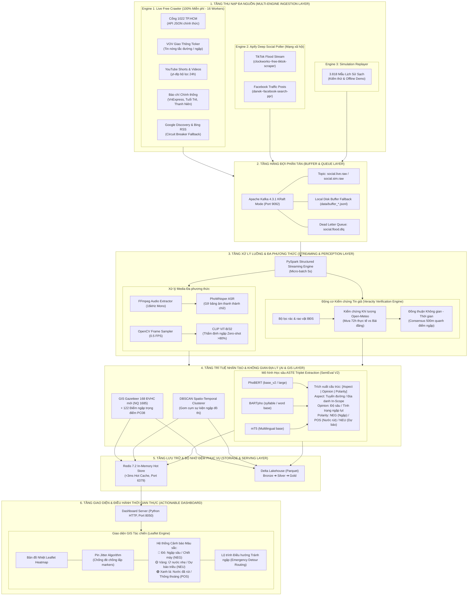

# 📘 BÀN GIAO TOÀN DIỆN DỰ ÁN & CẨM NANG HỆ THỐNG (PROJECT HANDOVER & SYSTEM OVERVIEW)
## Real-Time Multimodal Urban Flood Monitoring & Veracity Verification System (TP. Hồ Chí Minh & Vùng Đô Thị Mở Rộng)

> **Dự án**: Đồ án Chuyên ngành Dữ liệu lớn (SE363) - Trường ĐH Công nghệ Thông tin (UIT - VNU-HCM) & Mục tiêu Công bố Quốc tế (ICWSM / EMNLP).  
> **Nhóm thực hiện**: 
> - **Thuận** (System Lead & Primary Annotator / Gold Reference)
> - **Hùng** (Co-worker & Independent Peer Annotator)
> 
> **Mục đích tài liệu**: Cung cấp bức tranh toàn cảnh 100% về kiến trúc hệ thống, toàn bộ mã nguồn đang triển khai (Big Data, Crawler, Dashboard, AI), kho ngữ liệu ASTE (10.249 records), phân định rõ ràng **ĐÃ LÀM GÌ - ĐANG LÀM GÌ - SẼ LÀM GÌ**, cùng các kinh nghiệm thực chiến xương máu để **Agent ở tài khoản Pro mới có thể đọc hiểu và tiếp tục dự án ngay lập tức mà không gặp bất kỳ trở ngại nào**.

---

## 📑 MỤC LỤC CHI TIẾT
1. [TỔNG QUAN DỰ ÁN & BÀI TOÁN KHOA HỌC](#1-tổng-quan-dự-án--bài-toán-khoa-học)
2. [SƠ ĐỒ KIẾN TRÚC HỆ THỐNG TOÀN TRÌNH (END-TO-END ARCHITECTURE)](#2-sơ-đồ-kiến-trúc-hệ-thống-toàn-trình-end-to-end-architecture)
3. [CHI TIẾT TOÀN DIỆN CÁC THÀNH PHẦN HỆ THỐNG ĐANG TRIỂN KHAI](#3-chi-tiết-toàn-diện-các-thành-phần-hệ-thống-đang-triển-khai)
   - 3.1. [Tầng Thu Nạp Đa Nguồn (Multi-Engine Ingestion)](#31-tầng-thu-nạp-đa-nguồn-multi-engine-ingestion)
   - 3.2. [Tầng Hàng Đợi & Luồng Dữ Liệu Lớn (Kafka & PySpark Streaming)](#32-tầng-hàng-đợi--luồng-dữ-liệu-lớn-kafka--pyspark-streaming)
   - 3.3. [Tầng Kiểm Chứng Tin Giả & Khí Tượng Vật Lý (Veracity Engine)](#33-tầng-kiểm-chứng-tin-giả--khí-tượng-vật-lý-veracity-engine)
   - 3.4. [Tầng Lưu Trữ & Bộ Nhớ Nóng (Redis Hot Store & Delta Lakehouse)](#34-tầng-lưu-trữ--bộ-nhớ-nóng-redis-hot-store--delta-lakehouse)
   - 3.5. [Tầng Giao Diện Tác Chiến & Bản Đồ Nhiệt (GIS Dashboard & Heatmap)](#35-tầng-giao-diện-tác-chiến--bản-đồ-nhiệt-gis-dashboard--heatmap)
4. [TỔNG KẾT TIẾN ĐỘ DỰ ÁN: ĐÃ LÀM GÌ – ĐANG LÀM GÌ – SẼ LÀM GÌ](#4-tổng-kết-tiến-độ-dự-án-đã-làm-gì--đang-làm-gì--sẽ-làm-gì)
   - 4.1. [ĐÃ LÀM ĐƯỢC GÌ (Completed Milestones)](#41-đã-làm-được-gì-completed-milestones)
   - 4.2. [ĐANG LÀM GÌ (In-Progress State)](#42-đang-làm-gì-in-progress-state)
   - 4.3. [SẼ LÀM GÌ (Upcoming Roadmap & AI Upgrade)](#43-sẽ-làm-gì-upcoming-roadmap--ai-upgrade)
5. [ĐẶC TẢ KIẾN TRÚC AI NÂNG CAO: FAST PATH, SLOW PATH & ĐỊNH HƯỚNG CCTV](#5-đặc-tả-kiến-trúc-ai-nâng-cao-fast-path-slow-path--định-hướng-cctv)
   - 5.1. [Đường Suy Luận Nhanh (Fast Path - Text Stream)](#51-đường-suy-luận-nhanh-fast-path---text-stream)
   - 5.2. [Đường Suy Luận Đa Phương Thức Chuyên Sâu (Slow Path - Vision & Audio)](#52-đường-suy-luận-đa-phương-thức-chuyên-sâu-slow-path---vision--audio)
   - 5.3. [Định Hướng Ứng Dụng Camera Giao Thông (CCTV) Vào AI Theo Chỉ Đạo Của Thầy](#53-định-hướng-ứng-dụng-camera-giao-thông-cctv-vào-ai-theo-chỉ-đạo-của-thầy)
6. [KHO NGỮ LIỆU ASTE MASTER 10.249 RECORDS & PHÂN CÔNG THUẬN - HÙNG](#6-kho-ngữ-liệu-aste-master-10249-records--phân-công-thuận---hùng)
7. [BỘ KINH NGHIỆM THỰC CHIẾN XƯƠNG MÁU & NGUYÊN TẮC CỐT TỬ CỦA USER](#7-bộ-kinh-nghiệm-thực-chiến-xương-máu--nguyên-tắc-cốt-tử-của-user)
8. [CÔNG CỤ KIỂM ĐỊNH KÉP & BỘ HELPER TOÁN HỌC](#8-công-cụ-kiểm-định-kép--bộ-helper-toán-học)
9. [BẢNG TRA CỨU LỆNH NHANH (RUNBOOK CHEATSHEET)](#9-bảng-tra-cứu-lệnh-nhanh-runbook-cheatsheet)

---

## 1. TỔNG QUAN DỰ ÁN & BÀI TOÁN KHOA HỌC

### 1.1. Bối cảnh & Thách thức
TP. Hồ Chí Minh và vùng đô thị giáp ranh (Bình Dương, Bà Rịa - Vũng Tàu) thường xuyên bị ngập úng nghiêm trọng do triều cường sông Sài Gòn - Đồng Nai và các cơn mưa dông cực đoan:
- **Cảm biến thủy văn vật lý quá thưa thớt**: Toàn thành phố chỉ có trạm đo ở một vài cửa sông/kênh chính; hàng nghìn tuyến phố, khu dân cư hoàn toàn không có cảm biến.
- **Mạng xã hội (TikTok, Facebook, VOV Giao thông, Báo chí) là nguồn "cảm biến đám đông" (Crowdsourced Sensing) tức thời nhất**, nhưng chứa đầy **nhiễu nghiêm trọng**:
  + Tin rác thương mại / bất động sản (*"Huỳnh Tấn Phát 1tr8 phòng trọ ngập tràn ánh sáng"*, *"chậu cây ngập kho"*).
  + Clip câu tương tác tái sử dụng (recycled clips): lấy clip ngập từ các năm trước đăng lại khi trời đang nắng ráo.
  + Thói quen than phiền gián tiếp: người dân thường kêu xe bị chết máy, hỏng bugi thay vì nói thẳng tên tuyến đường.
  + Mất cân bằng nhãn: Người dân chỉ đăng bài khi ngập lụt (`NEG`), hầu như không ai đăng bài khi nước rút (`POS`), khiến các điểm cảnh báo ngập trên bản đồ bị "treo vĩnh viễn" nếu không phát hiện được trạng thái phục hồi.

### 1.2. Giải pháp Toàn Diện Của Hệ Thống
Dự án xây dựng một giải pháp hoàn chỉnh từ Big Data Ingestion, Streaming, AI Veracity Verification, Multimodal ASTE cho tới Interactive GIS Dashboard:
1. **Thu nạp đa nguồn**: Kết hợp crawler mạng xã hội và nguồn chính thống (1022, VOV, Báo đài).
2. **Kiểm chứng tin giả**: Đối soát dữ liệu lượng mưa thực tế thời gian thực từ Open-Meteo và cơ chế đồng thuận 500m.
3. **Mô hình AI ASTE**: Trích xuất bộ ba cấu trúc `(Aspect, Opinion, Polarity)` theo chuẩn quốc tế SemEval ASTE-Data-V2.
4. **Bản đồ Heatmap & Điều hướng Tránh Ngập**: Phục vụ người dân và cơ quan quản lý đô thị theo thời gian thực.

---

## 2. SƠ ĐỒ KIẾN TRÚC HỆ THỐNG TOÀN TRÌNH (END-TO-END ARCHITECTURE)



---

## 3. CHI TIẾT TOÀN DIỆN CÁC THÀNH PHẦN HỆ THỐNG ĐANG TRIỂN KHAI

### 3.1. Tầng Thu Nạp Đa Nguồn (Multi-Engine Ingestion)
- **Engine 1 - Live Free Crawler (`pipeline/live_free_crawler.py`)**: 
  + Vận hành 16 luồng thu thập không tốn phí bản quyền.
  + Kết nối API Cổng 1022 TP.HCM (phản ánh ngập chính thức của người dân).
  + Thu thập Ticker VOV Giao thông theo thời gian thực.
  + Cào YouTube Shorts bằng `yt-dlp` lọc video trong vòng 24 giờ.
  + Quét RSS báo điện tử chính thống (VnExpress, Tuổi Trẻ, Thanh Niên).
- **Engine 2 - Apify Deep Social Poller (`pipeline/tiktok_poller.py`, `pipeline/facebook_poller.py`)**:
  + Quét video TikTok theo hashtag ngập lụt (`#ngapsaigon`, `#muangap`, `#trieucuong`...).
  + Quét các bài viết trên Fanpage và nhóm giao thông Facebook lớn tại TP.HCM.
  + Được bảo vệ bởi bộ quản lý `core/apify_pool.py`: tự động xoay vòng key khi key hiện tại hết credit hoặc gặp lỗi HTTP 401/402.
- **Engine 3 - Simulation Replayer (`pipeline/simulation_replayer.py`)**:
  + Đọc 3.818 mẫu lịch sử sạch trong `data/raw/episodes` để tái hiện các cơn mưa ngập lịch sử, phục vụ việc kiểm thử hiệu năng và demo offline.

### 3.2. Tầng Hàng Đợi & Luồng Dữ Liệu Lớn (Kafka & PySpark Streaming)
- **Apache Kafka 4.3.1 (KRaft Mode)**:
  + Chạy qua Docker (`bigdata/docker-compose.yml`, Port 9092).
  + Topic chính: `social.live.raw` (dữ liệu cào thực) và `social.sim.raw` (dữ liệu giả lập).
  + Cơ chế Fallback an toàn: Nếu Kafka chưa khởi động hoặc gặp sự cố, crawler tự động lưu tạm vào file cục bộ `data/buffer_*.jsonl` để không bị mất dữ liệu.
- **PySpark Structured Streaming (`bigdata/run_streaming_pipeline.py`)**:
  + Chạy micro-batch mỗi 5 giây để đọc dữ liệu từ Kafka.
  + Bóc tách JSON, phân tích cấu trúc, gắn nhãn thời gian (watermark), và đẩy dữ liệu qua các mô-đun lọc Veracity và Gazetteer.

### 3.3. Tầng Kiểm Chứng Tin Giả & Khí Tượng Vật Lý (Veracity Engine)
Nằm tại `pipeline/veracity_checker.py`, thực hiện 3 tầng bảo vệ nghiêm ngặt:
1. **Lọc Heuristic & Rao vặt BĐS**: Loại bỏ ngay các bài quảng cáo phòng trọ, bán ô tô cũ, bán bạt chắn nước.
2. **Đối soát Khí tượng Vật lý Open-Meteo**: 
   - Khi bài viết đăng tin ngập lụt, hệ thống gọi Open-Meteo API để kiểm tra tổng lượng mưa thực tế tích lũy trong 72 giờ qua tại tọa độ tương ứng.
   - Nếu lượng mưa $\approx 0\text{mm}$ và thời tiết đang nắng ráo $\rightarrow$ Gắn cờ cảnh báo **Recycled Video** (tin câu tương tác dùng clip cũ).
3. **Đồng thuận Không gian - Thời gian (Spatio-Temporal Consensus)**:
   - Gom các tin phản ánh trong bán kính 500m và khung thời gian 60 phút. Càng có nhiều nguồn độc lập cùng báo ngập, độ tin cậy càng tiệm cận 100%.

### 3.4. Tầng Lưu Trữ & Bộ Nhớ Nóng (Redis Hot Store & Delta Lakehouse)
- **Redis 7.2 In-Memory Hot Store (Port 6379)**:
  + Lưu trữ trạng thái nóng tức thời của các tuyến đường và điểm ngập hiện tại.
  + Độ trễ phản hồi cực thấp ($< 3\text{ms}$), giúp Dashboard truy vấn liên tục mà không gây tải cho cơ sở dữ liệu chính.
- **Delta Lakehouse (Parquet Storage)** tại `bigdata/lakehouse/`:
  + Phân tầng dữ liệu theo chuẩn công nghiệp: **Bronze** (dữ liệu thô) $\rightarrow$ **Silver** (dữ liệu đã làm sạch & chuẩn hóa tọa độ) $\rightarrow$ **Gold** (bảng tổng hợp thống kê lịch sử ngập phục vụ nghiên cứu).

### 3.5. Tầng Giao Diện Tác Chiến Đa Bảng Điều Khiển (Modular Multi-Panel GIS Dashboard)
Nằm tại `dashboard/server.py` (Port 8050) và `dashboard/index.html`. Hệ thống giao diện điều hành đã được nâng cấp toàn diện từ một màn hình bản đồ đơn lẻ thành **Hệ Thống Bảng Điều Khiển Đa Phân Hệ (Modular Multi-Panel Dashboard)** chuẩn tác chiến công nghiệp, trong đó **Bản đồ Heatmap đóng vai trò là Trái tim cốt lõi (Core Component)** và được bao quanh, bổ trợ đắc lực bởi **5 phân hệ vệ tinh**:

```
┌────────────────────────────────────────────────────────────────────────────────────────┐
│             HỆ THỐNG ĐIỀU HÀNH 6 PHÂN HỆ (MODULAR MULTI-PANEL DASHBOARD)               │
├───────────────────────────────────────────┬────────────────────────────────────────────┤
│ 📍 PANEL 1: BẢN ĐỒ NHIỆT GIS CORE         │ 📊 PANEL 2: XẾP HẠNG ĐIỂM ĐEN THEO NQ 1685 │
│ • Bản đồ Leaflet Heatmap mật độ ngập      │ • Top điểm ngập theo 168 phường/xã mới     │
│ • Pin Jitter chống đè marker trùng đường  │ • Phân loại vùng đô thị lõi vs giáp ranh   │
│ • Routing dẫn đường tránh điểm ngập       │ • Thống kê tần suất ngập lụt lũy kế        │
├───────────────────────────────────────────┼────────────────────────────────────────────┤
│ 💓 PANEL 3: GIÁM SÁT SỨC KHỎE VI DỊCH VỤ  │ 📈 PANEL 4: DIỄN BIẾN NGẬP THEO THỜI GIAN  │
│ • Heartbeat & độ trễ Redis (<3ms)         │ • Time-Series xu hướng ngập theo giờ/ngày  │
│ • Trạng thái Kafka Broker, PySpark        │ • Chu kỳ triều cường kết hợp vũ lượng mưa  │
│ • Quản lý tài nguyên Apify Key Pool       │ • Dự báo đỉnh triều và điểm bùng phát      │
├───────────────────────────────────────────┼────────────────────────────────────────────┤
│ ⚡ PANEL 5: TỐC ĐỘ THU THẬP & KIỂM ĐỊNH   │ 🔔 PANEL 6: DÒNG TIN TỨC HIỆN TRƯỜNG LIVE  │
│ • Ingestion Throughput (Events/giây)      │ • Ticker tin tức nóng từ TikTok, FB, VOV   │
│ • Tỷ lệ tin rác bị Veracity Engine chặn   │ • Badge màu sắc trực quan (Đỏ/Vàng/Xanh)   │
│ • Tỷ lệ xác thực khí tượng Open-Meteo     │ • Click xem video/audio và tọa độ thực tế  │
└───────────────────────────────────────────┴────────────────────────────────────────────┘
```

#### Chi tiết 6 Panels Điều hành Thực tế:
1. **Panel 1: Bản đồ Nhiệt Ngập lụt Thời gian thực (Geospatial Heatmap Core)**:
   - Trái tim của toàn hệ thống, trực quan hóa cường độ ngập theo thời gian thực trên nền bản đồ Leaflet.
   - **Thuật toán Pin Jitter**: Tự động phân tách vi sai tọa độ của các ghim cùng nằm trên một con đường, chống hoàn toàn hiện tượng marker đè chồng lấp lên nhau.
   - **Hệ thống điều khiển chuyên sâu**: Thanh trượt cửa sổ thời gian (Time Window: 15m, 30m, 60m, 120m), chuyển đổi chế độ Trực tiếp (Live Stream) vs Giả lập (Simulation Replayer), kích hoạt cào sâu (Deep Crawl / Apify Poll), quét lân cận (Proximity Scan), và lớp cảnh báo điều tiết của CSGT.
   - **Emergency Detour Routing**: Tự động tính toán đường vòng thay thế an toàn khi lộ trình phương tiện giao thông cắt qua các vùng ngập đỏ.
2. **Panel 2: Bảng Xếp hạng Điểm ngập theo Phường / Xã Mới (Theo Nghị quyết 1685)**:
   - Thống kê và xếp hạng top các điểm nóng ngập lụt được ánh xạ chuẩn xác theo 168 đơn vị hành chính mới sau sáp nhập tại TP.HCM (Thủ Đức, Quận 1 đến 12, Bình Thạnh, Gò Vấp, Bình Tân...) cùng vùng giáp ranh Bình Dương & Vũng Tàu.
3. **Panel 3: Giám sát Trạng thái Vi dịch vụ (System & Node Health)**:
   - Theo dõi nhịp tim (Heartbeat) và tài nguyên của cụm hạ tầng: Kafka Broker (Port 9092), Redis In-Memory Hot Store (Port 6379), PySpark Streaming worker, và tình trạng credit/hạn mức của Apify Key Pool.
4. **Panel 4: Biểu đồ Diễn biến Ngập theo Thời gian (Time-Series Flood Trend)**:
   - Đồ thị đường biến thiên thể hiện số lượng sự cố ngập lụt theo từng khung giờ trong ngày, đối sánh tương quan giữa đỉnh triều dâng và thời điểm mưa cực đoan đổ xuống.
5. **Panel 5: Tốc độ Thu thập & Kiểm định Dữ liệu (Ingestion Throughput & Veracity Analytics)**:
   - Đo lường thông lượng dữ liệu đầu vào (Events per second), thống kê tỷ lệ phần trăm tin rác quảng cáo BĐS bị loại bỏ, và tỷ lệ bài đăng được Veracity Engine thẩm định thành công qua khí tượng Open-Meteo.
6. **Panel 6: Dòng Tin tức Hiện trường Mới nhất (Live Alerts Feed)**:
   - Luồng cấp tin tức thời gian thực hiển thị từng bài đăng mới nhất từ TikTok, Facebook, Cổng 1022 và VOV Giao thông kèm nhãn phân cực cảm xúc (Đỏ: Ngập sâu/Chết máy, Vàng: Ứ nước/Triều dâng, Xanh lá: Nước đã rút).

#### Các Cải Tiến Công Nghệ Vượt Trội Trên Dashboard:
- **Chuẩn hóa Icon Vectơ Lucide (Enterprise Lucide SVG Icons)**: Toàn bộ các icon hoạt họa/emoji cũ đã được thay thế 100% bằng bộ icon vectơ chuyên nghiệp của Lucide, đồng bộ màu sắc phân cấp theo từng nhóm chức năng ở thanh Sidebar.
- **Cơ chế Điều hướng Đa Chế Độ & Phím Tắt Tác Chiến**:
  + **Chế độ Lưới Tổng quan (Grid Overview Mode)**: Hiển thị đồng thời cả 6 ô panel trên một màn hình lớn để bao quát toàn diện hệ thống.
  + **Chế độ Phóng to Tiêu điểm (Focus Mode)**: Hỗ trợ phím tắt số từ `1` đến `6` để lập tức phóng to bất kỳ panel nào ra 100% toàn màn hình; bấm `0` hoặc `Esc` để thu nhỏ về màn hình lưới.
- **Khắc phục Triệt để Lỗi Vỡ Gạch Bản đồ (Leaflet ResizeObserver & Dual-Tick Fallback)**:
  + Tích hợp API hiện đại `ResizeObserver` kết hợp cơ chế kích hoạt 2 nhịp (`requestAnimationFrame` + `300ms fallback`) để tự động gọi `map.invalidateSize()` mỗi khi chuyển đổi qua lại giữa các panel, **triệt tiêu hoàn toàn lỗi xám gạch (grey tiles) hoặc lệch tâm bản đồ**.
- **Không Gây Tải Máy Chủ (Zero Server Compute Overhead)**:
  + Toàn bộ hiệu ứng chuyển panel và đồ thị biểu đồ được kết xuất 100% ở phía máy khách (Client-Side Rendering bằng JavaScript), máy chủ backend chỉ phân phối các gói JSON siêu nhẹ (< 15 KB), dành trọn vẹn tài nguyên CPU/GPU cho AI và PySpark.
- *Định hướng cải thiện thêm*: Trong giai đoạn tới, có thể tinh chỉnh thêm độ mượt của gradient lớp phủ Heatmap và bổ sung biểu đồ phân tích trực quan kết nối dữ liệu camera CCTV.

---

## 4. TỔNG KẾT TIẾN ĐỘ DỰ ÁN: ĐÃ LÀM GÌ – ĐANG LÀM GÌ – SẼ LÀM GÌ

Đây là phần định vị tiến độ quan trọng nhất để Agent mới nắm rõ bức tranh toàn cục:

```
┌────────────────────────────────────────────────────────────────────────────────────────┐
│                        BỨC TRANH TIẾN ĐỘ 3 CỘT MỐC CỦA DỰ ÁN                           │
├────────────────────────────────────────────────────────────────────────────────────────┤
│ 1. ĐÃ LÀM ĐƯỢC GÌ (COMPLETED):                                                         │
│    ✅ Xây dựng & tích hợp hoàn chỉnh hệ thống Big Data (Kafka KRaft, Redis 7.2, Docker)│
│    ✅ Hoàn thiện bộ crawlers đa nguồn (16 luồng free + Apify pool + Replayer)          │
│    ✅ Hoàn thành Dashboard GIS Leaflet Heatmap, Pin Jitter, điều hướng tránh ngập      │
│    ✅ Xây dựng động cơ Veracity kiểm chứng khí tượng Open-Meteo & Consensus 500m       │
│    ✅ Dataset Phase 1: 500 records (Thuận) đã audit chuẩn mực                          │
│    ✅ Dataset Phase 2: 2.000 records (Thuận & Hùng mù đôi, đạt Cohen's Kappa κ = 0.88) │
│    ✅ Dataset Phase 3 (Phần Thuận): 3.875 records ĐÃ XONG 100%, cứu 782 records reject │
│       oan, đạt 3.798 records có nhãn (98.01%), vượt qua 10/10 Passes Linter đạt 0 lỗi  │
│    ✅ Bộ kiểm định kép: deep_10_pass_audit.py & audit_index_integrity.py               │
├────────────────────────────────────────────────────────────────────────────────────────┤
│ 2. ĐANG LÀM GÌ (IN-PROGRESS):                                                          │
│    ⏳ Phân công Phase 3: Bạn HÙNG ĐANG THỰC HIỆN phần của Hùng (3.874 records, dòng    │
│       6.376 đến 10.249). Bạn THUẬN ĐỢI HÙNG LÀM XONG RỒI DÒ / ĐỐI SOÁT LẠI.            │
│    ⏳ Mô hình AI trong hệ thống hiện tại đang chạy mô hình CŨ TẠM THỜI (do huấn luyện  │
│       trên dataset cũ chưa được chuẩn hóa kỹ).                                         │
├────────────────────────────────────────────────────────────────────────────────────────┤
│ 3. SẼ LÀM GÌ (UPCOMING ROADMAP):                                                       │
│    🎯 Đợi Hùng xong Phase 3 ➔ Dò soát lại ➔ Gộp toàn bộ 3 Phase thành MASTER 10K CHUẨN │
│    🎯 Chạy lại Benchmark (PhoBERT, BARTpho, mT5, XLM-R, LLMs) trên toàn bộ Master 10K   │
│    🎯 ÁP DỤNG VÀO PRODUCTION NẾU F1 ĐẠT TRÊN 70% (F1 >= 70%)                            │
│    🎯 Chuẩn hóa kiến trúc AI 2 nhánh: FAST PATH (Text stream) & SLOW PATH (Multimodal) │
│    🎯 TÍCH HỢP CAMERA GIAO THÔNG (CCTV) TP.HCM VÀO AI THEO ĐỊNH HƯỚNG CỦA THẦY          │
└────────────────────────────────────────────────────────────────────────────────────────┘
```

---

## 5. ĐẶC TẢ KIẾN TRÚC AI NÂNG CAO: FAST PATH, SLOW PATH & ĐỊNH HƯỚNG CCTV

Mã nguồn triển khai thử nghiệm hiện có tại `bigdata/ai_service/ai_microservice.py` (Port 8001). Sau khi hoàn thành Master Dataset 10K và đạt $F_1 \ge 70\%$, hệ thống AI sẽ được nâng cấp theo kiến trúc 2 nhánh chuyên biệt:

```
                                  ┌───────────────────────────┐
                                  │   DỮ LIỆU ĐẦU VÀO ĐẾN     │
                                  └─────────────┬─────────────┘
                                                │
                     ┌──────────────────────────┴──────────────────────────┐
                     │                                                     │
                     ▼ (Chỉ có Text / Cần phản hồi <10ms)                  ▼ (Có Video / Audio / Nghi vấn tin giả)
       ┌───────────────────────────┐                         ┌───────────────────────────┐
       │   NHÁNH 1: FAST PATH      │                         │    NHÁNH 2: SLOW PATH     │
       │   (Real-Time Text ASTE)   │                         │  (Multimodal Verification)│
       ├───────────────────────────┤                         ├───────────────────────────┤
       │ • Backbone: PhoBERT-base  │                         │ • ASR: PhoWhisper (Audio) │
       │ • Input: Text ngắn/tiêu đề│                         │ • Vision: CLIP ViT-B/32   │
       │ • Độ trễ: <= 10ms trên GPU│                         │ • Generative: BARTpho     │
       │ • Bóc tách Span tức thì   │                         │ • Độ trễ: 1.5s - 5.0s     │
       └─────────────┬─────────────┘                         └─────────────┬─────────────┘
                     │                                                     │
                     └──────────────────────────┬──────────────────────────┘
                                                ▼
                                  ┌───────────────────────────┐
                                  │   TÍCH HỢP CAMERA CCTV    │
                                  │   GIAO THÔNG ĐÔ THỊ TP.HCM│
                                  │  (Computer Vision & Kè bờ)│
                                  └─────────────┬─────────────┘
                                                ▼
                                  ┌───────────────────────────┐
                                  │   BẢN ĐỒ TÁC CHIẾN GIS    │
                                  └───────────────────────────┘
```

### 5.1. Đường Suy Luận Nhanh (Fast Path - Text Stream)
- **Mục tiêu**: Phục vụ luồng xử lý streaming tốc độ cao (SLA $\le 35\text{ms}$, trên GPU thực tế $\le 10\text{ms}$).
- **Backbone**: `vinai/phobert-base-v2` huấn luyện theo dạng Span Extraction / Table Filling.
- **Nhiệm vụ**: Nhận diện trực tiếp thực thể con đường và vị ngữ ngập trong các tiêu đề tin tức, ticker VOV, và bài đăng văn bản để cập nhật tức thì lên bản đồ.

### 5.2. Đường Suy Luận Đa Phương Thức Chuyên Sâu (Slow Path - Vision & Audio)
- **Mục tiêu**: Xử lý các bài đăng có đính kèm video, âm thanh tiếng nói của người dân tại hiện trường ngập (SLA $\le 5\text{s}$).
- **Các thành phần phối hợp**:
  + **FFmpeg & PhoWhisper ASR**: Trích xuất luồng âm thanh 16kHz mono từ video TikTok/Facebook và gỡ băng tiếng nói địa phương thành văn bản.
  + **OpenCV & CLIP ViT-B/32**: Trích xuất khung hình (0.5 FPS), thẩm định thị giác Zero-shot xem khung hình có thực sự xuất hiện cảnh ngập nước (độ tương đồng cosine $> 80\%$) hay không.
  + **BARTpho-syllable**: Mô hình Generative ASTE tổng hợp các đặc trưng đa phương thức để đưa ra bộ ba Triplet có độ tin cậy tuyệt đối.

### 5.3. Định Hướng Ứng Dụng Camera Giao Thông (CCTV) Vào AI Theo Chỉ Đạo Của Thầy
Theo định hướng của Thầy hướng dẫn đề tài, một bước đột phá sắp tới là **kết nối mạng lưới Camera CCTV giao thông công cộng của TP.HCM** vào hệ thống AI:
- **Ý nghĩa khoa học & thực tiễn**: Mạng xã hội cho biết người dân *nói* gì về ngập, nhưng hình ảnh từ Camera CCTV giao thông cho biết mặt đường *thực tế* đang ngập ở mức độ nào.
- **Giải pháp triển khai**:
  1. Kết nối luồng RTSP / Snapshot từ hệ thống camera giao thông đô thị TP.HCM tại các nút giao trọng điểm (như Hàng Xanh, ngã tư Thủ Đức, đường Trần Xuân Soạn, Quốc Hương...).
  2. Ứng dụng mô hình Thị giác Máy tính (Computer Vision / Segmentation) để nhận diện vùng ngập nước trên mặt đường, đo lường mức ngập tương đối so với vỉa hè hoặc bánh xe.
  3. **Đối soát chéo (Cross-Validation)**: Khi mạng xã hội báo tin ngập tại một tuyến đường có camera, AI lập tức soi chiếu hình ảnh camera tại đó. Nếu hình ảnh xác nhận có nước ngập $\rightarrow$ Tự động nâng độ tin cậy lên 100% và kích hoạt cảnh báo khẩn cấp trên bản đồ!

---

## 6. KHO NGỮ LIỆU ASTE MASTER 10.249 RECORDS & PHÂN CÔNG THUẬN - HÙNG

Kho ngữ liệu chuẩn quốc tế lưu tại [master_10k_triplets.txt](file:///D:/SE363_RAWDATA/data/processed/aste_v2_format/master_10k_triplets.txt) gồm đúng **10.249 records**:

```text
========================================================================================
                      BẢNG PHÂN CÔNG GÁN NHÃN VÀ TRẠNG THÁI HIỆN TẠI
========================================================================================
• PHASE 1 (Dòng 1 đến Dòng 500: 500 records):
  - Người làm: Thuận
  - Trạng thái: ĐÃ HOÀN TẤT & AUDIT CHUẨN MỰC
  - File: data/validate_label/thuan/phase1.txt

• PHASE 2 (Dòng 501 đến Dòng 2.500: 2.000 records):
  - Người làm: Thuận & Hùng (Double-Blind Independent Annotation)
  - Trạng thái: ĐÃ HOÀN TẤT, ĐẠT COHEN'S KAPPA κ = 0.88 (Polarity)
  - File: data/validate_label/thuan/phase2.txt & data/validate_label/hung/phase2.txt

• PHASE 3 (Dòng 2.501 đến Dòng 10.249: 7.749 records):
  1. PHẦN THUẬN (Dòng 2.501 đến 6.375: 3.875 records):
     - Trạng thái: ĐÃ HOÀN TẤT 100%, ĐÃ CỨU 782 RECORDS REJECT OAN
     - Kết quả: 3.798 records có nhãn (98.01%), 4.976 triplets, chỉ còn 77 rejects (1.99%)
     - Nghiệm thu: ĐẠT 10/10 PASSES: 0 LỖI (deep_10_pass_audit.py)
     - File: data/validate_label/thuan/phase3.txt
  
  2. PHẦN HÙNG (Dòng 6.376 đến 10.249: 3.874 records):
     - Trạng thái: HÙNG ĐANG LÀM, THUẬN ĐỢI HÙNG LÀM XONG SẼ DÒ / ĐỐI SOÁT LẠI
     - File đích: data/validate_label/hung/phase3.txt (hiện đang trống)
========================================================================================
```

---

## 7. BỘ KINH NGHIỆM THỰC CHIẾN XƯƠNG MÁU & NGUYÊN TẮC CỐT TỬ CỦA USER

> [!IMPORTANT]
> Đây là những nguyên tắc tối cao đã được kiểm chứng và chấn chỉnh qua hàng chục phiên làm việc với User. **Agent mới tuyệt đối không được vi phạm hay tự ý thay đổi bất kỳ quy tắc nào!**

### 1. 🚨 BẮT BUỘC LƯU Ý: Bình Dương & Vũng Tàu LÀ IN-SCOPE (TUYỆT ĐỐI CẤM REJECT)
- **Căn cứ**: Đề tài nghiên cứu áp dụng cho **Vùng Đại đô thị TP.HCM mở rộng (Greater HCMC Metropolitan Area)**. Về kinh tế, chuỗi cung ứng, luồng di chuyển lao động hàng ngày và lưu vực thủy văn (sông Sài Gòn - Đồng Nai), **Bình Dương** và **Vũng Tàu** là hai địa bàn đã sáp nhập kinh tế - không gian chặt chẽ với TP.HCM.
- **Khu vực Bình Dương**: *Thủ Dầu Một, Thuận An, Dĩ An, Bến Cát, Tân Uyên, Bàu Bàng, Lái Thiêu, ĐT743, ĐT744, ĐT748, QL13, KCN Sóng Thần, VSIP...* $\rightarrow$ **Bắt buộc giữ lại và gán nhãn** trực tiếp cho địa danh đó.
- **Khu vực Vũng Tàu**: *TP Vũng Tàu, TP Bà Rịa, TX Phú Mỹ, Đất Đỏ, Long Điền, Xuyên Mộc, Hồ Tràm, Đường 30/4, Thùy Vân, Hạ Long, Bãi Sau, Bãi Trước, Bến Đình...* $\rightarrow$ **Bắt buộc giữ lại và gán nhãn**.
- **Chỉ gán `REJECT (####[])` khi**: Sự kiện ngập diễn ra ở tỉnh ngoài thực sự (*Hà Nội, Cần Thơ, Cà Mau, Gia Lai, Tam Kỳ, Thái Lan/Bangkok, Trung Quốc...*).

### 2. ⚠️ Lỗi Lạm Dụng Fallback (`DOC_FALLBACK_MISUSE / PASS 9`)
- **Nguyên nhân sai lầm cũ**: Crawler tự động dán tiền tố `Tại TP. Hồ Chí Minh , ` vào câu. Khi trong câu **đã có tên đường cụ thể** (*đường Trần Xuân Soạn, đường Tô Ngọc Vân, đường Đặng Thùy Trâm, đường Linh Đông...*), annotator cũ gán Aspect là `TP. Hồ Chí Minh` khiến linter Pass 9 báo lỗi `SUSPECT_FALLBACK_USAGE`. Thay vì sửa Aspect thành tên đường, annotator cũ lại **thẳng tay gắn `####[]` để lách linter**, làm mất hàng trăm bản tin ngập lụt quý giá!
- **Quy tắc chuẩn**:
  + **Ưu tiên số 1**: Khi câu đã có tên đường / địa danh cụ thể $\rightarrow$ **BẮT BUỘC gán Aspect là tên đường / địa danh đó**, CẤM dùng Fallback `TP. Hồ Chí Minh`.
  + **Chỉ dùng Fallback khi**: Câu hoàn toàn không nhắc tới bất kỳ một tên đường cụ thể nào mà chỉ nói về hiện trường ngập chung chung (ví dụ: *"Tại TP. Hồ Chí Minh , Mưa lớn khiến hàng loạt xe chết máy"* $\rightarrow$ Aspect `TP. Hồ Chí Minh` `[1, 2, 3, 4]`).
  + **TUYỆT ĐỐI CẤM REJECT câu chỉ vì vi phạm Pass 9**: Phải sửa Aspect về đúng tên đường.

### 3. 🎭 Phân Biệt Khẩu Ngữ Châm Biếm Đời Thường (Slang/Satire) vs. Meme Giải Trí
- **Giữ lại và gán `NEG`**: Người dân dùng ngôn ngữ bình dân, ví von đời thực để kêu than ngập: *"thất thủ"*, *"như sông"*, *"hóa sông"*, *"biển nước"*, *"bì bõm"*, *"lội nước"*, *"dắt bộ xe máy"*, *"kê dọn đồ đạc"*, *"nước lút bánh xe"*, *"chèo xuồng tạm"*, *"mưa tí là ngập"*, *"nhà biến thành hầm"*. Đây là phản ánh hiện trường chân thực của bài toán đô thị!
- **Chỉ gán `REJECT (####[])` khi**: Yếu tố ngập lụt chỉ làm nền phụ cho nội dung giải trí khác:
  + So sánh phim hoạt hình/anime (*Vùng đất linh hồn*).
  + Clip đi xem ca nhạc concert (*chị Chi hát live*).
  + Clip thú cưng nô đùa dưới nước (`#thucung`, `#dangyeu`).
  + Mẹo kỹ thuật xử lý xe bị thủy kích chung chung.
  + Rao vặt phòng trọ studio, bán xe ô tô cũ, chậu hoa cây cảnh ngập kho.
  + Ký ức Sài Gòn trước năm 1975, tranh luận triết lý dùng lu chống ngập.

### 4. ✂️ Xử Lý Câu Bị Cắt Cụt Do Buffer Crawler
- Các bài viết từ TikTok/Facebook do giới hạn buffer (~250 ký tự) thường bị cắt ngang ở từ cuối (ví dụ: *"Khu vực giao với đường Linh Đông ngập nặng nhất , dòn..."*).
- **Quy tắc**: Nếu ở vế trước đã có đầy đủ địa danh (`đường Linh Đông`) và tình trạng ngập (`ngập nặng nhất`) $\rightarrow$ **Bắt buộc trích xuất Triplet**, không được vội vã đánh đồng là câu cụt để reject!

### 5. 🏗️ Phân Định Công Trình Hạ Tầng (`POS`) & Dự Báo Đỉnh Triều (`NEU`)
- Trạm bơm vận hành hết công suất, máy bơm di động, nạo vét kênh mương, cống kiểm soát triều, nước rút bớt, đường sau nâng cấp không còn ngập $\rightarrow$ Gán nhãn **`POS`**.
- Dự báo đỉnh triều, đo đạc mực nước tại các trạm Phú An, Nhà Bè, Thủ Dầu Một, Vũng Tàu $\rightarrow$ Gán nhãn **`NEU`**.

### 6. 🔄 Nguyên Tắc Nhất Quán Tuyệt Đối & Micro-Batching
- **User đặc biệt lưu ý**: Không được đổi quy tắc gán nhãn giữa chừng sau vài chục lô. Mọi lô từ đầu đến cuối phải tuân thủ nghiêm ngặt [BI_QUYET_GAN_NHAN_VA_AUDIT_DATASET_ASTE.md](file:///D:/SE363_RAWDATA/documents/BI_QUYET_GAN_NHAN_VA_AUDIT_DATASET_ASTE.md).
- **Micro-Batching**: Luôn chia nhỏ dữ liệu thành từng lô 50 – 100 records để đọc hiểu toàn bộ ngữ cảnh câu, không chạy ẩu hàng loạt bằng script heuristic thay thế việc đọc hiểu.

---

## 8. CÔNG CỤ KIỂM ĐỊNH KÉP & BỘ HELPER TOÁN HỌC

Kiến trúc kiểm định của dự án áp dụng mô hình **Dual-Engine Audit**:

```
┌────────────────────────────────────────────────────────────────────────┐
│                   KIẾN TRÚC KIỂM ĐỊNH KÉP (DUAL-ENGINE)                │
└────────────────────────────────────────────────────────────────────────┘
          │                                              │
          ▼                                              ▼
┌──────────────────────────────────┐   ┌──────────────────────────────────┐
│   ENGINE 1: CHUYÊN GIA / AGENT   │   │     ENGINE 2: SCRIPT AUDITOR     │
│   (Semantic Reasoning Engine)    │   │  (Mathematical & Linting Engine) │
├──────────────────────────────────┤   ├──────────────────────────────────┤
│ • Đọc hiểu trọn vẹn ngữ cảnh câu.│   │ • 100% READ-ONLY (Không sửa file)│
│ • Phân định POS / NEG / NEU.     │   │ • Đối soát toán học Span Index.  │
│ • Nhận diện địa danh In-Scope.   │   │ • Phát hiện rò rỉ giới từ/dấu câu│
│ • Quyết định trích xuất / reject.│   │ • Giải mã ngược (Reconstruction) │
└──────────────────────────────────┘   └──────────────────────────────────┘
```

### 8.1. Danh mục 10 Nhóm Lỗi Được Quét Bởi `deep_10_pass_audit.py`
1. **Pass 1: Syntax Format**: Kiểm tra cú pháp phân cách `####` và cấu trúc danh sách Python `[([a], [o], 's')]`.
2. **Pass 2: Token Offset**: Kiểm tra chỉ số token có vượt quá số từ trong câu không.
3. **Pass 3: Overlap**: Kiểm tra xem Aspect và Opinion có bị trùng đè vị trí lên nhau không.
4. **Pass 4: Border Punctuation**: Kiểm tra rò rỉ dấu câu (`"`, `'`, `,`, `.`, `!`, `?`) ở rìa Aspect/Opinion.
5. **Pass 5: Preposition Leakage**: Kiểm tra giới từ thừa ở đầu Aspect (`ở`, `tại`, `trên`, `trong`, `tới`...).
6. **Pass 6: Polarity Validity**: Chỉ chấp nhận 3 giá trị `POS`, `NEG`, `NEU`.
7. **Pass 7: Out-of-Scope Provinces**: Phát hiện các tỉnh ngoài phạm vi chưa được reject.
8. **Pass 8: Polarity Mismatch**: Kiểm tra các từ mang nghĩa phục hồi (*"nước rút"*, *"khô ráo"*) bị gán nhầm `NEG`.
9. **Pass 9: Fallback Misuse**: Phát hiện câu đã có tên đường cụ thể nhưng lại dùng Fallback `TP. Hồ Chí Minh`.
10. **Pass 10: Bare Noun as Opinion**: Bắt lỗi các danh từ hiện tượng trơ trọi không có tính từ/vị ngữ (*"điểm ngập"*, *"vùng ngập"*, *"mực nước"*).

### 8.2. Công Cụ Sinh Triplet Chuẩn Xác `span_helper.py`
Khi cần tạo hoặc sửa Triplet, **bắt buộc gọi qua `span_helper.py`**:
```python
from scripts.span_helper import make_triplet

# Đầu vào: câu text gốc, cụm Aspect bằng chữ, cụm Opinion bằng chữ, Polarity
trip = make_triplet(
    text="Tại TP. Hồ Chí Minh , đường Nguyễn Văn Quá ngập sâu khiến xe chết máy .",
    asp_phrase="đường Nguyễn Văn Quá",
    opi_phrase="ngập sâu",
    polarity="NEG"
)
# Kết quả trả về triplet số chuẩn xác 100%: ([6, 7, 8, 9], [10, 11], 'NEG')
```
*Tác dụng*: Tự động dò tìm token index, tự động cắt bỏ giới từ thừa, tự động gọt sạch dấu câu ở biên, đảm bảo không bao giờ bị lệch vị trí số từ.

---

## 9. BẢNG TRA CỨU LỆNH NHANH (RUNBOOK CHEATSHEET)

Mọi thao tác chạy lệnh trên Windows PowerShell, sử dụng môi trường ảo: `.\.venv\Scripts\python.exe`.

### 9.1. Kiểm định Dữ liệu ASTE
```powershell
# 1. Kiểm định kép 10 vòng độc lập (Bắt buộc đạt 10/10 PASSES: 0 LỖI)
.\.venv\Scripts\python.exe scripts/deep_10_pass_audit.py data/validate_label/thuan/phase3.txt

# 2. Đối soát giải mã ngược token (Bắt buộc 0 lỗi lệch từ)
.\.venv\Scripts\python.exe scripts/audit_index_integrity.py data/validate_label/thuan/phase3.txt

# 3. Xem thống kê nhanh phân bố nhãn
.\.venv\Scripts\python.exe scripts/stats_phase3.py
```

### 9.2. Khởi động Toàn Trình Hệ Thống (End-to-End System)
```powershell
# 1. Khởi động hạ tầng Kafka KRaft & Redis 7.2 (Docker)
docker-compose -f bigdata/docker-compose.yml up -d

# 2. Khởi động Dashboard Web Server (Port 8050)
.\.venv\Scripts\python.exe dashboard/server.py

# 3. Khởi động PySpark Streaming Pipeline (Xử lý micro-batch 5s)
.\.venv\Scripts\python.exe bigdata/run_streaming_pipeline.py

# 4. Khởi động Crawler thu nạp đa nguồn miễn phí
.\.venv\Scripts\python.exe pipeline/live_free_crawler.py
```

### 9.3. Thao tác Git An Toàn
```powershell
# Kiểm tra trạng thái
git status

# Commit và Push lên main
git add -A
git commit -m "feat: <mô tả công việc cụ thể>"
git push origin main
```

---

## 📌 DANH SÁCH TÀI LIỆU QUY CHUẨN ĐỌC THÊM
1. [BI_QUYET_GAN_NHAN_VA_AUDIT_DATASET_ASTE.md](file:///D:/SE363_RAWDATA/documents/BI_QUYET_GAN_NHAN_VA_AUDIT_DATASET_ASTE.md): **KIM CHỈ NAM QUY TẮC GÁN NHÃN VÀ AUDIT (ĐỌC KỸ TỪ MỤC I ĐẾN MỤC X)**.
2. [PHASE3_RECOVERY_AUDIT_REPORT.md](file:///D:/SE363_RAWDATA/documents/PHASE3_RECOVERY_AUDIT_REPORT.md): Báo cáo chi tiết quá trình rà soát và phục hồi 782 records reject Phase 3 của Thuận.
3. [PHASE2_EVALUATION_COHEN_KAPPA_AND_PHASE3_ALLOCATION.md](file:///D:/SE363_RAWDATA/documents/PHASE2_EVALUATION_COHEN_KAPPA_AND_PHASE3_ALLOCATION.md): Báo cáo đánh giá Cohen's Kappa Phase 2 ($\kappa = 0.88$) và kế hoạch phân công Phase 3.
4. [SYSTEM_ARCHITECTURE_AND_RUNBOOK.md](file:///D:/SE363_RAWDATA/documents/SYSTEM_ARCHITECTURE_AND_RUNBOOK.md): Cẩm nang chi tiết vận hành toàn trình Crawling - Streaming - Dashboard.
5. [UNIFIED_SYSTEM_GUIDE.md](file:///D:/SE363_RAWDATA/documents/UNIFIED_SYSTEM_GUIDE.md): Bản đặc tả kiến trúc học thuật phục vụ bài báo quốc tế (ICWSM/EMNLP).
