# Sơ Đồ Luồng Xử Lý Hệ Thống RadiNet (AI Multi-Modal Pipeline Flow)

Tài liệu này trực quan hóa toàn bộ luồng dữ liệu, cơ chế phân luồng AI Fast/Slow path, chuỗi dự phòng (Fallback Chain), tầng điều hướng quyết định (Decision Routing), định vị không gian 4 tầng (GIS Grounding) và quản lý vòng đời sự kiện (Event Lifecycle FSM) của hệ thống **RadiNet**.

Mã nguồn Mermaid thuần túy được lưu trữ tại: [`RadiNet/documents/RADINET_PIPELINE_FLOW.mmd`](file:///home/counting/Workspaces/ryan/RadiNet/documents/RADINET_PIPELINE_FLOW.mmd).

---

## 🗺️ Sơ Đồ Luồng Trực Quan (Mermaid Flowchart)

```mermaid
flowchart TB
    %% ---------------------------------------------------------------------
    %% STAGE 1: DATA SOURCES & INGESTION
    %% ---------------------------------------------------------------------
    subgraph S1["GIAI ĐOẠN 1: NGUỒN DỮ LIỆU & THU NẠP (INGESTION)"]
        direction TB
        FB["Facebook Crawler<br/>(Bài viết, nhóm giao thông, fanpage)"]
        TT["TikTok Flood Stream<br/>(Video ngắn, hashtag bão ngập)"]
        NW["Báo chí Chính thống<br/>(VnExpress, Tuổi Trẻ, Bản tin triều)"]
        
        CR["Bộ Thu Thập Dữ Liệu (Crawlers & Polling)<br/>Chu kỳ 5 - 15 phút / Batch & Stream"]
        KQ[["Hàng Đợi Luồng Kafka / Redis Stream<br/>(Băm pHash chống trùng lặp & Phân phối)"]]
        
        FB & TT & NW --> CR --> KQ
    end

    %% ---------------------------------------------------------------------
    %% STAGE 2: MULTI-MODAL EXTRACTION & PERCEPTION
    %% ---------------------------------------------------------------------
    subgraph S2["GIAI ĐOẠN 2: BÓC TÁCH ĐA PHƯƠNG THỨC (PERCEPTION)"]
        direction TB
        TX["Khai Phá Văn Bản (Text Channel)<br/>Tiêu đề, chú thích caption, emoji, bình luận"]
        
        subgraph MediaProc["Xử Lý Media (Media Processor)"]
            AU_EXT["FFmpeg Audio Extractor<br/>Tách âm thanh 16kHz Mono"]
            VI_EXT["OpenCV Frame Sampler<br/>Lấy mẫu 0.5 FPS & chọn top 3 ảnh ngập"]
            
            PW["vinai/phowhisper-base (ASR)<br/>Gỡ băng âm thanh lời nói thành chữ"]
            CLIP["openai/clip-vit-base-patch32<br/>1. Thẩm định ngập Zero-shot (&gt;80% cos)<br/>2. Trích xuất visual vector 512D"]
            
            AU_EXT --> PW
            VI_EXT --> CLIP
        end
        
        KQ --> TX
        KQ --> AU_EXT
        KQ --> VI_EXT
    end

    %% ---------------------------------------------------------------------
    %% STAGE 3: AI EXTRACTION SERVICE & DUAL-PATH INFERENCE
    %% ---------------------------------------------------------------------
    subgraph S3["GIAI ĐOẠN 3: DỊCH VỤ AI TRÍCH XUẤT (GPU WORKERS)"]
        direction TB
        ROUTE{"Phân Luồng Dữ Liệu<br/>(Đơn hay Đa phương thức?)"}
        
        TX --> ROUTE
        PW & CLIP --> ROUTE
        
        %% Fast Path
        FP["Luồng Nhanh Fast Path (&le;35ms)<br/>vinai/phobert-base-v2 (Span / Table Head)<br/>Trích xuất vị trí Aspect/Opinion, Zero Hallucination"]
        
        %% Slow Path
        SP["Luồng Chậm Slow Path (~450ms)<br/>vinai/bartpho-syllable (Seq2Seq Multimodal)<br/>Dung hợp: Text + Lời gỡ băng + Vector ảnh CLIP"]
        
        ROUTE -- "Bài văn bản đơn thuần" --> FP
        ROUTE -- "Video TikTok / Bài phức tạp" --> SP
        
        %% Confidence Gate & Fallback
        CONF{"Độ Tin Cậy &ge; 0.70?"}
        FP --> CONF
        
        LLM["Tầng Dự Phòng (LLM Fallback)<br/>Gemini 1.5 Flash / Qwen 2.5 7B API<br/>Xử lý tiếng lóng dị biệt, xuất JSON chuẩn"]
        
        CONF -- "KHÔNG (conf &lt; 0.70 / từ mới)" --> LLM
        
        %% Triplet Aggregation
        TR["Bộ Ba ASTE Hoàn Chỉnh (Schema v3)<br/>[aspect, opinion, polarity, category, severity, conf]"]
        
        CONF -- "CÓ (Độ tin cậy cao)" --> TR
        LLM --> TR
        SP --> TR
    end

    %% ---------------------------------------------------------------------
    %% STAGE 4: DECISION ROUTING & VERACITY CHECKS
    %% ---------------------------------------------------------------------
    subgraph S4["GIAI ĐOẠN 4: ĐIỀU HƯỚNG QUYẾT ĐỊNH & KIỂM CHỨNG (VERACITY)"]
        direction TB
        DR["Tầng Điều Hướng Quyết Định (Decision Router)<br/>Tách rời Cực tính (Polarity) khỏi Sự kiện Ngập"]
        
        SIG_RESOLVED["Tín Hiệu Giải Tỏa (FLOOD_RESOLVED)<br/>POS + RECOVERED / 'nước rút', 'hết ngập'<br/>&rarr; Chuyển đường từ ĐỎ sang XANH"]
        SIG_EMERGENCY["Báo Động Khẩn Cấp (FLOOD_EMERGENCY)<br/>severity HIGH hoặc 'ngập sâu', 'chết máy'<br/>&rarr; Báo động ĐỎ, cấm đường"]
        SIG_WARNING["Cảnh Báo Vừa (FLOOD_WARNING)<br/>severity MEDIUM hoặc tin đo đạc NEU ngập<br/>&rarr; Báo động VÀNG, cảnh báo chậm"]
        SIG_INFO["Tin Tham Khảo / Bỏ Qua<br/>LOW / Dự báo / Phàn nàn chung chung"]
        
        TR --> DR
        DR --> SIG_RESOLVED
        DR --> SIG_EMERGENCY
        DR --> SIG_WARNING
        DR --> SIG_INFO
        
        PP_CHECK["Kiểm Chứng Đa Nguồn (Corroboration)<br/>&ge; 2 tài khoản độc lập trong r &le; 500m<br/>Radar mưa & Triều cường vật lý xác nhận"]
        
        SIG_EMERGENCY & SIG_WARNING & SIG_RESOLVED --> PP_CHECK
    end

    %% ---------------------------------------------------------------------
    %% STAGE 5: GEO-RESOLUTION & SPATIAL GROUNDING (GIS)
    %% ---------------------------------------------------------------------
    subgraph S5["GIAI ĐOẠN 5: ĐỊNH VỊ ĐỊA LÝ ĐA TẦNG (GIS GROUNDING)"]
        direction TB
        GEO_IN["Tên Vị Trí Trích Xuất (Aspect Verbatim Span)"]
        
        T1{"Tầng 1: 122 Điểm Đen CSGT?<br/>(csgt_122_flood_hotspots.json)"}
        T2{"Tầng 2: Cache Tự Học?<br/>(gazetteer_dynamic_cache.json)"}
        T3{"Tầng 3: OpenStreetMap Dynamic?<br/>(Nominatim Geocoder TP.HCM)"}
        T4["Tầng 4: 168 Phường/Xã NQ 1685<br/>(hcmc_168_administrative_units.json)"]
        
        GEO_IN --> T1
        T1 -- CÓ --> R1["Tọa độ 5 số thập phân CSGT<br/>Provenance: SPAN_MATCHED (conf 0.98)"]
        T1 -- KHÔNG --> T2
        
        T2 -- CÓ --> R2["Tọa độ từ Cache đã học<br/>Provenance: FUZZY / CACHE (conf 0.90)"]
        T2 -- KHÔNG --> T3
        
        T3 -- CÓ --> R3["Tọa độ tim đường OSM Highway<br/>Provenance: SPAN_MATCHED (conf 0.85)"]
        T3 -- KHÔNG --> T4
        
        T4 --> R4["Tọa độ tâm Phường / Quận<br/>Provenance: DOC_FALLBACK (conf 0.65)"]
        
        PP_CHECK --> GEO_IN
    end

    %% ---------------------------------------------------------------------
    %% STAGE 6: EVENT LIFECYCLE & SERVING
    %% ---------------------------------------------------------------------
    subgraph S6["GIAI ĐOẠN 6: QUẢN LÝ VÒNG ĐỜI SỰ KIỆN & PHỤC VỤ (SERVING)"]
        direction TB
        FSM["Máy Trạng Thái Vòng Đời Sự Kiện (Event Lifecycle FSM)<br/>DETECTED &rarr; ACTIVE &rarr; RESOLVING &rarr; CLOSED"]
        
        DB_STORE[("PostGIS (Không gian) +<br/>Redis (State Cache) +<br/>Elasticsearch (Tìm kiếm)")]
        
        DASH["Bản Đồ Cảnh Báo Trực Tiếp (Live Dashboard)<br/>1. Tuyến đường Đỏ (Ngập sâu, cấm qua)<br/>2. Tuyến đường Xanh (Nước đã rút, an toàn)<br/>3. Gợi ý lộ trình né điểm ngập"]
        
        QUEUE_AUDIT["Hàng Đợi Kiểm Duyệt Bán Tự Động<br/>Dành cho trường hợp tranh chấp / độ tin cậy thấp"]
        
        R1 & R2 & R3 & R4 --> FSM
        FSM --> DB_STORE --> DASH
        FSM -.->|Trường hợp bất thường| QUEUE_AUDIT
        NW -.->|Báo chính thống xác thực| FSM
    end

    %% ---------------------------------------------------------------------
    %% STYLING
    %% ---------------------------------------------------------------------
    style S1 fill:#F8FAFC,stroke:#94A3B8,stroke-width:1.5px
    style S2 fill:#F0F9FF,stroke:#0284C7,stroke-width:1.5px
    style S3 fill:#F0FDF4,stroke:#16A34A,stroke-width:2px
    style S4 fill:#FFFBEB,stroke:#D97706,stroke-width:1.5px
    style S5 fill:#EFF6FF,stroke:#2563EB,stroke-width:2px
    style S6 fill:#FAF5FF,stroke:#9333EA,stroke-width:2px

    style FP fill:#DCFCE7,stroke:#15803D,stroke-width:2px,color:#14532D
    style SP fill:#FEF3C7,stroke:#B45309,stroke-width:2px,color:#78350F
    style LLM fill:#FEE2E2,stroke:#B91C1C,stroke-width:1.5px,color:#7F1D1D
    style TR fill:#D1FAE5,stroke:#059669,stroke-width:2px,color:#064E3B
    style DASH fill:#E0E7FF,stroke:#4338CA,stroke-width:2px,color:#1E1B4B
    style FSM fill:#FDE68A,stroke:#D97706,stroke-width:2px,color:#78350F
    style R1 fill:#DCFCE7,stroke:#16A34A,stroke-width:1.5px
    style R2 fill:#EFF6FF,stroke:#2563EB,stroke-width:1.5px
    style R3 fill:#FEF9C3,stroke:#CA8A04,stroke-width:1.5px
    style R4 fill:#FEE2E2,stroke:#DC2626,stroke-width:1.5px
```

---

## 📌 Các Điểm Nhấn Kiến Trúc Trong Sơ Đồ

1. **Phân Luồng Kép (Dual-Path Ingestion)**:
   - Các bài đăng chỉ có văn bản (chiếm $>85\%$ lưu lượng) đi thẳng vào **Fast Path** (`PhoBERT-base`) với độ trễ $\le 35\text{ms}$.
   - Các bài video TikTok đi qua nhánh **Slow Path** với `PhoWhisper` (gỡ băng lời nói) và `CLIP` (lọc video giả mạo & xuất vector đặc trưng) trước khi vào `BARTpho`.
2. **Cơ Chế Leo Thang Tin Cậy (Confidence Gate)**:
   - Khi `PhoBERT` đạt $\text{confidence} \ge 0.70$, xuất thẳng bộ ba ra tầng nghiệp vụ.
   - Khi $\text{confidence} < 0.70$ (do gặp tiếng lóng dị biệt hoặc câu văn cụt), tự động leo thang sang `LLM Fallback` (Gemini / Qwen API).
3. **Tách Rời Cực Tính Cảm Xúc (Polarity Decoupling)**:
   - Cực tính `POS` kết hợp từ vựng rút nước kích hoạt tín hiệu `FLOOD_RESOLVED` để chuyển tuyến đường từ màu **ĐỎ** sang màu **XANH**.
   - Cực tính `NEU` đo đạc ("ngập 50cm") vẫn kích hoạt `FLOOD_EMERGENCY` mà không bị bỏ sót.
4. **Hạ Tầng Định Vị 4 Tầng (4-Tier Spatial Grounding)**:
   - Tầng 1: 122 Điểm đen CSGT (`SPAN_MATCHED`).
   - Tầng 2: Bộ nhớ đệm tự học (`CACHE`).
   - Tầng 3: Tim đường OpenStreetMap động (`OSM`).
   - Tầng 4: 168 Đơn vị hành chính NQ 1685 (`DOC_FALLBACK`).
