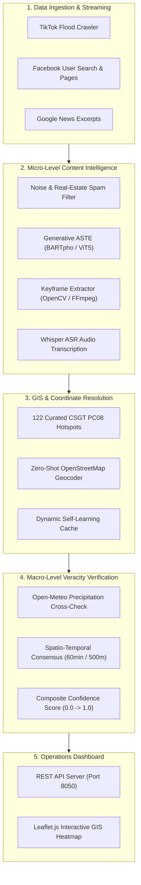
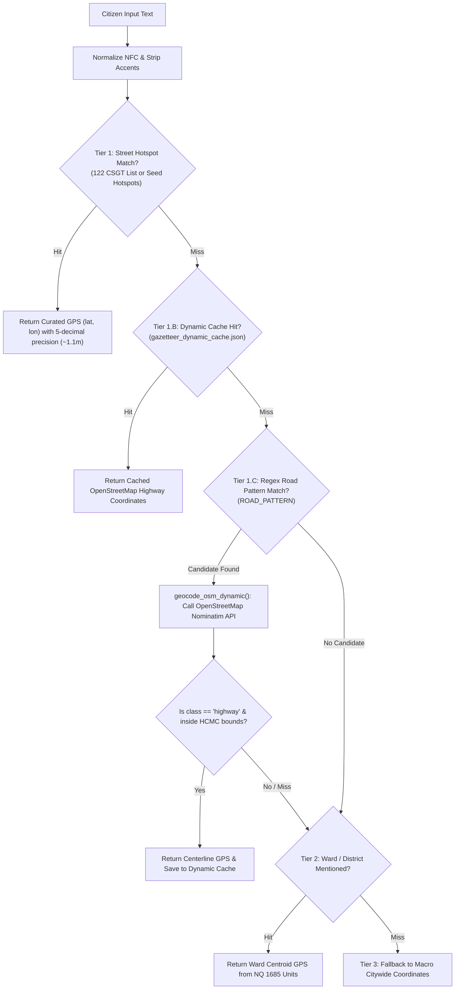
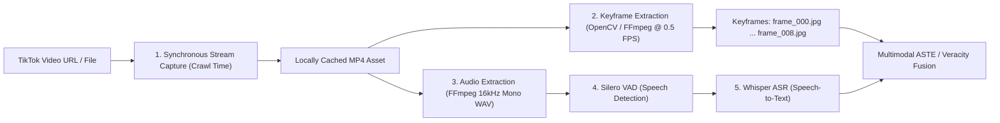
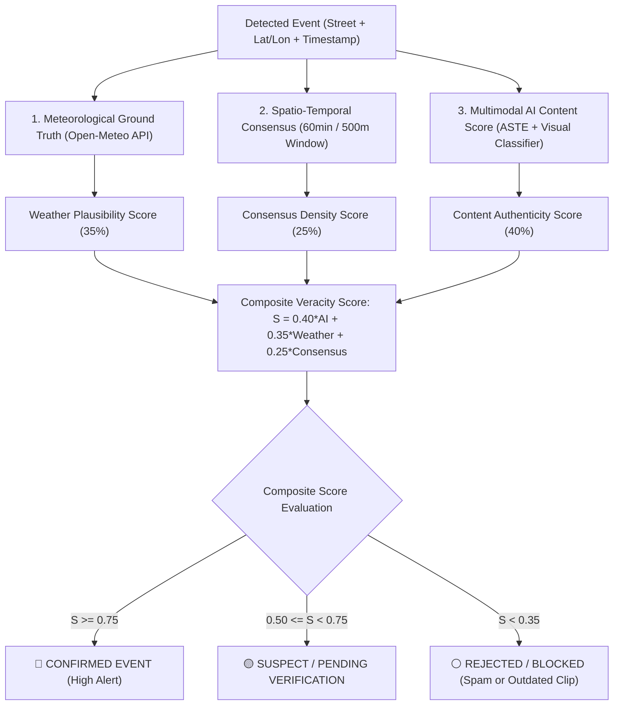

# 🌊 RadiNet: System Operation & Core Technical Solutions Guide
## Urban Drainage & Flooding Monitoring System (TP. Hồ Chí Minh)

> **Document Classification**: Core Engineering Reference & Academic Implementation Guide  
> **Target Audience**: Research Engineers, AI Specialists, and System Developers  
> **System Version**: RadiNet 2.0 (Multimodal Streaming & GIS Intelligence)

---

## 📑 Table of Contents
1. [Executive System Overview](#1-executive-system-overview)
2. [End-to-End System Workflow (How to Make the System Work)](#2-end-to-end-system-workflow-how-to-make-the-system-work)
3. [Core Solution 1: Street Coordinate Resolution (Geocoding & GIS)](#3-core-solution-1-street-coordinate-resolution-geocoding--gis)
4. [Core Solution 2: TikTok Video Ingestion & Frame Extraction](#4-core-solution-2-tiktok-video-ingestion--frame-extraction)
5. [Core Solution 3: ASTE Polarity & Aspect Governance](#5-core-solution-3-aste-polarity--aspect-governance)
6. [Core Solution 4: Multi-Source Veracity & Fake Report Mitigation](#6-core-solution-4-multi-source-veracity--fake-report-mitigation)
7. [Step-by-Step Execution & Deployment Manual](#7-step-by-step-execution--deployment-manual)
8. [Troubleshooting & Operational Reference](#8-troubleshooting--operational-reference)

---

## 1. Executive System Overview

RadiNet is a near real-time urban flood monitoring, aspect-sentiment extraction, and situational awareness platform for Ho Chi Minh City. It aggregates unstructured citizen reports from **TikTok, Facebook, and Google News**, processes them through NLP and Multimodal AI, cross-verifies authenticity against meteorological ground truth, and projects actionable incident heatmaps onto an interactive GIS command dashboard.

### Architectural Philosophy: Separation of Concerns



---

## 2. End-to-End System Workflow (How to Make the System Work)

The RadiNet lifecycle operates across 5 automated stages from stream ingestion to GIS visualization:

```
[Social Post] ──> [Filter Spam] ──> [ASTE Triplets] ──> [Street GPS Match] ──> [Weather Verify] ──> [Leaflet Heatmap]
```

### Stage 1: Multi-Platform Ingestion
- **TikTok Video Stream**: Polls hashtags (`#ngaptphcm`, `#trieucuong`, `#muangap`) via Apify or internal crawlers.
- **Facebook Traffic Groups & Search**: Monitors high-traffic community groups (e.g., *Tôi là dân Quận 7*, *Cảnh sát giao thông TP.HCM*, *Giao thông Quốc lộ 13*).
- **Google News Ingestion**: Fetches official journalistic reports from accredited news agencies (*Tuổi Trẻ*, *VnExpress*, *Thanh Niên*).

### Stage 2: Anti-Spam & Semantic Cleaning
Before passing text to transformer models, `pipeline/event_processor.py` strips irrelevant noise:
- **BĐS (Real Estate) Spam**: Drops ads selling apartments, houses, or land using flood keywords metaphorically (e.g., *"giá ngập tràn"*, *"chủ ngộp kẹt tiền"*).
- **Commercial Ads & Education**: Filters promotional discount campaigns, language centers, and repair shop ads.
- **Linguistic Normalization**: Ensures 100% canonical NFC Unicode encoding and removes HTML entities.

### Stage 3: NLP & Generative ASTE
- Extracts triplets `(Aspect | Opinion | Polarity)` using fine-tuned Seq2Seq models (`vinai/bartpho-syllable` or `VietAI/vit5-base`).
- Maps informal colloquialisms (*"nước ngập lút bánh xe dắt bộ bì bõm"*) into standardized semantic expressions (*"ngập sâu gây cản trở giao thông"*, `NEG`).

### Stage 4: Hierarchical Coordinate Extraction & Spatial Mapping
- Calls `core/gazetteer.py:match_hotspot()` to resolve the exact street coordinates (`lat`, `lon`) and administrative ward.

### Stage 5: Veracity Cross-Checking & Dashboard Projection
- Queries the Open-Meteo API using the extracted coordinates to cross-reference actual precipitation in the corresponding hour.
- Clustered reports within 500 meters and 60 minutes boost the event confidence score.
- Confirmed events are served via `/api/realtime-heatmap` and rendered as interactive Leaflet pins on `dashboard/index.html`.

---

## 3. Core Solution 1: Street Coordinate Resolution (Geocoding & GIS)

### The Fundamental Problem
Social media posts rarely provide GPS coordinates. Instead, citizen text contains:
- Informal street names (*"đường số 11"*, *"khúc trần xuân soạn gần cầu"*).
- Missing districts, abbreviations (*"Q7"*, *"TP.TĐ"*), or slang.
- Complex intersections (*"ngã tư Bảy Hiền"*, *"vòng xoay Lăng Cha Cả"*).
- **The Risk**: Hardcoding or using random coordinates (`random.uniform`) produces false alerts in rivers, cemeteries, or private residences.

### The Solution: 3-Tier Hierarchical Spatial Resolution Engine
The coordinate extraction in `core/gazetteer.py` enforces a strict **Street-First Hierarchy**:



### Component A: 122 Curated CSGT PC08 Hotspots
- Defined in `RadiNet/data/csgt_122_flood_hotspots.json` and generated by `scripts/build_csgt_hotspots.py`.
- Compiled directly from official HCMC Traffic Police alerts (83 rain-flood points + 39 high-tide points).
- Every hotspot has exact 5-decimal GPS coordinates surveyed directly on the road centerline:
  ```json
  {
    "id": "csgt_tide_01",
    "street": "Trần Xuân Soạn",
    "segment": "Từ Huỳnh Tấn Phát đến Lâm Văn Bền",
    "ward": "Phường Tân Hưng",
    "district": "TP.HCM",
    "lat": 10.75105,
    "lon": 106.71451
  }
  ```

### Component B: Zero-Shot Dynamic Geocoding from OpenStreetMap (OSM)
When a post mentions a street not in the 122 curated list (e.g., *"Đường Lê Văn Việt"*), `core/gazetteer.py:geocode_osm_dynamic()` queries the OpenStreetMap Nominatim API dynamically:

```python
# 1. Query OpenStreetMap Nominatim with strict HCMC scope
url = f"https://nominatim.openstreetmap.org/search?street={urllib.parse.quote(street_clean)}&city={urllib.parse.quote('Thành phố Hồ Chí Minh')}&format=json&limit=5"

# 2. Strict Centerline Filtering: ONLY accept highway entities
for d in response_data:
    if d.get("class") == "highway":
        lat = round(float(d["lat"]), 4)
        lon = round(float(d["lon"]), 4)
        break

# 3. Geographic Boundary Validation (Excludes other provinces)
if 10.38 <= lat <= 11.15 and 106.35 <= lon <= 107.02:
    DYNAMIC_CACHE[query.lower()] = {"lat": lat, "lon": lon, "display_name": f"Đường {street_clean}"}
    save_dynamic_cache()
    return DYNAMIC_CACHE[query.lower()]
```

### Component C: Interactive Verification CLI
You can test coordinate extraction for any sentence or street name in the terminal:
```bash
python RadiNet/scripts/demo_extract_street_coordinates.py "Đường Phan Huy Ích Gò Vấp đang ngập nặng"
```
**Output:**
```text
[+] Extracted Street   : Đường Phan Huy Ích
    • GPS Coordinates  : Latitude = 10.8372, Longitude = 106.6362
    • Admin Unit (Ward): Phường Gò Vấp
    • Data Source      : csgt_or_seed (Priority: 3)
    • Google Maps Link : https://www.google.com/maps?q=10.8372,106.6362
```

---

## 4. Core Solution 2: TikTok Video Ingestion & Frame Extraction

### The Fundamental Problem
1. **Signed CDN Expiration**: TikTok video and image CDN links use security signatures (`x-expires=...`, `x-signature=...`) that expire within hours or days. Once expired, any HTTP request yields `HTTP Error 403: Forbidden`.
2. **Video Data for LLMs**: Large language and sequence-to-sequence models cannot ingest raw `.mp4` video files directly. The video must be decomposed into visual keyframes and transcribed audio tracks.

### The Architectural Solution
RadiNet employs a multi-step media decomposition pipeline:



### Step 1: Real-Time Stream Capture
- At crawl time (before token expiration), the video stream is piped to local storage or persistent object store (e.g., `RadiNet/data/audio_sample/` or `data/media/`).
- Persistent canonical video URLs are constructed using the author and post ID:  
  `https://www.tiktok.com/@{author_name}/video/{item_id}`

### Step 2: Keyframe Sampling Strategy
- Video frames are sampled using uniform temporal sampling (default: $0.5\text{ FPS}$, or 1 frame every 2 seconds).
- A maximum threshold (e.g., 10–12 frames) is enforced to prevent memory saturation in downstream vision encoders (CLIP / Swin Transformer).

### Step 3: Audio Track Extraction for Whisper ASR
- The video's audio is demuxed into a standard **16kHz mono, 16-bit PCM WAV** file using FFmpeg:
  ```bash
  ffmpeg -y -i input_video.mp4 -vn -acodec pcm_s16le -ar 16000 -ac 1 output_audio.wav
  ```
- **Silero VAD** filters out silent sections, heavy rain noise, and motorcycle engine sounds.
- **Whisper ASR** (`openai/whisper-large-v3` or `PhoWhisper`) transcribes Vietnamese citizen speech into text, capturing spoken street names not present in the written caption.

### Step 4: Using the Automated Media Extraction Tool
A standalone decomposition script has been created at [`RadiNet/scripts/extract_tiktok_frames.py`](file:///home/counting/Workspaces/ryan/RadiNet/scripts/extract_tiktok_frames.py).

To extract frames and audio from any video:
```bash
python RadiNet/scripts/extract_tiktok_frames.py \
    --video "path/to/video.mp4" \
    --output_dir "RadiNet/data/extracted_frames" \
    --fps 0.5 \
    --max_frames 10
```

**Output Structure:**
```text
RadiNet/data/extracted_frames/sample_video/
├── frames/
│   ├── frame_000_0.0s.jpg
│   ├── frame_001_2.0s.jpg
│   ├── frame_002_4.0s.jpg
│   └── frame_003_6.0s.jpg
└── sample_video.wav          # Ready for Whisper speech transcription
```

---

## 5. Core Solution 3: ASTE Polarity & Aspect Governance

### Standardizing Sentiment Polarity (SemEval-2014 Lineage)
In standard ASTE benchmarks (PASTE, STAGE, EMC-GCN, BMRC), **polarity describes the author's attitude/sentiment toward the target aspect, NOT whether a flood physically occurred**:

| Polarity | SemEval Attitude | Urban Flood Domain Meaning | Example Triplet $(a, o, p)$ | Operational Value |
| :--- | :--- | :--- | :--- | :--- |
| **`NEG`** | Grievance, complaint, severe distress. | Heavy flooding, traffic stalled, water in houses. | `(Võ Văn Ngân, ngập như thác xe chết máy, NEG)` | Triggers high-priority warning & detour. |
| **`NEU`** | Objective, factual statement, measurement. | Water depth measurement, schedule, forecast, question. | `(Nguyễn Huệ, ngập sâu khoảng 30cm, NEU)`<br>`(Quốc Hương, ngập chưa mọi người?, NEU)` | **Factual Ground Truth Telemetry**; depth monitoring. |
| **`POS`** | Praise, satisfaction, good outcome, relief. | Water receded, dry road, restored traffic, effective pumps. | `(Trần Xuân Soạn, nước đã rút sạch thông thoáng, POS)` | **Incident Resolution**; turns red pins to green. |

### Decoupling Flood Alerting from Sentiment
The dashboard determines flood events from **Aspect Category + Opinion Semantics**:
- `(Nguyễn Huệ, ngập sâu 30cm, NEU)` $\rightarrow$ **Active Flood Incident** (Factual measurement trigger).
- `(Nguyễn Huệ, nước đã rút hết, POS)` $\rightarrow$ **Incident Resolution** (Clears the red warning).

### Aspect Sanitization & 4-Tier Categorization
1. **Automated Span Cleaning**: Strips prepositional noise (`ở`, `tại`, `trên`) and trailing verbal bleed (`mới không còn`, `xảy ra`):
   - `"ở Sài Gòn hở mưa là"` $\rightarrow$ `"Sài Gòn"`
   - `"Nguyễn Hữu Cảnh mới không còn"` $\rightarrow$ `"Nguyễn Hữu Cảnh"`
2. **4-Tier Taxonomy**:
   - `LOCATION_STREET`: Traffic corridors & intersections (*Trần Xuân Soạn*, *Phan Huy Ích*).
   - `LOCATION_ADMIN`: Administrative boundaries (*Phường Linh Đông*, *Quận 7*).
   - `HYDROLOGY`: Natural and drainage water bodies (*Sông Sài Gòn*, *Kênh Nhiêu Lộc*).
   - `INFRASTRUCTURE_ASSET`: Pumps, sewers, vehicles (*Trạm bơm Thảo Điền*, *xe máy*).

---

## 6. Core Solution 4: Multi-Source Veracity & Fake Report Mitigation

To prevent old videos, reposted clips, or internet rumors from causing false flood alarms on the GIS dashboard, `pipeline/veracity_checker.py` implements a 3-layer verification model:



1. **Weather Layer (35% weight)**: Queries historical and live hourly rainfall data from Open-Meteo for the exact `(lat, lon)`. If rain $> 1.0\text{mm/h}$ or high-tide alert is active, weather plausibility is confirmed.
2. **Consensus Layer (25% weight)**: Maintains a 60-minute sliding window across a 500-meter radius. If multiple distinct users post about the same street corridor, consensus score approaches 1.0.
3. **AI Content Layer (40% weight)**: Combines ASTE extraction confidence with computer vision flood-presence classification on extracted keyframes.

---

## 7. Step-by-Step Execution & Deployment Manual

### Prerequisites & Python Environment
Use the dedicated Anaconda environment configured with CUDA and dependencies:
```bash
PYTHON_BIN="/home/counting/anaconda3/envs/ryan_env/bin/python"
```

### Command 1: Run Offline Simulation Mode (Recommended for Demos & Testing)
Plays back rich annotated user reports across HCMC flood episodes without consuming Apify crawler quotas:
```bash
$PYTHON_BIN RadiNet/run_pipeline_test.py --mode simulation --window 120 --port 8050
```
- Open your browser at: `http://localhost:8050`
- Features interactive Leaflet pins, live heatmaps, and veracity audit breakdowns.

### Command 2: Run Near Real-Time Live Mode
Pulls live posts from TikTok and Facebook using Apify actors:
```bash
$PYTHON_BIN RadiNet/run_pipeline_test.py --mode live --window 60 --port 8050
```

### Command 3: Prepare Stratified ASTE Training Data
Generates balanced, sanitized `train.json`, `val.json`, and `test.json` splits from `hcmc_flood_annotated_v2_multimodal.json`:
```bash
$PYTHON_BIN RadiNet/finetune/prepare_dataset.py
```

### Command 4: Fine-Tune the Generative ASTE Model
Trains `vinai/bartpho-syllable` or `VietAI/vit5-base` using FP16 mixed precision:
```bash
$PYTHON_BIN RadiNet/finetune/train_generative_aste.py \
    --model_name "vinai/bartpho-syllable" \
    --epochs 6 \
    --batch_size 8 \
    --learning_rate 5e-5 \
    --output_dir "RadiNet/finetune/checkpoints/best_aste_model"
```

### Command 5: Benchmark Evaluation on Test Split
Evaluates Precision, Recall, and Triplet F1 on the independent test set:
```bash
$PYTHON_BIN RadiNet/finetune/evaluate_aste.py
```

### Command 6: Test Street Coordinate Extraction Interactively
```bash
$PYTHON_BIN RadiNet/scripts/demo_extract_street_coordinates.py "Đường Trần Xuân Soạn Quận 7 ngập sâu"
```

---

## 8. Troubleshooting & Operational Reference

| Issue / Symptom | Root Cause | Solution |
| :--- | :--- | :--- |
| **`HTTP 403 Forbidden` on TikTok media URLs** | Signed CDN tokens expired (`x-expires` timestamp passed). | Download video stream immediately at crawl time or run `scripts/extract_tiktok_frames.py` on locally archived MP4 files. |
| **Port 8050 already in use (`Address already in use`)** | A previous instance of `dashboard/server.py` is still running. | Kill the existing process: `fuser -k 8050/tcp` or specify a new port via `--port 8055`. |
| **Extractive ASTE model (Span-ASTE) fails** | 99.96% of opinions and 27.3% of aspects are canonical summaries, not verbatim character spans. | **Must use Generative ASTE (Seq2Seq)** via `finetune/train_generative_aste.py`. |
| **Zero recall on `POS` sentiment class** | Extreme class imbalance (only 17 POS triplets in dataset). | Use **Multi-label Stratified Splitting** (implemented in `prepare_dataset.py`) and class-weighted loss ($w_{\text{POS}} = 15.0$). |
| **Nominatim API returns `None` or timeouts** | OpenStreetMap rate limits (max 1 req/sec) or query outside HCMC. | Results are cached automatically in `data/gazetteer_dynamic_cache.json`. Ensure the query includes `"Hồ Chí Minh"`. |
