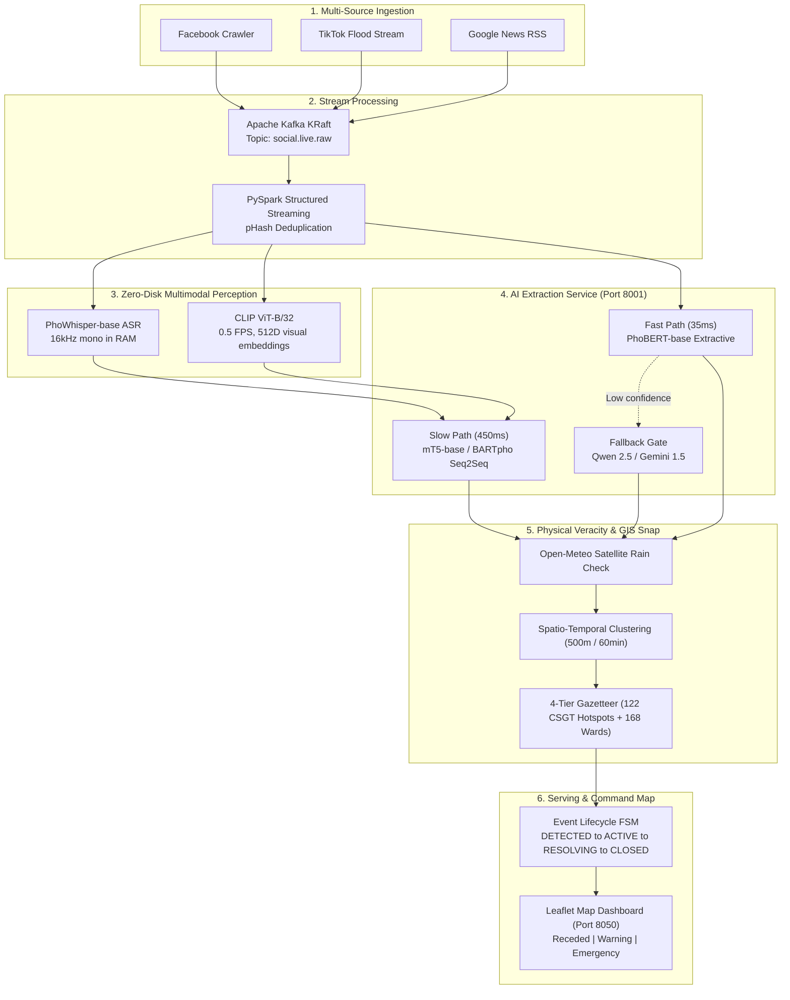

# 🌊 Unified System Specification & Executive Blueprint
## Real-Time Multimodal Urban Flood Monitoring & Veracity Verification System (TP. Hồ Chí Minh)

> **Document Type:** Single Source of Truth (SSOT) & Expert Methodology  
> **Target Audience:** Project Collaborators, Academic Reviewers, Data Engineers, and AI Specialists  
> **Academic Scope:** International Conference Target (ICWSM / EMNLP) & Big Data Capstone (SE363 - UIT VNU-HCM)  

---

## 1. Executive Summary: What We Are Doing

This project builds an end-to-end Big Data & Multimodal AI system that monitors and maps urban flooding in real time across Ho Chi Minh City by mining unstructured crowdsourced citizen streams (**TikTok, Facebook, and News**).

```
[Citizen Social Streams]       [AI Perception & Veracity Pipeline]        [Live Actionable Map]
• TikTok Videos           ──►  • Noise & Real-Estate Filters        ──►  Interactive GIS Heatmap
• Facebook Traffic Posts       • Multimodal ASTE (PhoBERT / mT5)         • 🔴 RED: Deep Flood / Blocked
• Google News RSS              • Physical Open-Meteo Weather Check       • 🟢 GREEN: Water Receded
                               • Spatio-Temporal Consensus Engine        • Turn-by-turn Detour
```

### Why Existing Solutions Fail
1. **Physical sensors are sparse:** Hydrological gauges only exist at major canals and rivers; thousands of urban streets have zero sensor coverage.
2. **Social sensing is immediate but noisy:**
   - **Commercial Spam:** Real estate ads (*"Huỳnh Tấn Phát 1tr8 phòng trọ ngập tràn ánh sáng"*) and promotional sales (*"quà ngập tràn"*).
   - **Recycled Media:** Virality-seeking users reposting flood clips from past years during dry, sunny weather.
   - **Severe Negative Imbalance:** Over 94% of posts complain about active flooding; almost nobody posts when water recedes, preventing cities from clearing emergency alerts.
   - **Administrative Zoning Reforms:** Ho Chi Minh City's Resolution 1685/NQ-UBTVQH15 eliminated district-level tiers and reformed wards, breaking legacy geocoders.

---

## 2. The ASTE Problem in Urban Disaster Sensing

### 2.1. Problem Formulation
Aspect Sentiment Triplet Extraction (ASTE) extracts structured 3-tuples from raw text:

**(Aspect, Opinion, Polarity)**

- **Aspect:** The specific spatial or infrastructural entity (e.g., *"đường Trần Xuân Soạn"*, *"cầu Ba Son"*, *"trạm bơm Thảo Điền"*).
- **Opinion:** The descriptive phrase expressing flood depth, traffic impact, or operational state (e.g., *"ngập sâu lút bánh xe"*, *"nước đã rút sạch"*, *"xe chết máy hàng loạt"*).
- **Polarity:** Sentiment attitude toward the aspect: **POS** (Positive/Recovery), **NEG** (Negative/Disruption), or **NEU** (Neutral/Measurement/Notice).

### 2.2. Domain-Specific Challenges
1. **Colloquialisms & Teencode:** Heavy use of Vietnamese street slang (*"ngập sml"*, *"chết máy dắt bộ"*, *"bì bõm"*, *"nước ngập tới háng"*).
2. **Vehicle Misattribution:** Citizens instinctively complain about their vehicles (*"xe máy chết máy"*); models must correctly map the problem to the underlying street entity.
3. **Decoupling Sentiment from Flood State:** A sentence stating *"nước đã rút sạch"* describes a past flood, but the sentiment attitude is **`POS`** and indicates a **`RECOVERED`** physical state.

---

## 3. Data Representation: SemEval ASTE-Data-V2 Format

To ensure compatibility with international benchmark baselines (Xu et al., EMNLP 2020), the corpus is adapted into the **SemEval ASTE v2** token-index format:

```text
token_0 token_1 ... token_n #### [([aspect_start, ..., aspect_end], [opinion_start, ..., opinion_end], 'POLARITY')]
```

### Concrete Examples from the Master Dataset:
1. **Multi-Aspect Hydrological Measurement (`NEU`):**
   ```text
   Đáng chú ý , triều cường trên sông Sài Gòn đang ở mức cao .####[([7, 8, 9], [10, 11, 12, 13], 'NEU'), ([4, 5], [10, 11, 12, 13], 'NEU')]
   ```
   - Tokens `[7, 8, 9]` = *"sông Sài Gòn"* (Aspect 1)
   - Tokens `[4, 5]` = *"triều cường"* (Aspect 2)
   - Tokens `[10, 11, 12, 13]` = *"đang ở mức cao"* (Opinion)
   - Polarity = `'NEU'`

2. **Active Severe Inundation (`NEG`):**
   ```text
   Đến chiều 11 / 9 , nước vẫn chưa rút hết , nhiều hộ dân phải lội trong dòng nước để lau dọn bùn đất , di chuyển đồ đạc .####[([6], [7, 8, 9, 10], 'NEG')]
   ```
   - Token `[6]` = *"nước"* (Aspect)
   - Tokens `[7, 8, 9, 10]` = *"vẫn chưa rút hết"* (Opinion)
   - Polarity = `'NEG'`

3. **Context Prefix Injection for Document Fallback (`POS`):**
   ```text
   Tại TP. Hồ Chí Minh , Sáng 11 / 9 , khi nước bắt đầu rút , chị tranh thủ dọn bùn đất .####[([1, 2, 3, 4], [12, 13, 14, 15], 'POS')]
   ```
   - When a post does not name a specific street, the city entity is prepended (`Tại TP. Hồ Chí Minh ,`), anchoring token positions `[1, 2, 3, 4]` with provenance `DOC_FALLBACK`.

---

## 4. Dataset Annotation Methodology & Expert Rules

### 4.1. Polarity Decision Rules (The 1-Sentence Litmus Test)
*"Does the sentence contain an explicit evaluative judgment regarding the aspect?"*
- **`NEU` (Neutral / Informational / Event Announcement):** Objective facts without affective judgment.
  - *"Khánh thành cống ngăn triều Mương Chuối"* $\rightarrow$ Administrative event announcement (`NEU`).
  - *"Đài Nam Bộ dự báo triều cường đạt 1m70"* $\rightarrow$ Hydrological forecast (`NEU`).
  - *"Đoạn này ngập chưa mọi người?"* $\rightarrow$ Interrogative inquiry (`NEU`, does not trigger alerts).
- **`POS` (Positive / Recovery & Praise):**
  - **POS-RECOVERY**: Water receded, roads dried, traffic resumed (*"nước rút sạch"*, *"thông thoáng"*). Associated with recovery state.
  - **POS-PRAISE**: Praise for pumping efficiency or emergency rescue (*"trạm bơm chạy tốt"*, *"CSGT đẩy xe giúp dân"*).
- **`NEG` (Negative / Active Disruption):**
  - Active flooding, stalled vehicles, water entering homes (*"ngập lút bánh xe"*, *"hàng loạt xe chết máy"*).

### 4.2. Five Golden Annotation Rules
1. **100% Verbatim Spans:** The dataset preserves noise verbatim. Slang and abbreviations (*"TXS"*, *"kinh khũng"*) must **never** be manually corrected inside the text span. Normalization is strictly handled by GIS Gazetters, preserving character matching.
2. **Belt-and-Braces Span Sanitation:** Spans must be stripped of auxiliary prepositions (*ở, tại, trên*), must be exact substrings, and Aspect and Opinion spans must **never** overlap.
3. **Never Label Vehicles as Aspects:** Motorbikes and cars are victims, not flooded infrastructure. Always map the opinion to the street where the breakdown occurred.
4. **Emoji Policy:** Emojis are preserved raw. Duplicate emojis are collapsed (`😭😭😭` $\rightarrow$ `😭`). Emojis can determine polarity (`😭` = `NEG`, `🎉` = `POS`). In textless posts (e.g., *"Hầm An Phú 😭😭"*), the emoji itself acts as the Opinion span.
5. **Spatiotemporal Proximity for POS:** A `POS` recovery report only deactivates an active red alert if it occurs in spatial (radius <= 500m) and temporal proximity to an active incident.

### 4.3. Episode-Based Dataset Split (Preventing Data Leakage)
To prevent models from "memorizing" vocabulary across the same storm, the corpus is split by **weather episodes**, never random shuffle:
- **Train Set (80%):** Historical archive + early flood episodes.
- **Dev / Validation (10%):** Distinct mid-season storm episode.
- **Test Set (10%):** Completely independent late-season typhoon episode with 100% Human-Gold verification (>= 30 POS and >= 30 NEU samples for statistical validity).

---

## 5. Multimodal AI Architecture & Pipeline



### 5.1. Dual-Path AI Inference
- **Fast Path (<= 35ms):** Monolingual `PhoBERT-base` with joint span-pair tagging. Guarantees zero lexical hallucination and handles 85%+ of standard text posts under high throughput.
- **Slow Path (~450ms):** Generative `mT5-base` / `BARTpho` Seq2Seq. Fuses text, spoken audio transcripts from `PhoWhisper`, and 512D visual embeddings from `CLIP-ViT-B/32`.
- **Zero-Disk Streaming:** Streams media buffers directly in memory (`io.BytesIO`), maintaining a zero-persistent-disk footprint during live inference.

### 5.2. 4-Tier GIS Grounding
- **Tier 1 (CSGT Hotspots):** Snaps verbatim street names to 122 verified flood coordinates (`SPAN_MATCHED`, conf 0.98).
- **Tier 2 (Dynamic Learned Cache):** Matches abbreviations and learned aliases (`FUZZY`, conf 0.90).
- **Tier 3 (OpenStreetMap):** Zero-shot geocoding along highway centerlines (`OSM_MATCHED`, conf 0.85).
- **Tier 4 (168 Wards):** Snaps document-fallback posts to newly reformed commune boundaries per NQ 1685 (`DOC_FALLBACK`, conf 0.65).
